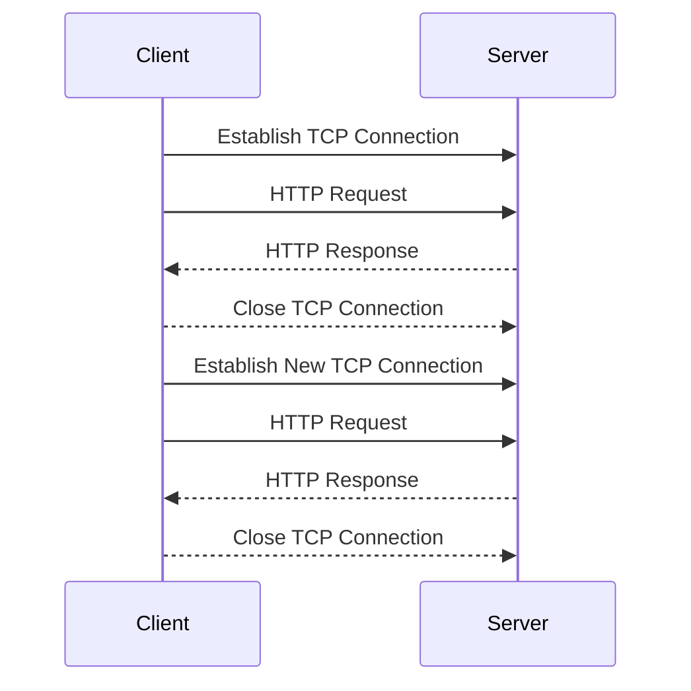
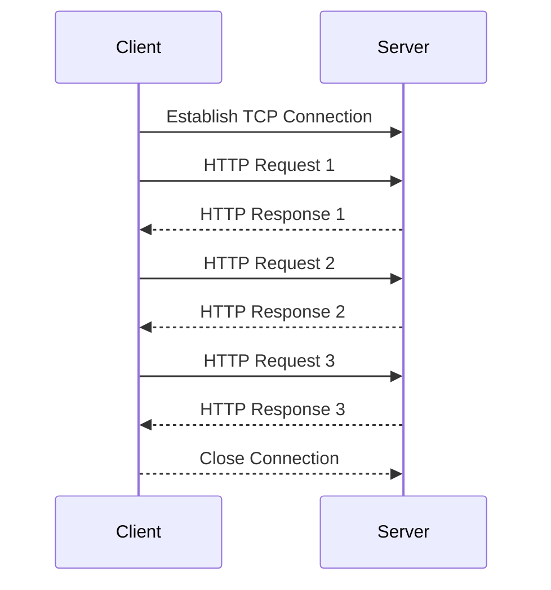
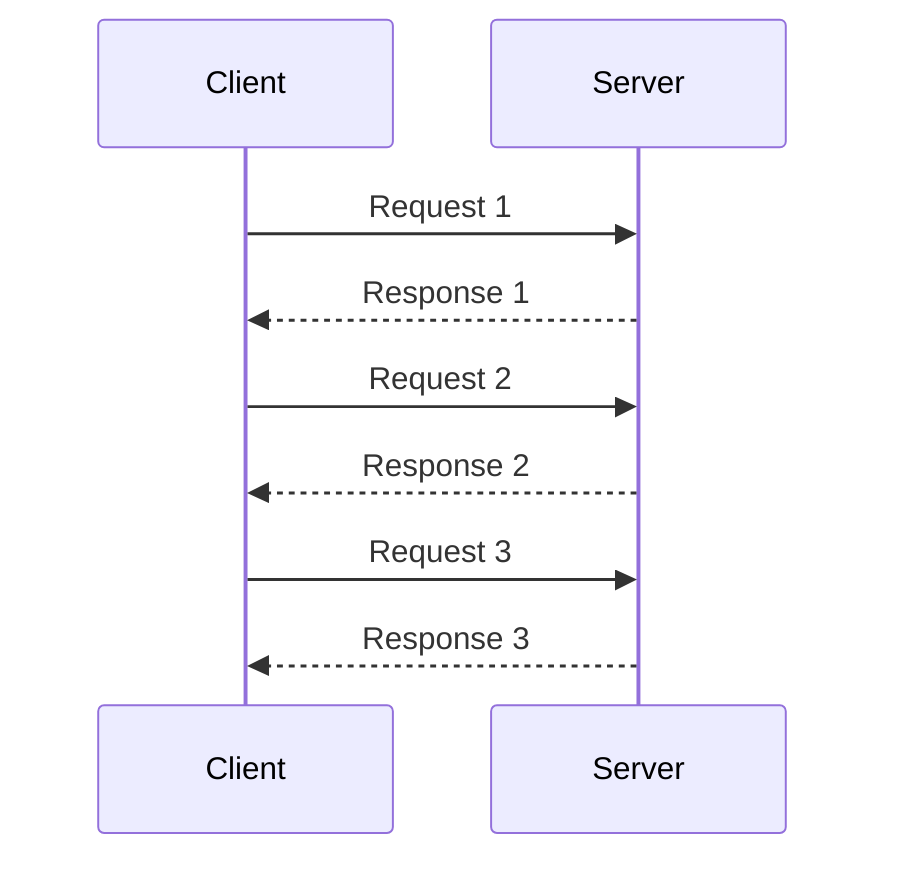
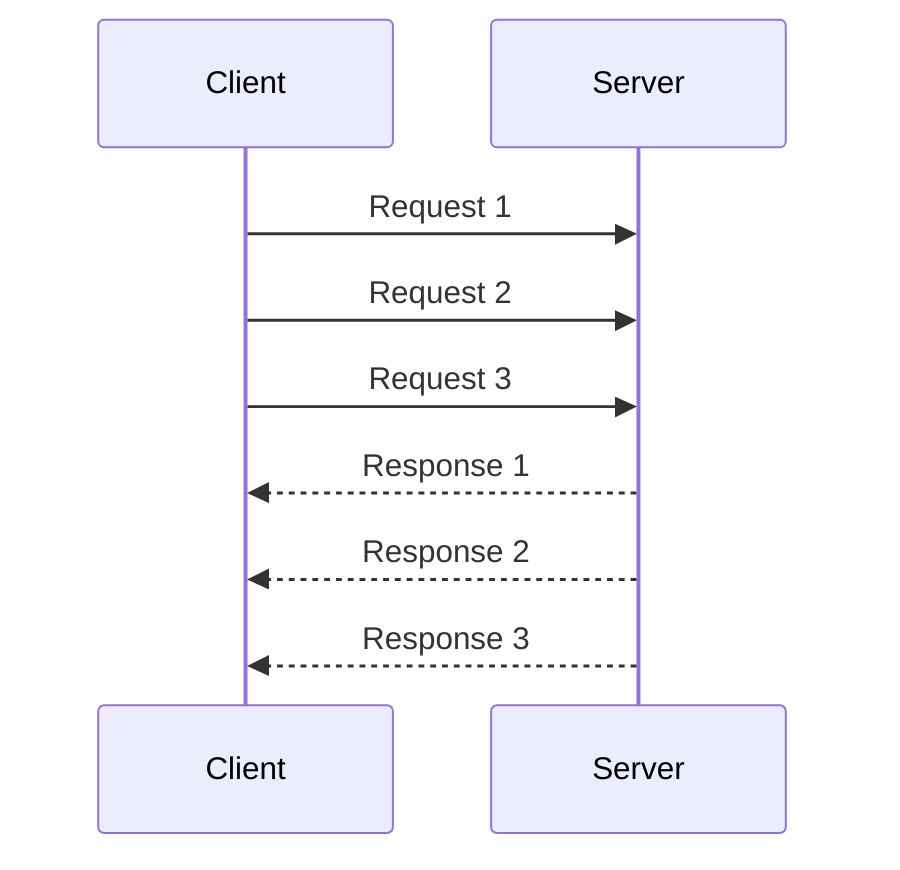
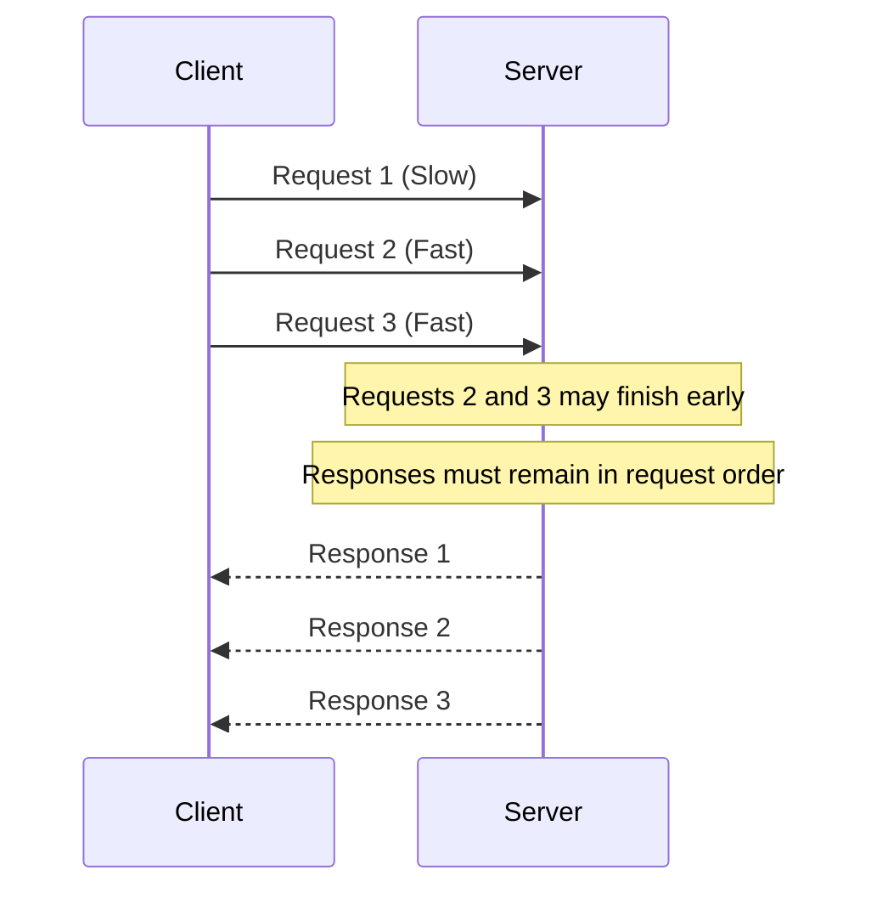
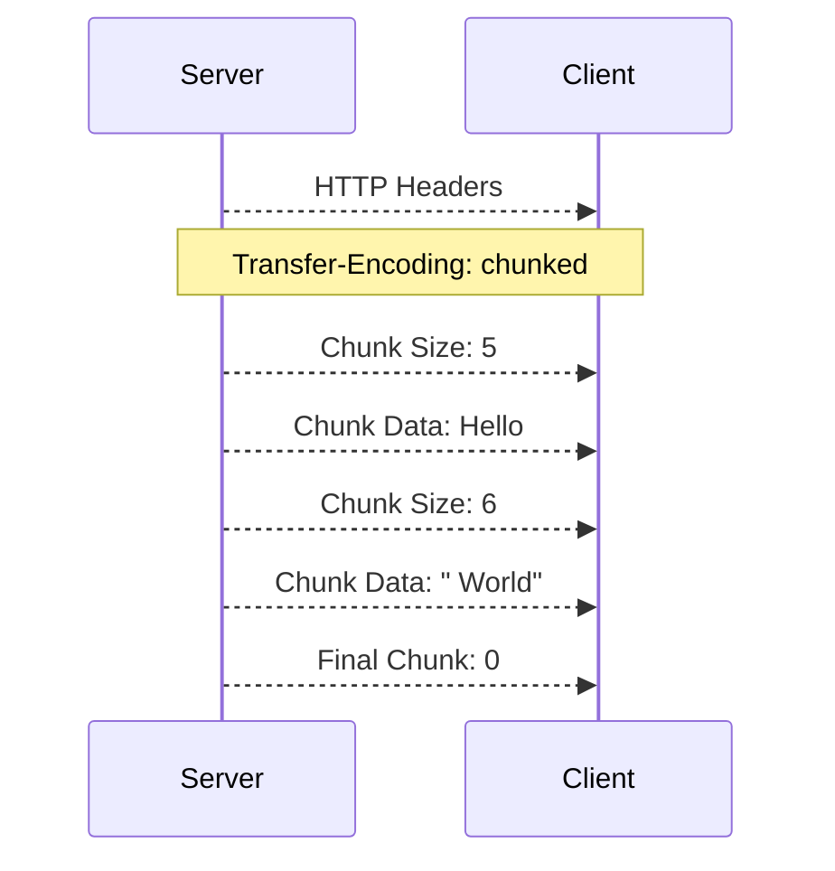
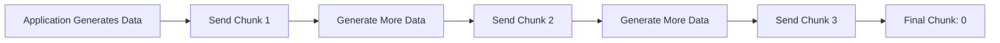

<Callout type="info" title="Review">
This section introduces important HTTP connection and data transfer mechanisms, including **Keep-Alive**, **HTTP Pipelining**, and different ways HTTP messages can transfer data.

We will examine how multiple HTTP requests can use a single TCP connection, how HTTP Pipelining allows requests to be sent without waiting for previous responses, and why this mechanism is rarely used in modern web communication.

We will also cover HTTP message transfer methods, including **Content-Length** and **Chunked Transfer Encoding**, to understand how clients and servers determine where an HTTP message begins and ends.

Understanding these mechanisms is important for learning how HTTP connections work internally and provides useful context for topics such as **HTTP request smuggling**, connection management, and modern HTTP protocols.
</Callout>


## HTTP Keep-Alive

By default, an HTTP connection does not necessarily need to be closed after a single request and response.

**Keep-Alive**, also known as a **persistent connection**, allows the client and server to reuse the same TCP connection for multiple HTTP requests.

Without persistent connections, the process would look like this:



Creating a new TCP connection for every request adds unnecessary overhead. Repeated handshakes consume time and resources, so persistent connections are useful for reducing that cost.

With **Keep-Alive**, the same TCP connection can be reused:



<Accordion title="Example: Persistent HTTP Connection">

**Request:**

```http
GET /index.html HTTP/1.1
Host: example.com
Connection: keep-alive
```

**Response:**

```http
HTTP/1.1 200 OK
Content-Type: text/html
Connection: keep-alive
Content-Length: 100
```

The TCP connection can remain open, allowing additional requests.

In HTTP/1.1, persistent connections are enabled by default, so the `Connection: keep-alive` header is generally unnecessary.

**Example using curl:**

```bash
curl --http1.1 http://example.com/1 http://example.com/2
```

curl may reuse the same connection for multiple requests to the same origin when the protocol, server response, and connection conditions permit it.

**Important distinction:** `curl --keepalive-time 20` configures the interval for TCP keepalive probes when TCP keepalive is enabled. It does not enable HTTP persistent connections by itself.
</Accordion>

---

## HTTP/1.0 vs HTTP/1.1

### HTTP/1.0

In HTTP/1.0, connections were generally closed after the response.

To request a persistent connection, the client could use:

```http
GET / HTTP/1.0
Host: example.com
Connection: keep-alive
```

### HTTP/1.1

In HTTP/1.1, persistent connections are the default behavior.

The connection normally remains open unless one side specifies:

```http
Connection: close
```

For example:

```http
HTTP/1.1 200 OK
Connection: close
```

After the response is completed, the connection is closed.

<Callout type="info" title="HTTP/1.1 Default">
In HTTP/1.1, `Connection: keep-alive` is usually unnecessary because persistent connections are enabled by default. The `Connection: close` header indicates that the connection will not be kept open for further HTTP/1.1 exchanges.
</Callout>

---

# HTTP Pipelining

**HTTP Pipelining** is a feature of HTTP/1.1 that allows a client to send multiple HTTP requests without waiting for the previous responses.

## Without Pipelining



The client waits for each response before sending the next request.

## With Pipelining



The requests are sent consecutively through the same persistent connection without waiting for individual responses.

<Accordion title="Example: HTTP Pipelining Requests">

Multiple HTTP/1.1 requests can be sent over the same connection:

```http
GET /page1 HTTP/1.1
Host: example.com

GET /page2 HTTP/1.1
Host: example.com

GET /page3 HTTP/1.1
Host: example.com

```

Each request must be correctly framed, including its terminating blank line. The server sends the corresponding responses in request order.

**Example using netcat:**

```bash
printf 'GET /path1 HTTP/1.1\r\nHost: example.com\r\n\r\nGET /path2 HTTP/1.1\r\nHost: example.com\r\nConnection: close\r\n\r\n' | nc example.com 80
```

This sends two HTTP requests through one TCP connection. The second request asks the server to close the connection after completing the exchange.

The example illustrates request pipelining, but actual behavior depends on server support and connection handling.
</Accordion>

---

## Head-of-Line Blocking

HTTP pipelining has an important limitation called **Head-of-Line Blocking**.

Imagine the client sends:

```text
Request 1
Request 2
Request 3
```

If `Request 1` takes a long time to process, the responses to later requests may be delayed, even if those requests could otherwise finish quickly.



This limitation contributed to HTTP pipelining being largely abandoned by browsers.

HTTP/2 later introduced **multiplexing**, which allows multiple streams to exchange data concurrently over one connection.

<Callout type="warning" title="Pipelining vs. Multiplexing">
HTTP Pipelining and HTTP/2 Multiplexing are not the same thing.

- **Pipelining:** Multiple requests are sent without waiting for previous responses, but responses must remain ordered.
- **Multiplexing:** Multiple independent streams can exchange data concurrently, without requiring complete responses to be delivered in request order.

HTTP/2 removes HTTP/1.1's response-ordering constraint between independent streams. However, all HTTP/2 streams still share a TCP connection, so TCP-level packet loss can temporarily block delivery across streams.
</Callout>

---

# Transfer-Encoding

An HTTP message needs a way to determine where its body ends.

One common mechanism is the `Content-Length` header, which specifies the body size in bytes.

**Example:**

```http
HTTP/1.1 200 OK
Content-Type: text/plain
Content-Length: 13

Hello, World!
```

The client knows exactly how many bytes belong to the response body.

Sometimes, however, the server does not know the final response size when it starts sending data.

This is where **Transfer-Encoding** can be used in HTTP/1.1.

**Example:**

```http
Transfer-Encoding: chunked
```

The most common transfer coding you will encounter in HTTP/1.1 is:

```text
chunked
```

<Callout type="info" title="Protocol Scope">
Chunked Transfer Encoding is an HTTP/1.1 message-framing mechanism. HTTP/2 and HTTP/3 use their own framing mechanisms and do not use the HTTP/1.1 `Transfer-Encoding: chunked` mechanism.
</Callout>

---

# Chunked Transfer Encoding

**Chunked Transfer Encoding** allows the sender to transmit an HTTP/1.1 message body in multiple pieces called **chunks**.

The sender does not need to know the complete response size before sending the first chunk.

The general format is:

```text
<chunk size in hexadecimal>\r\n
<chunk data>\r\n
...
0\r\n
\r\n
```

Each chunk contains:

1. A chunk size written in hexadecimal.
2. A carriage return and line feed (`CRLF`).
3. The chunk data, containing exactly the specified number of bytes.
4. Another `CRLF`.

The final chunk has a size of:

```text
0
```

The zero-sized chunk marks the end of the chunked message body. An optional trailer section may follow before the final empty line.

## Example

```http
HTTP/1.1 200 OK
Content-Type: text/plain
Transfer-Encoding: chunked

5
Hello
6
 World
0

```

The client interprets the chunks as:

```text
Hello World
```

The numbers represent chunk sizes in **hexadecimal**.

For example:

```text
5
```

means:

```text
5 bytes
```

And:

```text
A
```

means:

```text
10 bytes
```

because:

```text
A hexadecimal = 10 decimal
```

---

## Chunked Response Flow



The client reconstructs the chunks to create the complete response body.

---

# Why Is Chunked Encoding Useful?

Chunked encoding is useful when the server generates data dynamically.



The server can begin sending data before it knows the total size.

Common situations include:

- Streaming data
- Dynamically generated content
- Large responses
- Proxy communication
- Data produced gradually

---

# Transfer-Encoding Examples

## Example 1: Chunked Response

```http
HTTP/1.1 200 OK
Content-Type: text/plain
Transfer-Encoding: chunked

A
HelloWorld
0

```

`A` in hexadecimal means:

```text
10 bytes
```

The response body is:

```text
HelloWorld
```

The body contains exactly 10 bytes, matching the hexadecimal chunk size.

## Example 2: Multiple Chunks

```http
HTTP/1.1 200 OK
Transfer-Encoding: chunked

5
Hello
1
 
5
World
0

```

The client combines the chunks:

```text
Hello World
```

The chunk sizes are:

- `5`: the five bytes in `Hello`
- `1`: the single space character
- `5`: the five bytes in `World`
- `0`: the end of the message body

## Example 3: HTTP Request Using Chunked Encoding

Chunked encoding can also appear in an HTTP request.

```http
POST /upload HTTP/1.1
Host: example.com
Transfer-Encoding: chunked
Connection: close

4
test
4
data
0

```

The reconstructed request body becomes:

```text
testdata
```

The two data chunks contain four bytes each, followed by the final zero-sized chunk.

---

# Content-Length vs. Transfer-Encoding

## Content-Length

The complete body size is known before transmission.

```http
POST /login HTTP/1.1
Host: example.com
Content-Type: application/x-www-form-urlencoded
Content-Length: 26

username=test&password=123
```

The body is 26 bytes long. The server reads the number of bytes specified by `Content-Length` to determine the body boundary.

## Transfer-Encoding: chunked

The body is sent in multiple chunks.

```http
POST /login HTTP/1.1
Host: example.com
Transfer-Encoding: chunked
Connection: close

4
user
4
name
0

```

The reconstructed body is:

```text
username
```

The server processes the chunks until it encounters the final zero-sized chunk.

## Comparison

| Feature | Content-Length | Chunked Transfer Encoding |
|---|---|---|
| Body size known beforehand | Yes | Not required |
| Body sent in chunks | Not defined by this header | Yes |
| Uses hexadecimal chunk sizes | No | Yes |
| Requires a final `0` chunk | No | Yes |
| Common in HTTP/1.1 | Yes | Yes |

---

# Important Security Concept

`Content-Length` and `Transfer-Encoding` are especially important in HTTP security testing because different HTTP components may interpret the boundaries of a request differently.

For example:


If a front-end proxy and a back-end server disagree about where one HTTP request ends and another begins, this can potentially lead to **HTTP Request Smuggling**.

Three famous parsing patterns are:

```text
CL.TE
```

```text
TE.CL
```

```text
TE.TE
```

Where:

```text
CL = Content-Length
TE = Transfer-Encoding
```

These labels describe different ways front-end and back-end components may prioritize or interpret the two framing headers.

The basic idea is that two HTTP components interpret the same request differently. That disagreement can cause part of the request to be treated as belonging to another HTTP request.

<Callout type="warning" title="Security Note">
The presence of both `Content-Length` and `Transfer-Encoding` does not automatically mean a vulnerability exists. Request smuggling requires inconsistent parsing behavior between HTTP components.

When testing, use an authorized environment and account for the HTTP version, intermediary behavior, and server-specific parsing rules.
</Callout>

---

# Key Takeaways

- **Keep-Alive** allows multiple HTTP requests and responses to reuse the same TCP connection.
- HTTP/1.1 uses persistent connections by default.
- `Connection: close` indicates that the connection should not remain open for further HTTP/1.1 exchanges.
- **HTTP Pipelining** allows multiple requests to be sent without waiting for previous responses.
- Pipelining suffers from **Head-of-Line Blocking** and is largely obsolete in browsers.
- HTTP/2 multiplexing allows concurrent streams, although TCP-level packet loss can still affect the shared connection.
- **Transfer-Encoding** describes how an HTTP/1.1 message body is transferred.
- **Chunked Transfer Encoding** divides a message body into multiple chunks.
- Each chunk starts with its size written in hexadecimal.
- A chunk size of `0` marks the end of the chunked message body.
- `Content-Length` specifies the total body size, while chunked encoding allows the body to be sent incrementally.
- Differences in how HTTP components process `Content-Length` and `Transfer-Encoding` are important when studying **HTTP Request Smuggling**.
