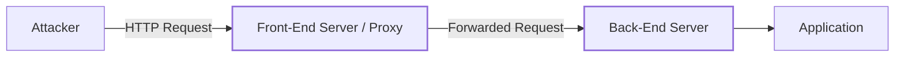
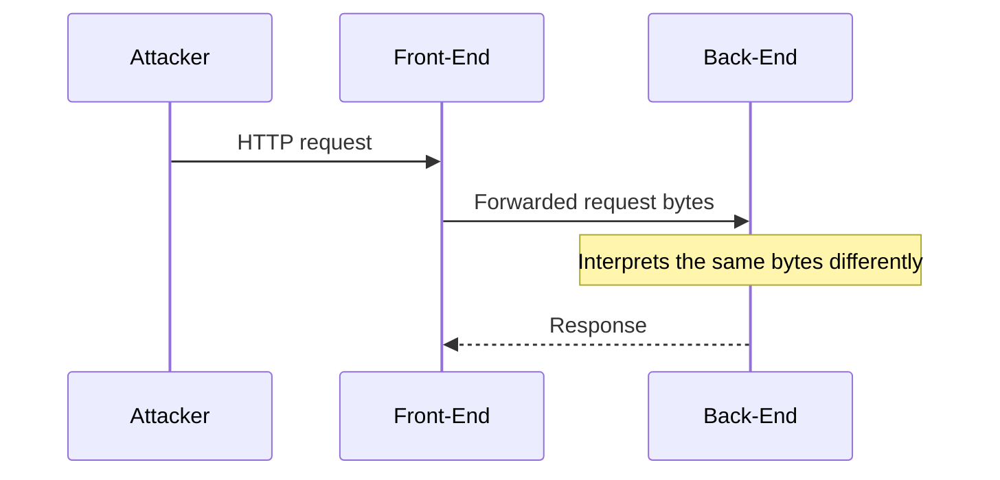
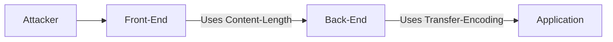
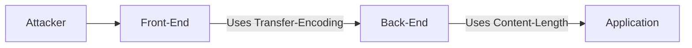
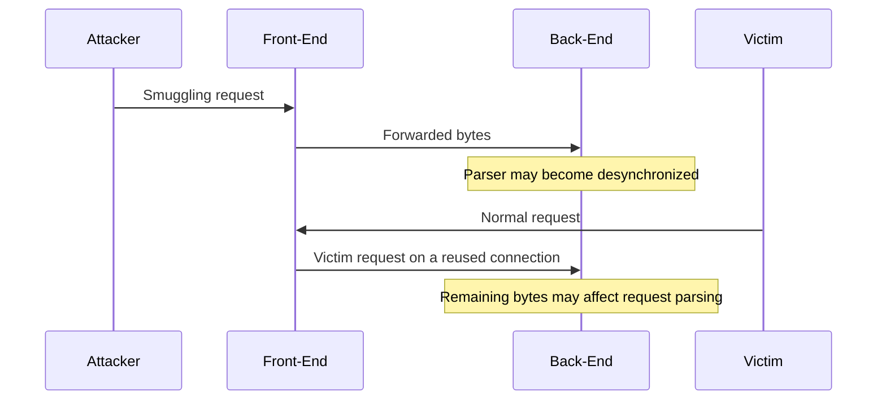
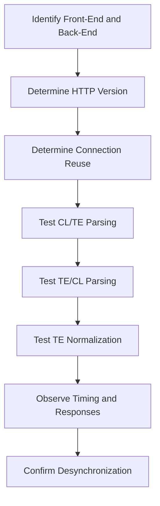
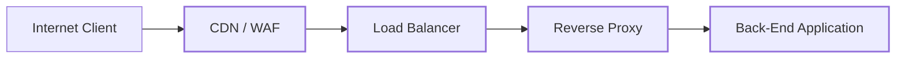
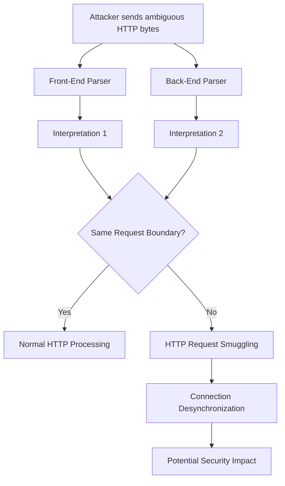

<Callout type="info">
**HTTP Request Smuggling (HRS)** is a vulnerability that occurs when two HTTP components, typically a **front-end proxy** and a **back-end server**, interpret the boundaries of HTTP requests differently. This discrepancy is commonly caused by inconsistent handling of headers such as `Content-Length` and `Transfer-Encoding`.

In a typical architecture, the **front-end server** acts as a proxy and forwards client requests to the **back-end server**. If these two components disagree about where a request ends and the next request begins, an attacker may be able to **desynchronize the HTTP connection** and cause part of one request to be interpreted as a separate request by the back-end.

The three classic request-smuggling variants are:

- **CL.TE:** Front-end uses `Content-Length`, while the back-end uses `Transfer-Encoding`.
- **TE.CL:** Front-end uses `Transfer-Encoding`, while the back-end uses `Content-Length`.
- **TE.TE:** Both use `Transfer-Encoding`, but parse or normalize the header differently.

The core concept is simple:

```text
Front-End interpretation ≠ Back-End interpretation
```

This parser discrepancy can potentially lead to **request queue poisoning, access-control bypass, cache poisoning, and other attacks**, depending on the architecture and how the affected HTTP connections are reused.
</Callout>




The important point is that the attacker is not necessarily attacking the back-end directly.

Instead, the attacker exploits a **parsing discrepancy** between:

- The **front-end server**, which acts as a reverse proxy or load balancer.
- The **back-end server**, which processes the forwarded requests.

The vulnerability becomes possible when both servers interpret the HTTP message boundaries differently.

---

## 1. Why Request Smuggling Happens

HTTP/1.1 provides mechanisms for determining the length of an HTTP message body. Two particularly important headers are:

```http
Content-Length
Transfer-Encoding: chunked
```

### `Content-Length`

`Content-Length` specifies the size of the HTTP message body in bytes.

Example:

```http
POST / HTTP/1.1
Host: example.com
Content-Length: 11

hello=world
```

The receiver interprets the body as exactly 11 bytes.

### `Transfer-Encoding: chunked`

With chunked transfer encoding, the message body is divided into chunks. Each chunk begins with its size expressed in hexadecimal, followed by the chunk data and a CRLF delimiter.

For example:

```http
POST / HTTP/1.1
Host: example.com
Transfer-Encoding: chunked

5
hello
0
```

The structure is:

```text
chunk-size\r\n
chunk-data\r\n
...
0\r\n
\r\n
```

The terminating zero-sized chunk, followed by the final CRLF, indicates the end of the chunked message body.

<Callout type="warning">
These examples illustrate HTTP/1.1 message framing. Real requests must have correctly formatted CRLF delimiters and consistent byte counts. When investigating request smuggling, count the actual bytes transmitted rather than relying on how a request looks in a text editor.
</Callout>

---

## 2. The Core of HTTP Request Smuggling

The fundamental problem is:

```text
Front-End interpretation
         ≠
Back-End interpretation
```

For example:



Suppose the attacker sends data over one TCP connection, and the two HTTP components disagree about the message boundaries.

The front-end believes:

```text
Request #1 = bytes 1 → 120
Request #2 = bytes 121 → ...
```

The back-end believes:

```text
Request #1 = bytes 1 → 100
Request #2 = bytes 101 → ...
```

Those extra bytes can therefore become the beginning of a different request, or combine with subsequent bytes to form one.

This is the essence of request smuggling.

---

## 3. The Three Important Variants

The three classic variants are:

```text
CL.TE
TE.CL
TE.TE
```

Where:

```text
CL = Content-Length
TE = Transfer-Encoding
```

The notation describes which framing mechanism the **front-end** and **back-end** prioritize.

---

## 4. CL.TE

### Definition

In a **CL.TE** vulnerability:

```text
Front-End → Content-Length
Back-End  → Transfer-Encoding
```

The two servers therefore disagree about where the request ends.



### CL.TE Example

Consider this illustrative HTTP request:

```http
POST / HTTP/1.1
Host: vulnerable.example
Content-Length: 13
Transfer-Encoding: chunked

0

GET /admin HTTP/1.1
Host: vulnerable.example
```

The important headers are:

```http
Content-Length: 13
Transfer-Encoding: chunked
```

#### Front-end interpretation

The front-end trusts:

```http
Content-Length: 13
```

Therefore, it considers the first request to contain a body of 13 bytes.

Conceptually, it sees:

```text
POST / HTTP/1.1
...
[13 bytes of body]
```

The remaining bytes may stay on the connection, depending on how the front-end parses and forwards the request.

#### Back-end interpretation

The back-end honors:

```http
Transfer-Encoding: chunked
```

It interprets the zero-sized chunk as the end of the chunked body:

```text
0\r\n
\r\n
```

Bytes remaining after that boundary may be interpreted as another request, provided the framing and connection state permit it.

For example, the back-end may encounter bytes intended to form:

```http
GET /admin HTTP/1.1
Host: vulnerable.example
```

This creates the discrepancy:

```text
FRONT-END

POST / HTTP/1.1
      |
      └── Content-Length determines the boundary


BACK-END

POST / HTTP/1.1
      |
      └── Chunked encoding ends at the zero-sized chunk

GET /admin
      |
      └── May be interpreted as another request
```

<Callout type="warning">
The request above illustrates the concept, not a guaranteed working payload. The exact boundary depends on the number of bytes transmitted, the CRLF delimiters, and the parsing behavior of both components. A valid demonstration must verify the actual byte sequence and each component's interpretation.
</Callout>

---

## 5. Testing CL.TE with curl

For testing in an authorized lab, `curl` can help construct and inspect HTTP requests.

A basic attempt might look like this:

```bash
curl --http1.1 \
  -X POST \
  -H 'Host: vulnerable.example' \
  -H 'Content-Length: 13' \
  -H 'Transfer-Encoding: chunked' \
  --data-binary $'0\r\n\r\nGET /admin HTTP/1.1\r\nHost: vulnerable.example\r\n\r\n' \
  http://vulnerable.example/
```

However, `curl` and intermediate HTTP libraries can normalize, reject, or modify requests with conflicting framing headers. The example is therefore a starting point for understanding the test, not proof that the intended bytes will reach the server unchanged.

For precise testing, **Burp Repeater, netcat, or a purpose-built raw TCP client** can provide more control over the transmitted bytes.

For example, a raw request can be sent with:

```bash
printf 'POST / HTTP/1.1\r\nHost: vulnerable.example\r\nContent-Length: 13\r\nTransfer-Encoding: chunked\r\n\r\n0\r\n\r\nGET /admin HTTP/1.1\r\nHost: vulnerable.example\r\n\r\n' \
  | nc vulnerable.example 80
```

This illustrates the use of a raw TCP connection. It does not guarantee successful smuggling: the request framing, exact byte count, network path, and server behavior must still be verified.

Request smuggling is fundamentally a **raw-byte and message-framing problem**.

---

## 6. TE.CL

### Definition

In a **TE.CL** vulnerability:

```text
Front-End → Transfer-Encoding
Back-End  → Content-Length
```

The front-end understands chunked encoding, while the back-end uses `Content-Length`.



### TE.CL Example

A conceptual request contains conflicting framing information:

```http
POST / HTTP/1.1
Host: vulnerable.example
Content-Length: 4
Transfer-Encoding: chunked

[chunked body]
```

The important discrepancy is:

```text
Front-End:
Transfer-Encoding: chunked
        ↓
Reads the chunk structure

Back-End:
Content-Length: 4
        ↓
Reads the specified number of body bytes
```

The exact payload must be constructed so that the front-end's chunk parser and the back-end's length-based parser establish different boundaries. A chunk size must match the actual number of chunk-data bytes, and the back-end's `Content-Length` must be interpreted relative to the correct message body.

The two components can therefore establish different request boundaries.

### How the Desynchronization Happens

Conceptually:

```text
Attacker
   |
   v
┌──────────────────────┐
│ Front-End             │
│ TE = chunked          │
│                       │
│ Reads complete chunks │
└──────────┬───────────┘
           |
           v
┌──────────────────────┐
│ Back-End              │
│ CL = 4                │
│                       │
│ Reads the framed      │
│ message using CL      │
└──────────┬───────────┘
           |
           v
      Desynchronized
      HTTP connection
```

Once the connection is desynchronized, subsequent bytes can be interpreted as a separate HTTP request.

---

## 7. TE.TE

### Definition

In a **TE.TE** scenario, both servers support:

```http
Transfer-Encoding: chunked
```

At first glance:

```text
Front-End → TE
Back-End  → TE
```

should avoid the classic CL-versus-TE discrepancy.

The problem occurs when the two implementations **parse or normalize the `Transfer-Encoding` header differently**.

This is commonly called **obfuscation-based request smuggling**.

---

## 8. TE.TE Obfuscation

Implementations may disagree about unusual, malformed, or inconsistently normalized representations of transfer-coding headers.

Potential differences include:

```text
Whitespace handling
Header casing
Duplicate headers
Invalid transfer-coding syntax
Unexpected separators
Header normalization
```

For example:

```http
Transfer-Encoding: chunked
Transfer-Encoding: identity
```

Different implementations may reject this request, select a value, combine the values, or process the headers differently.

One component might effectively use the first value, while another uses the last. That behavior is implementation-dependent and should not be assumed without testing.

Similarly, differences in handling malformed syntax can cause a situation where:

```text
Front-End → TE
Back-End  → Different framing interpretation
```

The important concept is not the exact spelling of the header.

> **Different HTTP parsers reach different conclusions about the same bytes.**

---

## 9. Connection Desynchronization

Request smuggling becomes particularly dangerous when HTTP connections are reused.

Suppose:



The attacker can cause the back-end connection to become **desynchronized**.

The next request arriving on that connection may then be interpreted in an unexpected context.

This is why request smuggling can become much more serious than simply receiving an unusual HTTP response.

<Callout type="warning">
Cross-user impact is not automatic. It depends on whether the affected connection is reused, how the proxy assigns requests to back-end connections, and whether the remaining bytes can influence the next request. Some architectures isolate connections or reject malformed traffic, limiting this risk.
</Callout>

---

## 10. Request Queue Poisoning

A useful mental model is a queue.

**Front-End Queue**

```text
Request A
Request B
Request C
Request D
```

**Back-End Queue**

```text
Request A'
Request B'
Request C'
Request D'
```

Normally:

```text
A = A'
B = B'
C = C'
D = D'
```

With request smuggling, the boundaries may shift:

```text
A ≠ A'
```

For example:

```text
Front-End:

┌──────── Request 1 ────────┐┌── Request 2 ──┐
│                           ││               │
└───────────────────────────┘└───────────────┘


Back-End:

┌──── Request 1 ────┐┌────── Request 2 ─────────┐
│                   ││                          │
└───────────────────┘└──────────────────────────┘
```

That difference is the vulnerability: the two components no longer agree on the sequence of requests being processed.

---

## 11. Why HTTP/1.1 Matters

Classic request smuggling is strongly associated with **HTTP/1.1 persistent connections**, where multiple requests may be sent sequentially over the same TCP connection.

The client sends:

```text
Request 1
Request 2
Request 3
```

The connection looks conceptually like:

```text
TCP Stream
─────────────────────────────────────────────►

[HTTP Request 1][HTTP Request 2][HTTP Request 3]
```

The server must correctly determine where each request starts and ends.

If:

```text
Front-End parser ≠ Back-End parser
```

the stream can become desynchronized.

Request smuggling is not exclusively a matter of an individual server parsing one request incorrectly. The critical issue is often a **difference between the parsing and forwarding behavior of multiple components**.

---

## 12. CL.TE vs TE.CL vs TE.TE

| Variant | Front-End | Back-End | Main Problem |
|---|---|---|---|
| **CL.TE** | `Content-Length` | `Transfer-Encoding` | Different request boundaries |
| **TE.CL** | `Transfer-Encoding` | `Content-Length` | Different request boundaries |
| **TE.TE** | `Transfer-Encoding` | `Transfer-Encoding` | Parser or normalization discrepancy |

The key thing to remember:

```text
CL.TE
    FE trusts CL
    BE trusts TE

TE.CL
    FE trusts TE
    BE trusts CL

TE.TE
    Both process TE
    But parse or normalize it differently
```

---

## 13. Detecting Request Smuggling

A safe methodology is:



Useful tools include:

```text
curl
Burp Suite
netcat
Wireshark
tcpdump
```

For example:

```bash
curl --http1.1 -v http://vulnerable.example/
```

The `-v` option helps inspect the request and response exchange. It does not, by itself, reveal how a reverse proxy and back-end independently parsed the request.

For raw traffic:

```bash
sudo tcpdump -i any -nn -A 'tcp port 80'
```

Or save a packet capture for later analysis:

```bash
sudo tcpdump -i any -nn -s0 -w capture.pcap 'tcp port 80'
```

Then inspect the stream in Wireshark.

<Callout type="info">
Encrypted HTTPS traffic cannot normally be read as plaintext by simply capturing TCP packets. To inspect HTTPS message contents, use an authorized interception point or appropriate TLS decryption material. Packet captures can still reveal connection behavior, timing, and transport-level events.
</Callout>

---

## 14. What You Should Actually Look For

When analyzing a suspected HRS vulnerability, do not focus only on status codes such as:

```text
HTTP 200
HTTP 400
HTTP 500
```

Look for **desynchronization indicators**:

```text
Unexpected response timing
Connection hangs
Different responses between repeated requests
Request queue corruption
Unexpected 404 or 400 responses
Back-end receiving an unexpected method or path
Connection reuse behaving differently
```

A particularly useful observation is:

```text
Request A
    ↓
Front-End: accepted

Back-End:
    ↓
Waits for additional bytes
```

This can indicate that the two components disagree about the request boundary. It is not conclusive on its own, since timeouts and other server-side issues can produce similar symptoms.

---

## 15. Front-End / Back-End Architecture

A realistic deployment might look like this:



The attack surface is not necessarily just:

```text
Client ↔ Application
```

It can be:

```text
Client
   ↓
CDN
   ↓
WAF
   ↓
Load Balancer
   ↓
Reverse Proxy
   ↓
Application
```

Every additional HTTP parser is another opportunity for disagreement.

Because apparently one parser wasn't enough for humanity.

---

## 16. Important Distinction: HTTP Request Smuggling vs. Request Splitting

These are different vulnerabilities.

### HTTP Request Smuggling

The attacker exploits **different interpretations of request boundaries** between HTTP components.

```text
Front-End interpretation
         ≠
Back-End interpretation
```

### HTTP Response Splitting

The attacker injects response delimiters, such as CRLF sequences, into response-related data, potentially manipulating HTTP headers or response boundaries.

```text
Attacker input
     ↓
CRLF injection
     ↓
Potentially manipulated HTTP responses or headers
```

They should not be treated as the same vulnerability. Request smuggling focuses on disagreement about request framing across components; response splitting focuses on injecting delimiters into response construction.

---

## 17. Security Impact

Depending on the architecture and exact exploitation primitive, request smuggling can potentially lead to:

- Access-control bypass
- Web cache poisoning
- Request queue poisoning
- Authentication bypass
- Security-control bypass
- Access to unintended back-end endpoints
- Session-related attacks
- Credential or request interference
- Cross-user request interference

The impact depends heavily on:

```text
Front-End behavior
+
Back-End behavior
+
Connection reuse
+
Caching
+
Authentication architecture
```

Finding a parser discrepancy does not automatically mean remote code execution. Security reports occasionally make that particular leap of imagination, but impact must be demonstrated rather than invented.

---

## 18. Defensive Measures

The strongest defense is to ensure that every HTTP component interprets request boundaries consistently.

### 1. Reject Ambiguous Requests

Requests containing conflicting framing information should generally be rejected rather than forwarded.

For example:

```http
Content-Length: ...
Transfer-Encoding: chunked
```

requires careful validation. Do not assume that every implementation will handle conflicting framing information identically.

### 2. Normalize Requests

The front-end should parse and normalize incoming requests before forwarding them. Where possible, it should construct a fresh, unambiguous request rather than blindly forwarding potentially conflicting framing headers.

### 3. Avoid Parser Inconsistencies

Keep HTTP parsing behavior consistent across:

```text
CDN
WAF
Load Balancer
Reverse Proxy
Application Server
```

Patch affected components and review how each component handles malformed or duplicate headers.

### 4. Close Ambiguous Connections

If a malformed or ambiguous request is detected:

```text
Reject request
+
Close the affected connection
```

This is generally safer than attempting to recover from ambiguous framing while keeping a potentially desynchronized connection alive.

### 5. Monitor Desynchronization Indicators

SOC monitoring can look for:

```text
Repeated malformed HTTP requests
Unexpected HTTP methods
Abnormal 400, 408, or 502 patterns
Connection resets
Unusual request timing
WAF, proxy, and back-end disagreement
```

Monitoring is a detection layer, not a substitute for fixing inconsistent parsing.

---

## 19. Final Mental Model

The entire vulnerability can be reduced to one idea:



The three patterns to memorize are:

| Variant | Front-End | Back-End |
|---|---|---|
| **CL.TE** | `Content-Length` | `Transfer-Encoding` |
| **TE.CL** | `Transfer-Encoding` | `Content-Length` |
| **TE.TE** | `Transfer-Encoding` | `Transfer-Encoding`, with different parsing or normalization |

And the central principle is:

> **HTTP Request Smuggling occurs when the front-end and back-end disagree about where one HTTP request ends and another begins.**

The attack is fundamentally a **parser differential + persistent connection + ambiguous message framing** problem, not merely a weird HTTP header trick.