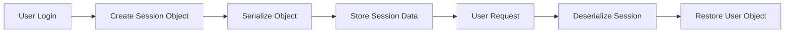
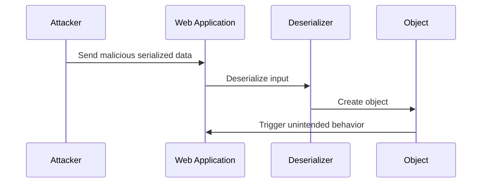
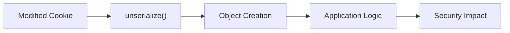
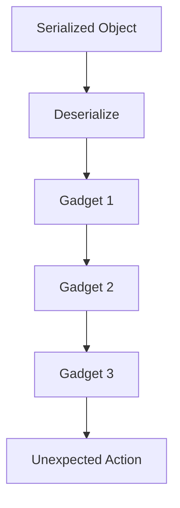
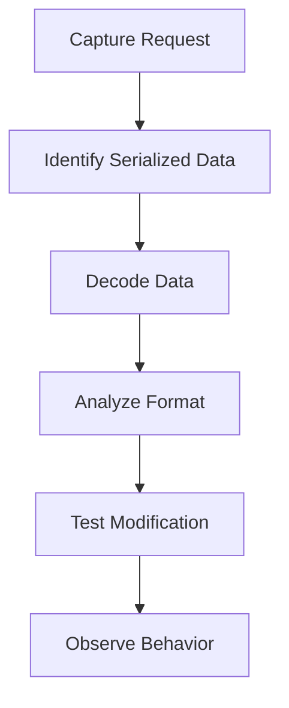
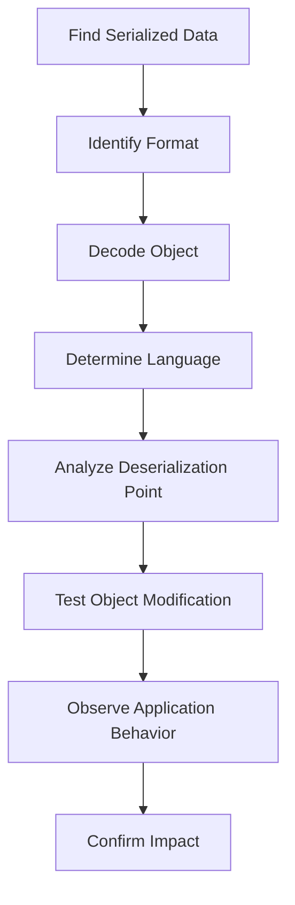

<Callout type="info" title="Overview">
**Insecure Deserialization** is a vulnerability that occurs when an application deserializes untrusted or attacker-controlled data without proper validation.

Serialization converts an object into a format that can be stored or transmitted.

Deserialization performs the reverse operation by reconstructing the original object.

The vulnerability appears when the application trusts serialized data and allows attackers to manipulate the object structure, modify values, or trigger unintended behavior during object reconstruction.
</Callout>

```text
Object
   |
   | Serialization
   v
Serialized Data
   |
   | Deserialization
   v
Object
```

If an attacker controls the serialized data:

```text
Attacker-Controlled Data
          |
          v
    Deserialization
          |
          v
 Unexpected Object State
          |
          v
    Security Impact
```

---

## Serialization vs Deserialization

<Accordion title="Serialization">
Serialization converts an object into a transferable format.

**Example:**

```python
user = {
    "username": "admin",
    "role": "user"
}
```

**Serialized representation:**

```text
username=admin&role=user
```

The serialized data can be:

- Stored in databases
- Sent through APIs
- Stored in cookies
- Placed in session files
- Transmitted between services
</Accordion>

<Accordion title="Deserialization">
Deserialization reconstructs the original object:

```text
Serialized Data
       |
       v
  Deserializer
       |
       v
 Object Instance
```

**Example:**

```python
data = deserialize(input)
```

The problem begins when:

```python
data = deserialize(user_input)
```

The application assumes that user-controlled data is trustworthy.
</Accordion>

---

## Normal Serialization Flow

A normal application may use serialization for sessions:



**Example serialized object:**

```json
{
  "username": "john",
  "role": "user"
}
```

The application expects:

```text
role = user
```

But if an attacker can modify it:

```json
{
  "username": "john",
  "role": "admin"
}
```

the application may trust the modified object.

<Callout type="warning" title="Important Distinction">
Changing a serialized value does not automatically grant privileges. The application must trust the modified value, fail to verify its integrity, or otherwise mishandle the reconstructed object.
</Callout>

---

## Why Deserialization Is Dangerous

Deserialization is not just parsing data.

Many serialization formats contain information about:

- Object type
- Class name
- Object properties
- References
- Internal states

**Example:**

```text
Serialized Data

Class: User
Property: username
Property: role
```

During deserialization:

```text
Serialized Data
       |
       v
 Object Constructor
       |
       v
Methods / Magic Functions
       |
       v
 Application Logic
```

Some languages automatically execute special methods during object reconstruction.

<Callout type="danger" title="Attack Concept">
The general attack flow:
</Callout>



The impact depends on:

- Language
- Serialization format
- Available classes
- Application logic
- Existing libraries

---

## Common Serialization Formats

Different technologies use different formats.

<Accordion title="Java Native Serialization">
Java native serialization stores serialized object data.

**Magic bytes:**

```text
AC ED 00 05
```

These bytes are a common signature for Java serialization streams.
</Accordion>

<Accordion title="PHP Serialization">
**Example:**

```text
O:4:"User":2:{s:8:"username";s:5:"admin";}
```

PHP serialized objects can contain class names, properties, and their serialized values.
</Accordion>

<Accordion title="Python Pickle">
Pickle is Python's native object serialization format.

```python
pickle.loads(data)
```

Deserializing untrusted pickle data can execute attacker-controlled behavior.
</Accordion>

<Accordion title=".NET Serialization">
Examples of .NET serialization technologies include:

```text
BinaryFormatter
ObjectStateFormatter
LosFormatter
```

Some legacy formatters are dangerous when used with untrusted data. `BinaryFormatter` is obsolete and should not be used for new development.
</Accordion>

<Accordion title="JSON">
JSON itself is not automatically unsafe.

However, unsafe type handling can introduce problems:

```json
{
  "$type": "Some.Object"
}
```

Risk depends on how the application interprets type metadata and whether it permits unsafe polymorphic deserialization.
</Accordion>

---

## PHP Object Injection

PHP uses serialized objects such as:

```php
class User {
    public $username;
    public $role;
}
```

**Serialized object:**

```text
O:4:"User":2:{
s:8:"username";s:5:"admin";
s:4:"role";s:5:"admin";
}
```

**Vulnerable code:**

```php
$data = $_COOKIE['session'];

$user = unserialize($data);
```

The application trusts the cookie value.

**Attack flow:**



---

## Java Deserialization

Java serialization stores object information:

```text
Object
Class
Fields
References
```

**Vulnerable pattern:**

```java
ObjectInputStream in =
    new ObjectInputStream(input);

Object obj = in.readObject();
```

If attacker-controlled data reaches:

```java
readObject()
```

the application may instantiate unexpected classes and trigger behavior associated with deserialization hooks.

Java deserialization attacks often rely on:

```text
Gadget Chains
```

A gadget chain is a sequence of existing classes that can be combined to trigger unintended behavior.

<Callout type="info" title="Gadget Chain">
A **gadget** is an existing class or method with behavior that can be useful in an exploit chain.

A gadget chain combines multiple gadgets:
</Callout>

```text
Gadget A
    |
    v
Gadget B
    |
    v
Gadget C
    |
    v
Dangerous Operation
```

The attacker usually does not upload a new class. Instead, they abuse classes already available in the application environment.



---

## Common Impact

<Callout type="warning" title="Potential Security Impact">
Insecure deserialization can lead to:

- Authentication bypass
- Privilege escalation
- Data manipulation
- Remote Code Execution (RCE)
- Server-Side Request Forgery (SSRF)
- File modification
- Application compromise

The impact depends heavily on the available object behavior, application design, and execution privileges.
</Callout>

---

## Finding Deserialization Points

<Accordion title="Cookies">
**Example:**

```http
Cookie: session=eyJ...
```

Inspect cookies for encoded or serialized data. A Base64-looking value alone does not prove that it contains a serialized object.
</Accordion>

<Accordion title="Parameters">
**Example:**

```http
POST /profile

data=rO0ABXNy...
```

Check parameters that contain structured, encoded, or binary-looking values.
</Accordion>

<Accordion title="Headers">
**Example:**

```http
X-User-Object: <serialized-data>
```

Custom headers can carry application-specific serialized data.
</Accordion>

<Accordion title="Files">
Examples of file extensions worth investigating:

```text
.ser
.pkl
.dat
.bin
```

File extensions are clues, not proof of the serialization format.
</Accordion>

<Accordion title="Encoded Data">
Look for:

```text
Base64
Hex
URL Encoding
Binary blobs
```

Decode the data and identify its actual format before drawing conclusions.
</Accordion>

---

## Identifying Java Serialization

Java serialized objects commonly start with:

```text
AC ED 00 05
```

**Base64 representation:**

```text
rO0AB...
```

**Example:**

```http
Cookie: session=rO0ABXNy...
```

This can indicate Java native serialization.

<Callout type="warning" title="Signature Is Not Confirmation">
The `AC ED 00 05` signature and the `rO0AB...` Base64 prefix are useful indicators, but they do not by themselves confirm an exploitable deserialization vulnerability.
</Callout>

---

## Burp Suite Testing Workflow

A basic workflow:



**Useful Burp extensions and tools:**

- Java Deserialization Scanner
- J2EEScan
- Hackvertor
- Decoder

Use these tools in an authorized test environment and confirm behavior through observable application responses.

---

## Detection Techniques

<Accordion title="Suspicious Parameters">
Look for parameter names such as:

```text
object=
data=
state=
session=
token=
```

These names are generic indicators only. Many legitimate parameters use the same names.
</Accordion>

<Accordion title="Encoded Objects">
Examples include:

```text
Base64 strings
Large binary values
Serialized object signatures
```

Investigate whether the data is actually deserialized by the application.
</Accordion>

<Accordion title="Error Messages">
Examples:

```text
java.io.InvalidClassException
```

```text
unserialize(): Error at offset
```

```text
TypeError during object creation
```

Such errors may reveal the underlying language, serialization mechanism, or object-handling behavior.
</Accordion>

---

## Python Pickle Example

<Callout type="danger" title="Unsafe Deserialization">
Python pickle is designed for object serialization, but unpickling untrusted data can execute arbitrary code.
</Callout>

**Vulnerable pattern:**

```python
import pickle

obj = pickle.loads(user_input)
```

The dangerous operation is:

```python
pickle.loads()
```

It can invoke object reconstruction behavior defined by the serialized data.

```text
Untrusted Pickle Data
          |
          v
    pickle.loads()
          |
          v
   Dangerous Behavior
```

Never use pickle to deserialize data supplied by an untrusted source.

---

## Prevention

<Callout type="success" title="Recommended Practices">
The safest solution is:

```text
Do not deserialize untrusted data
```

Recommended practices:

- Avoid native object serialization for user-controlled data.
- Use simple data formats such as JSON when appropriate.
- Validate input against an explicit schema before processing.
- Implement strict allowlists for permitted classes when supported.
- Disable dangerous deserialization features.
- Sign serialized objects when integrity is required, and verify the signature before deserialization.
- Keep libraries updated.
- Avoid PHP `unserialize()` on user input.
- Avoid Java `ObjectInputStream` with untrusted data unless robust filtering and validation are in place.
- Avoid Python `pickle.loads()` on external input.
</Callout>

---

## Secure Alternative

**Unsafe:**

```python
import pickle

user = pickle.loads(data)
```

**Safer for plain data:**

```python
import json

user = json.loads(data)
```

JSON represents data rather than arbitrary executable object behavior. However, JSON is not a complete security boundary: validate its schema, enforce authorization server-side, and avoid unsafe type resolution.

---

## Detection Methodology



The core question:

```text
Can an attacker control data
that reaches a dangerous deserialization process?
```

If yes, investigate whether object reconstruction can cause unintended behavior.

---

## Further Reading

- PortSwigger Web Security Academy: Insecure Deserialization
- OWASP Deserialization Cheat Sheet
- ysoserial: Java deserialization research
- PHP Object Injection research
- .NET Deserialization research
