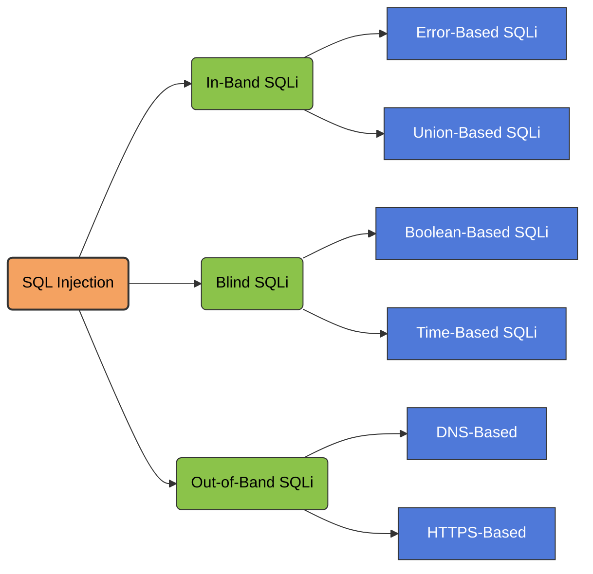

<Callout title="Overview" icon="shield-alert">
  **SQL injection (SQLi)** is a web security vulnerability that allows an attacker to interfere with the queries that an application makes to its database.

  This can allow an attacker to view data that they are not normally able to retrieve. This might include data that belongs to other users, or any other data that the application can access. In many cases, an attacker can modify or delete this data, causing persistent changes to the application's content or behavior.

  In some situations, an attacker can escalate a SQL injection attack to compromise the underlying server or other back-end infrastructure. It can also enable them to perform denial-of-service attacks.
</Callout>

<Frame caption="SQL Injection Classification">
  
</Frame>

## SQL Injection Classification



---

## 1. What Is SQL Injection?

SQL injection (SQLi) is a web security vulnerability that allows an attacker to interfere with the queries that an application makes to its database.

This can allow an attacker to view data that they are not normally able to retrieve. This might include data that belongs to other users, or any other data that the application can access.

In many cases, an attacker can modify or delete this data, causing persistent changes to the application's content or behavior.

In some situations, an attacker can escalate a SQL injection attack to compromise the underlying server or other back-end infrastructure. It can also enable them to perform denial-of-service attacks.

## 2. What Is the Impact of a Successful SQL Injection Attack?

A successful SQL injection attack can result in unauthorized access to sensitive data, such as:

- Passwords.
- Credit card details.
- Personal user information.

SQL injection attacks have been used in many high-profile data breaches over the years. These have caused reputational damage and regulatory fines.

In some cases, an attacker can obtain a persistent backdoor into an organization's systems, leading to a long-term compromise that can go unnoticed for an extended period.

<Callout title="Potential Impact" icon="shield-alert">
  The impact depends on the application's database privileges, query structure, database engine, and the security controls surrounding the application.
</Callout>

## 3. How to Detect SQL Injection Vulnerabilities

You can detect SQL injection manually using a systematic set of tests against every entry point in the application.

To do this, you would typically submit:

- The single quote character `'` and look for errors or other anomalies.
- Some SQL-specific syntax that evaluates to the base (original) value of the entry point, and to a different value, and look for systematic differences in the application responses.
- Boolean conditions such as `OR 1=1` and `OR 1=2`, and look for differences in the application's responses.
- Payloads designed to trigger time delays when executed within a SQL query, and look for differences in the time taken to respond.
- OAST payloads designed to trigger an out-of-band network interaction when executed within a SQL query, and monitor any resulting interactions.

Alternatively, you can find the majority of SQL injection vulnerabilities quickly and reliably using Burp Scanner.

<Callout title="Testing Note" icon="info">
  Perform these tests only against systems you own or have explicit authorization to assess. Response differences, database errors, timing changes, and out-of-band interactions should be evaluated together to reduce false positives.
</Callout>

## 4. SQL Injection in Different Parts of the Query

Most SQL injection vulnerabilities occur within the `WHERE` clause of a `SELECT` query. Most experienced testers are familiar with this type of SQL injection.

However, SQL injection vulnerabilities can occur at any location within the query, and within different query types.

Some other common locations where SQL injection arises are:

- In `UPDATE` statements, within the updated values or the `WHERE` clause.
- In `INSERT` statements, within the inserted values.
- In `SELECT` statements, within the table or column name.
- In `SELECT` statements, within the `ORDER BY` clause.

---

# SQL Database Reference

This section contains the SQL commands and query examples from the original notes, organized into expandable reference sections.

## 5. Show Information

<AccordionGroup>
  <Accordion title="Show Available Databases" icon="database">
    ```sql
    -- Show all available databases
    SHOW DATABASES;
    ```
  </Accordion>

  <Accordion title="Select a Database" icon="folder-open">
    ```sql
    -- Select a specific database
    USE nameofdatabase;
    USE mysql
    ```
  </Accordion>

  <Accordion title="Show Tables" icon="table">
    ```sql
    -- Show all tables inside the selected database
    SHOW TABLES;
    ```
  </Accordion>
</AccordionGroup>

## 6. Search Queries

<AccordionGroup>
  <Accordion title="Describe a Table">
    ```sql
    DESCRIBE tablename
    ```
  </Accordion>

  <Accordion title="Select a Column">
    ```sql
    SELECT <column>
    FROM <databasename.tablename>
    WHERE <condition>
    ```
  </Accordion>

  <Accordion title="UNION-Based Extraction">
    ```sql
    -- UNION-based extraction (for SQL injection scenarios)
    SELECT <column>
    FROM <databasename.tablename>
    WHERE <condition>
    UNION SELECT ...;
    ```
  </Accordion>

  <Accordion title="Basic SELECT Examples">
    ```sql
    SELECT * FROM <tablename>;
    SELECT * FROM <databasename.tablename>;
    ```

    ```sql
    SELECT User FROM Users WHERE Id=399586;
    ```
  </Accordion>
</AccordionGroup>

## 7. Create Table

<Accordion title="Create a New Table" icon="table">
  Use this to create a new table in the current database.

  ```sql
  CREATE TABLE nikola (
      id INT PRIMARY KEY AUTO_INCREMENT,
      username VARCHAR(20) UNIQUE NOT NULL,
      name VARCHAR(100) NOT NULL,
      age INT,
      email VARCHAR(100) UNIQUE NOT NULL,
      create_time TIMESTAMP DEFAULT CURRENT_TIMESTAMP
  );
  ```
</Accordion>

## 8. Modify Data

<AccordionGroup>
  <Accordion title="Insert Data" icon="plus-circle">
    Add a new record into the table:

    ```sql
    INSERT INTO tablename (id, name, age, email)
    VALUES ("1234", "cna", "44", "example@mail.com");
    ```
  </Accordion>

  <Accordion title="Update Data" icon="pencil">
    Modify an existing record in the table:

    ```sql
    UPDATE databasename.tablename
    SET email = "notable@mail.com"
    WHERE id = "1234";
    ```
  </Accordion>

  <Accordion title="Delete Data" icon="trash-2">
    Remove a record from the table:

    ```sql
    DELETE FROM databasename.tablename
    WHERE id = "1234";
    ```
  </Accordion>
</AccordionGroup>

<Callout title="Important" icon="alert-triangle">
  `UPDATE` and `DELETE` statements can modify or remove persistent data. Always verify the target database and the `WHERE` condition before running these commands.
</Callout>

## 9. Information Schema Queries

The following queries reference the `information_schema` metadata tables.

<AccordionGroup>
  <Accordion title="List Schemas">
    ```sql
    SELECT schema_name
    FROM information_schema.schemata;
    ```
  </Accordion>

  <Accordion title="List Tables">
    ```sql
    SELECT table_name
    FROM information_schema.tables;
    ```
  </Accordion>

  <Accordion title="List Columns">
    ```sql
    SELECT column_name
    FROM information_schema.columns;
    ```
  </Accordion>

  <Accordion title="Concatenate Schema Names">
    ```sql
    SELECT group_concat(schema_name)
    FROM information_schema.schemata;
    ```
  </Accordion>

  <Accordion title="Concatenate Table Names">
    ```sql
    SELECT group_concat(table_name)
    FROM information_schema.tables
    WHERE table_schema=database()*-- *
    ```
  </Accordion>

  <Accordion title="Concatenate Column Names">
    ```sql
    SELECT group_concat(column_name)
    FROM information_schema.columns
    WHERE table_schema=<DSName>
      AND table_name=<TableName>;
    ```
  </Accordion>
</AccordionGroup>

## 12. SQLi Exploitation Functions & Operators

This section covers the core SQL functions and operators used during SQL injection exploitation. These functions are essential for extracting data character-by-character (Blind SQLi), triggering errors (Error-Based SQLi), dumping multiple rows at once, and controlling query execution flow.

<AccordionGroup>
  <Accordion title="Result Limiting & Sorting (LIMIT, GROUP BY, ORDER BY)" icon="list">
    These clauses are heavily used in SQLi to control the output of the query, determine the number of columns, or trigger specific database errors.
    
    ```sql
    limit 0,1
    group by
    order by
    ```
    <Note title="Usage in SQLi">
      - `ORDER BY`: Used to determine the exact number of columns in a `SELECT` statement before attempting a `UNION` injection. The attacker increments the column number until the application returns an error.
      - `LIMIT 0,1`: Used to extract exactly one row at a time (e.g., row 0, then row 1). This is highly useful in Blind SQLi to extract data row by row without flooding the application with results.
      - `GROUP BY`: Frequently used in Error-Based SQLi (specifically the "Double Query" or "ExtractValue" techniques). When combined with `floor(rand()*2)`, it forces a duplicate key error that leaks data in the error message.
    </Note>
  </Accordion>

  <Accordion title="Data Concatenation (GROUP_CONCAT)" icon="combine">
    `GROUP_CONCAT` is used to combine multiple rows of data into a single string. This is crucial for Union-Based SQLi because it allows an attacker to dump all usernames and passwords in a single HTTP request.
    
    ```sql
    select group_concat(user,":",password) from tablename
    ```
    <Note title="Usage in SQLi">
      The separator `":"` is explicitly defined to format the output cleanly (e.g., `admin:password123,user:pass456`). Without `GROUP_CONCAT`, an attacker would have to extract data row by row using `LIMIT`.
    </Note>
  </Accordion>

  <Accordion title="String Manipulation (SUBSTR / MID)" icon="scissors">
    `SUBSTR` and `MID` are used to extract a substring from a given string. They are the absolute backbone of Blind SQLi, allowing attackers to extract data character by character by asking true/false questions.

    ```sql
    select substr or mid (inputstring,start,length)
    select substr("attvdef",1,3) --> att 
    select substr("attvdef",-3,3) --> def new version is mid
    select mid("attvdef",1,5) --> attv
    ```
    <Note title="Usage in SQLi">
      - `substr(string, start, length)`: Extracts characters starting from position 1.
      - Negative Indexing (`-3, 3`): Allows extracting from the end of the string. This is extremely useful when the length of the string is unknown (e.g., extracting the last 3 characters of a password hash).
      - `MID` is the modern equivalent of `SUBSTR` and is supported across most database engines (MySQL, MSSQL, PostgreSQL).
    </Note>
  </Accordion>

  <Accordion title="Math & Random Functions (FLOOR, RAND)" icon="calculator">
    These functions are primarily used in Error-Based SQLi to intentionally trigger database errors that contain the extracted data.

    ```sql
    select floor(0.8) --> output 0
    select floor(1.5) --> output 1
    select floor(rand()*2)
    ```
    <Note title="Usage in SQLi">
      - `FLOOR(x)` returns the largest integer less than or equal to `x`.
      - `RAND()*2` generates a random number between 0 and 1.999..., which when passed to `FLOOR()`, results in either `0` or `1`.
      - When used in a subquery with `GROUP BY`, the database attempts to group by a temporary table key generated by `floor(rand()*2)`. Due to a race condition in how MySQL evaluates this, it occasionally tries to insert a duplicate key, throwing an error like `Duplicate entry '1' for key 'group_key'`. Attackers replace the `1` with the data they want to extract.
    </Note>
  </Accordion>

  <Accordion title="Conditional Logic & Time Delays (IF, SLEEP)" icon="clock">
    These functions are the foundation of Time-Based Blind SQLi. If the application does not return errors or reflect boolean logic in the HTTP response, the attacker can infer the answer based on how long the server takes to respond.

    ```sql
    select if((mid("attvdef",-3,3) = def),(sleep(3)),(0));
    select if( (mid(version(),1,1) = 5 ),(sleep(1)),(0))
    select sleep(3)
    ```
    <Note title="Usage in SQLi">
      - `IF(condition, true_action, false_action)`: Evaluates the condition. If true, it executes the first parameter; if false, the second.
      - `SLEEP(n)`: Pauses the database execution for `n` seconds.
      - In the first example, if the last 3 characters of "attvdef" are "def", the database sleeps for 3 seconds. If not, it returns 0 immediately.
      - In the second example, the attacker checks the first character of the database version. If it is `5`, the server sleeps for 1 second. By iterating through characters, the entire version string can be extracted blindly.
    </Note>
  </Accordion>

  <Accordion title="Pattern Matching (LIKE)" icon="search">
    The `LIKE` operator is used to search for a specified pattern in a column. It is often used to bypass authentication or extract data when partial information is known.

    ```sql
    select email from tablename like "admin%"
    ```
    <Note title="Usage in SQLi">
      The `%` wildcard represents zero, one, or multiple characters. The query `LIKE "admin%"` will match any email starting with "admin" (e.g., `admin@test.com`, `administrator@target.com`). This is useful in Boolean-Based Blind SQLi to check if a username or email follows a specific naming convention.
    </Note>
  </Accordion>
</AccordionGroup>

---

# NoSQL Database Reference

## 10. Show Information

<AccordionGroup>
  <Accordion title="Start the MongoDB Shell" icon="terminal">
    ```text
    mongo
    ```
  </Accordion>

  <Accordion title="Show Databases" icon="database">
    ```javascript
    // show databases
    show dbs
    ```
  </Accordion>

  <Accordion title="Select a Database" icon="folder-open">
    ```javascript
    // use databasesname
    use databasename
    ```
  </Accordion>

  <Accordion title="Show Collections" icon="table">
    ```javascript
    // show table
    show collections
    ```
  </Accordion>

  <Accordion title="Show Collection Documents" icon="file-text">
    ```javascript
    // show information about table
    db.CollectionName.find()
    ```
  </Accordion>
</AccordionGroup>

## 11. Search Queries

<AccordionGroup>
  <Accordion title="Find a User">
    ```javascript
    db.CollectionName.find({"User":"admin"})
    ```
  </Accordion>

  <Accordion title="Count Documents">
    ```javascript
    db.CollectionName.count()
    ```
  </Accordion>

  <Accordion title="Count Documents Using a Greater-Than Condition">
    ```javascript
    // {"id":3456,...}
    db.CollectionName.find({"id":{$gt:123}}).count()
    ```
  </Accordion>

  <Accordion title="Combine Conditions With $and">
    ```javascript
    // {"id":3456,"state":"ML"}
    db.CollectionName.find({
      $and: [
        {"id":{$gt:200}},
        {"state":"FL"}
      ]
    })
    ```
  </Accordion>

  <Accordion title="Regular Expression Search">
    ```javascript
    db.CollectionName.find({"state":{$regex:"^M.*"}})
    ```
  </Accordion>
</AccordionGroup>

<Callout title="MongoDB Compatibility" icon="info">
  The `mongo` shell and `db.CollectionName.count()` are associated with older MongoDB workflows. Modern MongoDB environments commonly use `mongosh` and alternatives such as `countDocuments()`. Availability and syntax depend on the MongoDB version.
</Callout>

---

## Quick Reference

<CardGroup cols={2}>
  <Card title="SQL Injection Fundamentals" icon="shield-alert">
    Understand SQLi classifications, impact, detection methods, and vulnerable query locations.
  </Card>
  <Card title="SQL Commands" icon="database">
    Review database selection, table discovery, `SELECT`, `INSERT`, `UPDATE`, and `DELETE` statements.
  </Card>
  <Card title="Information Schema" icon="list-tree">
    Explore schema, table, and column metadata queries.
  </Card>
  <Card title="NoSQL Queries" icon="terminal">
    Review MongoDB shell commands, document searches, counting, conditional operators, and regular expressions.
  </Card>
</CardGroup>
