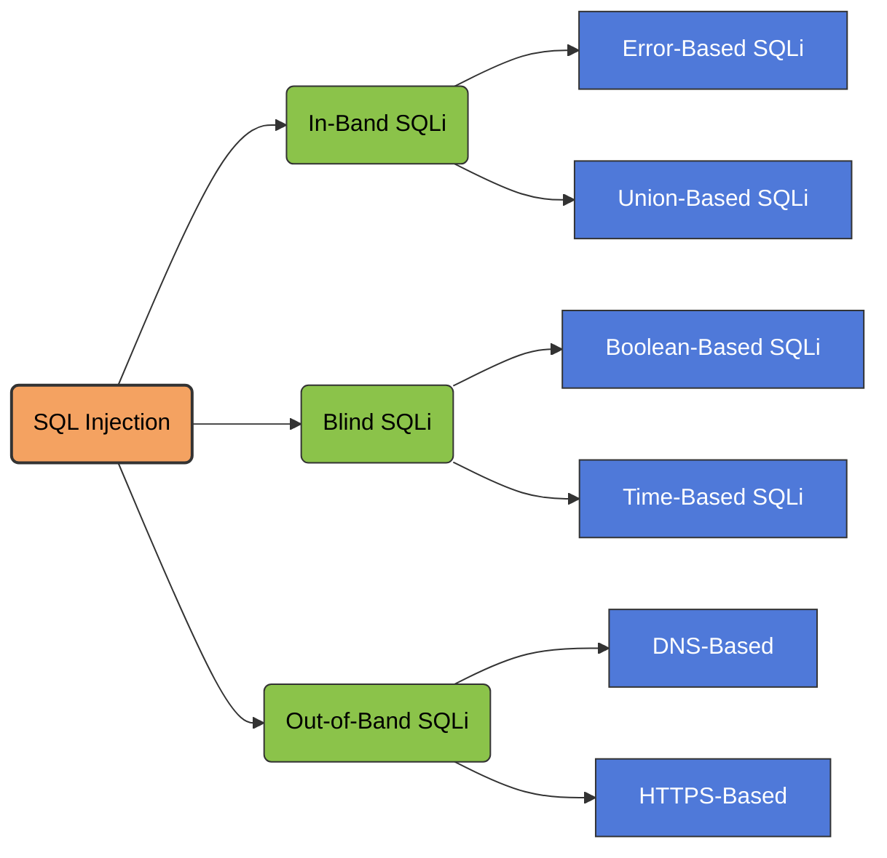

<Callout title="Overview" icon="shield-alert">
  **SQL injection (SQLi)** is a web security vulnerability that allows an attacker to interfere with the queries that an application makes to its database.

  This can allow an attacker to view data that they are not normally able to retrieve. This might include data that belongs to other users, or any other data that the application can access. In many cases, an attacker can modify or delete this data, causing persistent changes to the application's content or behavior.

  In some situations, an attacker can escalate a SQL injection attack to compromise the underlying server or other back-end infrastructure. It can also enable them to perform denial-of-service attacks.
</Callout>

<Frame caption="SQL Injection Classification">
  
</Frame>

## SQL Injection Classification



---

## 1. What Is SQL Injection?

SQL injection (SQLi) is a web security vulnerability that allows an attacker to interfere with the queries that an application makes to its database.

This can allow an attacker to view data that they are not normally able to retrieve. This might include data that belongs to other users, or any other data that the application can access.

In many cases, an attacker can modify or delete this data, causing persistent changes to the application's content or behavior.

In some situations, an attacker can escalate a SQL injection attack to compromise the underlying server or other back-end infrastructure. It can also enable them to perform denial-of-service attacks.

## 2. What Is the Impact of a Successful SQL Injection Attack?

A successful SQL injection attack can result in unauthorized access to sensitive data, such as:

- Passwords.
- Credit card details.
- Personal user information.

SQL injection attacks have been used in many high-profile data breaches over the years. These have caused reputational damage and regulatory fines.

In some cases, an attacker can obtain a persistent backdoor into an organization's systems, leading to a long-term compromise that can go unnoticed for an extended period.

<Callout title="Potential Impact" icon="shield-alert">
  The impact depends on the application's database privileges, query structure, database engine, and the security controls surrounding the application.
</Callout>

## 3. How to Detect SQL Injection Vulnerabilities

You can detect SQL injection manually using a systematic set of tests against every entry point in the application.

To do this, you would typically submit:

- The single quote character `'` and look for errors or other anomalies.
- Some SQL-specific syntax that evaluates to the base (original) value of the entry point, and to a different value, and look for systematic differences in the application responses.
- Boolean conditions such as `OR 1=1` and `OR 1=2`, and look for differences in the application's responses.
- Payloads designed to trigger time delays when executed within a SQL query, and look for differences in the time taken to respond.
- OAST payloads designed to trigger an out-of-band network interaction when executed within a SQL query, and monitor any resulting interactions.

Alternatively, you can find the majority of SQL injection vulnerabilities quickly and reliably using Burp Scanner.

<Callout title="Testing Note" icon="info">
  Perform these tests only against systems you own or have explicit authorization to assess. Response differences, database errors, timing changes, and out-of-band interactions should be evaluated together to reduce false positives.
</Callout>

## 4. SQL Injection in Different Parts of the Query

Most SQL injection vulnerabilities occur within the `WHERE` clause of a `SELECT` query. Most experienced testers are familiar with this type of SQL injection.

However, SQL injection vulnerabilities can occur at any location within the query, and within different query types.

Some other common locations where SQL injection arises are:

- In `UPDATE` statements, within the updated values or the `WHERE` clause.
- In `INSERT` statements, within the inserted values.
- In `SELECT` statements, within the table or column name.
- In `SELECT` statements, within the `ORDER BY` clause.

---

# SQL Database Reference

This section contains the SQL commands and query examples from the original notes, organized into expandable reference sections.

## 5. Show Information

<AccordionGroup>
  <Accordion title="Show Available Databases" icon="database">
    ```sql
    -- Show all available databases
    SHOW DATABASES;
    ```
  </Accordion>

  <Accordion title="Select a Database" icon="folder-open">
    ```sql
    -- Select a specific database
    USE nameofdatabase;
    USE mysql
    ```
  </Accordion>

  <Accordion title="Show Tables" icon="table">
    ```sql
    -- Show all tables inside the selected database
    SHOW TABLES;
    ```
  </Accordion>
</AccordionGroup>

## 6. Search Queries

<AccordionGroup>
  <Accordion title="Describe a Table">
    ```sql
    DESCRIBE tablename
    ```
  </Accordion>

  <Accordion title="Select a Column">
    ```sql
    SELECT <column>
    FROM <databasename.tablename>
    WHERE <condition>
    ```
  </Accordion>

  <Accordion title="UNION-Based Extraction">
    ```sql
    -- UNION-based extraction (for SQL injection scenarios)
    SELECT <column>
    FROM <databasename.tablename>
    WHERE <condition>
    UNION SELECT ...;
    ```
  </Accordion>

  <Accordion title="Basic SELECT Examples">
    ```sql
    SELECT * FROM <tablename>;
    SELECT * FROM <databasename.tablename>;
    ```

    ```sql
    SELECT User FROM Users WHERE Id=399586;
    ```
  </Accordion>
</AccordionGroup>

## 7. Create Table

<Accordion title="Create a New Table" icon="table">
  Use this to create a new table in the current database.

  ```sql
  CREATE TABLE nikola (
      id INT PRIMARY KEY AUTO_INCREMENT,
      username VARCHAR(20) UNIQUE NOT NULL,
      name VARCHAR(100) NOT NULL,
      age INT,
      email VARCHAR(100) UNIQUE NOT NULL,
      create_time TIMESTAMP DEFAULT CURRENT_TIMESTAMP
  );
  ```
</Accordion>

## 8. Modify Data

<AccordionGroup>
  <Accordion title="Insert Data" icon="plus-circle">
    Add a new record into the table:

    ```sql
    INSERT INTO nikola (id, name, age, email)
    VALUES ("1234", "cna", "44", "example@mail.com");
    ```
  </Accordion>

  <Accordion title="Update Data" icon="pencil">
    Modify an existing record in the table:

    ```sql
    UPDATE databasename.tablename
    SET email = "notable@mail.com"
    WHERE id = "1234";
    ```
  </Accordion>

  <Accordion title="Delete Data" icon="trash-2">
    Remove a record from the table:

    ```sql
    DELETE FROM databasename.tablename
    WHERE id = "1234";
    ```
  </Accordion>
</AccordionGroup>

<Callout title="Important" icon="alert-triangle">
  `UPDATE` and `DELETE` statements can modify or remove persistent data. Always verify the target database and the `WHERE` condition before running these commands.
</Callout>

## 9. Information Schema Queries

The following queries reference the `information_schema` metadata tables.

<AccordionGroup>
  <Accordion title="List Schemas">
    ```sql
    SELECT schema_name
    FROM information_schema.schemata;
    ```
  </Accordion>

  <Accordion title="List Tables">
    ```sql
    SELECT table_name
    FROM information_schema.tables;
    ```
  </Accordion>

  <Accordion title="List Columns">
    ```sql
    SELECT column_name
    FROM information_schema.columns;
    ```
  </Accordion>

  <Accordion title="Concatenate Schema Names">
    ```sql
    SELECT group_concat(schema_name)
    FROM information_schema.schemata;
    ```
  </Accordion>

  <Accordion title="Concatenate Table Names">
    ```sql
    SELECT group_concat(table_name)
    FROM information_schema.tables
    WHERE table_schema=database()*-- *
    ```
  </Accordion>

  <Accordion title="Concatenate Column Names">
    ```sql
    SELECT group_concat(column_name)
    FROM information_schema.columns
    WHERE table_schema=<DSName>
      AND table_name=<TableName>;
    ```
  </Accordion>
</AccordionGroup>

---

# NoSQL Database Reference

## 10. Show Information

<AccordionGroup>
  <Accordion title="Start the MongoDB Shell" icon="terminal">
    ```text
    mongo
    ```
  </Accordion>

  <Accordion title="Show Databases" icon="database">
    ```javascript
    // show databases
    show dbs
    ```
  </Accordion>

  <Accordion title="Select a Database" icon="folder-open">
    ```javascript
    // use databasesname
    use databasename
    ```
  </Accordion>

  <Accordion title="Show Collections" icon="table">
    ```javascript
    // show table
    show collections
    ```
  </Accordion>

  <Accordion title="Show Collection Documents" icon="file-text">
    ```javascript
    // show information about table
    db.CollectionName.find()
    ```
  </Accordion>
</AccordionGroup>

## 11. Search Queries

<AccordionGroup>
  <Accordion title="Find a User">
    ```javascript
    db.CollectionName.find({"User":"admin"})
    ```
  </Accordion>

  <Accordion title="Count Documents">
    ```javascript
    db.CollectionName.count()
    ```
  </Accordion>

  <Accordion title="Count Documents Using a Greater-Than Condition">
    ```javascript
    // {"id":3456,...}
    db.CollectionName.find({"id":{$gt:123}}).count()
    ```
  </Accordion>

  <Accordion title="Combine Conditions With $and">
    ```javascript
    // {"id":3456,"state":"ML"}
    db.CollectionName.find({
      $and: [
        {"id":{$gt:200}},
        {"state":"FL"}
      ]
    })
    ```
  </Accordion>

  <Accordion title="Regular Expression Search">
    ```javascript
    db.CollectionName.find({"state":{$regex:"^M.*"}})
    ```
  </Accordion>
</AccordionGroup>

<Callout title="MongoDB Compatibility" icon="info">
  The `mongo` shell and `db.CollectionName.count()` are associated with older MongoDB workflows. Modern MongoDB environments commonly use `mongosh` and alternatives such as `countDocuments()`. Availability and syntax depend on the MongoDB version.
</Callout>

---

## Quick Reference

<CardGroup cols={2}>
  <Card title="SQL Injection Fundamentals" icon="shield-alert">
    Understand SQLi classifications, impact, detection methods, and vulnerable query locations.
  </Card>
  <Card title="SQL Commands" icon="database">
    Review database selection, table discovery, `SELECT`, `INSERT`, `UPDATE`, and `DELETE` statements.
  </Card>
  <Card title="Information Schema" icon="list-tree">
    Explore schema, table, and column metadata queries.
  </Card>
  <Card title="NoSQL Queries" icon="terminal">
    Review MongoDB shell commands, document searches, counting, conditional operators, and regular expressions.
  </Card>
</CardGroup>