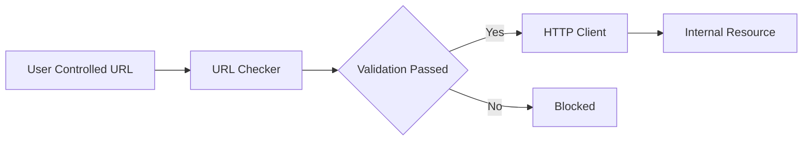
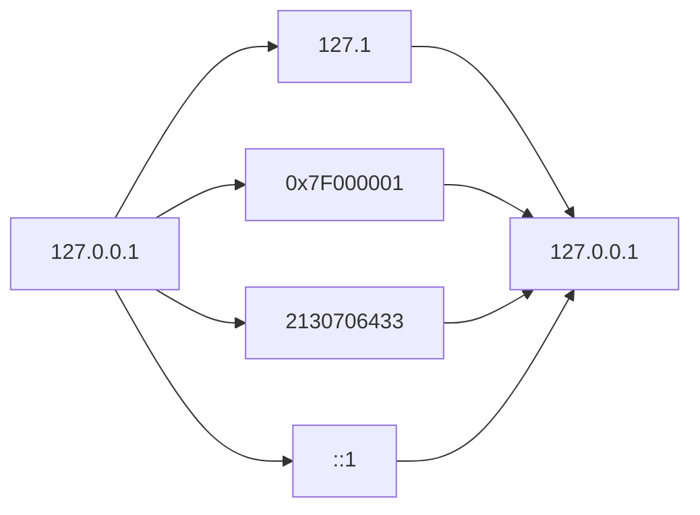
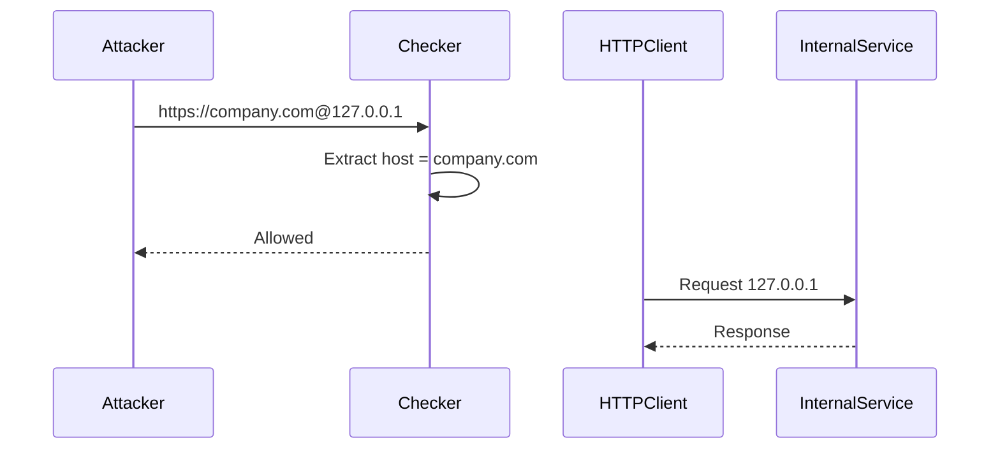
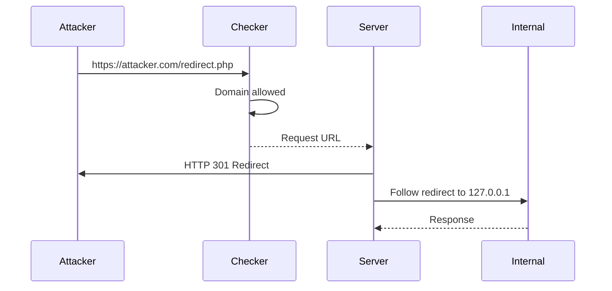
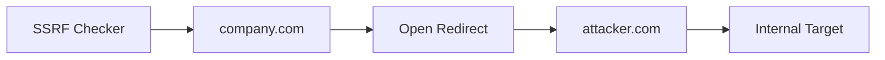
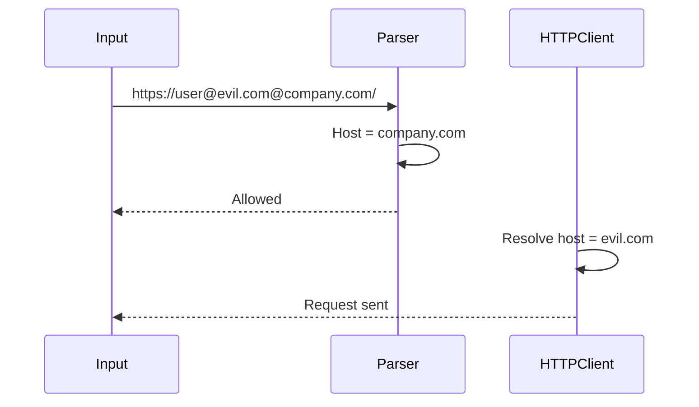

<Callout type="default" title="Overview">
In SSRF prevention, URL validation is one of the most critical security controls.

A vulnerable URL checker may incorrectly validate attacker-controlled URLs due to parsing differences, IP representation tricks, redirects, or inconsistencies between the validation logic and the HTTP client library.

A secure checker must validate the **final destination** of the request, not only the initial user input.
</Callout>

<Frame type="image" caption="SSRF URL Validation Bypass Concept">

</Frame>

## Why URL Validation Fails



The problem occurs when:

```text
Checker interpretation != HTTP Client interpretation
```

The validation function sees one destination, while the HTTP library requests another.

---

## IP Address Representation Bypass

A common mistake is checking only known internal IP formats.

Example:

Blocked:

```text
127.0.0.1
```

Possible bypasses:

<CodeGroup>
  ```text Bypass 1
  127.1
  ```
  ```text Bypass 2
  0x7F000001
  ```
  ```text Bypass 3
  2130706433
  ```
  ```text IPv6
  [::1]

  [0:0:0:0:0:0:0:1]
  ```
</CodeGroup>



<Warning title="Warning">
IP validation should normalize the IP address before checking it against blocklists.
</Warning>

---

## Domain Validation Regex Bypass

A common mistake is extracting the hostname using a weak regex.

Example:

Allowed:

```text
https://company.com
```

Validation:

```text
Host = company.com
```

Whitelist:

```text
company.com
auth.company.com
blog.company.com
```

---

Attacker input:

```text
https://company.com@127.0.0.1
```

URL parsing:

```text
Username: company.com
Host: 127.0.0.1
```

The checker may incorrectly trust:

```text
company.com
```

while the HTTP client connects to:

```text
127.0.0.1
```

---



---

## Redirect Based SSRF Bypass

Another mistake:

<Steps>
  1. Validate the original URL.
  2. Follow redirects automatically.
</Steps>

Example:

Allowed:

```text
https://google.com
```

Redirect:

```text
https://attacker.com/redirect.php
        |
        v
http://127.0.0.1
```

The checker validates:

```text
attacker.com
```

but the server finally requests:

```text
127.0.0.1
```

---



<Callout type="error" title="Danger">
URL validation must happen after redirects are resolved, or redirects to untrusted destinations must be blocked.
</Callout>

---

## Open Redirect Chaining

Even if the allowed domain is secure, an existing Open Redirect can become an SSRF primitive.

Example:

Trusted domain:

```text
https://company.com
```

Open Redirect:

```text
https://company.com/redirect?url=https://attacker.com
```

Flow:



---

## Parser Inconsistency

Different URL parsers may interpret the same URL differently.

Example:

```text
https://user@evil.com@company.com/
```

Parser A:

```text
Host = company.com
```

Whitelist:

```text
Allowed
```

HTTP client:

```text
Host = evil.com
```

Request goes to:

```text
evil.com
```

---



<Note icon="key" title="Secure URL Validation Checklist">
  1. Parse URL using a trusted URL parser.
  2. Normalize hostname before validation.
  3. Resolve DNS before making requests.
  4. Validate the final destination after redirects.
  5. Block localhost addresses.
  6. Block private IP ranges.
  7. Block link-local addresses.
  8. Block cloud metadata IPs.
  9. Avoid regex-only URL validation.
  10. Ensure validator and HTTP client parse URLs identically.
</Note>

## Related Vulnerabilities

<CardGroup cols={2}>
  <Card title="Server-Side Request Forgery (SSRF)" href="https://owasp.org/www-community/attacks/Server_Side_Request_Forgery">
    Exploiting server-side applications to send unauthorized requests.
  </Card>
  <Card title="Open Redirect" href="https://owasp.org/www-community/attacks/Unvalidated_Redirects_and_Forwards_Cheat_Sheet">
    Manipulating URL parameters to redirect users to malicious sites.
  </Card>
  <Card title="DNS Rebinding" href="https://en.wikipedia.org/wiki/DNS_rebinding">
    Bypassing same-origin policies by manipulating DNS resolution.
  </Card>
  <Card title="URL Parser Confusion" href="https://www.blackhat.com/docs/us-17/thursday/us-17-Tsai-A-New-Era-Of-SSRF-Exploiting-URL-Parser-In-Trending-Programming-Languages.pdf">
    Inconsistencies in how different languages parse URL components.
  </Card>
  <Card title="Access Control Bypass" href="https://owasp.org/www-community/Access_Control">
    Gaining unauthorized access to restricted functionality or data.
  </Card>
</CardGroup>