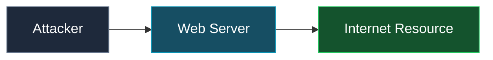
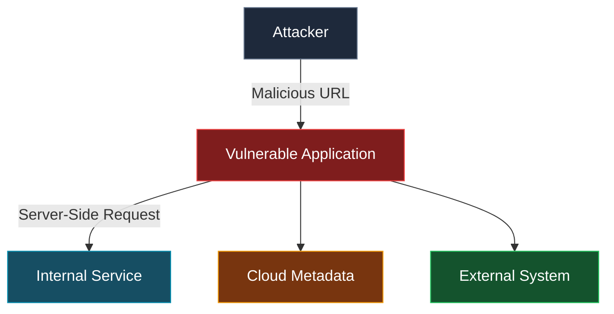
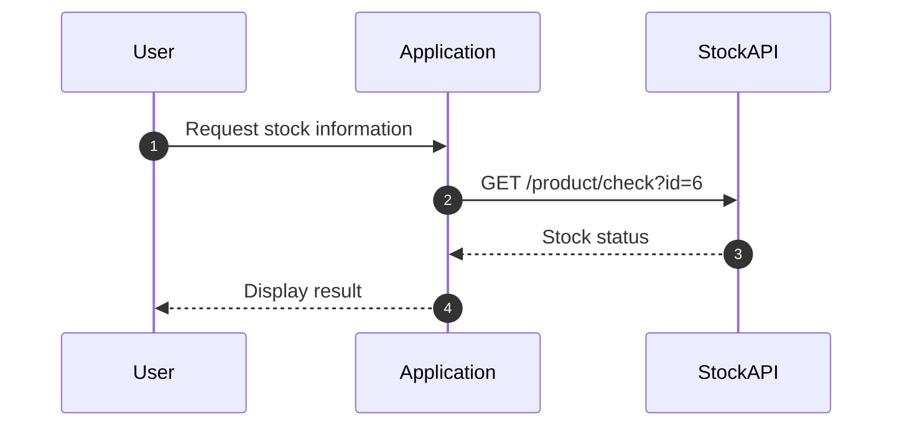
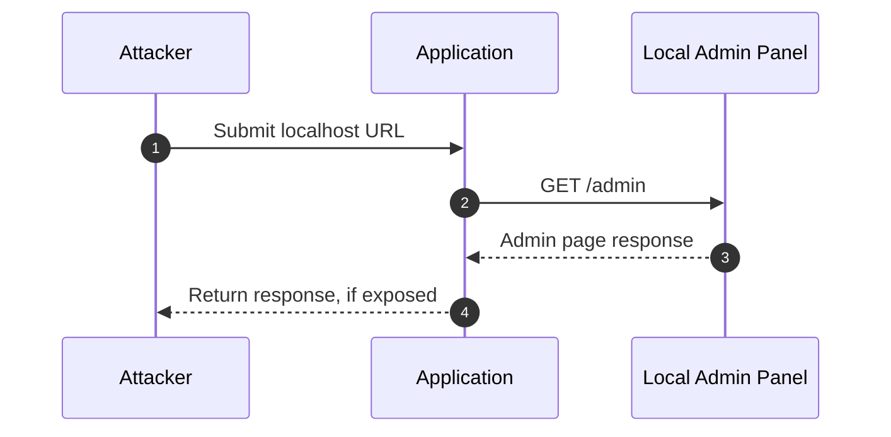
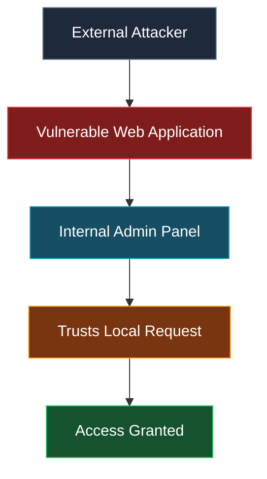
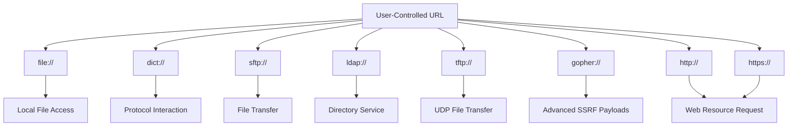

<Callout title="Overview" icon="shield-alert">
  **Server-Side Request Forgery (SSRF)** is a web vulnerability where an attacker can force a server-side application to make HTTP requests to unintended locations.

  Instead of the attacker directly communicating with a target, the vulnerable server acts as a proxy and performs the request on behalf of the attacker.
</Callout>

<Frame caption="SSRF Concept">
  
</Frame>

## Vulnerable Code

<Expandable title="View vulnerable PHP implementation" defaultOpen>
  <Callout type="danger" title="Danger: Unvalidated User Input">
    The application passes a user-controlled URL directly to `fopen()` without validating the destination. Depending on the PHP configuration and available stream wrappers, this can allow unintended server-side resource access.
  </Callout>

  ```php
  <?php

  /**
   * Check if the 'img' GET variable is set.
   */

  if (isset($_GET['img'])) {
      $img = $_GET['img'];

      /**
       * Send a request vulnerable to SSRF since
       * no validation is being done on $img
       * before sending the request.
       */
      $image = fopen($img, 'rb');

      /**
       * Dump the contents of the image.
       */
      fpassthru($image);
  }

  ?>

  <!DOCTYPE html>
  <html>
  <head>
      <meta charset="utf-8">
      <meta name="viewport" content="width=device-width, initial-scale=1">
      <title>Cat</title>
  </head>
  <body>
      
  </body>
  </html>
  ```
</Expandable>

---

## 1. SSRF Concept

In a normal request, the application communicates with the resources it was designed to access.



The server acts as an intermediary between the client and the intended resource.

In an SSRF scenario, the attacker influences the destination of the server-side request.



The server may be able to reach resources that are inaccessible directly from the attacker's machine.

## 2. Why SSRF Happens

SSRF usually occurs when an application accepts a user-controlled URL without proper validation.

**Example of vulnerable code:**

```php
<?php

if (isset($_GET['img'])) {
    $img = $_GET['img'];
    $image = fopen($img, 'rb');
    fpassthru($image);
}

?>
```

The application directly uses user input:

```php
fopen($img, 'rb');
```

No validation exists before the URL is used.

The attacker controls the following parameter:

```text
img=
```

If the application does not properly restrict the destination, the server may make requests to unintended resources.

---

## 3. Normal Application Flow

Consider a shopping application that checks product availability through an external stock API.

**Example request:**

```http
POST /product/stock

stockApi=http://stock.example.com/product/check?id=6
```

The application sends the request to the intended stock service and returns the result.



The stock API is an expected destination, and the application uses its response to display product availability.

---

## 4. SSRF Attack Flow

An attacker changes the destination from the legitimate stock API to a local resource.

**Original parameter:**

```http
stockApi=http://stock.example.com/product/check?id=6
```

**Modified parameter:**

```http
stockApi=http://localhost/admin
```

The resulting request flow may look like this:



The server accesses a resource that the attacker may not be able to reach directly.

---

## 5. SSRF Targets

The following categories are common areas to investigate during an authorized SSRF assessment.

<Tabs>
  <Tab title="Localhost">
    <text color="secondary" size="sm">Loopback addresses and local services</text>

    Common targets include:

    ```text
    127.0.0.1
    localhost
    ::1
    ```

    **Example request:**

    ```bash
    curl "https://target.com/image?url=http://127.0.0.1/admin"
    ```

    Localhost requests may reach services bound to the loopback interface, depending on the server's network configuration and access controls.
  </Tab>

  <Tab title="Internal Network">
    <text color="secondary" size="sm">Private IP addresses and internal services</text>

    Internal services may not be exposed publicly.

    Examples:

    ```text
    http://10.0.0.5
    http://192.168.1.10
    http://172.16.0.20
    ```

    **Example request:**

    ```bash
    curl "https://target.com/image?url=http://192.168.1.10/admin"
    ```

    Potential targets include internal APIs, administrative panels, databases, and other services reachable from the application server.
  </Tab>

  <Tab title="Cloud Metadata">
    <text color="secondary" size="sm">Cloud instance metadata endpoints</text>

    Cloud environments may expose metadata endpoints containing instance configuration and other sensitive information.

    **AWS metadata endpoint:**

    ```text
    http://169.254.169.254/latest/meta-data/
    ```

    **Example request:**

    ```bash
    curl "https://target.com/image?url=http://169.254.169.254/latest/meta-data/"
    ```

    **Potentially exposed information:**

    - IAM credentials
    - Instance information
    - Cloud configuration
  </Tab>
</Tabs>

<Callout type="danger" title="Impact: Cloud Metadata Exposure">
  Access to cloud metadata endpoints can result in significant cloud account compromise, depending on the environment, metadata service configuration, and permissions associated with the exposed credentials.
</Callout>

---

## 6. SSRF Types

<AccordionGroup>
  <Accordion title="Full-Blown SSRF" defaultOpen>
    **Basic SSRF** occurs when a vulnerable application makes a server-side request to a user-controlled destination and returns the response to the attacker.

    The attacker can directly view the response from the target resource, potentially exposing internal services, sensitive information, or restricted endpoints.

    ```mermaid
    sequenceDiagram
        autonumber
        participant Attacker
        participant Application
        participant InternalService

        Attacker->>Application: Submit malicious URL
        Note right of Attacker: http://internal-service/admin
        Application->>InternalService: Server-side request
        InternalService-->>Application: Response data
        Application-->>Attacker: Return internal response
    ```

    **Key characteristic:** The attacker can see the result of the server-side request.
  </Accordion>

  <Accordion title="Blind SSRF" defaultOpen>
    **Blind SSRF** occurs when the server makes a request, but the response from the requested resource is not returned to the attacker.

    The attacker cannot directly see the response and must rely on indirect methods to determine whether the request was executed.

    ```mermaid
    sequenceDiagram
        autonumber
        participant Attacker
        participant Application
        participant InternalService

        Attacker->>Application: Submit malicious URL
        Application->>InternalService: Server-side request
        InternalService-->>Application: Response
        Note over Application,InternalService: Response is not exposed
        Application-->>Attacker: No target response returned
    ```

    **Detection methods:**

    - DNS callbacks
    - HTTP callbacks
    - Timing differences
  </Accordion>
</AccordionGroup>

<Callout type="warning" title="Potential Impact">
  A successful SSRF attack can lead to:

  - Internal service access
  - Authentication bypass
  - Information disclosure
  - Cloud credential exposure
  - Port scanning
  - Access to administrative panels
  - Possible remote code execution
</Callout>

---

## 7. SSRF Through Trust Relationships

Many SSRF vulnerabilities exist because internal systems trust requests originating from local machines or trusted network segments.

**Example attack path:**



The internal service may interpret the request as originating from a trusted server.

**Perceived request source:**

```text
Request Source = Local Server
```

**Possible authorization decision:**

```text
Allow Access
```

This trust relationship can become dangerous when an attacker can influence requests made by the trusted server.

---

## 8. Testing SSRF With curl

The following examples illustrate common SSRF assessment checks. Run them only against systems you own or are explicitly authorized to test.

<AccordionGroup>
  <Accordion title="Basic URL Injection">
    **Example parameter:**

    ```text
    url=
    ```

    **Test:**

    ```bash
    curl "https://target.com/page?url=http://127.0.0.1"
    ```
  </Accordion>

  <Accordion title="Test Localhost">
    ```bash
    curl "https://target.com/page?url=http://localhost"
    ```
  </Accordion>

  <Accordion title="Test Internal IP">
    ```bash
    curl "https://target.com/page?url=http://10.0.0.1"
    ```
  </Accordion>

  <Accordion title="Test Metadata Endpoint">
    ```bash
    curl "https://target.com/page?url=http://169.254.169.254"
    ```
  </Accordion>
</AccordionGroup>

### Common SSRF Bypass Techniques

<AccordionGroup>
  <Accordion title="IP Representation">
    Some URL parsers and networking libraries accept alternative representations of IPv4 addresses. Depending on the implementation, these representations may resolve to the same address.

    **Standard representation:**

    ```text
    127.0.0.1
    ```

    **Alternative representations:**

    ```text
    127.1
    ```

    ```text
    2130706433
    ```

    ```text
    0x7f000001
    ```

    <Callout title="Security Note" icon="shield-check">
      Validate the final resolved IP address rather than relying only on string-based hostname or IP filtering.
    </Callout>
  </Accordion>

  <Accordion title="URL Parsing Tricks">
    Differences between URL parsers can cause security filters and HTTP clients to interpret the same URL differently.

    **Example:**

    ```text
    http://localhost@evil.com
    ```

    In this example, `localhost` is the user-information component, while `evil.com` is the hostname.

    <Callout title="Security Note" icon="shield-check">
      Use a consistent URL parser, validate the parsed hostname, and apply the same canonicalization rules before making the outbound request.
    </Callout>
  </Accordion>

  <Accordion title="DNS Rebinding">
    DNS rebinding exploits the gap between hostname validation and the actual network connection. A hostname may initially resolve to an allowed public IP and later resolve to a restricted address.

    ```mermaid
    flowchart TD
        A["Application receives URL"] --> B["Resolve hostname"]
        B --> C["Initial DNS response"]
        C --> D["Allowed public IP"]
        D --> E["Validation passes"]
        E --> F["DNS response changes"]
        F --> G["Restricted IP, such as 127.0.0.1"]
        G --> H["Potential SSRF"]

        style D fill:#14532d,color:#fff,stroke:#22c55e
        style G fill:#7f1d1d,color:#fff,stroke:#ef4444
        style H fill:#78350f,color:#fff,stroke:#f59e0b
    ```

    <Callout title="Security Note" icon="shield-check">
      Validate resolved IP addresses against an explicit allowlist, reject loopback, private, link-local, and other prohibited ranges, and ensure the actual connection uses the validated address. Account for DNS changes, redirects, and IPv4/IPv6 representations.
    </Callout>
  </Accordion>
</AccordionGroup>

<Callout title="SSRF Testing Checklist" icon="list-check">
  - [ ] Identify URL parameters
  - [ ] Test localhost
  - [ ] Test 127.0.0.1
  - [ ] Test internal IP ranges
  - [ ] Test cloud metadata endpoints
  - [ ] Test different URL formats
  - [ ] Test redirects
  - [ ] Test DNS rebinding
  - [ ] Check blind SSRF behavior
  - [ ] Monitor external callbacks
</Callout>

<Callout title="Prevention" icon="shield-check">
  1. Validate and sanitize user-controlled URLs.
  2. Use allowlists instead of blocklists.
  3. Disable unnecessary URL schemes.
  4. Block requests to internal IP ranges.
  5. Prevent access to cloud metadata services.
  6. Normalize URLs before validation.
  7. Restrict outbound network connections.
  8. Apply network segmentation.
</Callout>

---

## 9. SSRF Supported URL Schemes

In SSRF vulnerabilities, an attacker may control the URL scheme used by a server-side request.

Different schemes can trigger different behaviors, such as reading local files, communicating with internal services, or accessing external resources. Actual behavior depends on the HTTP client, language runtime, installed stream wrappers, and network configuration.

| Scheme | Description | Common SSRF Impact |
| --- | --- | --- |
| `file://` | Used to access local files on the server filesystem | Local File Disclosure |
| `dict://` | DICT protocol used for accessing dictionary services | Internal service interaction |
| `sftp://` | Secure File Transfer Protocol over SSH | File transfer access |
| `ldap://` | Lightweight Directory Access Protocol | Directory service interaction |
| `tftp://` | Trivial File Transfer Protocol over UDP | File transfer interaction |
| `gopher://` | Protocol for retrieving and distributing documents | Advanced SSRF exploitation |
| `http://` | Standard web protocol for fetching resources | Web and internal HTTP requests |
| `https://` | Secure version of HTTP | Encrypted web requests |

### URL Scheme Flow



---

## 10. Related Vulnerabilities

<CardGroup cols={2}>
  <Card title="Broken Access Control" icon="shield-alert" href="https://owasp.org/www-community/Broken_Access_Control">
    Exploiting server-side applications to send unauthorized requests.
  </Card>
  <Card title="Information Disclosure" icon="file-warning" href="https://owasp.org/www-community/Information_Leakage">
    Unintended exposure of sensitive information.
  </Card>
  <Card title="Cloud Metadata Exposure" icon="cloud" href="https://docs.aws.amazon.com/AWSEC2/latest/UserGuide/configuring-instance-metadata-service.html">
    Accessing cloud metadata endpoints to steal credentials.
  </Card>
  <Card title="Open Redirect" icon="external-link" href="https://owasp.org/www-community/attacks/Unvalidated_Redirects_and_Forwards_Cheat_Sheet">
    Manipulating URL parameters to redirect users to malicious sites.
  </Card>
  <Card title="XXE" icon="file-code" href="https://owasp.org/www-community/vulnerabilities/XML_External_Entity_(XXE)_Processing">
    Exploiting XML parsers to read local files or make requests.
  </Card>
  <Card title="Request Smuggling" icon="network" href="https://owasp.org/www-community/attacks/HTTP_Request_Smuggling">
    Interfering with how a website processes sequences of HTTP requests.
  </Card>
</CardGroup>

---

## 11. References

<CardGroup cols={3}>
  <Card title="OWASP SSRF Prevention Cheat Sheet" icon="book-open" href="https://cheatsheetseries.owasp.org/cheatsheets/Server_Side_Request_Forgery_Prevention_Cheat_Sheet.html">
    OWASP Cheat Sheet Series
  </Card>
  <Card title="PortSwigger Web Security Academy" icon="graduation-cap" href="https://portswigger.net/web-security/ssrf">
    Server-Side Request Forgery (SSRF)
  </Card>
  <Card title="CWE-918" icon="shield-check" href="https://cwe.mitre.org/data/definitions/918.html">
    Server-Side Request Forgery (SSRF)
  </Card>
</CardGroup>