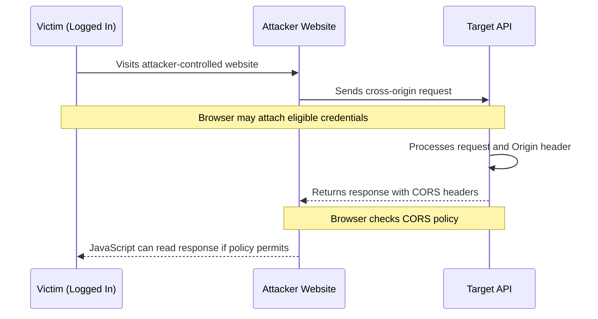

<Callout type="info">
**Cross-Origin Resource Sharing (CORS) misconfiguration** occurs when a server uses insecure headers to define which origins are allowed to access its resources. Depending on the configuration and the affected endpoint, this can allow unauthorized cross-origin access to sensitive user data.

CORS is a browser-enforced mechanism. It controls whether browser JavaScript can read a cross-origin response; it is not a replacement for server-side authentication or authorization.
</Callout>

---

## Background: SOP vs CORS

Before testing for CORS misconfigurations, it is important to understand the relationship between the **Same-Origin Policy (SOP)** and **CORS**. The two mechanisms work together to define what browser JavaScript may and may not read.

### Origin

An **origin** is defined by three components:

```text
Origin = Protocol (Scheme) + Host + Port
```

Example:

```text
https://example.com:443
```

- **Protocol:** `https`
- **Host:** `example.com`
- **Port:** `443`

If any of these components differs, the browser considers the two URLs **cross-origin**. Default ports are normalized, so `https://example.com` and `https://example.com:443` are the same origin.

### Same Origin vs Cross Origin

| Feature | Same Origin | Cross Origin |
| --- | --- | --- |
| Protocol | Must match | May differ |
| Host | Must match | May differ |
| Port | Must match (after default-port normalization) | May differ |
| Browser restriction | SOP permits same-origin access | SOP restricts access; CORS may grant permission |
| JavaScript response access | Generally allowed | Requires applicable CORS permission |
| Example | `/status` | `https://api.example.com/status` |

### Quick Origin Examples

| Comparison | Result |
| --- | --- |
| `https://example.com/page1` vs `https://example.com/page2` | Same-origin (path differs, origin matches) |
| `https://example.com` vs `https://api.example.com` | Cross-origin (host differs) |
| `http://example.com` vs `https://example.com` | Cross-origin (protocol differs) |
| `https://example.com:443` vs `https://example.com:8080` | Cross-origin (port differs) |

### JavaScript Example: Same Origin vs Cross Origin

The following two snippets use the same `XMLHttpRequest` code; only the request URL differs. The difference in behavior is exactly what SOP enforces and what CORS relaxes.

**Case 1 — Same-Origin request (SOP allows JavaScript to read the response):**

Page is loaded from `https://mywebsite.com/dashboard` and requests the relative URL `/status`, which the browser resolves to `https://mywebsite.com/status`.

```javascript
function httpreq() {
    var xhttp = new XMLHttpRequest();

    xhttp.onreadystatechange = function() {
        if (this.readyState == 4 && this.status == 200) {
            alert(this.responseText);
        }
    };

    xhttp.open("GET", "/status", true);
    xhttp.send();
}
```

```text
Page Origin:    https://mywebsite.com
Request Origin: https://mywebsite.com   (same origin)
```

<Callout type="success" title="Result">
  The request is **same-origin**. SOP allows JavaScript to read the server response without requiring CORS permission — `alert(this.responseText)` succeeds.
</Callout>

**Case 2 — Cross-Origin request (SOP blocks JavaScript from reading the response unless CORS permits it):**

The same page now requests an absolute URL on a different host.

```javascript
function httpreq() {
    var xhttp = new XMLHttpRequest();

    xhttp.onreadystatechange = function() {
        if (this.readyState == 4 && this.status == 200) {
            alert(this.responseText);
        }
    };

    xhttp.open("GET", "https://api.example.com/status", true);
    xhttp.send();
}
```

```text
Page Origin:    https://mywebsite.com
Request Origin: https://api.example.com   (different host → cross-origin)
```

<Callout type="warning" title="Result">
  The request is **cross-origin**. The browser may still send the request, but **SOP prevents JavaScript from reading the response** unless the server returns valid CORS headers (e.g. `Access-Control-Allow-Origin: https://mywebsite.com`). Without those headers, `alert(this.responseText)` either never fires or the body is hidden from JavaScript — this is exactly the situation a CORS misconfiguration weakens.
</Callout>

### SOP (Same-Origin Policy)

SOP is a browser security mechanism that prevents one website from freely reading responses belonging to another origin. It restricts cross-origin access to data through browser APIs.

<Callout type="danger" title="Security impact">
  SOP restricts cross-origin access to data through browser APIs. It does **not** universally prevent a website from **sending** requests to another origin, and it is not a replacement for server-side authorization or CSRF protection.
</Callout>

### CORS (Cross-Origin Resource Sharing)

CORS is the browser-enforced mechanism that allows a server to specify which external origins may access its responses through supported cross-origin APIs. A server signals permission via response headers such as:

```http
Access-Control-Allow-Origin: https://mywebsite.com
Access-Control-Allow-Credentials: true
```

The browser checks these headers before exposing the response to the requesting JavaScript.

<Note  title="Important distinction">
  CORS does not independently authenticate the requesting website or authorize an operation on the server. The server must still enforce authentication and authorization.
</Note>

### Core CORS Headers

The browser and server exchange a small set of CORS headers to negotiate cross-origin access. **Response headers** are set by the server; **request headers** are sent by the browser during a preflight. Each one answers a different question — open the tab for the header you want to inspect.

<Tabs>
  <Tab title="Access-Control-Allow-Origin">
    **Question it answers:** *"Which origin is allowed to read this response body from JavaScript?"*

    - **Side:** Server response header (returned in both the preflight response and the actual response).
    - **Purpose:** Specifies which origin is permitted to read the response body from JavaScript.
    - **Allowed values:**
      - `*` — any origin may read the response. **Only valid when credentials are NOT involved.**
      - A single specific origin, e.g. `https://mywebsite.com`. Must match scheme + host + port exactly.
      - The reflected value of the request's `Origin` header — i.e. the server echoes back whatever `Origin` the browser sent.
    - **Browser behavior:** The browser compares the request's `Origin` header to this response value. If they match (or the value is `*`), JavaScript may read the response body. If they do not match, the response body is hidden from JavaScript.
    - **No wildcard subdomains:** The CORS spec does **not** support patterns like `*.example.com`. You cannot write `Access-Control-Allow-Origin: *.example.com` — the browser will not interpret it as a wildcard. Each trusted origin must be returned explicitly, or the server must echo the request's `Origin` after validating it.
    - **Security note:** Reflecting the request's `Origin` back without validation is the most common CORS misconfiguration — it effectively tells the browser "any origin is allowed".
  </Tab>

  <Tab title="Access-Control-Allow-Credentials">
    **Question it answers:** *"May the cross-origin request carry the victim's cookies / HTTP auth / TLS client cert, and may the response be read when it does?"*

    - **Side:** Server response header (returned in both the preflight response and the actual response).
    - **Purpose:** Indicates whether the cross-origin request is permitted to include credentials — cookies, HTTP Authorization headers, or client-side TLS certificates.
    - **Allowed values:** Only the literal string `true`. Any other value, or the absence of the header, means credentials are not allowed.
    - **Browser behavior:** When the response contains `Access-Control-Allow-Credentials: true` AND the JavaScript request was made with `credentials: 'include'` AND the `Access-Control-Allow-Origin` value matches the request origin exactly, the browser will:
      - Attach the victim's cookies / HTTP-auth to the cross-origin request, AND
      - Allow JavaScript to read the response body.
    - **Critical rule:** When `Access-Control-Allow-Credentials: true` is returned, `Access-Control-Allow-Origin` **must be a specific origin** — it **cannot be `*`**. Modern browsers reject the combination `ACAO: *` + `ACAC: true` for credentialed requests.
    - **Security note:** This is the dangerous switch. Combined with a reflected `Access-Control-Allow-Origin`, it is what allows an attacker's page to read authenticated victim data cross-origin. Without `ACAC: true`, even a fully permissive `ACAO: *` cannot leak authenticated responses — the browser simply will not attach the victim's cookies to the cross-origin request in the first place.
  </Tab>

  <Tab title="Access-Control-Allow-Methods">
    **Question it answers:** *"Which HTTP methods may the actual cross-origin request use?"*

    - **Side:** Server response header (returned in the preflight response only).
    - **Purpose:** Returned in response to a CORS preflight (`OPTIONS`) request. Lists which HTTP methods are permitted for the actual cross-origin request that follows.
    - **Allowed values:** A comma-separated list, e.g. `GET, POST, PUT, DELETE, OPTIONS`. For **non-credentialed** requests only, `*` may be used to mean "any method".
    - **Browser behavior:** During a preflight, the browser sends `Access-Control-Request-Method: <method>`. The server replies with `Access-Control-Allow-Methods`. If the requested method appears in the list (or the response is `*` and credentials are not used), the browser proceeds with the actual request; otherwise the actual request is blocked at the preflight stage.
    - **Relevance:** This header only matters for **non-simple** requests — i.e. requests that trigger a preflight (e.g. `PUT`, `DELETE`, `PATCH`, or any method using custom/non-safelisted headers). Simple `GET`/`HEAD`/`POST` requests with safelisted content types and headers do **not** trigger a preflight, so this header is never consulted for them.
    - **Security note:** Returning a broad list (`GET, POST, PUT, PATCH, DELETE`) can enable cross-origin state-changing operations when paired with weak CSRF defenses. Restrict it to the methods the application actually needs to expose cross-origin.
  </Tab>

  <Tab title="Origin">
    **Question it answers:** *"Which origin is the JavaScript making this request running from?"*

    - **Side:** Browser request header (sent on every cross-origin CORS request, both simple and preflighted).
    - **Purpose:** Tells the server the origin of the page that initiated the request, so the server can decide whether to grant access.
    - **Format:** `scheme://host[:port]`, e.g. `https://mywebsite.com`. The browser always sets this header itself — JavaScript cannot forge or override it.
    - **Server behavior:** The server reads `Origin` from the request, validates it against its allowlist, and returns the matching `Access-Control-Allow-Origin` value in the response.
    - **Security note:** Because the browser controls this header, it is safe for the server to reflect it back into `Access-Control-Allow-Origin` — **only if** the server also validates that the origin is on its allowlist. Blind reflection is the most common CORS misconfiguration.
  </Tab>

  <Tab title="Access-Control-Request-Method">
    **Question it answers:** *"Which HTTP method will the actual (real) request use?"*

    - **Side:** Browser request header (sent **only during a CORS preflight**, `OPTIONS`).
    - **Purpose:** Tells the server which HTTP method the actual request is going to use, so the server can pre-approve or reject it before the browser wastes a real request.
    - **Format:** A single method name, e.g. `PUT`, `DELETE`, `PATCH`.
    - **Browser behavior:** When the browser decides a cross-origin request needs a preflight, it sends an `OPTIONS` request with `Access-Control-Request-Method: <method>`. The server replies with `Access-Control-Allow-Methods`. If the requested method is in the allowed list, the browser proceeds with the actual request; otherwise the actual request is blocked at the preflight stage.
    - **Relevance:** Only sent for preflighted requests. Simple `GET` / `HEAD` / `POST` requests do not include this header because they do not trigger a preflight.
  </Tab>

  <Tab title="Access-Control-Request-Headers">
    **Question it answers:** *"Which request headers will the actual (real) request carry?"*

    - **Side:** Browser request header (sent **only during a CORS preflight**, `OPTIONS`).
    - **Purpose:** Lists every custom / non-safelisted header the actual request intends to send, so the server can pre-approve or reject them via `Access-Control-Allow-Headers` before the browser sends the real request.
    - **Format:** A comma-separated list of header names (lowercased by the browser), e.g.:

      ```http
      Access-Control-Request-Headers: content-type, authorization, x-custom-token
      ```

      Note: despite the name "Headers" (plural), the entire list is sent in a single header line.
    - **Browser behavior:** During the preflight, the browser collects every header the actual request is going to use, filters out the CORS-safelisted ones (`Accept`, `Accept-Language`, `Content-Language`, `Content-Type` limited to `application/x-www-form-urlencoded` / `multipart/form-data` / `text/plain`), and lists the rest in `Access-Control-Request-Headers`. The server must reply with `Access-Control-Allow-Headers` containing all of them (or `*` for non-credentialed requests). If any requested header is missing from the allowed list, the preflight fails and the browser never sends the actual request.
    - **Companion relationship:** This header is the request-side counterpart of `Access-Control-Allow-Headers`:
      - Browser asks: *"can I send `Authorization` and `X-Custom-Token`?"* (via `Access-Control-Request-Headers`)
      - Server answers: *"yes, you may send `Authorization, X-Custom-Token`"* (via `Access-Control-Allow-Headers`)
    - **Relevance:** Only sent for preflighted requests. Simple `GET` / `HEAD` / `POST` requests with safelisted headers do not include this header.
    - **Testing note:** When testing with `curl`, you craft this header manually to simulate a browser preflight. The example in the `OPTIONS` test (Accordion 8 below) shows the typical pairing of `Access-Control-Request-Method` and `Access-Control-Request-Headers`.
  </Tab>

  <Tab title="Side-by-Side Reference">
    A full CORS preflight is a two-step negotiation between browser and server. The table below shows every header in the order it appears during the negotiation. Companion headers (`Access-Control-Allow-Headers`, `Access-Control-Expose-Headers`, `Access-Control-Max-Age`) are listed for completeness — the first three response headers above are the primary focus of credentialed CORS attacks.

    | Phase | Who sends it | Header | What it does |
    | --- | --- | --- | --- |
    | Preflight (request) | Browser | `Origin` | Identifies the calling origin |
    | Preflight (request) | Browser | `Access-Control-Request-Method` | "I want to use this HTTP method" |
    | Preflight (request) | Browser | `Access-Control-Request-Headers` | "I want to send these headers" |
    | Preflight (response) | Server | `Access-Control-Allow-Origin` | "Yes, this origin can read responses" |
    | Preflight (response) | Server | `Access-Control-Allow-Methods` | "Yes, these methods are allowed" |
    | Preflight (response) | Server | `Access-Control-Allow-Headers` | "Yes, these request headers are allowed" |
    | Preflight (response) | Server | `Access-Control-Allow-Credentials` | "Yes, credentials may be attached" |
    | Preflight (response) | Server | `Access-Control-Max-Age` | "Cache this preflight result for N seconds" |

    **Companion response headers (for completeness):**

    - **`Access-Control-Allow-Headers`** — returned in the preflight response; lists which request headers the actual cross-origin request is allowed to carry (e.g. `Content-Type`, `Authorization`, `X-Custom-Header`). Companion to `Access-Control-Allow-Methods`.
    - **`Access-Control-Expose-Headers`** — listed in the **actual** response; tells the browser which response headers (beyond the safelisted defaults of `Cache-Control`, `Content-Language`, `Content-Type`, `Expires`, `Last-Modified`, `Pragma`) JavaScript is allowed to read via `xhr.getResponseHeader()`.
    - **`Access-Control-Max-Age`** — how long (in seconds) the browser may cache the preflight result before re-preflighting.

    <Callout type="info" title="How they combine">
      - `Access-Control-Allow-Origin` alone (no credentials) → unauthenticated cross-origin read.
      - `Access-Control-Allow-Origin` + `Access-Control-Allow-Credentials: true` (origin matches exactly) → **authenticated cross-origin read** — the high-impact case.
      - `Access-Control-Allow-Methods` only gates **which HTTP verbs** a preflighted cross-origin request may use; it does not by itself grant read access to the response body.
    </Callout>

    <Callout type="info" title="Preflight is a negotiation">
      A CORS preflight is essentially a **two-step negotiation**: the browser asks "may I send this method, with these headers, from this origin?" and the server replies "yes / no, and here is what you may do". The actual request is sent only if the preflight answers permit it.
    </Callout>
  </Tab>
</Tabs>

### The Key Difference: Does CORS Block the Request?

<Callout  icon="key" color="#FFC107" iconType="regular">
  **Not always.** A browser may send a cross-origin request even if JavaScript will not be allowed to read its response.
</Callout >

- For **simple requests** (e.g. a cross-origin `GET`), the browser sends the request without a preflight. If the response lacks valid CORS headers, the browser still prevents JavaScript from **reading** the response.
- For **preflighted requests** (e.g. `PUT`, or non-safelisted headers), failed preflight validation prevents the browser from sending the actual request at all.

> CORS primarily controls whether browser JavaScript can **read a cross-origin response**, not necessarily whether the request is sent.

<Callout type="warning" title="CORS is not a universal request blocker">
  HTML forms and other browser mechanisms can send certain cross-origin requests without a CORS preflight. This is one reason CORS alone is not a CSRF defense.
</Callout>

### Why This Matters for CORS Misconfiguration Testing

- A misconfigured CORS policy relaxes SOP restrictions and may let attacker-controlled JavaScript read sensitive responses.
- The attack only matters when SOP would normally block access — i.e. **cross-origin** requests.
- Understanding origin components (scheme / host / port) is the foundation for recognizing whether two origins are truly different and whether a server's origin validation is correct.
- Neither SOP nor CORS replaces proper server-side authentication, authorization, or CSRF defenses.

<Danger title="Key takeaway">
  **SOP** protects users by restricting cross-origin access to data. **CORS** provides a controlled mechanism for servers to allow specific cross-origin response access. A CORS misconfiguration is dangerous precisely because it weakens this SOP protection.
</Danger>

---

## Attack Flow



The browser's Same-Origin Policy normally prevents a website from reading responses from a different origin. A permissive or incorrectly validated CORS policy can relax that restriction.

### Conditions for a Successful Attack

<Callout type="danger">
For a typical credentialed CORS data-exposure scenario, the following conditions generally need to be met:

1. **Reflected or improperly trusted origin:** The server reflects an arbitrary `Origin` value into `Access-Control-Allow-Origin`, or otherwise allows an origin controlled by the attacker.
2. **Credentials allowed:** The response includes `Access-Control-Allow-Credentials: true` when credentialed access is required.
3. **Sensitive endpoint:** The endpoint returns sensitive information, such as profile details, account data, or API information.
4. **Authenticated victim:** The victim has an active session, and the browser is permitted to send the relevant credentials.
5. **Browser-readable response:** The browser accepts the CORS response, allowing the attacker's JavaScript to read it.

These conditions depend on the application. For example, a public endpoint may expose data cross-origin without credentials, while cookie-based attacks may be limited by `SameSite` cookie settings or other browser protections.
</Callout>

## Pentest Methodology

1. **Map the application:** Identify API endpoints that return sensitive data, such as `/api/user` or `/account/details`.
2. **Establish a baseline:** Send a normal request without an `Origin` header and observe the response.
3. **Submit an arbitrary origin:** Test with `Origin: https://attacker.com`.
4. **Analyze the response:** Check whether the origin is reflected in `Access-Control-Allow-Origin` and whether `Access-Control-Allow-Credentials: true` is present.
5. **Test origin-validation logic:** In an authorized environment, check how the server handles untrusted origins, similar-looking domains, subdomains, and the special `null` origin.
6. **Verify browser behavior:** Confirm that a real browser allows the intended cross-origin JavaScript to read the response. A `curl` result alone cannot prove browser exploitability.

---

## Testing with curl: Comprehensive Cases

The following examples use placeholder domains. Run them only against systems you own or are explicitly authorized to assess.

<Accordion title="1. Baseline request without an Origin header">

```bash
curl -i https://api.victim.com/user/profile
```

**Look for:**

- The default response headers.
- Whether the endpoint returns sensitive data.
- Whether authentication is required.
- Whether the server includes any CORS headers by default.

A request without an `Origin` header helps establish baseline behavior, but does not test whether a browser will permit cross-origin access.
</Accordion>

<Accordion title="2. Test arbitrary Origin reflection">

```bash
curl -i \
  -H "Origin: https://attacker.com" \
  https://api.victim.com/user/profile
```

**Look for:**

```http
Access-Control-Allow-Origin: https://attacker.com
Access-Control-Allow-Credentials: true
```

If the server reflects an untrusted origin, investigate whether that origin is actually allowed to read sensitive responses in a browser.

Reflection by itself does not establish the full impact. Check the endpoint's sensitivity, credential requirements, and the browser's CORS enforcement.
</Accordion>

<Accordion title="3. Test the null Origin">

```bash
curl -i \
  -H "Origin: null" \
  https://api.victim.com/user/profile
```

**Look for:**

```http
Access-Control-Allow-Origin: null
```

Some browser contexts, including certain sandboxed documents and opaque origins, serialize their origin as `null`. A server that trusts `null` indiscriminately may expose data to untrusted documents.

A `curl` request can test the server's response to this header, but it does not reproduce the browser restrictions or prove that a particular sandboxed document can exploit the policy.
</Accordion>

<Accordion title="4. Test subdomain validation">

If the server is intended to trust only selected subdomains of `victim.com`, test whether its validation checks the parsed hostname correctly.

```bash
curl -i \
  -H "Origin: https://victim.com.attacker.com" \
  https://api.victim.com/user/profile
```

```bash
curl -i \
  -H "Origin: https://attacker.victim.com" \
  https://api.victim.com/user/profile
```

```bash
curl -i \
  -H "Origin: https://victim.com.evil.com" \
  https://api.victim.com/user/profile
```

**Look for:** An origin being accepted when it should be rejected.

The second example is a subdomain of `victim.com`, unlike the first and third examples. Whether it should be trusted depends on the application's actual allowlist.

A secure implementation should parse the origin and compare its scheme, hostname, and port against an explicit policy. Simple substring checks can accidentally trust domains such as `victim.com.attacker.com`.
</Accordion>

<Accordion title="5. Test trust in unallocated subdomains">

```bash
curl -i \
  -H "Origin: https://this-does-not-exist.victim.com" \
  https://api.victim.com/user/profile
```

**Look for:**

```http
Access-Control-Allow-Origin: https://this-does-not-exist.victim.com
```

If the server trusts every subdomain, investigate whether an attacker could control an accepted subdomain. A dangling DNS record or subdomain takeover can sometimes make this possible.

Do not assume that a reflected origin means the subdomain is available for registration. Confirm DNS records, hosting configuration, and ownership through authorized testing.
</Accordion>

<Accordion title="6. Test HTTP versus HTTPS origin trust">

```bash
curl -i \
  -H "Origin: http://victim.com" \
  https://api.victim.com/user/profile
```

**Look for:**

```http
Access-Control-Allow-Origin: http://victim.com
```

If the application is intended to trust only `https://victim.com`, accepting the HTTP origin may violate its security policy.

The impact depends on whether an attacker can cause a browser to use that origin and whether the relevant credentials and network conditions permit the attack. Acceptance of an HTTP origin does not automatically demonstrate a successful man-in-the-middle attack.
</Accordion>

<Accordion title="7. Test with an authenticated session">

In an authorized test environment, use a test account and a valid test session cookie:

```bash
curl -i \
  -H "Origin: https://attacker.com" \
  -H "Cookie: session=YOUR_TEST_SESSION" \
  https://api.victim.com/user/profile
```

**Look for:**

- Whether the endpoint returns authenticated account data.
- Whether `Access-Control-Allow-Origin` allows the test origin.
- Whether `Access-Control-Allow-Credentials: true` is present.

This command simulates sending a cookie with `curl`. It does not reproduce browser cookie rules, including `SameSite`, third-party cookie restrictions, or browser CORS enforcement.

Never place real users' session cookies in testing notes, logs, or shared terminal history.
</Accordion>

<Accordion title="8. Test preflight requests with OPTIONS">

For requests that require a CORS preflight, browsers send an `OPTIONS` request before the actual request.

```bash
curl -i -X OPTIONS \
  -H "Origin: https://attacker.com" \
  -H "Access-Control-Request-Method: PUT" \
  -H "Access-Control-Request-Headers: Content-Type" \
  https://api.victim.com/user/profile
```

**Look for:**

```http
Access-Control-Allow-Origin: https://attacker.com
Access-Control-Allow-Methods: PUT
Access-Control-Allow-Headers: Content-Type
```

For credentialed access, also inspect:

```http
Access-Control-Allow-Credentials: true
```

A preflight is required for certain cross-origin requests, such as requests using `PUT` or non-safelisted headers. It is not required for every cross-origin request.

A successful preflight does not prove that the actual request will succeed or that its response contains sensitive data. Test the full browser request flow.
</Accordion>

<Accordion title="9. Test trust in third-party hosting origins">

Check whether the application trusts origins hosted on third-party platforms when such trust is not necessary.

```bash
curl -i \
  -H "Origin: https://attacker-bucket.s3.amazonaws.com" \
  https://api.victim.com/user/profile
```

```bash
curl -i \
  -H "Origin: https://attacker.github.io" \
  https://api.victim.com/user/profile
```

**Look for:** The server accepting an origin hosted on a third-party platform.

A broad trust rule can be dangerous if users can create content or control sites under an accepted origin. However, the fact that a service supports user-hosted content does not automatically make every origin on that service trusted by the target.

Verify the exact allowlist behavior and whether an attacker can control content at an origin that the target accepts.
</Accordion>

---

## Browser Limitations

<Callout type="warning">
Modern browsers reject a credentialed CORS response when it combines:

```http
Access-Control-Allow-Origin: *
Access-Control-Allow-Credentials: true
```

For credentialed CORS requests, the server must return a specific allowed origin rather than the wildcard `*`.

If the server reflects the attacker's exact origin and also permits credentials, the browser may allow the attacker's JavaScript to read the response, provided the remaining CORS requirements and credential rules are satisfied.

`curl` does not enforce these browser rules. Inspecting response headers with `curl` is a diagnostic step, not proof of a successful browser-based exploit.
</Callout>

Other browser and application controls can affect exploitability:

- Cookie `SameSite` attributes and third-party cookie restrictions.
- Whether the endpoint requires authentication.
- Whether the response includes sensitive data.
- Whether the request requires a successful preflight.
- Whether the target's origin validation is correct.
- Whether the attacker can host content at an origin that the target trusts.

---

## Proof of Concept (PoC) JavaScript

The following example is intended for an authorized lab using a test account. It displays the response locally so the tester can verify whether browser JavaScript can read it. It does not transmit the response to a third-party collection endpoint.

Save it as `poc.html` and serve it from a separate test origin, such as `http://localhost:8000`, while testing against an application you control.

<Accordion title="HTML and JavaScript PoC">

```html
<!DOCTYPE html>
<html lang="en">
<head>
  <meta charset="UTF-8">
  <meta name="viewport" content="width=device-width, initial-scale=1">
  <title>CORS Misconfiguration PoC</title>
</head>
<body>
  <h2>CORS Misconfiguration PoC</h2>
  <p id="status">Testing cross-origin access...</p>
  <pre id="result"></pre>

  <script>
    const targetUrl = "https://api.victim.com/user/profile";
    const status = document.getElementById("status");
    const result = document.getElementById("result");

    fetch(targetUrl, {
      method: "GET",
      credentials: "include"
    })
      .then(async (response) => {
        const body = await response.text();

        if (!response.ok) {
          status.textContent =
            `The request completed with HTTP ${response.status}.`;
        } else {
          status.textContent =
            "The browser allowed JavaScript to read the response.";
        }

        result.textContent = body;
      })
      .catch((error) => {
        status.textContent =
          "The browser could not complete a readable CORS request.";
        result.textContent = String(error);
      });
  </script>
</body>
</html>
```

**Expected behavior:** If the browser permits the credentialed cross-origin request, the response body appears in the page. Otherwise, the browser may block JavaScript from reading the response.

Replace `https://api.victim.com/user/profile` with an endpoint in your authorized test environment. The browser must also be able to send the relevant credentials for an authenticated scenario.
</Accordion>

---

## Remediation

<Info type="success">
- **Validate origins against a strict allowlist.** Compare parsed scheme, hostname, and port instead of using substring matching or blindly reflecting the `Origin` header.
- **Avoid credentialed CORS unless necessary.** Set `Access-Control-Allow-Credentials: true` only when the application genuinely requires credentialed cross-origin access.
- **Do not trust `null` by default.** Only permit opaque origins when there is a specific, reviewed requirement.
- **Use explicit origin policies.** Avoid broad trust in arbitrary subdomains or third-party hosting platforms.
- **Return appropriate CORS headers.** Do not grant untrusted origins access to sensitive responses.
- **Enforce authentication and authorization on the server.** CORS is not a substitute for access control.
- **Test preflight and actual requests.** Verify allowed origins, methods, headers, and credential behavior.
- **Use `Vary: Origin` when responses vary by origin.** This helps prevent shared caches from serving a response generated for one origin to another.
- **Review CORS policies regularly.** Remove unused origins and document why each trusted origin is required.
</Info>

## Summary

<Check icon="book">
CORS is a browser-enforced policy, not a server-side authorization mechanism.

If a server trusts an attacker-controlled origin and allows that origin to read a sensitive response using the victim's credentials, the result can be unauthorized cross-origin data exposure.

The real impact depends on the endpoint, origin-validation logic, authentication, cookie policy, and browser behavior. A misconfigured header is a finding; a demonstrated ability to read sensitive data establishes its practical impact.
</Check>
