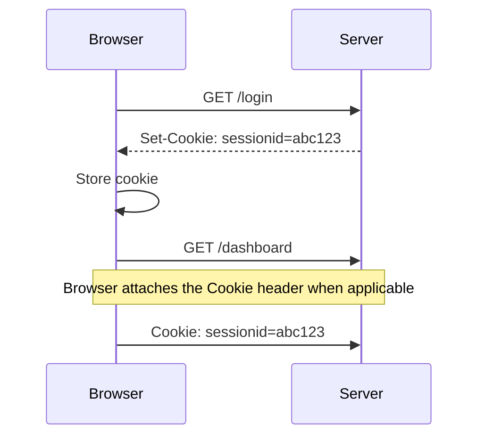
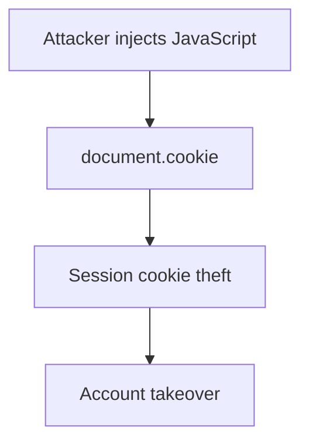
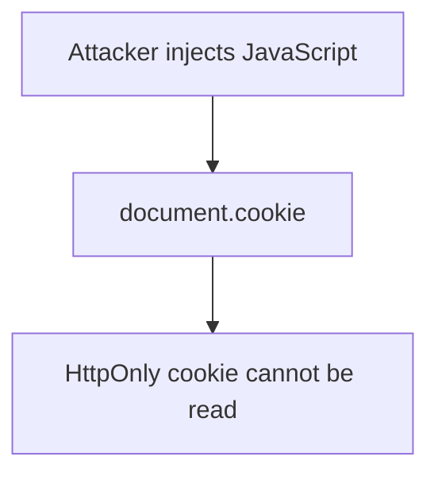
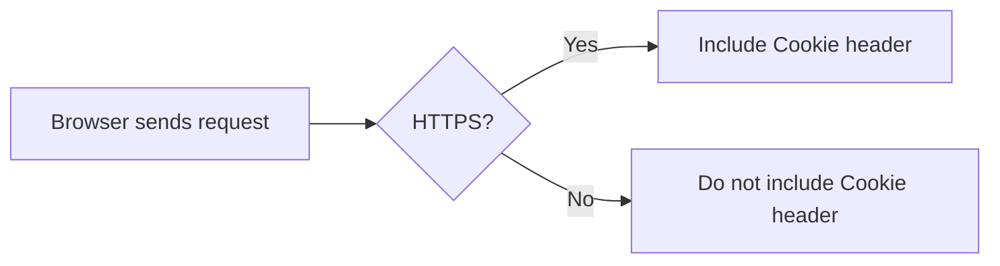
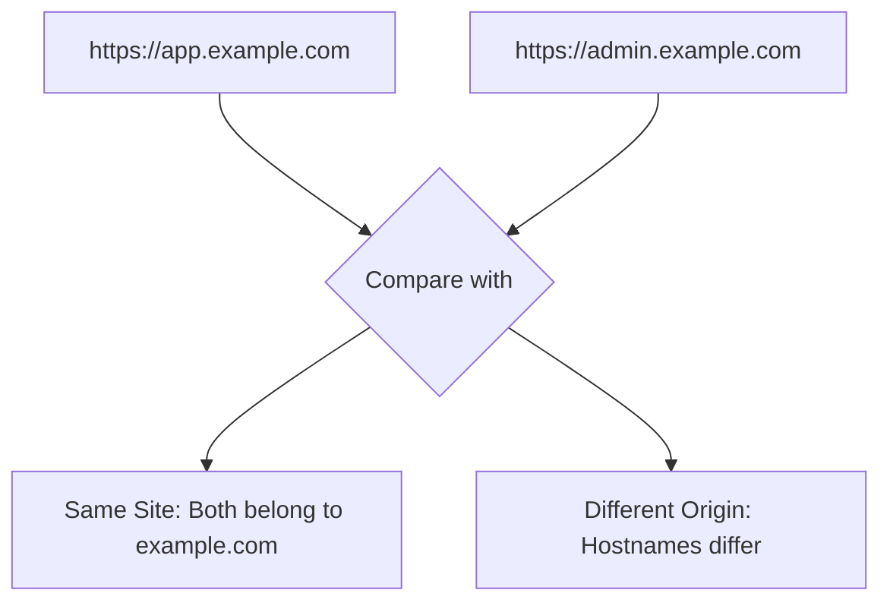
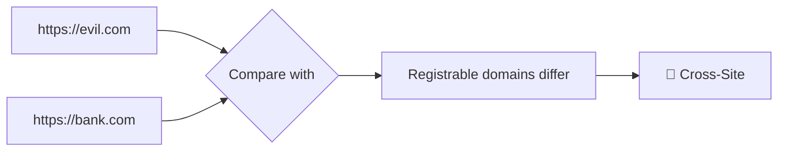
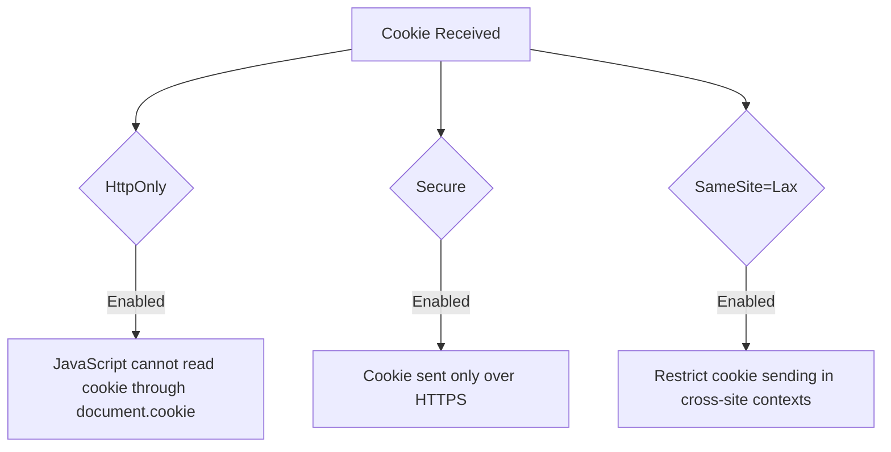

# HTTP Cookie Security Attributes

HTTP cookies are created by the server using the `Set-Cookie` response header. The server can attach security attributes to control how browsers store and send cookies.

<Accordion title="Example: Set-Cookie Response">
```http
HTTP/1.1 200 OK
Set-Cookie: sessionid=abc123; HttpOnly; Secure; SameSite=Lax
```
</Accordion>

The browser receives the cookie and stores both the value and its security attributes.

<Accordion title="Example: Browser Stores Cookie">
```text
Cookie Name:
sessionid

Cookie Value:
abc123

Security Attributes:
HttpOnly
Secure
SameSite=Lax
```
</Accordion>

The browser does **not** send these attributes back to the server. They are internal rules enforced by the browser. Future requests contain only the cookie name and value:

<Accordion title="Example: Cookie Request">
```http
GET /dashboard HTTP/1.1
Host: example.com
Cookie: sessionid=abc123
```
</Accordion>

---

<Accordion title="Cookie Lifecycle">



</Accordion>

---

# HttpOnly

<Accordion title="What is HttpOnly?">

`HttpOnly` is a cookie attribute that prevents JavaScript running in the browser from accessing the cookie value through APIs such as `document.cookie`.

</Accordion>

<Accordion title="Example: HttpOnly Cookie">

```http
Set-Cookie: sessionid=abc123; HttpOnly
```

</Accordion>

Normally, JavaScript can access cookies that are not marked `HttpOnly` and are otherwise accessible to the current document.

<Accordion title="Without HttpOnly">

```javascript
document.cookie
```

Output:

```text
sessionid=abc123
```

</Accordion>

When `HttpOnly` is enabled:

<Accordion title="With HttpOnly">

```javascript
document.cookie
```

Output:

```text
sessionid is not visible
```

</Accordion>

<Callout type="info" title="Security Purpose">
HttpOnly reduces the impact of Cross-Site Scripting (XSS) attacks by preventing attackers from directly reading and stealing session cookies through JavaScript.
</Callout>

<Accordion title="Without HttpOnly: Potential Attack Flow">



</Accordion>

<Accordion title="With HttpOnly: Cookie Reading Blocked">



</Accordion>

<Callout type="warning" title="Important Note">
HttpOnly does not completely stop XSS attacks.

An attacker may still perform actions on behalf of the victim because the browser can automatically attach cookies to requests that satisfy the cookie's sending rules.
</Callout>

Example:

```javascript
fetch("/profile/change-email")
```

The browser may automatically send:

```http
Cookie: sessionid=abc123
```

---

# Secure

<Accordion title="What is Secure?">

The `Secure` attribute instructs the browser to send the cookie only over secure HTTPS connections.
</Accordion>

<Accordion title="Example: Secure Cookie">

```http
Set-Cookie: sessionid=abc123; Secure
```

</Accordion>



<Callout type="info" title="Security Purpose">
Secure prevents cookies marked with this attribute from being transmitted over unencrypted HTTP connections.
</Callout>

---

# Same-Origin

<Accordion title="Same-Origin Definition">

Two URLs are considered **same-origin** only when all three components are identical:

```text
Scheme + Host + Port
```

The browser compares:

- **Scheme**: Protocol, such as `http` or `https`
- **Host**: Hostname, such as `app.example.com`
- **Port**: Network port, such as `443` or `8080`

</Accordion>

<Accordion title="Different Host">

```text
https://app.example.com:443

https://admin.example.com:443
```

Comparison:

```text
Scheme  ✔  https
Host    ✘  app.example.com ≠ admin.example.com
Port    ✔  443
```

Result:

```text
🔴 Different Origin
```

Because the hostname is different.

</Accordion>

<Accordion title="Different Port">

```text
https://app.example.com:443

https://app.example.com:8443
```

Comparison:

```text
Scheme  ✔  https
Host    ✔  app.example.com
Port    ✘  443 ≠ 8443
```

Result:

```text
🔴 Different Origin
```

Because the port is different.

</Accordion>

<Accordion title="Different Scheme">

```text
https://app.example.com

http://app.example.com
```

Comparison:

```text
Scheme  ✘  https ≠ http
Host    ✔  app.example.com
Port    ✘  443 ≠ 80
```

Result:

```text
🔴 Different Origin
```

Because the protocol scheme is different. The default port also differs: HTTPS normally uses `443`, while HTTP normally uses `80`.

</Accordion>

<Accordion title="Same-Origin Examples">

| URL | Result |
|---|---|
| `https://app.example.com:443` | Same Origin |
| `https://app.example.com:8443` | Different Origin |
| `http://app.example.com` | Different Origin |
| `https://admin.example.com:443` | Different Origin |

</Accordion>

---

# Same-Site

<Accordion title="Same-Site Definition">

Two URLs are generally considered **same-site** when they share the same scheme and registrable domain, commonly described as the effective top-level domain plus one label (**eTLD+1**).

```text
Site = Scheme + Registrable Domain
```

Unlike Same-Origin, different subdomains can still belong to the same site.

</Accordion>

<Accordion title="Same-Site Example">

```text
https://app.example.com

https://admin.example.com

https://shop.example.com
```

All belong to the site:

```text
https://example.com
```

Comparison:

```text
Registrable Domain  ✔  example.com
Subdomain           ✔  Different subdomains are allowed
```

Result:

```text
🔵 Same Site
```

</Accordion>

<Accordion title="Same-Site Examples">

| URL | Site |
|---|---|
| `https://app.example.com` | `https://example.com` |
| `https://admin.example.com` | `https://example.com` |
| `https://shop.example.com` | `https://example.com` |

</Accordion>

<Callout type="warning" title="Same-Site ≠ Same-Origin">
Two URLs can be **Same-Site** but still have **Different Origins**.
</Callout>



---

# Cross-Site

<Accordion title="Cross-Site Example">

Two URLs are considered **cross-site** when they belong to different sites, generally determined by their scheme and registrable domain.

</Accordion>



---

# SameSite Cookie Modes

<Callout type="info" title="SameSite Values">
The `SameSite` attribute controls cookie behavior in same-site and cross-site contexts.
</Callout>

Available values:

```text
Strict
Lax
None
```

## SameSite=Strict

<Accordion title="Strict Mode">

`SameSite=Strict` provides the strongest restriction on cross-site cookie sending.

The browser generally sends the cookie only in same-site contexts.

</Accordion>

<Accordion title="Same-Site Request">

```text
https://bank.com
       |
       v
https://bank.com/account
```

Cookie:

```text
✅ Sent
```

</Accordion>

<Accordion title="Cross-Site Request">

```text
https://evil.com
       |
       v
https://bank.com
```

Cookie:

```text
❌ Blocked
```

</Accordion>

<Callout type="success" title="Advantages">

- Strong CSRF protection when used appropriately
- Restricts cross-site cookie usage

</Callout>

<Callout type="warning" title="Disadvantages">

- May break login flows
- May affect external redirects and third-party integrations

</Callout>

---

## SameSite=Lax

<Callout type="info" title="Lax Mode">
`SameSite=Lax` provides a balance between security and usability.

The browser allows cookies during qualifying top-level navigations, typically when following a link, but blocks cookies in many cross-site subrequests and state-changing requests.
</Callout>

<Accordion title="Top-Level Navigation">

User clicks a link:

```text
https://evil.com
         |
         v
https://bank.com
```

Cookie:

```text
✅ Generally sent for a qualifying top-level safe navigation
```

</Accordion>

<Accordion title="Cross-Site POST Request">

Example:

```http
POST /change-password HTTP/1.1
Host: bank.com
```

Request origin:

```text
https://evil.com
```

Cookie:

```text
❌ Generally blocked under SameSite=Lax
```

</Accordion>

<Callout type="success" title="Default Browser Behavior">
Modern browsers commonly use `SameSite=Lax` as the default behavior when a cookie does not explicitly specify a `SameSite` value. Exact behavior can vary by browser and implementation.

It provides reasonable CSRF mitigation while keeping normal website navigation working.
</Callout>

---

## SameSite=None

<Accordion title="None Mode">

`SameSite=None` allows cookies to be sent in cross-site contexts, subject to other browser policies and cookie restrictions.

Example:

```http
Set-Cookie: sessionid=abc123; SameSite=None; Secure
```

</Accordion>

<Accordion title="Cross-Site Cookie Request">

```text
https://website-a.com
         |
         v
https://website-b.com
```

Cookie:

```text
✅ Eligible to be sent, subject to browser policies
```

</Accordion>

<Accordion title="Common Use Cases">

`SameSite=None` is commonly used for:

- Single Sign-On (SSO)
- Third-party authentication
- Embedded applications
- Cross-domain services

</Accordion>

<Callout type="warning" title="Security Requirement">
`SameSite=None` requires the `Secure` attribute in modern browsers.

**Correct:**

```http
Set-Cookie: sessionid=abc123; SameSite=None; Secure
```

**Incorrect:**

```http
Set-Cookie: sessionid=abc123; SameSite=None
```

Modern browsers generally reject cookies that specify `SameSite=None` without `Secure`.
</Callout>

---

# Cookie Attribute Comparison

| Attribute | Purpose |
|---|---|
| `HttpOnly` | Prevents JavaScript access to cookies through APIs such as `document.cookie` |
| `Secure` | Restricts cookie transmission to secure HTTPS connections |
| `SameSite=Strict` | Restricts cookie sending to same-site contexts |
| `SameSite=Lax` | Allows qualifying top-level navigations while restricting many cross-site requests |
| `SameSite=None` | Allows cross-site cookie usage, subject to browser policies, and requires `Secure` |

---

# Complete Secure Cookie Example

<Accordion title="Recommended Session Cookie">

```http
Set-Cookie: sessionid=random_value; HttpOnly; Secure; SameSite=Lax
```

</Accordion>

Cookie behavior:

<Accordion title="Browser Cookie Security Checks">



</Accordion>

---

# Summary

<Accordion title="Cookie Security Summary">

| Attribute | Browser Behavior |
|---|---|
| `HttpOnly` | JavaScript cannot read the cookie through `document.cookie` |
| `Secure` | Cookie is transmitted only over HTTPS |
| `SameSite=Strict` | Cookie is restricted to same-site contexts |
| `SameSite=Lax` | Cookie is allowed for qualifying top-level navigation but restricted in many cross-site requests |
| `SameSite=None` | Cookie can be sent cross-site and requires `Secure` |

</Accordion>

---

# Final Cookie Flow

<Accordion title="Complete Cookie Lifecycle">

```mermaid
sequenceDiagram
    participant Browser
    participant Server

    Browser->>Server: GET /login
    Server-->>Browser: Set-Cookie: sessionid=abc123; HttpOnly; Secure; SameSite=Lax

    Browser->>Browser: Store cookie and security attributes

    Browser->>Server: GET /dashboard
    Note over Browser,Server: Cookie is attached when its rules permit
    Browser->>Server: Cookie: sessionid=abc123
```

</Accordion>

---

<Callout type="warning" title="Important Security Note">
Cookie attributes are enforced by the browser.

The server sends:

```http
Set-Cookie: sessionid=abc123; HttpOnly; Secure; SameSite=Lax
```

The browser decides:

- Can JavaScript read the cookie?
- Should it be sent over HTTP or HTTPS?
- Should it be included in cross-site requests?

The server receives the cookie name and value in a subsequent request:

```http
Cookie: sessionid=abc123
```

The cookie's security attributes are not echoed back in the `Cookie` request header.
</Callout>
