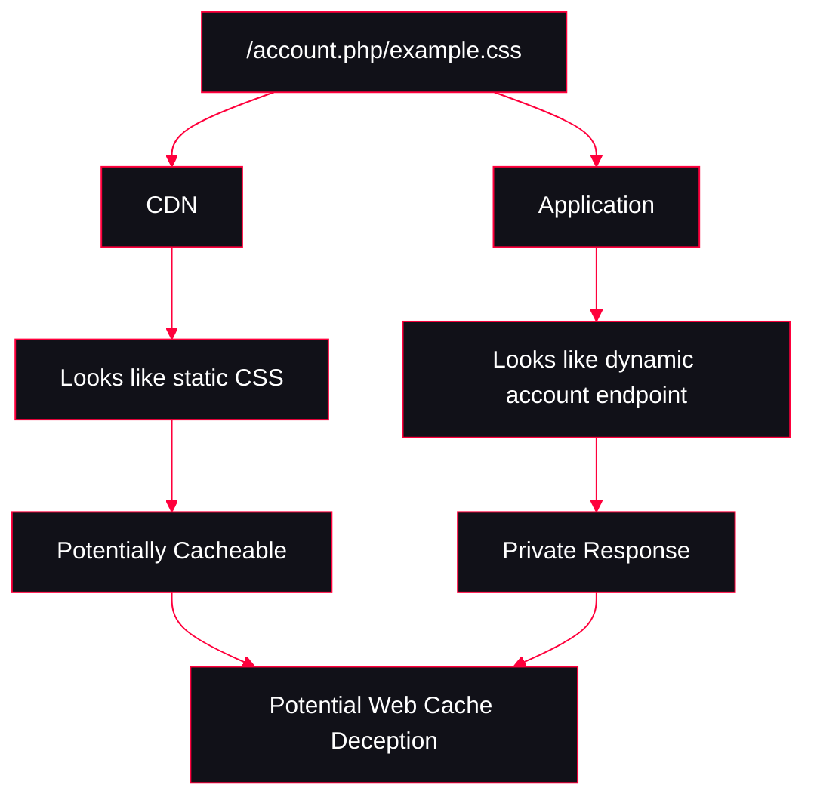
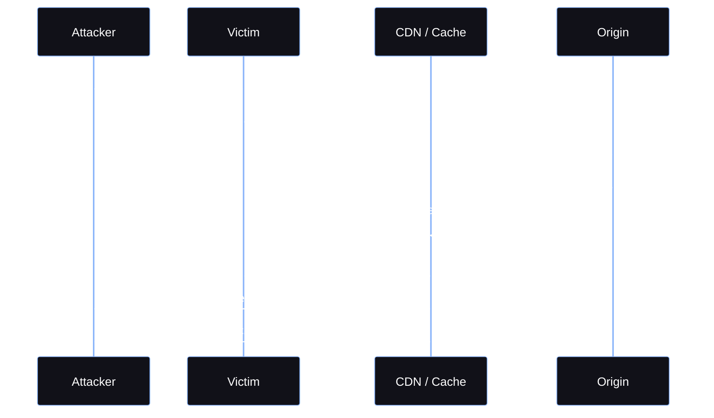
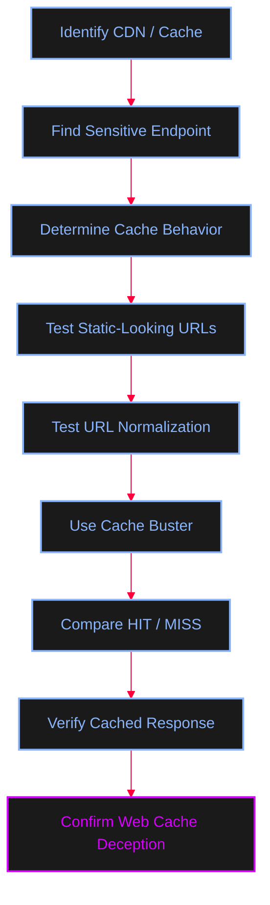

<Callout type="info" title="Overview">
**Web Cache Deception (WCD)** is a vulnerability that occurs when the **application** and the **web cache** interpret the same URL differently.

The application may treat a request as a dynamic, private resource, while the cache incorrectly treats it as a static resource and stores the resulting response.

An attacker can exploit this behavior by causing a victim to request a crafted URL while authenticated. If the victim's sensitive response is cached, the attacker may then request the same URL and retrieve the cached information.
</Callout>

---

## Web Cache Fundamentals

A **web cache** stores responses so that subsequent requests can be served faster without contacting the origin server every time.

<AccordionGroup>
  <Accordion title="Cache Miss vs Cache Hit">
    **Cache Miss:**
    ```mermaid
    %%{init: {'theme': 'base', 'themeVariables': { 'background': '#050505', 'primaryColor': '#111118', 'edgeLabelBackground':'#050505', 'primaryTextColor': '#ffffff', 'primaryBorderColor': '#FF003C', 'lineColor': '#FF003C', 'fontFamily': 'monospace' }}}%%
    flowchart LR
        A[Client] --> B[CDN / Cache]
        B -->|Cache Miss| C[Origin Server]
        C --> B
        B --> A
    ```
    
    **Cache Hit:**
    ```mermaid
    %%{init: {'theme': 'base', 'themeVariables': { 'background': '#050505', 'primaryColor': '#111118', 'edgeLabelBackground':'#050505', 'primaryTextColor': '#ffffff', 'primaryBorderColor': '#FF003C', 'lineColor': '#FF003C', 'fontFamily': 'monospace' }}}%%
    flowchart LR
        A[Client] --> B[CDN / Cache]
        B -->|Cache Hit| A
    ```
    A cache determines whether two requests correspond to the same stored response using a **cache key**.
  </Accordion>
</AccordionGroup>

---

## The Vulnerability: Path Mapping Discrepancy

The key concept behind many Web Cache Deception vulnerabilities is **path mapping**. The **cache** and the **application** may interpret the same URL differently.

<Callout type="warning" title="Application vs Cache Interpretation">

If the cache stores the private response, the attacker may later retrieve it using the same URL.
</Callout>

<Tabs>
  <Tab title="Case 1: `/profile/something.css`">
    Consider the following Django URL configuration:
    ```python
    [ ... ]
    from django.contrib import admin
    from django.urls import path

    urlpatterns = [
        path('^profile/', admin.site.urls),
    ]
    ```
    The application handles paths beginning with `/profile/`. Therefore, a request such as `GET /profile/something.css` may be mapped to the application route. The cache may look at the `.css` extension and interpret the URL as a static resource.

    ```mermaid
    %%{init: {'theme': 'base', 'themeVariables': { 'background': '#050505', 'primaryColor': '#111118', 'edgeLabelBackground':'#050505', 'primaryTextColor': '#ffffff', 'primaryBorderColor': '#FF003C', 'lineColor': '#FF003C', 'fontFamily': 'monospace' }}}%%
    flowchart LR
        A["/profile/something.css"] --> B[CDN / Cache]
        A --> C[Django Application]

        B --> D["Sees .css"]
        C --> E["Matches profile/ route"]

        D --> F["Static-looking resource"]
        E --> G["Dynamic application response"]

        F --> H["Potentially Cacheable"]
        G --> I["Private Response"]
    ```
  </Tab>
  <Tab title="Case 2: `/profile.css`">
    Now consider a slightly different URL configuration:
    ```python
    """mysite URL Configuration
    [ ... ]
    from django.contrib import admin
    from django.urls import path

    urlpatterns = [
        path('^profile', admin.site.urls),
    ]
    ```
    The route does **not require a `/` immediately after `profile`**. Therefore, a request such as `GET /profile.css` may match the `profile` route. The cache, however, may see `.css` and interpret the resource as a static CSS file.

    ```mermaid
    %%{init: {'theme': 'base', 'themeVariables': { 'background': '#050505', 'primaryColor': '#111118', 'edgeLabelBackground':'#050505', 'primaryTextColor': '#ffffff', 'primaryBorderColor': '#FF003C', 'lineColor': '#FF003C', 'fontFamily': 'monospace' }}}%%
    flowchart LR
        A["/profile.css"] --> B[CDN / Cache]
        A --> C[Django Application]

        B --> D["Sees .css"]
        C --> E["Matches profile route"]

        D --> F["Static-looking resource"]
        E --> G["Dynamic application response"]

        F --> H["Potentially Cacheable"]
        G --> I["Private Response"]
    ```
  </Tab>
</Tabs>

<Callout type="danger" title="The Important Difference">
The important security concept is not the specific Django syntax itself, but the **path-mapping discrepancy** between the cache and the origin application.

```text
         SAME URL
            │
      ┌─────┴─────┐
      ↓           ↓
    CACHE     APPLICATION
      │           │
      ↓           ↓
  Static URL   Dynamic URL
      │           │
      └─────┬─────┘
            ↓
     Parser / Mapping
       Discrepancy
            ↓
      Potential WCD
```
</Callout>

---

## Attack Scenario

A typical attack consists of tricking an authenticated victim into requesting a URL whose response can be stored in a shared cache.



---

## Detection Methodology

<Steps>
  <Step title="Step 1: Identify CDN / Cache">
    Determine whether the target uses a **CDN or shared caching layer**. Find an obvious static resource (e.g., `/static/app.js`) and inspect response headers and timing for evidence of caching.
    ```http
    X-Cache: HIT
    X-Cache: MISS
    ```
  </Step>
  
  <Step title="Step 2: Find Sensitive Endpoints">
    Look for APIs and dynamic endpoints that return user-specific information:
    ```text
    /account
    /profile
    /api/user
    /api/auth/session
    /backend-api/...
    ```
  </Step>
  
  <Step title="Step 3: Make the Endpoint Look Static">
    Try controlled URL variations that make a dynamic endpoint resemble a static resource:
    ```text
    /account/example.css
    /profile/example.js
    /api/user/example.png
    ```
    The goal is to determine whether the application continues to return the dynamic response while the CDN treats the URL as cacheable.
  </Step>
  
  <Step title="Step 4: Test URL Normalization & Bypasses">
    If a particular extension is blocked or normalized, test different URL representations to identify discrepancies between the cache and origin server.
    ```text
    /account/example%2ecss
    /account/example/;test.css
    /account/example/!test.css
    /account/example/.css
    ```
  </Step>
  
  <Step title="Step 5: Encoding and Parser Differences">
    Encoded characters and unusual path structures can expose differences between CDN and origin-server parsing.
    ```text
    /backend-api/conversations%0A%0D-testtest.css
    /api/auth/%0A%0D%09session.css
    ```
  </Step>
  
  <Step title="Step 6: Use Cache Buster & Tools">
    Use a **cache buster** (e.g., `?cb=unique-value`) to ensure each test request uses a unique cache key. Utilize tools like **Param Miner** or **Web Cache Deception Scanner** in Burp Suite to automate detection.
  </Step>
</Steps>



---

## Tools & Resources

<CardGroup cols={2}>
  <Card title="PortSwigger Web Security Academy" href="https://portswigger.net/web-security/web-cache-deception" icon="graduation-cap">
    Learn the fundamentals of Web Cache Deception.
  </Card>
  <Card title="Gotta Cache 'Em All" href="https://portswigger.net/research/gotta-cache-em-all" icon="search">
    PortSwigger Research on caching techniques.
  </Card>
  <Card title="Param Miner" href="https://github.com/PortSwigger/param-miner" icon="github">
    Burp Suite extension for finding hidden parameters and cache issues.
  </Card>
  <Card title="Web Cache Deception Scanner" href="https://github.com/PortSwigger/web-cache-deception-scanner" icon="github">
    Burp Suite extension specifically designed to test for WCD.
  </Card>
</CardGroup>
