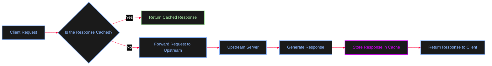
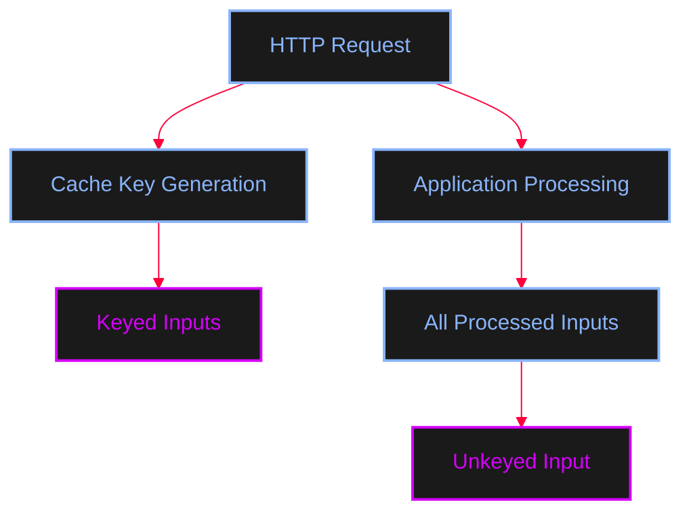
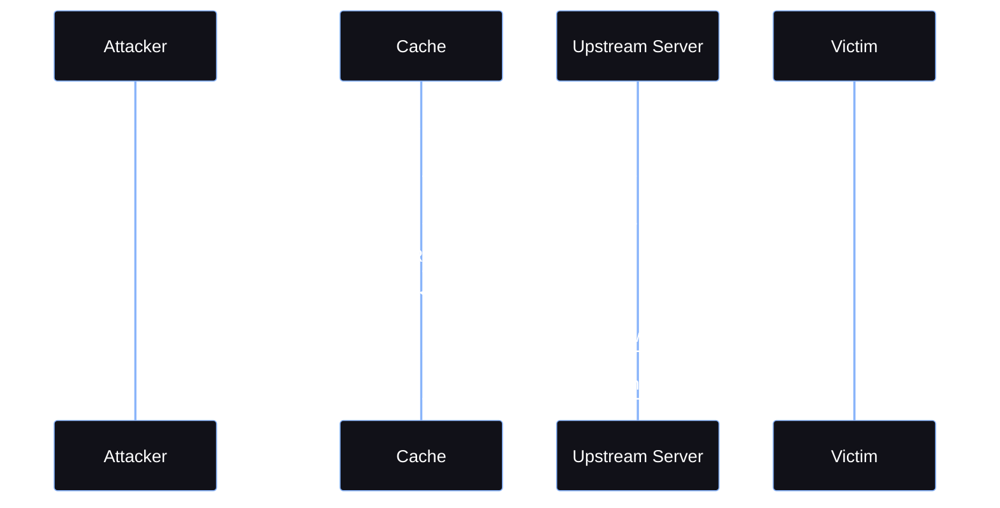
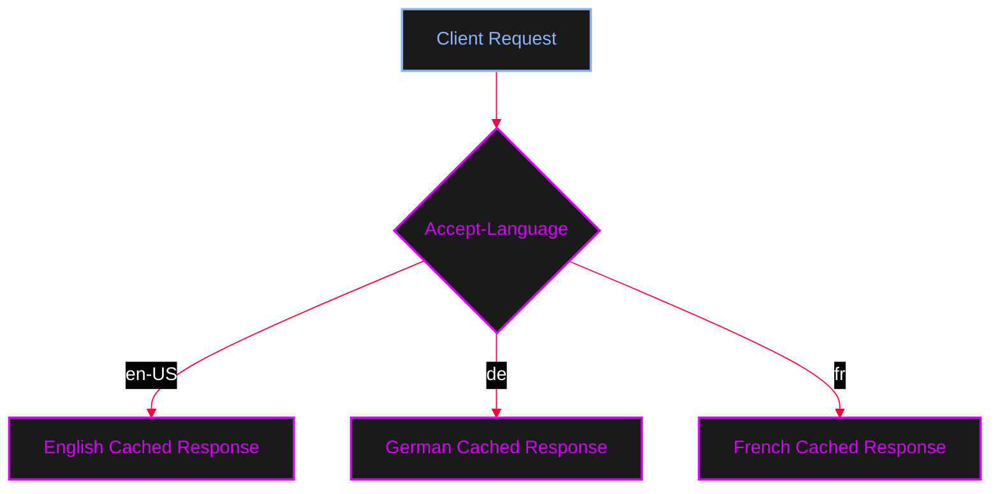

<Callout type="info" title="Overview">
Before exploring **Web Cache vulnerabilities**, it is important to understand how web caching and **Content Delivery Networks (CDNs)** work.

A **CDN (Content Delivery Network)** is a distributed network of servers designed to deliver web content efficiently to users. Instead of every user communicating directly with the origin server, a CDN can serve cached content from a server that is closer to the user.

CDNs use factors such as:
* The user's geographical location
* The location of the origin server
* The availability and location of CDN servers

One of the primary functions of a CDN is **caching**.

**Caching** involves storing copies of responses or resources so that future requests can be served faster without always contacting the upstream or origin server.
</Callout>

---

## Cache Hit vs Cache Miss

When a client sends a request, the cache checks whether a matching response already exists.

<Tabs>
  <Tab title="Cache Miss">
    A **Cache Miss** occurs when no matching cached response is available. The cache forwards the request to the upstream server.

    ```mermaid
    %%{init: {'theme': 'base', 'themeVariables': { 'background': '#050505', 'primaryColor': '#111118', 'edgeLabelBackground':'#050505', 'primaryTextColor': '#ffffff', 'primaryBorderColor': '#FF003C', 'lineColor': '#FF003C', 'fontFamily': 'monospace' }}}%%
    flowchart LR
        A[Client] --> B[CDN / Cache Server]
        B -->|Cache Miss| C[Upstream / Origin Server]
        C --> B
        B --> A
        
        classDef default fill:#111118,stroke:#585b70,stroke-width:1px,color:#ffffff;
        classDef action fill:#1a1a1a,stroke:#89b4fa,stroke-width:2px,color:#89b4fa;
        
        class A,B,C action;
    ```
  </Tab>
  <Tab title="Cache Hit">
    A **Cache Hit** occurs when a matching cached response already exists. The cache returns the stored response directly.

    ```mermaid
    %%{init: {'theme': 'base', 'themeVariables': { 'background': '#050505', 'primaryColor': '#111118', 'edgeLabelBackground':'#050505', 'primaryTextColor': '#ffffff', 'primaryBorderColor': '#FF003C', 'lineColor': '#FF003C', 'fontFamily': 'monospace' }}}%%
    flowchart LR
        A[Client] --> B[CDN / Cache Server]
        B -->|Cache Hit| A
        
        classDef default fill:#111118,stroke:#585b70,stroke-width:1px,color:#ffffff;
        classDef action fill:#1a1a1a,stroke:#89b4fa,stroke-width:2px,color:#89b4fa;
        classDef success fill:#1a1a1a,stroke:#a6e3a1,stroke-width:2px,color:#a6e3a1;
        
        class A action;
        class B success;
    ```
  </Tab>
</Tabs>

<Callout type="tip" title="Cache Decision Flow">
A cache server often acts as a **reverse proxy**. It receives requests from clients and decides whether it can serve a stored response or whether it needs to forward the request to the upstream server.


</Callout>

---

## What is a Cache Key?

A cache server needs a way to determine whether two requests should receive the same cached response. This is done using a **Cache Key**.

A cache key is a collection of request components that the cache uses to identify a unique resource or response. For example:
```text
https | GET | example.com | /news/show.php?id=1
```
In this example, the cache key may contain:
* Protocol: `https`
* HTTP Method: `GET`
* Host: `example.com`
* Request Path: `/news/show.php`
* Query Parameter: `id=1`

When another request generates the same cache key, the cache may return the previously stored response.

<AccordionGroup>
  <Accordion title="HTTP Request Example">
    Consider the following request:
    ```http
    GET /news/show.php?id=1 HTTP/1.1
    Host: example.com
    Accept-Language: en-US, en;q=0.5
    Accept-Encoding: gzip, deflate
    Referer: https://example.com
    Cookie: lang=de
    Connection: close
    ```
    Not every part of an HTTP request is necessarily included in the cache key.
  </Accordion>
</AccordionGroup>

### Keyed and Unkeyed Inputs

A **keyed input** is a part of the request that contributes to the cache key.
An **unkeyed input** is processed by the application but is not included in the cache key.

This difference is extremely important for web cache vulnerabilities.



<Callout type="warning" title="Cache Poisoning Concept">
For example, imagine that the application uses the following cookie to determine the language: `Cookie: lang=de`. However, suppose the `Cookie` header is **not included in the cache key**.

Since the `lang=de` cookie was not part of the cache key, multiple requests may map to the same cached object. As a result, another user requesting the same URL could receive the response generated using the previous request's language setting.


This type of behavior is one of the core concepts behind **Web Cache Poisoning**.
</Callout>

---

## Cache Headers

Some caching systems expose hit/miss information through response headers (e.g., `X-Cache: HIT` or `X-Cache: MISS`). The exact header depends on the CDN or reverse proxy.

### The `Vary` Header

The **Vary** response header tells caches that the response may change depending on specific request headers.

```http
Vary: Accept-Language
```
This tells the cache that responses should be stored separately depending on the value of the `Accept-Language` request header.


<Callout type="info">
Without appropriate cache variation, requests with different headers may incorrectly receive the same cached response. However, the exact handling of `Vary` depends on the caching implementation, and some CDNs may restrict or ignore certain variations.
</Callout>

---

### Preventing Responses from Being Cached

The server can use the `Cache-Control` response header to control how responses are cached.

<AccordionGroup>
  <Accordion title="no-cache">
    ```http
    Cache-Control: no-cache
    ```
    This allows storage but requires the cache to validate the response with the origin server before reusing it.
  </Accordion>
  <Accordion title="no-store">
    ```http
    Cache-Control: no-store
    ```
    This instructs caches not to store the response.
  </Accordion>
  <Accordion title="private">
    ```http
    Cache-Control: private
    ```
    This indicates that the response is intended for a private cache, such as a browser, rather than a shared cache.
  </Accordion>
  <Accordion title="max-age=0">
    ```http
    Cache-Control: max-age=0
    ```
    This indicates that the response becomes stale immediately and generally requires revalidation before reuse.
  </Accordion>
</AccordionGroup>

<Callout type="success" title="Conclusion">
Understanding **cache keys**, **keyed and unkeyed inputs**, **cache hits and misses**, and **cache control mechanisms** is essential before analyzing vulnerabilities such as **Web Cache Poisoning**, where attacker-controlled input can influence a response that is later served from a shared cache to other users.
</Callout>
