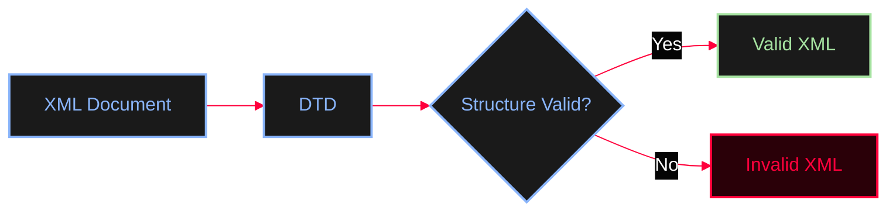
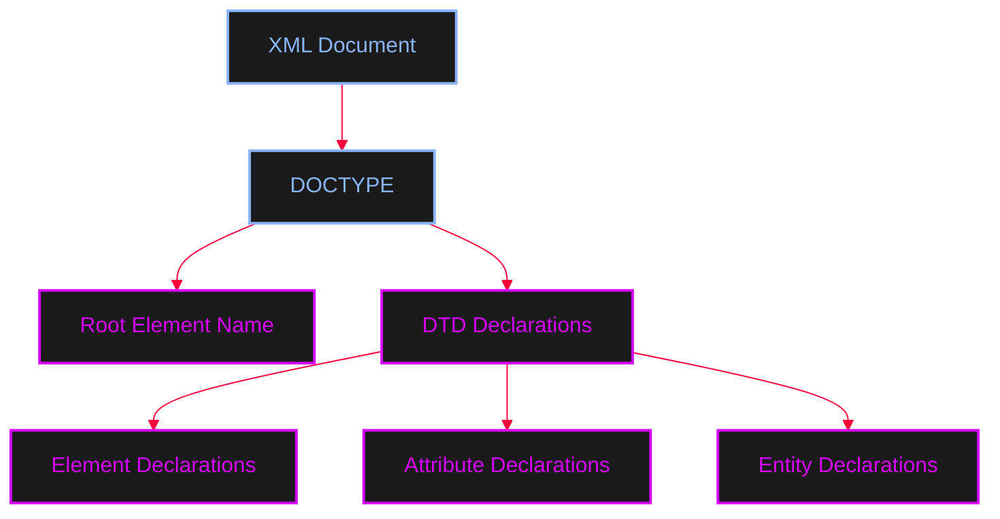
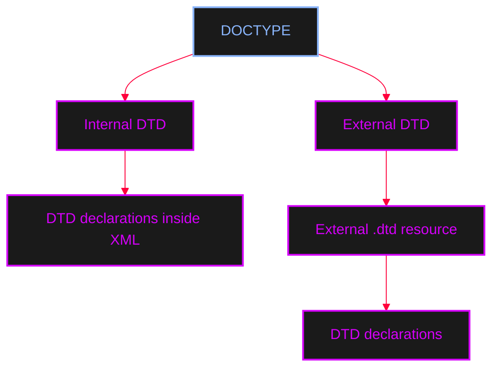
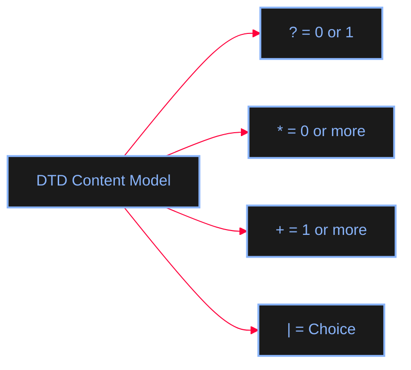
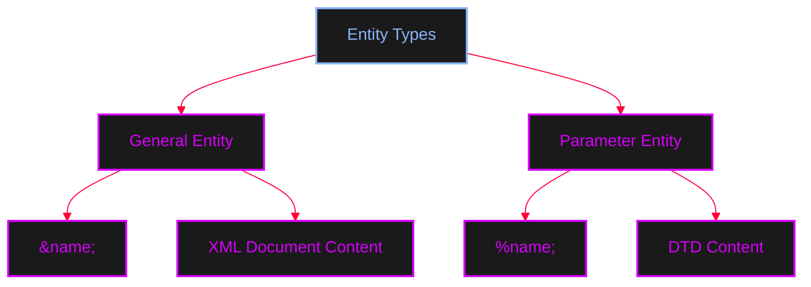
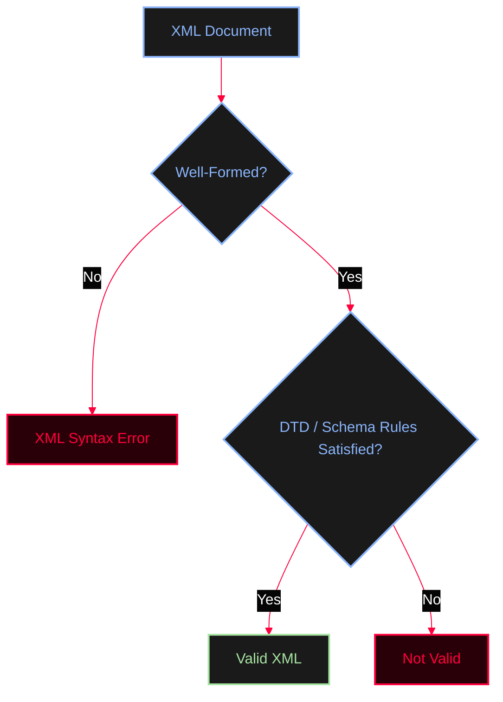
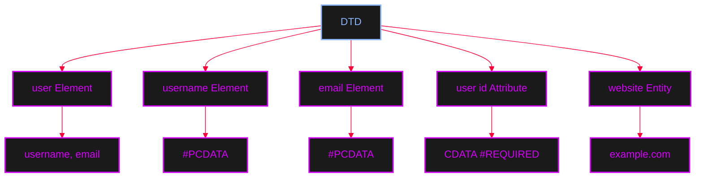

<Callout type="info" title="What is DTD?">
**DTD (Document Type Definition)** is a set of declarations used to define the **structure, rules, and allowed components of an XML document**.

In other words, a DTD defines what elements and attributes an XML document is allowed to contain and how those elements can be organized.
</Callout>

A DTD can define:
* Allowed elements
* Relationships between elements
* Element content
* Attributes
* Entities
* Entity values
* The overall document structure

<AccordionGroup>
  <Accordion title="XML & DTD Example">
    Consider the following XML document:
    ```xml
    <?xml version="1.0"?>
    <user>
        <name>CNA</name>
        <email>cna@example.com</email>
    </user>
    ```
    A DTD can define the expected structure of this document:
    ```xml
    <!DOCTYPE user [
        <!ELEMENT user (name, email)>
        <!ELEMENT name (#PCDATA)>
        <!ELEMENT email (#PCDATA)>
    ]>
    ```
    This DTD defines that:
    * The root element must be `<user>`
    * The `<user>` element must contain `<name>` and `<email>`
    * Both `<name>` and `<email>` contain text data
  </Accordion>
</AccordionGroup>

The XML parser can use the DTD to validate whether the XML document follows the expected structure. DTDs can also define **entities**, which allow reusable values or references to be declared inside the document.


The basic idea is:



A DTD does not contain the actual application data. Instead, it describes **how the XML document is allowed to be structured**.

---

## `DOCTYPE` Declaration

The DTD is introduced using the `DOCTYPE` declaration.

<AccordionGroup>
  <Accordion title="General Structure">
    ```xml
    <!DOCTYPE ROOT_ELEMENT [
        DTD DECLARATIONS
    ]>
    ```
    Here:
    * `DOCTYPE`: Document Type Declaration
    * `user`: Root Element
    * `[ ... ]`: Internal DTD Subset
  </Accordion>
</AccordionGroup>

The relationship can be visualized as:



The name after `DOCTYPE` normally identifies the document's root element. The names should correspond.

---

## Internal vs External DTD

There are two major ways to provide a DTD.

<Tabs>
  <Tab title="Internal DTD">
    A DTD can be written directly inside the XML document. This is called an **Internal DTD Subset**.
    
    <AccordionGroup>
      <Accordion title="Internal DTD Example">
        ```xml
        <?xml version="1.0" encoding="UTF-8"?>
        <!DOCTYPE user [
            <!ELEMENT user (username, email)>
            <!ELEMENT username (#PCDATA)>
            <!ELEMENT email (#PCDATA)>
        ]>
        <user>
            <username>adolfcna</username>
            <email>example@gmail.com</email>
        </user>
        ```
      </Accordion>
    </AccordionGroup>
  </Tab>
  <Tab title="External DTD">
    The DTD itself can also be stored outside the XML document in a separate `.dtd` resource.
    
    <AccordionGroup>
      <Accordion title="External DTD Example">
        XML Document:
        ```xml
        <?xml version="1.0" encoding="UTF-8"?>
        <!DOCTYPE user SYSTEM "user.dtd">
        <user>
            <username>adolfcna</username>
            <email>example@gmail.com</email>
        </user>
        ```
        `user.dtd` file:
        ```xml
        <!ELEMENT user (username, email)>
        <!ELEMENT username (#PCDATA)>
        <!ELEMENT email (#PCDATA)>
        ```
      </Accordion>
    </AccordionGroup>
  </Tab>
</Tabs>



---

## Elements (`<!ELEMENT>`)

The `<!ELEMENT>` declaration defines an XML element and its content model.

<Callout type="info" title="#PCDATA & ANY">
* **`#PCDATA`** (Parsed Character Data): Indicates that the element contains text. `<!ELEMENT username (#PCDATA)>`
* **`ANY`**: Allows a broad range of content inside an element. `<!ELEMENT user ANY>`
* **`EMPTY`**: Defines an element that cannot contain content. `<!ELEMENT image EMPTY>`
</Callout>

### Child Elements & Operators

DTD can define the exact child elements an element should contain, and use operators to control occurrence.

<Tabs>
  <Tab title="Sequence & Optional (?)">
    Sequence: `<!ELEMENT user (username, email)>`
    
    Optional (`?`): The element can occur **zero or one time**.
    ```xml
    <!ELEMENT user (username, email?)>
    ```
  </Tab>
  <Tab title="Repeating (*)">
    The `*` operator allows **zero or more occurrences**.
    ```xml
    <!ELEMENT user (username, email*)>
    ```
  </Tab>
  <Tab title="One or More (+)">
    The `+` operator means **one or more occurrences**.
    ```xml
    <!ELEMENT user (username, email+)>
    ```
  </Tab>
  <Tab title="Choice (|)">
    Alternatives using `|`. The `contact` element can contain either `email` or `phone`.
    ```xml
    <!ELEMENT contact (email | phone)>
    ```
  </Tab>
</Tabs>



---

## Attributes (`<!ATTLIST>`)

DTD can define attributes using `<!ATTLIST>`. The general syntax is:
`<!ATTLIST element-name attribute-name attribute-type default-value>`

<AccordionGroup>
  <Accordion title="Attribute Defaults">
    * **`#REQUIRED`**: The attribute must be present. `id CDATA #REQUIRED`
    * **`#IMPLIED`**: The attribute is optional and has no default value. `id CDATA #IMPLIED`
    * **Default Value**: Defines a default if the attribute is missing. `role CDATA "user"`
  </Accordion>
  <Accordion title="Attribute Example">
    ```xml
    <!ELEMENT user (#PCDATA)>
    <!ATTLIST user
        id CDATA #REQUIRED
    >
    ```
    This defines a mandatory `id` attribute for the `user` element:
    ```xml
    <user id="1337">adolfcna</user>
    ```
  </Accordion>
</AccordionGroup>

---

## Entities

An entity is a named piece of data that can be referenced later.

<Tabs>
  <Tab title="General Entity">
    A normal entity used inside XML document content. It uses `&name;`.
    
    <AccordionGroup>
      <Accordion title="General Entity Example">
        Declaration:
        ```xml
        <!ENTITY author "adolfcna">
        ```
        Reference:
        ```xml
        <author>&author;</author>
        ```
      </Accordion>
    </AccordionGroup>
  </Tab>
  <Tab title="Parameter Entity">
    Primarily used within the DTD itself. It uses `%name;` instead of `&name;`.
    
    <AccordionGroup>
      <Accordion title="Parameter Entity Example">
        Declaration:
        ```xml
        <!ENTITY % common "username">
        ```
        Reference within DTD:
        ```xml
        %common;
        ```
      </Accordion>
    </AccordionGroup>
  </Tab>
  <Tab title="Internal vs External Entity">
    * **Internal Entity**: Value is stored directly in the DTD.
      ```xml
      <!ENTITY site "example.com">
      ```
    * **External Entity**: Value is associated with an external resource using `SYSTEM`.
      ```xml
      <!ENTITY site SYSTEM "http://example.com/data.txt">
      ```
  </Tab>
</Tabs>



---

## Validation: Well-Formed vs Valid XML

<Steps>
  <Step title="Step 1: Well-Formed XML">
    An XML document is **well-formed** when it follows the basic syntax rules of XML (tags correctly nested and closed).
    ```xml
    <user>
        <username>adolfcna</username>
    </user>
    ```
  </Step>
  <Step title="Step 2: Valid XML">
    An XML document is **valid** when it is well-formed **and** conforms to a DTD or another applicable schema.
  </Step>
</Steps>



---

## Complete DTD Example

<AccordionGroup>
  <Accordion title="Complete XML with DTD">
    ```xml
    <?xml version="1.0" encoding="UTF-8"?>

    <!DOCTYPE user [
        <!ELEMENT user (username, email)>
        <!ELEMENT username (#PCDATA)>
        <!ELEMENT email (#PCDATA)>

        <!ATTLIST user
            id CDATA #REQUIRED
        >

        <!ENTITY website "example.com">
    ]>

    <user id="1337">
        <username>adolfcna</username>
        <email>example@gmail.com</email>
    </user>
    ```
  </Accordion>
</AccordionGroup>

The overall structure is:



---

## Key Takeaways

<AccordionGroup>
  <Accordion title="Summary Table">
    | Concept | Description | Syntax / Example |
    | --- | --- | --- |
    | **DTD** | Stands for **Document Type Definition**. | `DTD` |
    | **DOCTYPE** | Introduces a DTD in an XML document. | `<!DOCTYPE user [...]>` |
    | **Internal DTD** | DTD declarations inside the XML document. | `<!DOCTYPE user [ ... ]>` |
    | **External DTD** | DTD declarations in a separate resource. | `<!DOCTYPE user SYSTEM "user.dtd">` |
    | **`<!ELEMENT>`** | Defines an XML element and its content model. | `<!ELEMENT user (username, email)>` |
    | **`<!ATTLIST>`** | Defines attributes for an XML element. | `<!ATTLIST user id CDATA #REQUIRED>` |
    | **`#PCDATA`** | Parsed Character Data (text content). | `<!ELEMENT username (#PCDATA)>` |
    | **`ANY`** | Allows broad content. | `<!ELEMENT user ANY>` |
    | **`EMPTY`** | Element cannot contain content. | `<!ELEMENT image EMPTY>` |
    | **`?`** | Zero or one time. | `(email?)` |
    | **`*`** | Zero or more times. | `(email*)` |
    | **`+`** | One or more times. | `(email+)` |
    | **`\|`** | Choice between alternatives. | `(email \| phone)` |
    | **`#REQUIRED`** | Attribute is mandatory. | `id CDATA #REQUIRED` |
    | **`#IMPLIED`** | Attribute is optional. | `id CDATA #IMPLIED` |
    | **General Entity** | Referenced inside XML content. | `&name;` |
    | **Parameter Entity** | Referenced inside the DTD. | `%name;` |
    | **External Entity** | Value from external resource. | `<!ENTITY name SYSTEM "resource">` |
  </Accordion>
</AccordionGroup>
