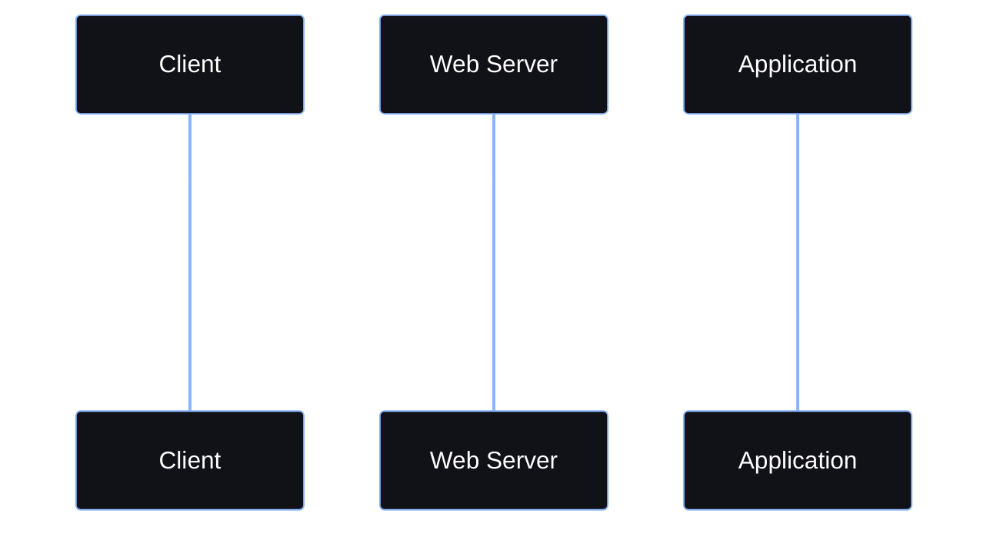
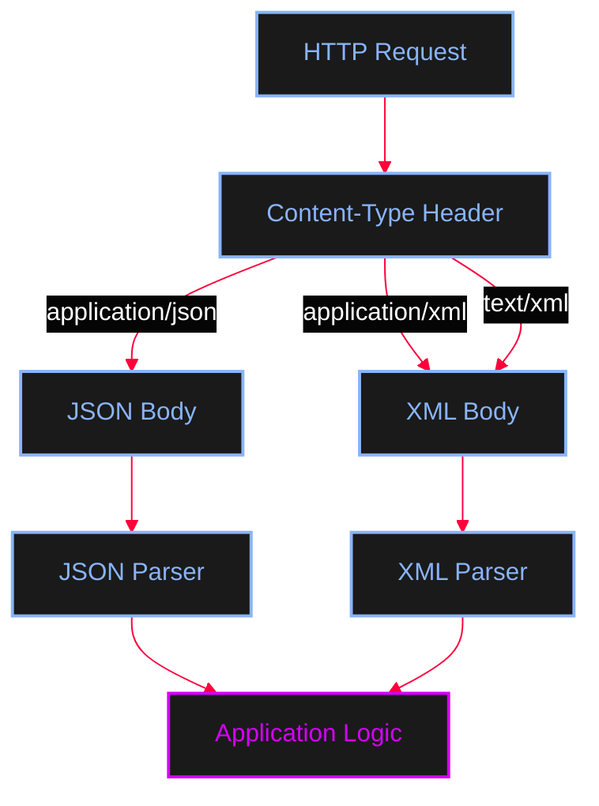
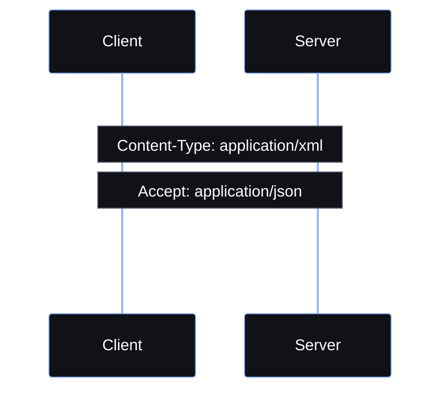

<Callout type="info" title="What is Data Transmission?">
**Data Transmission** in web applications refers to the process of sending and receiving data between a **Client** and a **Server** over a network.

In a typical web application, the Client sends an **HTTP Request** containing data, the Server receives and processes that data, and then returns an **HTTP Response**.
</Callout>

The transmitted data can include:
* User input
* Login credentials
* Form data
* JSON or XML data
* Cookies
* Authentication tokens
* Files and other resources


The basic communication model is:



The data transmitted between the Client and Server can be represented using different formats. Two of the most common formats are:
* **JSON**
* **XML**

---

## HTTP Request Anatomy

An HTTP Request contains several important components. A simplified request looks like:

```http
POST /api/user.php HTTP/1.1
Host: example.com
Content-Type: application/json

{
    "username": "adolfcna",
    "email": "example@gmail.com"
}
```

The request can be divided into: **HTTP Method**, **Request Target**, **Headers**, and **Request Body**.

The **Request Body** contains the actual data sent by the Client. The format of this data is identified using the `Content-Type` header.

---

## Content-Type

**Content-Type** tells the receiving application what type of data is contained in the HTTP Body.

<Tabs>
  <Tab title="JSON">
    ```http
    Content-Type: application/json
    ```
  </Tab>
  <Tab title="XML">
    ```http
    Content-Type: application/xml
    ```
    Another XML Content-Type that can be encountered is:
    ```http
    Content-Type: text/xml
    ```
  </Tab>
</Tabs>



<Callout type="warning">
`Content-Type` describes the format of the message body.
</Callout>

---

## Format Deep Dive: JSON vs XML

<Tabs>
  <Tab title="JSON (JavaScript Object Notation)">
    JSON is a lightweight text-based data format commonly used for communication between web applications. It represents data using **key-value pairs**.

    ```json
    {
        "username": "adolfcna",
        "email": "example@gmail.com",
        "instagram": "adolfcna"
    }
    ```

    **JSON Data Types:**
    * **String**: `"username": "adolfcna"`
    * **Number**: `"age": 25`
    * **Boolean**: `"active": true`
    * **Null**: `"email": null`
    * **Array**: `"skills": ["PHP", "Linux", "Web Security"]`

    ```mermaid
    %%{init: {'theme': 'base', 'themeVariables': { 'background': '#050505', 'primaryColor': '#111118', 'edgeLabelBackground':'#050505', 'primaryTextColor': '#ffffff', 'primaryBorderColor': '#FF003C', 'lineColor': '#FF003C', 'fontFamily': 'monospace' }}}%%
    flowchart TD
        A[JSON Object] --> B[username]
        A --> C[skills]

        B --> D[String]

        C --> E[Array]
        E --> F[PHP]
        E --> G[Linux]
        E --> H[Web Security]
        
        classDef default fill:#111118,stroke:#585b70,stroke-width:1px,color:#ffffff;
        classDef action fill:#1a1a1a,stroke:#89b4fa,stroke-width:2px,color:#89b4fa;
        classDef exec fill:#1a1a1a,stroke:#D500F9,stroke-width:2px,color:#D500F9;
        
        class A,B,C,E action;
        class D,F,G,H exec;
    ```
  </Tab>

  <Tab title="XML (Extensible Markup Language)">
    XML is another text-based format used to structure and exchange data. Unlike JSON, XML represents data using **elements**.

    ```xml
    <?xml version="1.0" encoding="UTF-8"?>
    <user>
        <username>adolfcna</username>
        <email>example@gmail.com</email>
        <instagram>adolfcna</instagram>
    </user>
    ```

    XML normally has a root element. Inside the root element, we can have child elements. XML can also store information inside **attributes** (e.g., `<user id="1337">`).

    ```mermaid
    %%{init: {'theme': 'base', 'themeVariables': { 'background': '#050505', 'primaryColor': '#111118', 'edgeLabelBackground':'#050505', 'primaryTextColor': '#ffffff', 'primaryBorderColor': '#FF003C', 'lineColor': '#FF003C', 'fontFamily': 'monospace' }}}%%
    flowchart TD
        A[user] --> B[username]
        A --> C[email]
        A --> D[instagram]

        B --> E["adolfcna"]
        C --> F["example@gmail.com"]
        D --> G["adolfcna"]
        
        classDef default fill:#111118,stroke:#585b70,stroke-width:1px,color:#ffffff;
        classDef action fill:#1a1a1a,stroke:#89b4fa,stroke-width:2px,color:#89b4fa;
        classDef exec fill:#1a1a1a,stroke:#D500F9,stroke-width:2px,color:#D500F9;
        
        class A,B,C,D action;
        class E,F,G exec;
    ```
  </Tab>
</Tabs>

---

## PHP Processing Pipelines

### Receiving and Responding to JSON

<Steps>
  <Step title="Step 1: Read Raw Body (`php://input`)">
    PHP can read the raw HTTP Request Body using `file_get_contents('php://input')`.
    <AccordionGroup>
      <Accordion title="PHP Code">
        ```php
        <?php
        header('Content-Type: application/json');
        $body = file_get_contents('php://input');
        $data = json_decode($body, true);

        echo "Username: " . $data['username'] . "\n";
        echo "Email: " . $data['email'] . "\n";
        ```
      </Accordion>
    </AccordionGroup>
  </Step>
  <Step title="Step 2: Decode JSON (`json_decode`)">
    `json_decode()` converts JSON into a PHP data structure. The second argument `true` causes JSON objects to be converted into associative arrays.
    ```mermaid
    %%{init: {'theme': 'base', 'themeVariables': { 'background': '#050505', 'primaryColor': '#111118', 'edgeLabelBackground':'#050505', 'primaryTextColor': '#ffffff', 'primaryBorderColor': '#FF003C', 'lineColor': '#FF003C', 'fontFamily': 'monospace' }}}%%
    flowchart LR
        A[JSON Text] --> B[json_decode]
        B --> C[PHP Associative Array]
        
        classDef default fill:#111118,stroke:#585b70,stroke-width:1px,color:#ffffff;
        classDef action fill:#1a1a1a,stroke:#89b4fa,stroke-width:2px,color:#89b4fa;
        classDef exec fill:#1a1a1a,stroke:#D500F9,stroke-width:2px,color:#D500F9;
        
        class A action;
        class B exec;
        class C action;
    ```
  </Step>
  <Step title="Step 3: Generate JSON Response (`json_encode`)">
    `json_encode()` converts the PHP array into JSON to be sent back to the client.
    <AccordionGroup>
      <Accordion title="PHP Code">
        ```php
        <?php
        header('Content-Type: application/json');
        $response = [
            "status" => "success",
            "username" => "adolfcna",
            "message" => "User received"
        ];
        echo json_encode($response);
        ```
      </Accordion>
    </AccordionGroup>
  </Step>
</Steps>

### Receiving and Responding to XML

<Steps>
  <Step title="Step 1: Read Raw Body">
    Just like JSON, XML is read from `php://input`.
  </Step>
  <Step title="Step 2: Parse XML (`simplexml_load_string`)">
    PHP's **SimpleXML** extension provides `simplexml_load_string()` for parsing XML stored in a string.
    <AccordionGroup>
      <Accordion title="PHP Code">
        ```php
        <?php
        header('Content-Type: application/xml');
        $body = file_get_contents('php://input');
        $xml = simplexml_load_string($body);

        echo "Username: " . $xml->username . "\n";
        echo "Email: " . $xml->email . "\n";
        ?>
        ```
      </Accordion>
    </AccordionGroup>
    ```mermaid
    %%{init: {'theme': 'base', 'themeVariables': { 'background': '#050505', 'primaryColor': '#111118', 'edgeLabelBackground':'#050505', 'primaryTextColor': '#ffffff', 'primaryBorderColor': '#FF003C', 'lineColor': '#FF003C', 'fontFamily': 'monospace' }}}%%
    flowchart LR
        A[HTTP Request] --> B[php://input]
        B --> C[Raw XML String]
        C --> D[simplexml_load_string]
        D --> E[SimpleXMLElement]
        E --> F[Application Logic]
        
        classDef default fill:#111118,stroke:#585b70,stroke-width:1px,color:#ffffff;
        classDef action fill:#1a1a1a,stroke:#89b4fa,stroke-width:2px,color:#89b4fa;
        classDef exec fill:#1a1a1a,stroke:#D500F9,stroke-width:2px,color:#D500F9;
        
        class A,B,C action;
        class D exec;
        class E,F action;
    ```
  </Step>
  <Step title="Step 3: Generate XML Response">
    PHP can return XML by outputting the raw XML string.
    <AccordionGroup>
      <Accordion title="PHP Code">
        ```php
        <?php
        header('Content-Type: application/xml');
        echo '<?xml version="1.0" encoding="UTF-8"?>';
        echo '
        <response>
            <status>success</status>
            <username>adolfcna</username>
            <message>User received</message>
        </response>
        ';
        ?>
        ```
      </Accordion>
    </AccordionGroup>
  </Step>
</Steps>

---

## Complete cURL Examples

<Tabs>
  <Tab title="Complete JSON Flow">
    <AccordionGroup>
      <Accordion title="json.php (Server Side)">
        ```php
        <?php
        header('Content-Type: application/json');
        $body = file_get_contents('php://input');
        $data = json_decode($body, true);

        if (!is_array($data)) {
            http_response_code(400);
            echo json_encode(["status" => "error", "message" => "Invalid JSON"]);
            exit;
        }

        $username = $data['username'] ?? '';
        $email = $data['email'] ?? '';

        $response = [
            "status" => "success",
            "username" => $username,
            "email" => $email
        ];

        echo json_encode($response);
        ```
      </Accordion>
      <Accordion title="cURL Request (Client Side)">
        ```bash
        curl -X POST http://localhost/json.php \
        -H "Content-Type: application/json" \
        -d '{
            "username": "adolfcna",
            "email": "example@gmail.com"
        }'
        ```
      </Accordion>
      <Accordion title="Expected JSON Response">
        ```json
        {
            "status": "success",
            "username": "adolfcna",
            "email": "example@gmail.com"
        }
        ```
      </Accordion>
    </AccordionGroup>

    ```mermaid
    %%{init: {'theme': 'base', 'themeVariables': { 'background': '#050505', 'primaryColor': '#111118', 'edgeLabelBackground':'#050505', 'primaryTextColor': '#ffffff', 'primaryBorderColor': '#FF003C', 'lineColor': '#FF003C', 'fontFamily': 'monospace' }}}%%
    flowchart LR
        A[cURL] -->|POST + JSON| B[Web Server]
        B --> C[json.php]
        C --> D[file_get_contents]
        D --> E[json_decode]
        E --> F[PHP Array]
        F --> G[Application Logic]
        G --> H[json_encode]
        H --> I[JSON Response]
        I --> A
        
        classDef default fill:#111118,stroke:#585b70,stroke-width:1px,color:#ffffff;
        classDef action fill:#1a1a1a,stroke:#89b4fa,stroke-width:2px,color:#89b4fa;
        classDef exec fill:#1a1a1a,stroke:#D500F9,stroke-width:2px,color:#D500F9;
        classDef attacker fill:#2a0008,stroke:#FF003C,stroke-width:2px,color:#FF003C;
        
        class A,B,C,D,F,G,H,I action;
        class E exec;
        class A attacker;
    ```
  </Tab>

  <Tab title="Complete XML Flow">
    <AccordionGroup>
      <Accordion title="xml.php (Server Side)">
        ```php
        <?php
        header('Content-Type: application/xml');
        $body = file_get_contents('php://input');
        $xml = simplexml_load_string($body);

        if ($xml === false) {
            http_response_code(400);
            echo '<?xml version="1.0" encoding="UTF-8"?>';
            echo '<response><status>error</status><message>Invalid XML</message></response>';
            exit;
        }

        $username = (string)($xml->username ?? '');
        $email = (string)($xml->email ?? '');

        $username = htmlspecialchars($username, ENT_XML1, 'UTF-8');
        $email = htmlspecialchars($email, ENT_XML1, 'UTF-8');

        echo '<?xml version="1.0" encoding="UTF-8"?>';
        echo "
        <response>
            <status>success</status>
            <username>$username</username>
            <email>$email</email>
        </response>
        ";
        ?>
        ```
      </Accordion>
      <Accordion title="cURL Request (Client Side)">
        ```bash
        curl -X POST http://localhost/xml.php \
        -H "Content-Type: application/xml" \
        -d '<?xml version="1.0" encoding="UTF-8"?>
        <user>
            <username>adolfcna</username>
            <email>example@gmail.com</email>
        </user>'
        ```
      </Accordion>
      <Accordion title="Expected XML Response">
        ```xml
        <?xml version="1.0" encoding="UTF-8"?>
        <response>
            <status>success</status>
            <username>adolfcna</username>
            <email>example@gmail.com</email>
        </response>
        ```
      </Accordion>
    </AccordionGroup>

    ```mermaid
    %%{init: {'theme': 'base', 'themeVariables': { 'background': '#050505', 'primaryColor': '#111118', 'edgeLabelBackground':'#050505', 'primaryTextColor': '#ffffff', 'primaryBorderColor': '#FF003C', 'lineColor': '#FF003C', 'fontFamily': 'monospace' }}}%%
    flowchart LR
        A[cURL] -->|POST + XML| B[Web Server]
        B --> C[xml.php]
        C --> D[file_get_contents]
        D --> E[simplexml_load_string]
        E --> F[SimpleXMLElement]
        F --> G[Application Logic]
        G --> H[XML Response]
        H --> A
        
        classDef default fill:#111118,stroke:#585b70,stroke-width:1px,color:#ffffff;
        classDef action fill:#1a1a1a,stroke:#89b4fa,stroke-width:2px,color:#89b4fa;
        classDef exec fill:#1a1a1a,stroke:#D500F9,stroke-width:2px,color:#D500F9;
        classDef attacker fill:#2a0008,stroke:#FF003C,stroke-width:2px,color:#FF003C;
        
        class A,B,C,D,F,G,H action;
        class E exec;
        class A attacker;
    ```
  </Tab>
</Tabs>

---

## `Content-Type` vs `Accept`

These two HTTP headers are often confused.

<CardGroup cols={2}>
  <Card title="Content-Type" icon="file-code">
    Describes the format of the **current message body** being sent.
    (e.g., `Content-Type: application/xml` means the Request Body is XML).
  </Card>
  <Card title="Accept" icon="check-circle">
    Tells the server which response media types the Client can accept or prefers.
    (e.g., `Accept: application/json` means the Client prefers a JSON response).
  </Card>
</CardGroup>

These headers can be used together:

```http
POST /api/user.php HTTP/1.1
Host: example.com
Content-Type: application/xml
Accept: application/json

<user>
    <username>adolfcna</username>
</user>
```

This means: **Request Body** is XML, but the **Preferred Response** is JSON.



---

## Summary & Key Takeaways

<AccordionGroup>
  <Accordion title="Key Takeaways">
    * **Data Transmission** is the process of exchanging data between a Client and Server.
    * HTTP Requests can contain data inside the **Request Body**.
    * `Content-Type` identifies the format of the HTTP Body.
    * **JSON** is a lightweight, text-based data format commonly used by APIs.
    * PHP can read the raw Request Body using `file_get_contents('php://input')`.
    * PHP can parse JSON using `json_decode()` and generate it using `json_encode()`.
    * **XML** is another text-based format for representing structured data.
    * PHP can parse XML using `simplexml_load_string()`.
    * `curl` can send both JSON and XML through HTTP.
    * `Content-Type` describes the format of the **body being sent**.
    * `Accept` describes the response formats the Client can accept/prefer.
  </Accordion>
  <Accordion title="General Web Data Transmission Model">
    ```mermaid
    %%{init: {'theme': 'base', 'themeVariables': { 'background': '#050505', 'primaryColor': '#111118', 'edgeLabelBackground':'#050505', 'primaryTextColor': '#ffffff', 'primaryBorderColor': '#FF003C', 'lineColor': '#FF003C', 'fontFamily': 'monospace' }}}%%
    flowchart LR
        A[Client] --> B[HTTP Request]
        B --> C[Content-Type]
        C --> D[Request Body]
        D --> E[Parser]
        E --> F[Application Logic]
        F --> G[HTTP Response]
        G --> A
        
        classDef default fill:#111118,stroke:#585b70,stroke-width:1px,color:#ffffff;
        classDef action fill:#1a1a1a,stroke:#89b4fa,stroke-width:2px,color:#89b4fa;
        classDef exec fill:#1a1a1a,stroke:#D500F9,stroke-width:2px,color:#D500F9;
        
        class A,B,C,D action;
        class E exec;
        class F,G action;
    ```
  </Accordion>
</AccordionGroup>
