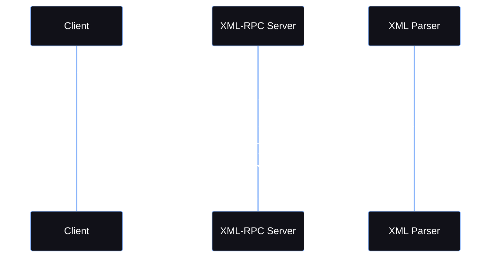

<Callout type="info" title="What is XML-RPC?">
**XML-RPC (XML Remote Procedure Call)** is a protocol that allows a client to execute methods on a remote server using XML-encoded requests and responses.

XML-RPC uses HTTP as the transport layer and XML as the data format.

A typical XML-RPC request contains:
* The name of the method to execute
* Parameters passed to the method
* XML structures describing the request
</Callout>


---

## How XML-RPC Works

The basic communication flow is:



---

## XML-RPC Request & Response Structure

<Tabs>
  <Tab title="Request Structure">
    A basic XML-RPC request contains a `methodCall` element.
    
    <AccordionGroup>
      <Accordion title="XML Request Example">
        ```http
        POST /xmlrpc.php HTTP/1.1
        Content-Type: text/xml
        ```
        ```xml
        <?xml version="1.0"?>
        <methodCall>
            <methodName>system.listMethods</methodName>
            <params>
            </params>
        </methodCall>
        ```
      </Accordion>
      <Accordion title="Detailed Request Example">
        ```xml
        <?xml version="1.0"?>

        <methodCall>
            <methodName>example.method</methodName>
            <params>
                <param>
                    <value>
                        <string>Hello</string>
                    </value>
                </param>
            </params>
        </methodCall>
        ```
        The important components are:
        ```text
        methodCall
            |
            +── methodName
            |
            └── params
                  |
                  └── param
                        |
                        └── value
        ```
        The server interprets `methodName` as the remote procedure that should be executed.
      </Accordion>
    </AccordionGroup>
  </Tab>

  <Tab title="Response Structure">
    After processing the request, the server returns a `methodResponse`.
    
    <AccordionGroup>
      <Accordion title="XML Response Example">
        ```xml
        <?xml version="1.0"?>

        <methodResponse>
            <params>
                <param>
                    <value>
                        <string>Hello</string>
                    </value>
                </param>
            </params>
        </methodResponse>
        ```
        The response contains the result returned by the remote method.
      </Accordion>
    </AccordionGroup>
  </Tab>
</Tabs>

---

## XML-RPC in WordPress

One well-known implementation of XML-RPC can be found in WordPress. The endpoint is commonly `/xmlrpc.php`.

WordPress XML-RPC can expose methods for functionality such as:
* Publishing content
* Editing posts
* Managing comments
* Uploading media
* Remote blogging functionality

The exact methods depend on the application and its configuration.

<Callout type="warning" title="Security Context">
An exposed XML-RPC endpoint is not automatically a vulnerability.

The security impact depends on which methods are enabled, how authentication is implemented, and how the application handles requests.
</Callout>

---

## Security Risks & Vulnerabilities

XML-RPC itself is a protocol, so it does not have a single CWE that represents "XML-RPC vulnerability." Instead, different weaknesses can occur depending on the implementation.

<Tabs>
  <Tab title="Brute-Force Abuse">
    Some XML-RPC implementations expose authentication-related methods that can allow multiple authentication attempts to be submitted through a single HTTP request.

    In WordPress, for example, the `system.multicall` method can invoke multiple XML-RPC calls within one request when it is enabled.

    ```mermaid
    %%{init: {'theme': 'base', 'themeVariables': { 'background': '#050505', 'primaryColor': '#111118', 'edgeLabelBackground':'#050505', 'primaryTextColor': '#ffffff', 'primaryBorderColor': '#FF003C', 'lineColor': '#FF003C', 'fontFamily': 'monospace' }}}%%
    flowchart LR
        A[Attacker] -->|HTTP Request| B[XML-RPC Endpoint]
        B --> C[system.multicall]
        C --> D[Multiple Method Calls]
        D --> E[Authentication Attempts]
        
        classDef default fill:#111118,stroke:#585b70,stroke-width:1px,color:#ffffff;
        classDef action fill:#1a1a1a,stroke:#89b4fa,stroke-width:2px,color:#89b4fa;
        classDef attacker fill:#2a0008,stroke:#FF003C,stroke-width:2px,color:#FF003C;
        
        class A attacker;
        class B,C,D action;
        class E attacker;
    ```

    If authentication controls such as rate limiting, lockout, or monitoring are insufficient, this can increase the efficiency of password-guessing attacks.

    <Callout type="danger">
    XML-RPC should not be treated as a magic bypass for authentication controls. The actual risk depends on the implementation and its defensive controls.
    </Callout>

    **Relevant CWE:**
    ```text
    CWE-307
    Improper Restriction of Excessive Authentication Attempts
    ```
    This CWE describes applications that do not properly restrict repeated authentication attempts.
  </Tab>

  <Tab title="XXE (XML External Entity)">
    XML-RPC uses XML, which means the server must parse XML.

    If the underlying XML parser is configured insecurely and allows external entity processing, an XML-RPC endpoint may potentially be affected by **XXE**.

    ```mermaid
    %%{init: {'theme': 'base', 'themeVariables': { 'background': '#050505', 'primaryColor': '#111118', 'edgeLabelBackground':'#050505', 'primaryTextColor': '#ffffff', 'primaryBorderColor': '#FF003C', 'lineColor': '#FF003C', 'fontFamily': 'monospace' }}}%%
    flowchart TD
        A[XML-RPC Request] --> B[XML Parser]
        B --> C{External Entities Enabled?}
        C -->|Yes| D[Potential XXE]
        C -->|No| E[External Entities Blocked]
        
        classDef default fill:#111118,stroke:#585b70,stroke-width:1px,color:#ffffff;
        classDef action fill:#1a1a1a,stroke:#89b4fa,stroke-width:2px,color:#89b4fa;
        classDef attacker fill:#2a0008,stroke:#FF003C,stroke-width:2px,color:#FF003C;
        classDef success fill:#1a1a1a,stroke:#a6e3a1,stroke-width:2px,color:#a6e3a1;
        
        class A,B,C action;
        class D attacker;
        class E success;
    ```

    **Relevant CWE:**
    ```text
    CWE-611
    Improper Restriction of XML External Entity Reference
    ```

    <Callout type="tip">
    XML-RPC and XXE are not the same thing.
    * **XML-RPC** is a protocol.
    * **XXE** is a vulnerability that can occur when an XML parser processes untrusted XML insecurely.
    </Callout>
  </Tab>

  <Tab title="SSRF (Server-Side Request Forgery)">
    Some XML-RPC methods may interact with URLs or remote resources.

    If an application allows an attacker to control a server-side request destination without proper validation, this can result in **Server-Side Request Forgery (SSRF)**.

    ```mermaid
    %%{init: {'theme': 'base', 'themeVariables': { 'background': '#050505', 'primaryColor': '#111118', 'edgeLabelBackground':'#050505', 'primaryTextColor': '#ffffff', 'primaryBorderColor': '#FF003C', 'lineColor': '#FF003C', 'fontFamily': 'monospace', 'actorBkg': '#111118', 'actorBorder': '#89b4fa', 'actorTextColor': '#ffffff', 'signalColor': '#ffffff', 'signalTextColor': '#ffffff', 'labelBoxBkgColor': '#111118', 'labelBoxBorderColor': '#585b70', 'labelTextColor': '#ffffff', 'loopTextColor': '#ffffff', 'noteBkgColor': '#111118', 'noteTextColor': '#ffffff', 'noteBorderColor': '#585b70' }}}%%
    sequenceDiagram
        participant A as Attacker
        participant X as XML-RPC Server
        participant I as Internal Service

        A->>X: XML-RPC Request
        X->>I: Server-Side Request
        I-->>X: Response
        X-->>A: Returned Data
    ```

    **Relevant CWE:**
    ```text
    CWE-918
    Server-Side Request Forgery (SSRF)
    ```
    Again, the CWE describes the vulnerability, not XML-RPC.
  </Tab>

  <Tab title="Information Disclosure">
    XML-RPC implementations may expose method names or application behavior that provides useful information to an attacker.

    For example, `system.listMethods` may reveal methods supported by the server when that functionality is available.

    Potentially exposed information can include:
    * Available methods
    * Application functionality
    * Plugin-specific methods
    * Error messages
    * Server behavior

    **Relevant CWE:**
    ```text
    CWE-200
    Exposure of Sensitive Information to an Unauthorized Actor
    ```

    An XML-RPC endpoint may sometimes allow an attacker to determine which methods are available.

    ```mermaid
    %%{init: {'theme': 'base', 'themeVariables': { 'background': '#050505', 'primaryColor': '#111118', 'edgeLabelBackground':'#050505', 'primaryTextColor': '#ffffff', 'primaryBorderColor': '#FF003C', 'lineColor': '#FF003C', 'fontFamily': 'monospace' }}}%%
    flowchart LR
        A[Attacker] -->|Method Enumeration| B[XML-RPC Endpoint]
        B --> C[Supported Methods]
        C --> A
        
        classDef default fill:#111118,stroke:#585b70,stroke-width:1px,color:#ffffff;
        classDef action fill:#1a1a1a,stroke:#89b4fa,stroke-width:2px,color:#89b4fa;
        classDef attacker fill:#2a0008,stroke:#FF003C,stroke-width:2px,color:#FF003C;
        
        class A,C attacker;
        class B action;
    ```
    Method enumeration by itself is not necessarily a vulnerability. It becomes security-relevant when the exposed methods reveal sensitive functionality or enable unauthorized operations.
  </Tab>
</Tabs>

---

## XML-RPC vs XXE Comparison

| Feature | XML-RPC | XXE |
|---|---|---|
| Type | Protocol | Vulnerability |
| Uses XML | Yes | Yes |
| Purpose | Remote method invocation | Abuse XML entity processing |
| CWE | No single CWE | CWE-611 |
| Can exist together | Yes | Yes |
| Example | `/xmlrpc.php` | External entity resolution |

---

## Security Assessment

When an XML-RPC endpoint is discovered during an authorized security assessment, useful areas to examine include:

<Steps>
  <Step title="Step 1: Endpoint Exposure">
    Identify if the XML-RPC endpoint is accessible and properly secured.
  </Step>
  <Step title="Step 2: Method Enumeration">
    Attempt to list available methods (e.g., using `system.listMethods`).
  </Step>
  <Step title="Step 3: Authentication & Authorization">
    Test for weak authentication, default credentials, or authorization bypasses.
  </Step>
  <Step title="Step 4: Rate Limiting">
    Check if `system.multicall` can be abused for brute-force attacks without rate limits.
  </Step>
  <Step title="Step 5: Input Validation & Parser Config">
    Test for XXE by injecting external entities to see if the parser resolves them.
  </Step>
  <Step title="Step 6: Server-Side Requests">
    Investigate if any methods trigger server-side requests leading to SSRF.
  </Step>
</Steps>

<Callout type="danger" title="Assessment Goal">
The goal is to identify weaknesses in the implementation rather than treating the presence of XML-RPC itself as a vulnerability.
</Callout>

---

## Key Takeaways

<Callout type="success" title="Summary">
* **XML-RPC is a protocol, not a vulnerability.**
* XML-RPC uses XML to perform remote procedure calls.
* WordPress commonly exposes XML-RPC through `/xmlrpc.php`.
* `system.multicall` can allow multiple method calls in a single request when supported.
* Weak authentication controls can lead to authentication-attempt abuse.
* **CWE-307** can apply to improper restriction of excessive authentication attempts.
* An insecure XML parser can introduce **XXE (CWE-611)**.
* Server-side requests triggered through XML-RPC can potentially result in **SSRF (CWE-918)**.
* Information disclosure issues may map to **CWE-200**, depending on the specific behavior.
* XML-RPC should therefore be treated as an **attack surface**, while the actual CWE depends on the discovered weakness.
</Callout>
