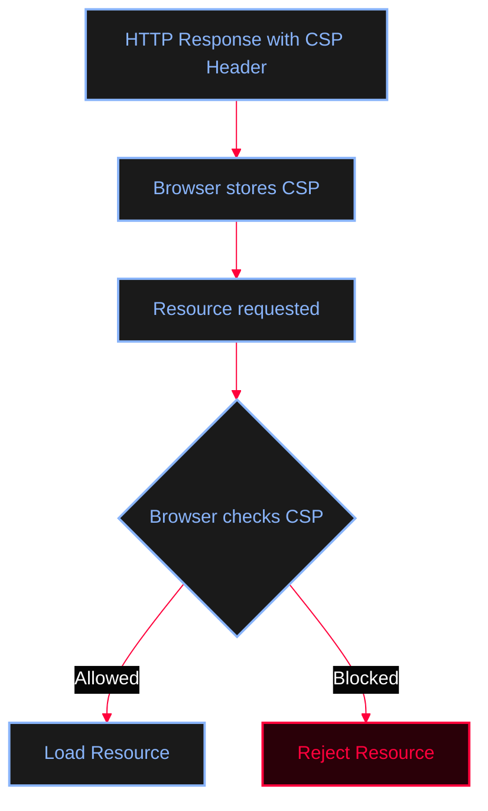
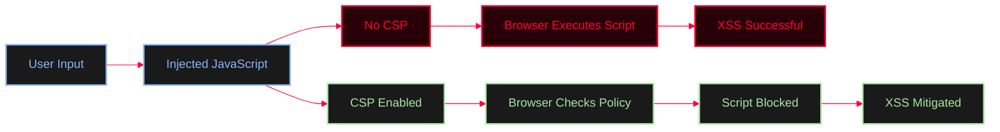
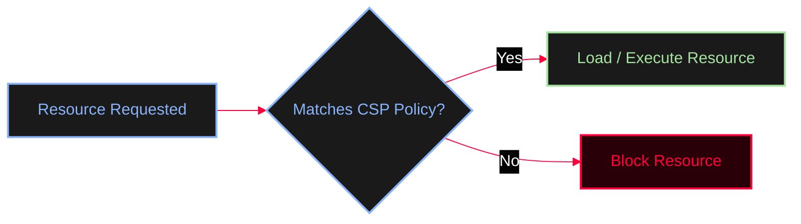

<Callout type="info" title="What is CSP?">
**Content Security Policy (CSP)** is a browser security mechanism that allows a website to define which resources are trusted and allowed to load or execute.

Its primary goal is to reduce the impact of **Cross-Site Scripting (XSS)** and other code injection attacks.
</Callout>


<Callout type="warning" title="CSP Response Header Example">
```http
HTTP/1.1 200 OK
Content-Security-Policy: default-src 'self'; script-src 'self'
```
The browser stores this policy and enforces it while rendering the page.
</Callout>

---

## How CSP Works

<Callout type="info" title="Browser Decision Process">

</Callout>

---

## Primary Goal: XSS Mitigation

CSP significantly reduces the impact of Cross-Site Scripting (XSS) by preventing browsers from executing unauthorized scripts.



---

## Common CSP Directives

<Tabs>
  <Tab title="Core Sources">
    <Callout type="info" title="default-src">
    Defines the default policy for all resource types unless another directive overrides it.
    
    **Example:**
    ```http
    Content-Security-Policy: default-src 'self'
    ```
    **Meaning:** Load all resources only from the same origin.
    </Callout>
    
    <Callout type="info" title="script-src">
    Controls which JavaScript files are allowed to execute.
    
    **Example:**
    ```http
    script-src 'self'
    ```
    **Allowed:** `https://example.com/app.js`
    **Blocked:** `https://evil.com/malware.js`
    </Callout>
    
    <Callout type="info" title="style-src">
    Controls where CSS files can be loaded from.
    
    **Example:**
    ```http
    style-src 'self'
    ```
    </Callout>
  </Tab>

  <Tab title="Media & Connections">
    <Callout type="info" title="img-src">
    Controls where images may be loaded from.
    
    **Example:**
    ```http
    img-src 'self' https://cdn.example.com
    ```
    </Callout>
    
    <Callout type="info" title="connect-src">
    Controls outbound browser connections such as:
    * Fetch API
    * XMLHttpRequest
    * WebSocket
    * EventSource
    
    **Example:**
    ```http
    connect-src 'self'
    ```
    </Callout>
    
    <Callout type="info" title="frame-src">
    Controls which websites may be embedded using `<iframe>`.
    </Callout>
  </Tab>

  <Tab title="Forms & Objects">
    <Callout type="info" title="object-src">
    Controls legacy plugins such as Flash and Java Applets.
    
    Most modern websites use:
    ```http
    object-src 'none'
    ```
    </Callout>
    
    <Callout type="info" title="form-action">
    Specifies where HTML forms are allowed to submit.
    </Callout>
    
    <Callout type="info" title="base-uri">
    Controls whether the HTML `<base>` element can modify relative URLs.
    </Callout>
  </Tab>
</Tabs>

---

## Special Keywords

<AccordionGroup>
  <Accordion title="'self'">
    `'self'` means the same **Origin** (Same Scheme, Same Host, Same Port).
    
    **Example:**
    ```http
    script-src 'self'
    ```
    Only JavaScript files from the same origin are allowed.
  </Accordion>
  <Accordion title="'none'">
    Blocks every source.
    
    **Example:**
    ```http
    object-src 'none'
    ```
    No objects are allowed.
  </Accordion>
  <Accordion title="'unsafe-inline'">
    <Callout type="danger">
    Allows inline JavaScript. This weakens CSP and may allow many XSS attacks.
    </Callout>
    
    **Example:**
    ```http
    script-src 'unsafe-inline'
    ```
    Then this becomes allowed:
    ```html
    <script>
    alert(1)
    </script>
    ```
  </Accordion>
  <Accordion title="'unsafe-eval'">
    Allows dangerous JavaScript functions such as `eval()`, `new Function()`, and `setTimeout("code")`. Generally discouraged.
  </Accordion>
</AccordionGroup>

---

## Advanced: Nonces & Hashes

<Steps>
  <Step title="Nonces">
    <Callout type="success">
    A nonce allows only specifically approved inline scripts to execute.
    </Callout>
    
    **Response header:**
    ```http
    Content-Security-Policy: script-src 'nonce-r4nd0m'
    ```
    
    **HTML:**
    ```html
    <script nonce="r4nd0m">
    console.log("Allowed")
    </script>
    ```
    Any inline script without the correct nonce is blocked.
  </Step>
  
  <Step title="Hashes">
    Instead of a nonce, CSP may allow scripts using a cryptographic hash.
    
    **Example:**
    ```http
    script-src 'sha256-xxxxxxxx'
    ```
    Only scripts matching that hash may execute.
  </Step>
</Steps>

<Callout type="success" title="CSP Decision Flow">

</Callout>

---

## Example Policy

<Callout type="tip" title="Comprehensive CSP Example">
```http
Content-Security-Policy:
default-src 'self';
script-src 'self';
style-src 'self';
img-src 'self' https://cdn.example.com;
object-src 'none';
base-uri 'self';
form-action 'self';
```

**Meaning:**
* JavaScript only from the same origin.
* CSS only from the same origin.
* Images from the same origin and the trusted CDN.
* No plugins.
* Forms can only submit to the same origin.
* The `<base>` element cannot point to another website.
</Callout>

---

## Important Notes

<Callout type="warning" title="Defense in Depth">
CSP is **not** a replacement for secure coding. It is an additional layer of defense.

A vulnerable application may still contain XSS, but a strong CSP can significantly reduce its impact.
</Callout>

---

## Summary

<AccordionGroup>
  <Accordion title="CSP Directive Summary Table">
    | Directive | Purpose |
    |-----------|---------|
    | `default-src` | Default policy for all resources |
    | `script-src` | Control JavaScript execution |
    | `style-src` | Control CSS loading |
    | `img-src` | Control image sources |
    | `connect-src` | Control Fetch, XHR, WebSocket |
    | `frame-src` | Control iframes |
    | `object-src` | Control plugins |
    | `form-action` | Control form submission |
    | `base-uri` | Control the `<base>` element |
  </Accordion>
</AccordionGroup>
