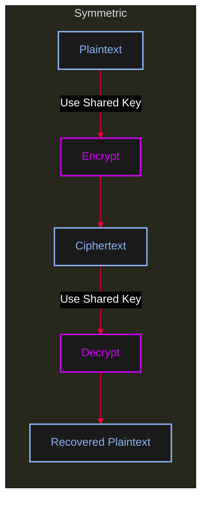
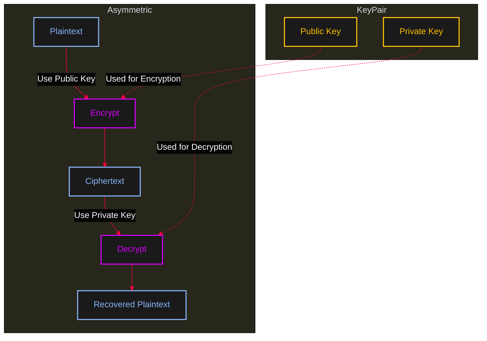

<Callout type="info" title="Concept Overview">
These protocols represent the evolution of security standards for wireless local area networks (WLANs) to protect data transmitted over Wi-Fi.
</Callout>

---

## Protocol Comparison

<AccordionGroup>
  <Accordion title="Comparison Table">
    | Protocol | Full Name | Year Introduced | Encryption Standard | Security Status | Key Vulnerability/Note |
    | -------- | --------- | -------------- | ------------------ | --------------- | ---------------------- |
    | **WEP** | Wired Equivalent Privacy | 1997 | RC4 (with static key) | **Obsolete/Insecure** | Weak key management and initialization vector (IV) reuse allows easy decryption in minutes. |
    | **WPA** | Wi-Fi Protected Access | 2003 | TKIP (Temporal Key Integrity Protocol) | **Deprecated** | A temporary fix for WEP's flaws, often used as a fallback. TKIP is now considered insecure. |
    | **WPA2** | Wi-Fi Protected Access II | 2004 | AES-CCMP | **Standard/Secure** | The long-time industry standard. Uses the robust Advanced Encryption Standard (AES). Susceptible to the KRACK attack, but patches are widely available. |
    | **WPA3** | Wi-Fi Protected Access III | 2018 | AES-GCMP | **Current/Most Secure** | The latest standard. Mandates stronger encryption, prevents offline dictionary attacks (via SAE handshake), and improves security for open networks (Opportunistic Wireless Encryption - OWE). |
  </Accordion>
</AccordionGroup>

<Callout type="success" title="Key Takeaways">
1. **WEP** should **never** be used.
2. **WPA** is outdated; use it only if absolutely necessary for legacy devices.
3. **WPA2** is still very common and secure *if* using AES (not TKIP).
4. **WPA3** is the most secure option and should be used on modern routers and devices for the strongest protection.
</Callout>

---

## Symmetric Encryption

<Callout type="info" title="How Symmetric Encryption Works">
In symmetric encryption, the same shared key is used for both encryption and decryption. This is the primary method used by Wi-Fi security protocols to protect data traffic.
</Callout>

<AccordionGroup>
  <Accordion title="Symmetric Encryption Algorithms">
    | Algorithm | Type | Status | Key Size Examples | Common Use / Notes |
    | :------- | :--- | :----- | :--------------- | :----------------- |
    | **AES** | Block Cipher | **Current Standard** | 128, 192, 256 bits | The dominant, fast, and highly secure encryption algorithm today. |
    | **ChaCha20** | Stream Cipher | **Modern/Recommended** | 128, 256 bits | Very fast in software; used in modern TLS/QUIC. |
    | **3DES (Triple DES)** | Block Cipher | Deprecated/Legacy | 112 or 168 bits effective | A slower, phased-out replacement for original DES. |
    | **Twofish** | Block Cipher | Legacy/Niche | 128, 192, 256 bits | Strong cipher, successor to Blowfish. |
    | **Blowfish** | Block Cipher | Legacy/Niche | Up to 448 bits | Fast, but older; often replaced by AES. |
    | **RC4** | Stream Cipher | **Broken/Insecure** | Variable | **Should not be used** due to known cryptographic flaws. |
    | **DES** | Block Cipher | Obsolete | 56 bits | Insecure against modern computing power. |
    | **IDEA** | Block Cipher | Legacy | 128 bits | Historically used in PGP (Pretty Good Privacy). |
    | **CAST-128/256** | Block Cipher | Older Standard | 40 to 128 bits (CAST-128) | Used in some older protocols and standards. |
  </Accordion>
</AccordionGroup>

---

## Asymmetric Encryption

<Callout type="info" title="How Asymmetric Encryption Works">
In asymmetric encryption, a key pair (Public Key and Private Key) is used. The public key encrypts data, and the private key decrypts it. This is commonly used for key exchange (like the WPA 4-Way Handshake) and digital signatures.
</Callout>

<AccordionGroup>
  <Accordion title="Asymmetric Encryption Algorithms">
    | Algorithm | Primary Use Case | Typical Key Size(s) | Security Basis / Notes |
    | :------- | :-------------- | :------------------ | :---------------------- |
    | **RSA** | Encryption, Digital Signatures | 2048, 3072, 4096 bits | Security is based on the computational difficulty of factoring the product of two large prime numbers. |
    | **DSA (Digital Signature Algorithm)** | Digital Signatures | 1024 to 3072 bits | Specifically designed *only* for generating and verifying digital signatures. |
    | **ECDSA (Elliptic Curve Digital Signature Algorithm)** | Digital Signatures | 256, 384, 521 bits | An elliptic curve version of DSA, offering equivalent security with much smaller key sizes. |
    | **ECC (Elliptic Curve Cryptography)** | Encryption/Signatures (as a family) | 256, 384, 521 bits | A broad category; algorithms like ECDH (Key Exchange) and ECDSA fall under this. |
    | **Diffie-Hellman (DH)** | Key Exchange | 2048 to 4096 bits | Primarily used to securely establish a shared secret (session key) over an insecure channel. |
    | **EdDSA / Ed25519** | Digital Signatures | 255 bits (Public Key size) | A modern, fast, and highly secure signature scheme based on Edwards-curve cryptography. |
    | **ElGamal** | Encryption, Digital Signatures | Varies (often requires larger keys than ECC) | A probabilistic public-key encryption system based on the discrete logarithm problem. |
  </Accordion>
</AccordionGroup>
