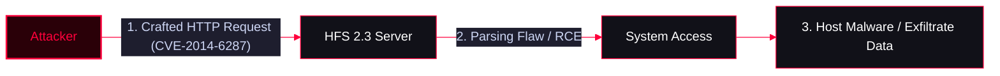

**Rejetto HFS** is a lightweight, open-source file server for Windows designed to share files over HTTP. It is commonly used to create simple file-sharing solutions, allowing users to upload and download files via a standard web browser without needing complex FTP setups.

<Callout type="info" title="MITRE ATT&CK Mapping">
* [T1190 - Exploit Public-Facing Application](https://attack.mitre.org/techniques/T1190/)
* [T1105 - Ingress Tool Transfer](https://attack.mitre.org/techniques/T1105/)
</Callout>

---

## Key Features & Concepts

<CardGroup cols={2}>
  <Card title="Ease of Use" icon="mouse-pointer">
    Provides an easy-to-use web interface for file management.
  </Card>
  <Card title="Portable" icon="package">
    No Installation Required. Can be run as a standalone portable executable.
  </Card>
  <Card title="Customizable" icon="code">
    Supports customizable HTML templates for the web interface.
  </Card>
  <Card title="Common Use Case" icon="network">
    Frequently deployed in internal networks for quick file distribution, but also widely used by attackers to host and distribute malicious payloads.
  </Card>
</CardGroup>

---

## Security Risks & Malicious Use

<Callout type="danger" title="Exploitation & Vulnerabilities">
HFS has been heavily targeted in cyberattacks due to severe vulnerabilities in older versions.

* **Remote Code Execution (RCE):** Older versions (most notably **Rejetto HFS 2.3**) are vulnerable to unauthenticated RCE (e.g., CVE-2014-6287). Attackers exploit parsing flaws in the HTTP requests to execute arbitrary commands on the server.
* **Malicious Use:** Attackers often compromise legitimate HFS servers or deploy their own HFS instances in the wild to:
  * Host and distribute malware payloads.
  * Gain unauthorized access to the underlying Windows system.
  * Exfiltrate stolen data.
</Callout>

---

## Mitigation & Hardening

<Callout type="warning" title="Defensive Recommendations">
To mitigate risks associated with Rejetto HFS, administrators should:
</Callout>

<Steps>
  <Step title="Step 1: Update">
    Immediately update to the latest version (HFS 3.x or later) to patch known vulnerabilities.
  </Step>
  <Step title="Step 2: Authentication">
    Secure the server with strong, complex passwords (Digest/Basic authentication).
  </Step>
  <Step title="Step 3: Configuration">
    Apply proper configurations, such as restricting access to specific IP addresses (IP whitelisting) and running the application with least privilege (not as Administrator).
  </Step>
  <Step title="Step 4: HTTPS">
    Enable SSL/TLS to encrypt traffic and protect credentials in transit.
  </Step>
</Steps>

---

## Resources

<CardGroup cols={1}>
  <Card title="Official Website" href="https://www.rejetto.com/hfs/" icon="external-link">
    Rejetto HFS Official Website
  </Card>
</CardGroup>
