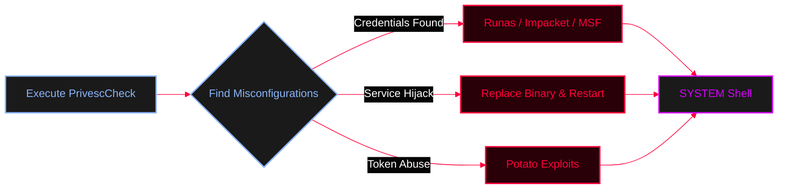

<Callout type="info" title="Concept Overview">
**PrivescCheck** is a powerful PowerShell script that aims to identify **Local Privilege Escalation (LPE)** vulnerabilities usually caused by Windows configuration issues or bad practices. It can also gather highly useful information for exploitation and post-exploitation tasks.

**MITRE ATT&CK Mapping:**
* [T1068 - Exploitation for Privilege Escalation](https://attack.mitre.org/techniques/T1068/)
* [T1087 - Account Discovery](https://attack.mitre.org/techniques/T1087/)
</Callout>




---

## Basic Enumeration & Reporting

<Tabs>
  <Tab title="Basic Enumeration">
    Always bypass the execution policy before running the script.
    ```powershell
    powershell -ep bypass -c ". .\PrivescCheck.ps1; Invoke-PrivescCheck"
    ```
  </Tab>

  <Tab title="Extended & Human-Readable">
    This option identifies important issues, gathers additional information, and saves the results to report files (TXT, HTML) that are easy to read and present.
    ```powershell
    powershell -ep bypass -c ". .\PrivescCheck.ps1; Invoke-PrivescCheck -Extended -Report PrivescCheck_$($env:COMPUTERNAME) -Format TXT,HTML"
    ```
  </Tab>

  <Tab title="All Checks & Machine-Readable">
    Performs extended and audit checks, and saves the results to human-readable reports, but also machine-readable files (CSV, XML), which can later be parsed for automated reporting or integration with tools like BloodHound/Neo4j.
    ```powershell
    powershell -ep bypass -c ". .\PrivescCheck.ps1; Invoke-PrivescCheck -Extended -Audit -Report PrivescCheck_$($env:COMPUTERNAME) -Format TXT,HTML,CSV,XML"
    ```
  </Tab>
</Tabs>

---

## Running via Meterpreter (Metasploit Integration)

<Callout type="warning" title="Metasploit Timeout Error">
If you run this script within a Meterpreter session, you will likely get a "timeout" error. Metasploit has a "response timeout" value, which is set to 15 seconds by default, but PrivescCheck takes a lot more time to run in most environments.
</Callout>

<Steps>
  <Step title="Step 1: The Error">
    <AccordionGroup>
      <Accordion title="Meterpreter Timeout Output">
        ```ruby
        meterpreter > load powershell
        meterpreter > powershell_import /local/path/to/PrivescCheck.ps1
        meterpreter > powershell_execute "Invoke-PrivescCheck"
        [-] Error running command powershell_execute: Rex::TimeoutError Operation timed out.
        ```
      </Accordion>
    </AccordionGroup>
  </Step>

  <Step title="Step 2: The Solution">
    You can set a different timeout value thanks to the `-t` option of the `sessions` command. In the following example, a timeout of 2 minutes (120 seconds) is set for the session with ID `1`.
    
    <AccordionGroup>
      <Accordion title="Increase Timeout & Execute">
        ```ruby
        msf6 exploit(multi/handler) > sessions -t 120 -i 1
        [*] Starting interaction with 1...

        meterpreter > load powershell
        Loading extension powershell...Success.
        meterpreter > powershell_import /local/path/to/PrivescCheck.ps1
        [+] File successfully imported. No result was returned.
        meterpreter > powershell_execute "Invoke-PrivescCheck"
        # The script will now run successfully without timing out.
        ```
      </Accordion>
    </AccordionGroup>
  </Step>
</Steps>

---

## Initial Access with Found Credentials

<Callout type="success" title="Exploiting Found Credentials">
If PrivescCheck discovers plaintext credentials (e.g., in registry, unattend files, or configuration files), you can use the built-in Windows `runas` utility to spawn a new shell or process as the privileged user.

```powershell
# Spawn a new CMD window as administrator using found credentials
runas /user:administrator cmd
```
</Callout>

<Callout type="tip">
*Note: You can also use tools like `impacket-psexec` or Metasploit `web_delivery` to get a proper shell if `runas` is not stealthy or interactive enough for your needs.*
</Callout>
