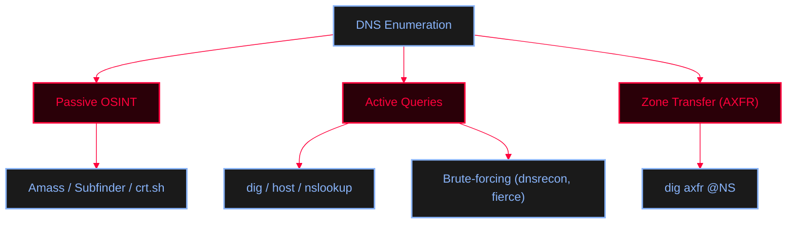

<Callout type="info" title="Concept Overview">
A comprehensive guide for DNS reconnaissance, covering basic queries, zone transfers, subdomain brute-forcing, and Nmap NSE scripts. Focuses entirely on extracting valuable information from DNS servers.
</Callout>




---

## Local Config & Status

<Callout type="info" title="Local DNS Configuration">
Check local DNS configurations and identify potential DNS tunneling setups.
```bash
cat ~/dns_tunneling
resolvectl status
```
</Callout>

---

## Passive DNS OSINT & Subdomain Discovery

<Callout type="tip" title="Passive Recon & Third-Party Lookups">
Gather DNS records and historical subdomains without sending direct queries to the target's authoritative name servers.
</Callout>

<CardGroup cols={2}>
  <Card title="DNSDumpster" href="https://dnsdumpster.com/" icon="globe">
    Online tool for DNS recon and mapping.
  </Card>
  <Card title="crt.sh" href="https://crt.sh" icon="certificate">
    Certificate transparency log search for subdomains.
  </Card>
</CardGroup>

<Tabs>
  <Tab title="WHOIS">
    ```bash
    whois example.com
    ```
  </Tab>
  <Tab title="Amass">
    ```bash
    amass enum --passive -d example.com
    ```
  </Tab>
  <Tab title="Sublist3r">
    ```bash
    python3 sublis3r.py -d example.com -b -t 50 -p 80,443,21,22 -e google,Dnsdumpster
    sublist3r -d example.com
    ```
  </Tab>
  <Tab title="Subfinder">
    ```bash
    subfinder -d example.com
    ```
  </Tab>
</Tabs>

---

## Basic DNS Queries

Use standard CLI utilities to enumerate different types of DNS records.

<Tabs>
  <Tab title="host Command">
    ```bash
    host -t ns example.com    # Enumerates name servers
    host -t mx example.com    # Enumerates mail servers
    host -t txt example.com
    ```
  </Tab>
  <Tab title="nslookup Command">
    ```bash
    nslookup -querytype=ns example.com
    nslookup -querytype=mx example.com
    nslookup -querytype=any example.com    # Enumerates anything possible
    ```
  </Tab>
  <Tab title="dig Command">
    ```bash
    dig ANY example.com
    dig ns example.com
    dig +short NS zonetransfer.me
    dig @a.ns.arvan.cloud example.com
    ```
  </Tab>
</Tabs>

---

## Reverse DNS & Subdomain Brute-forcing

Actively probe the target's DNS infrastructure to find unlisted subdomains and internal IPs.

<Tabs>
  <Tab title="Reverse DNS Lookup (PTR)">
    ```bash
    # Resolve IPs from a file
    for ip in $(cat file.txt); do host $ip.example.com; done

    # Scan an IP range and filter out "not found"
    for ip in $(seq 10 100); do host 172.20.10.$ip; done | grep -v "not found"
    ```
  </Tab>
  <Tab title="Active Brute-forcing Tools">
    ```bash
    # dnsrecon brute force
    dnsrecon -d example.com -D file.txt -t brt
    dnsrecon -d example.com -t std

    # fierce
    fierce -dns example.com
    fierce --domain example.com --subdomain-file /usr/share/seclist/DNS/fierce-hostlist.txt
    ```
  </Tab>
</Tabs>

---

## Zone Transfer (AXFR) Vulnerability

<Callout type="warning" title="Testing for DNS Zone Transfers">
If misconfigured, a DNS server might allow a full zone transfer, dumping all internal records. This is a critical vulnerability.
</Callout>

<Tabs>
  <Tab title="Manual Zone Transfer">
    ```bash
    # Find authoritative NS first
    dig ns example.com

    # Test Zone Transfer with dig
    dig @NS example.com A +recurse
    dig @NS example.com A +norecurse
    dig axfr @NS example.com

    # Test Zone Transfer with nslookup (Interactive)
    nslookup
    > set querytype=soa
    > example.com
    > ls -d ns1.example.com    # Zone transfer attempt (Windows syntax)
    ```
  </Tab>
  <Tab title="Automated Scanners">
    ```bash
    dnsenum example.com
    dnsrecon -d example.com
    dnsrecon -t axfr -d example.com    # Explicit zone transfer scan
    ```
  </Tab>
</Tabs>

---

## Nmap NSE Scripts for DNS

<Callout type="info" title="Nmap DNS Scripts">
Nmap provides several scripts for DNS enumeration and vulnerability detection via port 53.
</Callout>

```bash
nmap -T4 -p 53 --script broadcast-dns-service-discovery x.x.x.x
nmap -T4 -p 53 --script dns-brute x.x.x.x
nmap -Pn -sU -p 53 --script dns-recursion x.x.x.x
nmap -sU -p 53 --script dns-nsec-enum --script-args dns-nsec-enum.domains=example.com x.x.x.x
```
