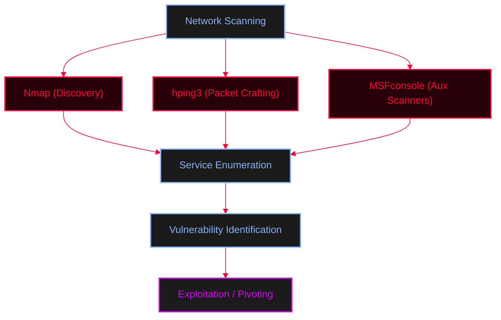

<Callout type="info" title="Concept Overview">
A comprehensive guide for mapping network ports, identifying services, and enumerating common protocols using Nmap, hping3, and Metasploit Framework (MSFconsole).
</Callout>




---

## Common Ports & Services

<Callout type="info" title="Quick Port Reference">

| Service | Protocol | Port(s) | Notes |
| :--- | :--- | :--- | :--- |
| **DNS** | TCP/UDP | 53 | Domain Name System |
| **RPC** | TCP/UDP | 135 | Remote Procedure Call |
| **NBT-NS** | UDP | 137 | NetBIOS Name Service (Old LLMNR is on port 5355) |
| **SMB over NBNS** | TCP | 139 | SMB via NetBIOS |
| **SMB** | TCP/UDP | 445 | Direct SMB |
| **LDAP** | TCP/UDP | 389 | Active Directory / Lightweight Directory Access Protocol |
| **NFS** | TCP | 2049 | Network File System |
| **SMTP** | TCP | 25 | Simple Mail Transfer Protocol |
| **SNMP** | TCP/UDP | 161, 162 | Simple Network Management Protocol |
| **IKE** | UDP | 500 | Internet Key Exchange (VPN) |
| **SSH** | TCP | 22 | Secure Shell |
| **Telnet** | TCP | 23 | Unencrypted remote login |
| **FTP** | TCP | 20, 21 | File Transfer Protocol (Data/Control) |
| **TFTP** | UDP | 69 | Trivial FTP (No auth) |
| **NTP** | UDP | 123 | Network Time Protocol |
| **BGP** | TCP | 179 | Border Gateway Protocol |

</Callout>

---

## Nmap (Network Mapper)

<AccordionGroup>
  <Accordion title="Scanning & OS Fingerprinting">
    ```bash
    # Aggressive scan (includes -sC, -sV, -O)
    nmap -A x.x.x.x --reason

    # OS Scan with guessing
    nmap -O x.x.x.x --osscan-guess --reason
    ```
  </Accordion>
  <Accordion title="NSE (Nmap Scripting Engine)">
    ```bash
    nmap --script smb-os-discovery x.x.x.x
    nmap --script nbstat x.x.x.x
    nmap -sV -p 445 --script vuln 172.20.10.1

    # Update NSE database after adding custom scripts to /usr/share/nmap/scripts/
    nmap --script-update
    nmap -sV -p 445 --script custom_script.nse 172.20.10.1
    ```
  </Accordion>
  <Accordion title="Evasion & Stealth Scans">
    ```bash
    # Fragmentation
    nmap -f x.x.x.x

    # Maximum Transmission Unit (Force fragmentation)
    nmap -mtu 8 x.x.x.x

    # Stealth Scans: FIN, Null, Xmas (FIN + PUSH + URG)
    nmap -sF x.x.x.x
    nmap -sN x.x.x.x
    nmap -sX x.x.x.x

    # Spoofing & Decoys
    nmap -D RND:10 x.x.x.x       # Random source IP decoys
    nmap -Pn -sT --spoof-mac 0 x.x.x.x # Spoof random source MAC
    ```
  </Accordion>
</AccordionGroup>

---

## hping3 (Packet Crafting)

<AccordionGroup>
  <Accordion title="Scanning & Flooding Commands">
    ```bash
    # Ping Scans
    hping3 -1 x.x.x.x            # ICMP Ping scan
    hping3 -1 x.x.x.x --rand-dest -I wlp7s0 # Random destination ICMP

    # UDP Scans
    hping3 -2 -p 80 x.x.x.x      # UDP scan
    hping3 --udp --data 500 --rand-source x.x.x.x # UDP scan with random source

    # TCP Scans
    hping3 -8 10-200 -S x.x.x.x -V # SYN scan mode
    hping3 -A -p 80 x.x.x.x      # ACK scan
    hping3 -S -p 22 -c 5 x.x.x.x # SYN scan on port 22, 5 packets
    hping3 -S -p 80 --tcp_timestamp x.x.x.x

    # Stealth Flags (FIN + PUSH + URG)
    hping3 -U -P -F x.x.x.x -p 80

    # Sequence & Listen Mode
    hping3 -Q -p 139 x.x.x.x     # Sequence number
    hping3 -9 HTTP -I wlp7s0     # Listen mode

    # SYN Flood Attack
    hping3 -S x.x.x.x -a x.x.x.x -p 22 --flood
    hping3 --flood x.x.x.x
    ```
  </Accordion>
</AccordionGroup>

---

## Metasploit Framework (MSFconsole)

<Steps>
  <Step title="Step 1: Port Scanning & Pivoting">
    <AccordionGroup>
      <Accordion title="MSF & Meterpreter Commands">
        ```ruby
        # Auxiliary port scanners
        msf5> use auxiliary/scanner/portscan/tcp
        msf5> use auxiliary/discovery/udp_sweep
        ```
        
        **Post-Exploitation Pivoting (Autoroute):**
        ```ruby
        meterpreter> sysinfo
        meterpreter> shell
        /bin/bash -i
        www-data@victim:/home$ ifconfig
        exit

        # Add route to internal network through compromised host
        meterpreter> run autoroute -s 192.168.10.2
        meterpreter> background

        msf5> sessions
        msf5> search portscan
        msf5> use 5
        msf5> set rhosts 192.168.10.2-90
        ```
      </Accordion>
    </AccordionGroup>
  </Step>

  <Step title="Step 2: Protocol-Specific Scanners">
    <Tabs>
      <Tab title="FTP">
        ```ruby
        msf5> search type:auxiliary name:ftp
        msf5> use auxiliary/scanner/ftp/ftp_version
        msf5> use auxiliary/scanner/ftp/ftp_login
        msf5> use auxiliary/scanner/ftp/anonymous
        ```
      </Tab>
      <Tab title="SMB">
        ```ruby
        msf5> setg rhost 192.158.32.23
        msf5> search type:auxiliary name:smb
        msf5> use auxiliary/scanner/smb/smb_version
        msf5> use auxiliary/scanner/smb/smb_enumusers
        msf5> use auxiliary/scanner/smb/smb_enumshares
        msf5> use auxiliary/scanner/smb/smb_logon
        ```
      </Tab>
      <Tab title="SSH">
        ```ruby
        msf5> setg rhost and hosts 
        msf5> search type:auxiliary name:ssh
        msf5> use auxiliary/scanner/ssh/ssh_version
        msf5> use auxiliary/scanner/ssh/ssh_login
        msf5> use auxiliary/scanner/ssh/ssh_enumusers
        ```
      </Tab>
      <Tab title="SMTP">
        ```ruby
        msf5> search type:auxiliary name:smtp
        msf5> use auxiliary/scanner/smtp/smtp_version
        msf5> use auxiliary/scanner/smtp/smtp_enum
        ```
      </Tab>
      <Tab title="HTTP">
        ```ruby
        msf5> search type:auxiliary name:http
        msf5> use auxiliary/scanner/http/http_version
        msf5> use auxiliary/scanner/http_header
        msf5> use auxiliary/scanner/http_robots.txt
        msf5> use auxiliary/scanner/dir_scanner
        msf5> use auxiliary/scanner/http_login
        msf6> use auxiliary/scanner/apache_userdir_enum # Find users
        ```
      </Tab>
      <Tab title="MySQL">
        ```ruby
        msf5> search type:auxiliary name:mysql
        msf5> use auxiliary/scanner/mysql/mysql_version
        msf5> use auxiliary/scanner/mysql/mysql_login
        msf5> use auxiliary/admin/mysql/mysql_enum
        msf5> use auxiliary/admin/mysql/mysql_sql # Interactive (e.g., show databases;)
        msf5> use auxiliary/scanner/mysql/mysql_schemadump
        ```
      </Tab>
    </Tabs>
  </Step>

  <Step title="Step 3: Manual MySQL Access">
    ```bash
    mysql -h 192.103.2.1 -u root -p 1234
    ```
  </Step>
</Steps>

---

## Specific Protocol Notes

<Callout type="warning" title="TFTP (Trivial File Transfer Protocol)">
TFTP operates on **UDP port 69** and **does not have an authentication method**, making it a prime target for reading sensitive files if exposed.
```bash
nmap -sU -p 69 --script tftp_enum --script-args tftp-enum.filelist=customlist.txt <IP>
```
</Callout>

<Callout type="warning" title="Active Directory / LDAP">
Active Directory and LDAP services typically operate on **TCP port 389**.
```bash
nmap -p 389 <IP>
```
</Callout>
