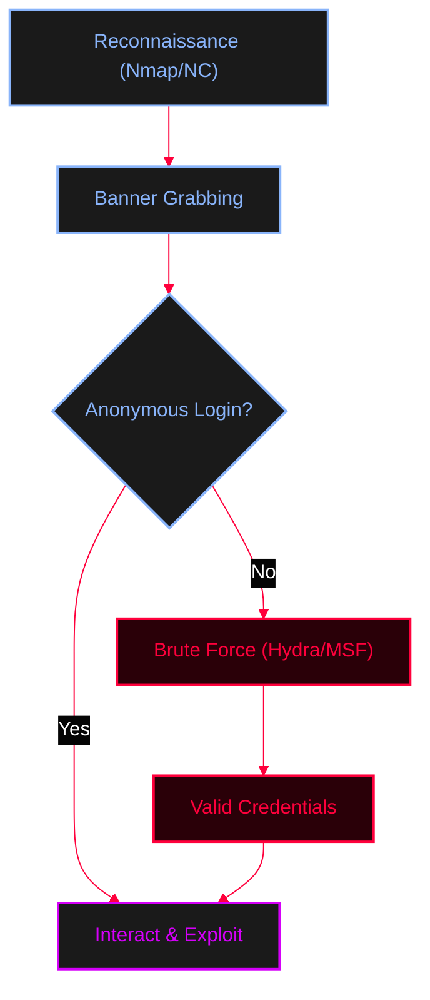

<Callout type="info" title="Concept Overview">
A quick guide for enumerating FTP services (port 21), checking for anonymous access, brute-forcing credentials, and interacting with the FTP server.
</Callout>

["23"](/docs/Asset/vb.jpg)



---

## Reconnaissance & Banner Grabbing

Scan for FTP scripts and grab the service banner to identify the version and potential vulnerabilities.

<Tabs>
  <Tab title="Nmap">
    ```bash
    # Run all FTP nmap scripts including anonymous check
    nmap --script ftp* ftp-anon -p 21 $ip
    ```
  </Tab>
  <Tab title="Netcat">
    ```bash
    # Banner grabbing with Netcat
    nc -vv 172.20.10.1 21
    ```
  </Tab>
</Tabs>

---

## Brute Forcing

<Callout type="danger" title="Credential Brute Force (MITRE ATT&CK T1110)">
Attempting to guess FTP credentials using wordlists. 
**Reference:** [MITRE ATT&CK T1110](https://attack.mitre.org/techniques/T1110/)
</Callout>

<Tabs>
  <Tab title="Hydra">
    ```bash
    hydra -t 4 -L /usr/share/metasploit/wordlists/data/unix_user.txt -P /usr/share/wordlists/nmap.lst $ip ftp
    ```
    *Note: Common password lists include `/usr/share/wordlists/nmap.lst` or `/usr/share/john/password.lst`.*
  </Tab>
  <Tab title="Metasploit Framework (MSFconsole)">
    ```ruby
    msfconsole -q
    search scanner ftp_login
    use auxiliary/scanner/ftp/ftp_login
    show options
    # set RHOSTS, USER_FILE, and PASS_FILE
    exploit
    ```
  </Tab>
</Tabs>

---

## FTP Interaction & Commands

Connect to the target FTP server. Try `anonymous` as both username and password if anonymous login is allowed.

```bash
ftp x.x.x.x
# Username: anonymous
# Password: (anything or anonymous)
```

<AccordionGroup>
  <Accordion title="Useful FTP Commands">
    ```bash
    ls              # List files
    get             # Get a single file from the remote computer
    mget *          # Get multiple files (downloads everything)
    put             # Send a single file
    mput            # Send multiple files
    send            # Send a single file (alias for put)
    binary          # Switches to binary transfer mode (for files/executables)
    ascii           # Switch to ASCII transfer mode (for text files)
    bye             # Exit FTP session
    ```
  </Accordion>
</AccordionGroup>
