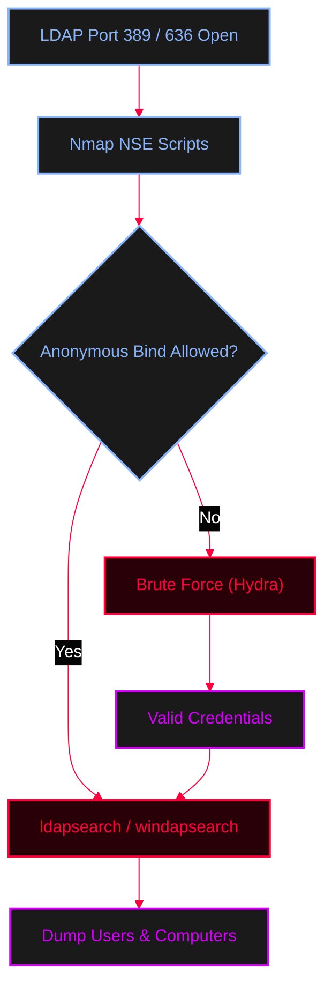

<Callout type="info" title="Concept Overview">
**Lightweight Directory Access Protocol (LDAP)** is a protocol used to access and manage directory information over an IP network. It is heavily used in Active Directory environments. The **Directory System Agent (DSA)** typically runs on port 389 (TCP) and LDAPS (LDAP over SSL) runs on port 636.
</Callout>




---

## Nmap Scanning

<Callout type="info" title="Nmap NSE Scripts for LDAP">
Use Nmap to enumerate LDAP root information, search for objects, and brute-force credentials.
</Callout>

<AccordionGroup>
  <Accordion title="Nmap Commands">
    ```bash
    # Basic scan to check if LDAP is open
    nmap -p 389 $ip

    # Extract LDAP root DSE (Default Naming Contexts)
    nmap -p 389 --script ldap-rootdse $ip

    # Search for common objects
    nmap -p 389 --script ldap-search $ip

    # Brute force LDAP credentials
    nmap -p 389 --script ldap-brute --script-args ldap.base='"cn=users,dc=CEH,dc=com"' $ip
    ```
  </Accordion>
</AccordionGroup>

---

## Command-line Enumeration (`ldapsearch`)

<Callout type="info" title="Anonymous Bind & Base Searching">
If anonymous binds are allowed, you can query the directory without credentials. The `-x` flag uses simple authentication instead of SASL.
</Callout>

<AccordionGroup>
  <Accordion title="ldapsearch Commands">
    ```bash
    # Basic anonymous search
    ldapsearch -h x.x.x.x -x

    # Find the base DN (Naming Contexts)
    ldapsearch -h x.x.x.x -x -s base namingcontexts

    # Search a specific Base DN for all objects
    ldapsearch -h x.x.x.x -x -b "DC=htb,DC=local"

    # Extract all users from a specific domain
    ldapsearch -x -H ldap://x.x.x.x -b "DC=htb,DC=local" '(objectclass=user)' sAMAccountName mail

    # Extract all computers on the domain
    ldapsearch -x -H ldap://x.x.x.x -b "DC=htb,DC=local" '(objectclass=computer)' name
    ```
  </Accordion>
</AccordionGroup>

---

## Advanced Tools

<Callout type="tip" title="windapsearch (Windows AD LDAP Search)">
A Python tool specifically designed to enumerate Windows Active Directory via LDAP queries easily.
</Callout>

<AccordionGroup>
  <Accordion title="windapsearch Commands">
    ```bash
    # Enumerate users (requires credentials if anonymous is disabled)
    windapsearch -d x.x.x.x -u 'domain\username' -p 'password' -U

    # Enumerate computers
    windapsearch -d x.x.x.x -u 'domain\username' -p 'password' -C

    # Enumerate domain admins
    windapsearch -d x.x.x.x -u 'domain\username' -p 'password' --da
    ```
  </Accordion>
</AccordionGroup>

<Callout type="danger" title="Brute Forcing Credentials">
Brute-forcing LDAP to find valid domain accounts.
**Reference:** [MITRE ATT&CK T1110](https://attack.mitre.org/techniques/T1110/)
</Callout>

<AccordionGroup>
  <Accordion title="Hydra Brute Force">
    ```bash
    # Hydra LDAP brute force
    hydra -L users.txt -P passwords.txt ldap://x.x.x.x -V
    ```
  </Accordion>
</AccordionGroup>
