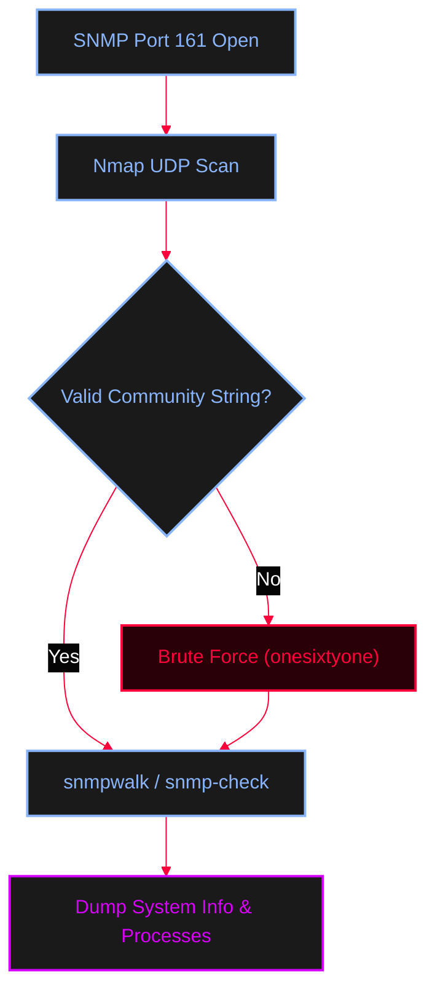

<Callout type="info" title="Concept Overview">
**Simple Network Management Protocol (SNMP)** is a protocol used to monitor and manage network devices. It operates on **UDP port 161** (and 162 for traps). If misconfigured (e.g., using default community strings like `public` or `private`), it can reveal extensive system and network information.
</Callout>




---

## Nmap Scanning

<AccordionGroup>
  <Accordion title="Nmap NSE Scripts for SNMP">
    Use Nmap to quickly identify SNMP services and extract data using built-in scripts.
    ```bash
    # Basic UDP scan with service detection
    nmap -sU -sV -p 161 x.x.x.x

    # Extract running processes
    nmap -sU -p 161 --script snmp-processes x.x.x.x

    # Run all SNMP enumeration scripts and save output
    nmap -sU -p 161 --script snmp-* x.x.x.x > snmp_result.txt

    # Brute force community strings
    nmap -sU -p 161 --script snmp-brute x.x.x.x
    ```
  </Accordion>
</AccordionGroup>

---

## SNMP Enumeration Tools

<Tabs>
  <Tab title="snmpwalk">
    Extract the entire MIB tree or query a specific OID.
    ```bash
    # Syntax: snmpwalk -v <version> -c <community> -t <timeout> <IP> [OID]
    snmpwalk -v1 -c public -t 10 172.20.10.1
    snmpwalk -v2c -c private -t 10 172.20.10.1

    # Query a specific OID (Object Identifier)
    # NOTE: Common OIDs are listed in /usr/share/snmpenum/{cisco.txt, linux.txt, ...}
    snmpwalk -v1 -c public 172.20.10.1 OID
    ```
  </Tab>
  <Tab title="snmp-check">
    Quick human-readable SNMP enumeration.
    ```bash
    # Quick human-readable SNMP enumeration
    snmp-check -c public x.x.x.x
    snmp-check -c private x.x.x.x
    ```
  </Tab>
  <Tab title="snmpenum">
    Uses dictionary files (like `cisco.txt` or `linux.txt`) to map specific OIDs to readable data.
    ```bash
    # Syntax: snmpenum <IP> <community> <dictionary_file>
    snmpenum x.x.x.x public /usr/share/snmpenum/linux.txt
    snmpenum x.x.x.x private /usr/share/snmpenum/cisco.txt
    ```
  </Tab>
</Tabs>

---

## Community String Brute Force

<Callout type="danger" title="Finding Valid Community Strings">
If `public` or `private` don't work, brute-force the community string.
**MITRE ATT&CK Mapping:** [T1110 Brute Force](https://attack.mitre.org/techniques/T1110/)
</Callout>

<Steps>
  <Step title="Step 1: Create Wordlists">
    ```bash
    # 1. Create a community string wordlist
    echo "public" > community
    echo "private" >> community
    echo "manager" >> community

    # 2. Create an IP list
    for ip in $(seq 1 254); do echo 172.20.10.$ip; done > ips
    ```
  </Step>
  <Step title="Step 2: Execute Brute Force">
    <Tabs>
      <Tab title="Onesixtyone">
        ```bash
        onesixtyone -c community -i ips
        ```
      </Tab>
      <Tab title="Metasploit (snmp_login)">
        ```ruby
        msfconsole -q
        use auxiliary/scanner/snmp/snmp_login
        set RHOSTS x.x.x.x
        set THREADS 11
        exploit
        ```
      </Tab>
    </Tabs>
  </Step>
</Steps>

---

## Metasploit Enumeration

<AccordionGroup>
  <Accordion title="MSFconsole SNMP Module">
    Automate the extraction of system details, network interfaces, and routing tables.
    ```ruby
    msf6> use auxiliary/scanner/snmp/snmp_enum
    msf6> set RHOSTS x.x.x.x
    msf6> exploit
    ```
  </Accordion>
</AccordionGroup>
