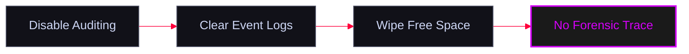

Techniques used by attackers to remove artifacts, clear event logs, and disable auditing to avoid detection and hinder incident response forensics.

<Info title="MITRE ATT&CK Mapping">
  - [T1070 - Indicator Removal](https://attack.mitre.org/techniques/T1070/)
  - [T1562 - Impair Defenses](https://attack.mitre.org/techniques/T1562/)
</Info>




---

## Windows Audit Policy (`auditpol`)

<Warning>
  Windows `auditpol` is used to manage audit policies. Attackers can disable logging for specific events (like logons or system changes) to operate stealthily.
</Warning>

<Tabs>
  <Tab title="View Policy">
    ```cmd
    :: View all current audit policy categories
    auditpol /get /category:*
    ```
  </Tab>
  <Tab title="Disable Auditing">
    ```cmd
    :: Disable success and failure auditing for System and Account Logon events
    auditpol /set /category:"system","account logon" /success:disable /failure:disable
    
    :: Verify that auditing is disabled
    auditpol /get /category:"system","account logon"
    ```
  </Tab>
  <Tab title="Clear & Remove">
    ```cmd
    :: Clear all audit policies (Very aggressive)
    auditpol /clear /y
    
    :: Remove all auditing settings completely
    auditpol /remove
    ```
  </Tab>
</Tabs>

---

## Windows Event Logs (`wevtutil`)

<Danger>
  `wevtutil` is a native Windows command-line tool for retrieving information about event logs and publishers. It can also be used to wipe specific logs clean.
</Danger>

```cmd
:: Clear the System event log
wevtutil cl system

:: Clear the Security event log
wevtutil cl security

:: Clear the Application event log
wevtutil cl application
```

---

## File System Anti-Forensics (`cipher`)

<Tip>
  When files are deleted in Windows, the data remains on the disk until it is overwritten. The `cipher` utility can be used to securely wipe all "free space" on a drive, making recovery of deleted tools, payloads, and stolen files impossible for forensic analysts.
</Tip>

```cmd
:: Overwrite all free space on the C:\ drive (0x00 then 0xFF then random data)
cipher /w:c:\
```

<Warning>
  _Note: This process takes a long time on large drives and generates heavy disk I/O, which may trigger behavioral detections._
</Warning>
