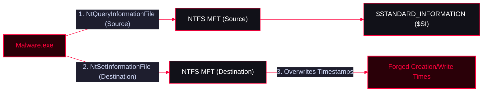

Timestomping is an anti-forensics technique in which an adversary modifies file timestamps to make malicious files or modified files appear legitimate. By manipulating timestamps, attackers attempt to blend malicious artifacts with normal system activity and evade detection by forensic investigators and security tools.

For example, an attacker may change a malware file's timestamps to match those of legitimate files in the same directory, making the file appear older or less suspicious.

<Callout type="info" title="MITRE ATT&CK">
**T1070.006 — Timestomp**

* **Parent technique:** [T1070 — Indicator Removal](https://attack.mitre.org/techniques/T1070/)
* **Tactic:** [Defense Evasion (TA0005)](https://attack.mitre.org/tactics/TA0005/)
* **Platforms:** Windows, Linux, macOS, and ESXi
</Callout>


---

## How Timestomping Works

Filesystems maintain timestamps that describe when a file was created, accessed, or modified. Investigators use these timestamps to reconstruct activity and establish a timeline of events.

An adversary may manipulate these values to make a file's timeline inconsistent with its actual creation or modification history.

Common objectives include:
* Hiding the recent creation of malicious files.
* Making modified files appear unchanged.
* Matching malware timestamps to legitimate files.
* Evading detection rules based on suspicious timestamp changes.
* Reducing the reliability of forensic timelines.

<Callout type="warning">
Timestamps alone do not prove malicious activity. Investigators should correlate file metadata with process execution, filesystem records, logs, and other available evidence.
</Callout>



---

## 1. Understanding File Timestamps

### Windows timestamp terminology

Windows and NTFS expose several timestamp concepts. Understanding the difference between user-visible file times and the underlying NTFS metadata is essential for detecting timestomping.

| Timestamp | Meaning | Common forensic use |
| --- | --- | --- |
| **Creation Time** | When the file was created in its current filesystem context | Identifying recently created or copied files |
| **Last Access Time** | When the file was last accessed, subject to filesystem behavior and configuration | Supporting evidence of file access |
| **Last Write Time** | When the file's content was last modified | Identifying changes to file contents |
| **Change Time** | When filesystem metadata was changed, depending on the filesystem and artifact being examined | Identifying metadata changes that may not involve content modification |

<Callout type="info" title="Note">
Windows' `dir` command displays Creation Time, Last Access Time, and Last Write Time through `/T:C`, `/T:A`, and `/T:W`. These options do not expose every underlying NTFS timestamp, and NTFS Change Time should not be confused with Last Write Time.
</Callout>

### Inspect timestamps using CMD

```bash
dir /T:C myfile.txt
dir /T:A myfile.txt
dir /T:W myfile.txt
```

The options mean:
* `/T:C` — Display Creation Time.
* `/T:A` — Display Last Access Time.
* `/T:W` — Display Last Write Time.

Without a `/T` option, `dir` normally displays Last Write Time.

---

## 2. Windows NTFS: `$STANDARD_INFORMATION` and `$FILE_NAME`

NTFS stores timestamp information in the Master File Table (MFT). Two important file attributes are `$STANDARD_INFORMATION` (`$SI`) and `$FILE_NAME` (`$FN`).

| Attribute | Description | Forensic significance |
| --- | --- | --- |
| **`$STANDARD_INFORMATION` (`$SI`)** | Stores standard file metadata, including the familiar creation, modification, access, and metadata-change timestamps | Commonly examined through ordinary filesystem interfaces and metadata APIs |
| **`$FILE_NAME` (`$FN`)** | Stores filename-related metadata, including a set of timestamps | Provides a second set of timestamp values that can be compared with `$SI` |

### Why compare `$SI` and `$FN`?

The timestamp sets can differ for legitimate reasons, including normal filesystem operations. However, suspicious inconsistencies may indicate timestamp manipulation and warrant further investigation.

<AccordionGroup>
  <Accordion title="Standard Information ($SI)">
    The `$SI` timestamps are commonly visible through Windows filesystem interfaces and are frequently targeted by timestomping techniques. Applications can often modify these values through supported file metadata APIs.
  </Accordion>
  <Accordion title="File Name ($FN)">
    The `$FN` timestamps are associated with the filename attribute in NTFS. They are not simply another display of the same values exposed by standard file metadata APIs. Changes to these records may involve filesystem operations or lower-level manipulation.
  </Accordion>
  <Accordion title="Double timestomping">
    An adversary may attempt to manipulate both timestamp sets to reduce inconsistencies that forensic tools could otherwise detect. This is commonly described as double timestomping.
  </Accordion>
</AccordionGroup>

<Callout type="warning">
A mismatch between `$SI` and `$FN` is an investigative lead, not conclusive proof of timestomping. File copying, renaming, moving, and other legitimate filesystem operations can also affect timestamp relationships.
</Callout>

---

## 3. Practical Example: Observe Timestamp Changes

The following experiment demonstrates normal timestamp behavior. It establishes a baseline that can help analysts understand how timestamp manipulation may complicate forensic investigations.

### Step 1 — Create a file

```bash
echo 0x001032 > myfile.txt
```

Inspect its timestamps:

```bash
dir /T:C myfile.txt
dir /T:A myfile.txt
dir /T:W myfile.txt
```

At this point, the file contains `0x001032`. Its Creation Time and Last Write Time will normally be close to the time it was created and written.

### Step 2 — Append additional content

```bash
echo 0xdeadbeef >> myfile.txt
```

The `>>` operator appends content rather than replacing the existing file.

The resulting content is:
```text
0x001032
0xdeadbeef
```

In this example, the file grows from 11 bytes to 24 bytes.

### Step 3 — Inspect the timestamps again

```bash
dir /T:C myfile.txt
dir /T:A myfile.txt
dir /T:W myfile.txt
```

The observed results in this experiment were:

| Timestamp | Before append | After append | Interpretation |
| --- | --- | --- | --- |
| Creation Time | 11:52 PM | 11:52 PM | Unchanged in the observed output |
| Last Access Time | 11:52 PM | 11:54 PM | Changed in the observed output |
| Last Write Time | 11:52 PM | 11:54 PM | Reflects the content modification |

<Callout type="info" title="Note">
These are the times reported by the supplied experiment, not universal Windows behavior. Last Access Time updates can be disabled, delayed, or affected by filesystem and operating-system settings. `dir` also displays limited time precision in this output.
</Callout>

### Timestomping Code Example (C++)

The following code demonstrates how an adversary can programmatically copy timestamps from a source file to a destination file using Windows NT APIs (`NtQueryInformationFile` and `NtSetInformationFile`).

<AccordionGroup>
  <Accordion title="timestomp.cpp">
    ```cpp
#include <windows.h>
#include <iostream>

typedef struct _FILE_BASIC_INFORMATION {
    LARGE_INTEGER CreationTime;
    LARGE_INTEGER LastAccessTime;
    LARGE_INTEGER LastWriteTime;
    LARGE_INTEGER ChangeTime;
    ULONG         FileAttributes;
} FILE_BASIC_INFORMATION, * PFILE_BASIC_INFORMATION;

typedef struct _IO_STATUS_BLOCK {
    union {
        NTSTATUS Status;
        PVOID    Pointer;
    };
    ULONG_PTR Information;
} IO_STATUS_BLOCK, * PIO_STATUS_BLOCK;

typedef enum _FILE_INFORMATION_CLASS {
    FileDirectoryInformation = 1,
    FileFullDirectoryInformation = 2,
    FileBothDirectoryInformation = 3,
    FileBasicInformation = 4,
    FileStandardInformation = 5,
    FileInternalInformation = 6,
    FileEaInformation = 7,
    FileAccessInformation = 8,
    FileNameInformation = 9,
    FileRenameInformation = 10,
    FileLinkInformation = 11,
    FileNamesInformation = 12,
    FileDispositionInformation = 13,
    FilePositionInformation = 14,
    FileFullEaInformation = 15,
    FileModeInformation = 16,
    FileAlignmentInformation = 17,
    FileAllInformation = 18,
    FileAllocationInformation = 19,
    FileEndOfFileInformation = 20,
    FileAlternateNameInformation = 21,
    FileStreamInformation = 22,
    FilePipeInformation = 23,
    FilePipeLocalInformation = 24,
    FilePipeRemoteInformation = 25,
    FileMailslotQueryInformation = 26,
    FileMailslotSetInformation = 27,
    FileCompressionInformation = 28,
    FileObjectIdInformation = 29,
    FileCompletionInformation = 30,
    FileMoveClusterInformation = 31,
    FileQuotaInformation = 32,
    FileReparsePointInformation = 33,
    FileNetworkOpenInformation = 34,
    FileAttributeTagInformation = 35,
    FileTrackingInformation = 36,
    FileIdBothDirectoryInformation = 37,
    FileIdFullDirectoryInformation = 38,
    FileValidDataLengthInformation = 39,
    FileShortNameInformation = 40,
    FileIoCompletionNotificationInformation = 41,
    FileIoStatusBlockRangeInformation = 42,
    FileIoPriorityHintInformation = 43,
    FileSfioReserveInformation = 44,
    FileSfioVolumeInformation = 45,
    FileHardLinkInformation = 46,
    FileProcessIdsUsingFileInformation = 47,
    FileNormalizedNameInformation = 48,
    FileNetworkPhysicalNameInformation = 49,
    FileIdGlobalTxDirectoryInformation = 50,
    FileIsRemoteDeviceInformation = 51,
    FileUnusedInformation = 52,
    FileNumaNodeInformation = 53,
    FileStandardLinkInformation = 54,
    FileRemoteProtocolInformation = 55,
    FileRenameInformationBypassAccessCheck = 56,
    FileLinkInformationBypassAccessCheck = 57,
    FileVolumeNameInformation = 58,
    FileIdInformation = 59,
    FileIdExtdDirectoryInformation = 60,
    FileReplaceCompletionInformation = 61,
    FileHardLinkFullIdInformation = 62,
    FileIdExtdBothDirectoryInformation = 63,
    FileDispositionInformationEx = 64,
    FileRenameInformationEx = 65,
    FileRenameInformationExBypassAccessCheck = 66,
    FileDesiredStorageClassInformation = 67,
    FileStatInformation = 68,
    FileMemoryPartitionInformation = 69,
    FileStatLxInformation = 70,
    FileCaseSensitiveInformation = 71,
    FileLinkInformationEx = 72,
    FileLinkInformationExBypassAccessCheck = 73,
    FileStorageReserveIdInformation = 74,
    FileCaseSensitiveInformationForceAccessCheck = 75,
    FileKnownFolderInformation = 76,
    FileStatBasicInformation = 77,
    FileId64ExtdDirectoryInformation = 78,
    FileId64ExtdBothDirectoryInformation = 79,
    FileIdAllExtdDirectoryInformation = 80,
    FileIdAllExtdBothDirectoryInformation = 81,
    FileStreamReservationInformation,
    FileMupProviderInfo,
    FileMaximumInformation
} FILE_INFORMATION_CLASS, * PFILE_INFORMATION_CLASS;

typedef NTSTATUS(WINAPI* NtQueryInformationFileX)(
    HANDLE                 FileHandle,
    PIO_STATUS_BLOCK       IoStatusBlock,
    PVOID                  FileInformation,
    ULONG                  Length,
    FILE_INFORMATION_CLASS FileInformationClass
    );

typedef NTSTATUS(WINAPI* NtSetInformationFileX)(
    HANDLE                 FileHandle,
    PIO_STATUS_BLOCK       IoStatusBlock,
    PVOID                  FileInformation,
    ULONG                  Length,
    FILE_INFORMATION_CLASS FileInformationClass
    );


int wmain(int argc, WCHAR** argv) {


    if (argc < 3) {
        std::wcout << "Usage : \n[+] " << argv[0] << " <SRC_FILE> <DST_FILE>\n";
        getchar();
        return FALSE;
    }


    FILE_BASIC_INFORMATION dst_fbi, src_fbi;
    IO_STATUS_BLOCK IOSTAT;


    const WCHAR* srcfile = argv[1];
    const WCHAR* dstfile = argv[2];

    NtQueryInformationFileX PNtQueryInformationFileX = (NtQueryInformationFileX)GetProcAddress(GetModuleHandle(L"ntdll.dll"),
        "NtQueryInformationFile");
    if (!PNtQueryInformationFileX) {
        std::cout << "[-] Could Not Resolve NtQueryInformationFile function address\n";
        return FALSE;
    }

    NtSetInformationFileX PNtSetInformationFileX = (NtSetInformationFileX)GetProcAddress(GetModuleHandle(L"ntdll.dll"),
        "NtSetInformationFile");
    if (!PNtSetInformationFileX) {
        std::cout << "[-] Could Not Resolve NtSetInformationFile function address\n";
        return FALSE;
    }

    HANDLE HSFILE = CreateFileW(
        srcfile,
        GENERIC_READ,
        0, nullptr, OPEN_EXISTING, 0, nullptr);
    if (HSFILE == INVALID_HANDLE_VALUE) {
        std::cout << "[-] Invalid Handle of src file\n";
        return FALSE;
    }

    HANDLE HDFILE = CreateFileW(dstfile,
        GENERIC_READ | GENERIC_WRITE | FILE_WRITE_ATTRIBUTES,
        0, nullptr, OPEN_EXISTING, 0, nullptr);
    if (HDFILE == INVALID_HANDLE_VALUE) {
        std::cout << "[-] Invalid Handle of dst file\n";
        CloseHandle(HSFILE);
        return FALSE;
    }

    if (PNtQueryInformationFileX(HSFILE,
        &IOSTAT,
        &src_fbi,
        sizeof(FILE_BASIC_INFORMATION),
        FileBasicInformation) < 0) {
        std::wcout << "[-] Could not Get " << dstfile << " file information\n";
        CloseHandle(HSFILE);
        CloseHandle(HDFILE);
        return FALSE;
    }

    dst_fbi.LastWriteTime = src_fbi.LastWriteTime;
    dst_fbi.LastAccessTime = src_fbi.LastAccessTime;
    dst_fbi.ChangeTime = src_fbi.ChangeTime;
    dst_fbi.CreationTime = src_fbi.CreationTime;

    if (PNtSetInformationFileX(
        HDFILE,
        &IOSTAT,
        &dst_fbi,
        sizeof(FILE_BASIC_INFORMATION),
        FileBasicInformation) < 0) {
        CloseHandle(HSFILE);
        CloseHandle(HDFILE);
        std::cout << "[-] Timestomping Failed\n";
        return FALSE;
    }

    std::cout << "[+] Timestomping successfuly\n";
    CloseHandle(HSFILE);
    CloseHandle(HDFILE);

    return 0x0000;
}
    ```
  </Accordion>
</AccordionGroup>

### Compile Time

<Tabs>
  <Tab title="Windows Build (cl.exe)">
    *Using `/MT` statically links the Visual C++ runtime so you won't get "Missing MSVCP140.dll" errors on other machines.*
    ```batch
    @ECHO OFF
    cl.exe /nologo /Ox /MT /W0 /GS- /DNDEBUG /Tctimestomp.cpp /link /OUT:timestomp.exe /SUBSYSTEM:CONSOLE /MACHINE:x64
    ```
  </Tab>

  <Tab title="MinGW (Portable & Static)">
    *Using `-municode` is required for `wmain`. Using `-static` links all standard library DLLs into the executable.*
    ```bash
    x86_64-w64-mingw32-g++ timestomp.cpp -municode -O3 -static -w -fno-stack-protector -fno-exceptions -fno-rtti -DNDEBUG -s -o timestomp.exe
    ```
  </Tab>
</Tabs>

### What does this demonstrate?

A file can change without every timestamp changing in the same way. In forensic analysis, this distinction matters because attackers may exploit timestamp behavior to make malicious activity appear older or less suspicious than it really is.

---

## 4. Timestomping Across Operating Systems

Timestomping is not limited to Windows. Similar timestamp manipulation can occur on Linux, macOS, and VMware ESXi.

<Tabs>
  <Tab title="Windows">
    Windows applications and tools can modify supported file timestamps through APIs and command-line interfaces.

    Relevant investigation sources include:
    * NTFS `$STANDARD_INFORMATION` and `$FILE_NAME` records.
    * Process creation and command-line telemetry.
    * File creation and modification events.
    * Differences between filesystem metadata and independent logs.

    Example inspection commands:
    ```bash
    dir /T:C myfile.txt
    dir /T:A myfile.txt
    dir /T:W myfile.txt
    ```
  </Tab>
  <Tab title="Linux">
    Linux provides the `touch` utility, which can change a file's access and modification times.

    ```bash
    touch -a -m -t 202601011200 myfile.txt
    ```

    This sets the access and modification times to the specified date and time, subject to the utility's timestamp format and filesystem capabilities.

    A file's timestamps can also be copied from another file:
    ```bash
    touch -r reference.txt myfile.txt
    ```

    These operations do not generally set the file's creation time. Linux filesystems and tools differ in their support for creation-time metadata.

    Detection should correlate timestamp changes with shell history where available, process telemetry, audit events, and filesystem records.
  </Tab>
  <Tab title="macOS">
    macOS filesystems and command-line tools expose several timestamp properties, but support varies by filesystem and operation.

    Investigators should correlate file metadata with process activity, system logs, endpoint telemetry, and other filesystem artifacts rather than relying on a single timestamp.

    A timestamp that appears older than the file's observed creation or execution history should be treated as a lead for further analysis.
  </Tab>
  <Tab title="ESXi">
    Threat actors targeting VMware ESXi may attempt to alter file timestamps as part of anti-forensics or persistence activity.

    Useful evidence sources include:
    * ESXi shell and command-execution logs, when available.
    * File metadata and filesystem records.
    * Changes to scripts, binaries, and startup-related files.
    * Authentication records and administrative activity.

    Investigators should preserve relevant logs and filesystem artifacts before making changes to the affected host.
  </Tab>
</Tabs>

---

## 5. Relationship to File Masquerading

Timestomping may be combined with [File and Directory Masquerading (T1036)](https://attack.mitre.org/techniques/T1036/) to make malicious files appear more legitimate.

For example, an attacker could use a misleading filename and manipulate timestamps to resemble those of nearby legitimate files.

| Technique | Purpose |
| --- | --- |
| **Timestomping (T1070.006)** | Manipulates timestamps to obscure a file's timeline |
| **File and Directory Masquerading (T1036)** | Makes a file or directory appear to be something it is not |
| **Combined use** | Makes suspicious files harder to distinguish from legitimate artifacts |

---

## 6. Detection Strategy

Detection should focus on suspicious behavior and inconsistencies across independent evidence sources. A single timestamp is rarely sufficient to identify timestomping reliably.

### MITRE ATT&CK Detection Strategy: DET0591

DET0591 — Cross-Platform Behavioral Detection of File Timestomping via Metadata Tampering describes a detection strategy for identifying timestamp manipulation across supported platforms.

| Analytic ID | Detection focus | What to investigate |
| --- | --- | --- |
| **AN1626** | Cross-platform timestamp manipulation | Timestamp-altering API usage, suspicious command execution, and potential double-timestomping behavior |
| **AN1627** | Linux and Unix-like timestamp utilities | Unusual use of `touch -a -m -t` or `touch -r`, especially in suspicious directories or by unexpected users |
| **AN1628** | Timestamp manipulation through utilities and metadata interfaces | Use of tools such as `touch` and `SetFile`, scripts, and low-level metadata operations |
| **AN1629** | Abuse of BusyBox utilities and related behavior | Suspicious timestamp changes associated with backdoors, persistence, or log manipulation |

<Callout type="info" title="Note">
Detection analytic identifiers and descriptions should be verified against the current MITRE ATT&CK detection strategy. The techniques and data sources applicable to an environment depend on its operating systems, audit configuration, and available endpoint telemetry.
</Callout>

### Recommended detection workflow

<Steps>
  <Step title="Step 1: Collect file metadata">
    Record creation, access, modification, and available metadata-change timestamps. On Windows, obtain both `$SI` and `$FN` timestamp sets where forensic tooling permits.
  </Step>
  <Step title="Step 2: Correlate process activity">
    Identify processes that performed timestamp-altering operations, including relevant APIs, command-line tools, scripts, and unusual administrative activity.
  </Step>
  <Step title="Step 3: Compare independent evidence">
    Correlate file timestamps with process execution, security logs, file-system events, application logs, and known file activity.
  </Step>
  <Step title="Step 4: Investigate inconsistencies">
    Prioritize unexplained timestamp mismatches, suspicious timestamp changes, and files whose apparent timeline conflicts with other evidence.
  </Step>
  <Step title="Step 5: Preserve forensic artifacts">
    Preserve relevant metadata, logs, and disk evidence before remediation whenever possible. Document collection methods and timestamps to maintain evidentiary integrity.
  </Step>
</Steps>

---

## 7. Investigation Checklist

Use this checklist during initial triage:

* [ ] Identify recently created or modified files in suspicious locations.
* [ ] Compare `$SI` and `$FN` timestamps on NTFS where possible.
* [ ] Check for unusual timestamp-altering commands or API activity.
* [ ] Correlate metadata with process execution and filesystem telemetry.
* [ ] Investigate suspicious filename and timestamp combinations.
* [ ] Account for legitimate copying, renaming, extraction, and synchronization behavior.
* [ ] Preserve relevant logs and metadata for forensic analysis.
