<Callout type="info" title="Concept Overview">
Techniques for hiding data within other files (images, audio) or filesystem features to bypass security controls, exfiltrate data, or hide payloads. 

**MITRE ATT&CK Mapping:** [T1027.003 - Steganography](https://attack.mitre.org/techniques/T1027/003/)

```mermaid
%%{init: {'theme': 'base', 'themeVariables': { 'background': '#050505', 'primaryColor': '#111118', 'edgeLabelBackground': '#050505', 'primaryTextColor': '#ffffff', 'primaryBorderColor': '#FF003C', 'lineColor': '#FF003C', 'fontFamily': 'monospace' }}}%%
flowchart LR
    A["Payload / Secret Data"] --> B["Cover File<br/>(Image/Audio/Text)"]
    B --> C["Steganography Tool<br/>(Steghide/Exiftool/ADS)"]
    C --> D["Stego File (Looks Normal)"]
    D --> E["Extraction Tool<br/>(Binwalk/Foremost)"]
    E --> F["Hidden Data Recovered"]

    classDef action fill:#111118,stroke:#585b70,stroke-width:1px,color:#cdd6f4;
    classDef attacker fill:#2a0008,stroke:#FF003C,stroke-width:2px,color:#FF003C;
    classDef exec fill:#1a1a1a,stroke:#D500F9,stroke-width:2px,color:#D500F9;
    class A,B action;
    class C,D attacker;
    class E,F exec;
```

</Callout>




---

## Steghide (Image & Audio Steganography)

<Callout type="info" title="What is Steghide?">
`steghide` is a steganography program that allows you to hide confidential files in image or audio files. It supports BMP, JPEG, WAV, and AU files.
</Callout>

<AccordionGroup>
  <Accordion title="Installation & Basic Usage">
    ```bash
    # Install steghide
    sudo apt install steghide
    
    # Embed a file into a cover image (with password prompt)
    steghide embed -cf cover.jpg -ef secret.txt
    
    # Embed a file with a specific password
    steghide embed -cf cover.jpg -ef secret.txt -p MyPassword
    
    # Extract hidden data from a stego file
    steghide extract -sf stego_image.jpg
    
    # Extract with a specific password
    steghide extract -sf stego_image.jpg -p MyPassword
    
    # View info about a stego file without extracting
    steghide info stego_image.jpg
    ```
  </Accordion>
</AccordionGroup>

---

## Exiftool (Metadata Manipulation)

<Callout type="info" title="Hiding Data in Metadata">
`exiftool` is not traditional steganography, but it is an excellent way to hide small payloads (like Base64 encoded commands) inside the EXIF metadata of images (e.g., Comment, Copyright, or Author tags).
</Callout>

<AccordionGroup>
  <Accordion title="Reading and Writing Metadata">
    ```bash
    # Read all metadata from a file
    exiftool image.jpg
    
    # Hide a payload in the "Comment" tag
    exiftool -Comment="powershell -enc <base64_payload>" image.jpg
    
    # Hide data in the Copyright tag
    exiftool -Copyright="SecretExfilData" image.jpg
    
    # Extract the hidden comment specifically
    exiftool -Comment image.jpg
    
    # Extract all metadata to a text file for analysis
    exiftool image.jpg > metadata.txt
    ```
  </Accordion>
</AccordionGroup>

---

## Windows Alternate Data Streams (ADS)

<Callout type="danger" title="Filesystem Steganography (ADS)">
NTFS supports Alternate Data Streams, where you can hide an entire executable behind a benign text file (e.g., `file.txt:exe`). This is a classic technique for hiding payloads on Windows systems.
</Callout>

<Steps>
  <Step title="Step 1: Creating an ADS">
    ```cmd
    :: Hide an executable inside a text file
    type payload.exe > normal.txt:payload.exe
    ```
  </Step>
  <Step title="Step 2: Executing an ADS payload">
    ```cmd
    :: Direct execution usually fails, so we create a symbolic link (symlink) to execute it
    mklink C:\Windows\System32\rundll32.exe C:\temp\normal.txt:payload.exe
    
    :: Or use WMIC to execute the stream
    wmic process call create "C:\temp\normal.txt:payload.exe"
    ```
  </Step>
  <Step title="Step 3: Detecting ADS">
    ```cmd
    :: List all alternate data streams in a directory
    dir /r
    
    :: View contents of a specific text ADS
    more < normal.txt:hiddenstream.txt
    ```
  </Step>
</Steps>

---

## Traditional File Appending (Concatenation)

<Callout type="warning" title="Appending Data to the End of Files">
Many file formats (like JPEG, PDF, ZIP) read their headers and stop processing when they hit their specific End-Of-File (EOF) marker. This means you can append extra data or another file to the end of them without corrupting the original file's ability to open normally.
</Callout>

<Tabs>
  <Tab title="Linux (cat)">
    ```bash
    # Combine an image and a zip file into a polyglot file
    cat image.jpg payload.zip > stego_image.jpg
    
    # The file acts as a valid image, but can also be extracted as a zip:
    unzip stego_image.jpg
    ```
  </Tab>
  <Tab title="Windows (copy /b)">
    ```cmd
    :: Combine a PDF and a text file
    copy /b document.pdf secret.txt combined.pdf
    ```
  </Tab>
</Tabs>

---

## Extraction & Analysis Tools

<Callout type="success" title="Forensics: Finding Hidden Data">
When analyzing suspicious files, use these tools to extract hidden content from appended data or file structures.
</Callout>

<Tabs>
  <Tab title="Binwalk (Linux)">
    ```bash
    # Scan a file for embedded files and executable code
    binwalk suspicious_image.jpg
    
    # Extract all found files
    binwalk -e suspicious_image.jpg
    ```
  </Tab>
  <Tab title="Foremost (Linux)">
    ```bash
    # Carve files out of raw data based on their headers
    foremost -i suspicious_image.jpg -o output_directory
    ```
  </Tab>
</Tabs>
